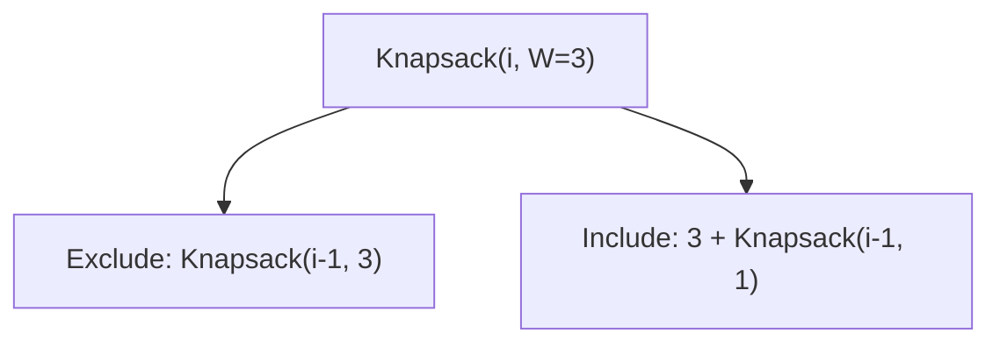
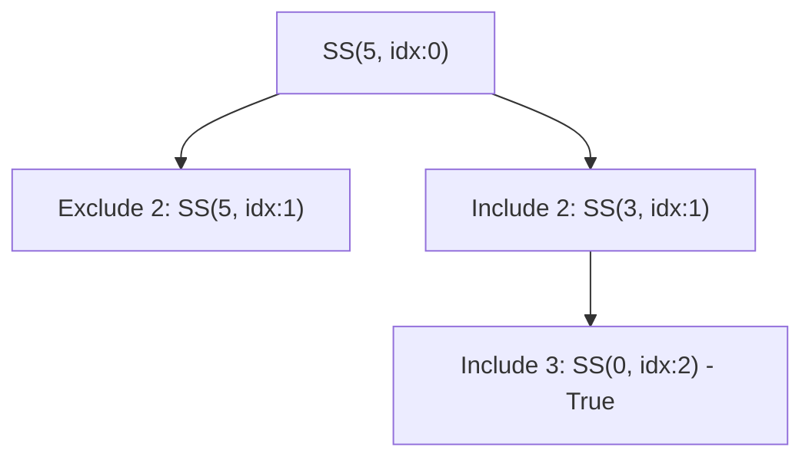
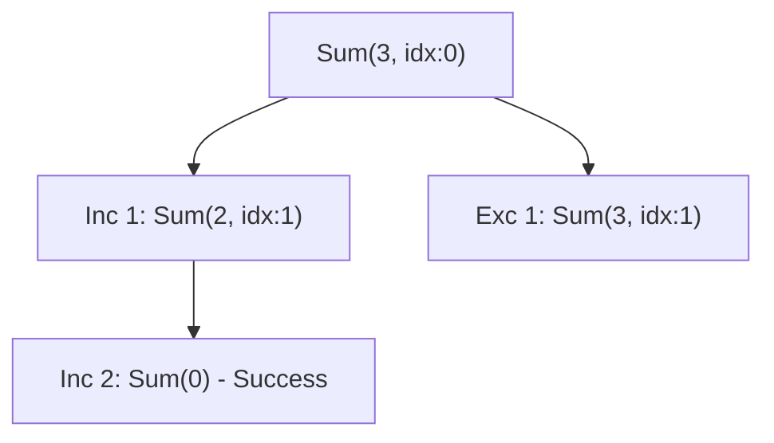
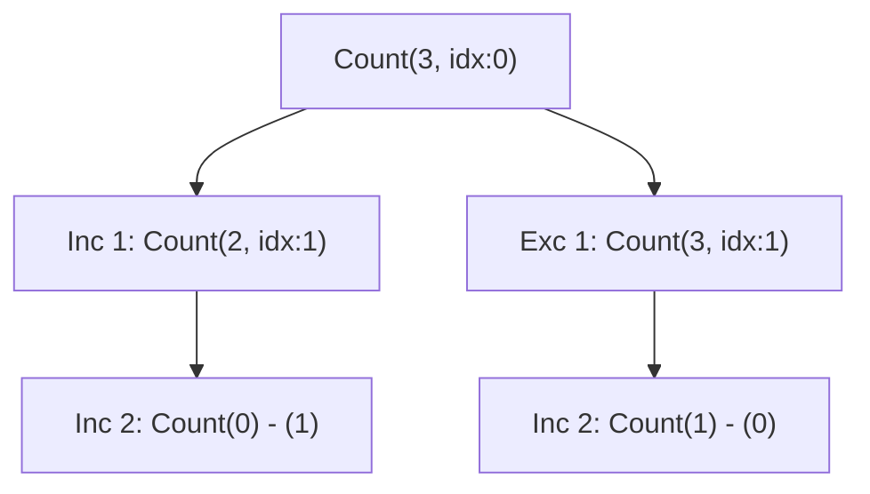
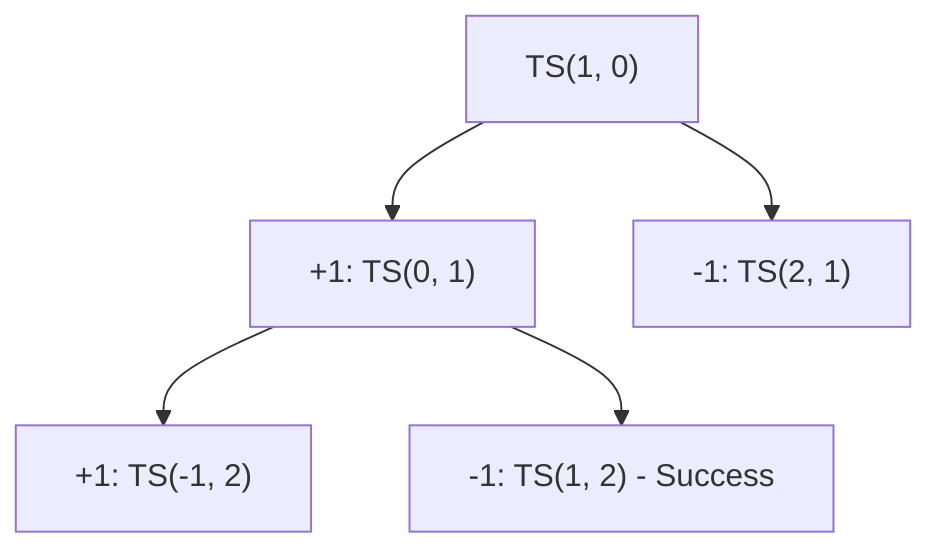

# 0/1 Knapsack Pattern

## Introduction
The 0/1 Knapsack pattern is a classic dynamic programming problem where you are given a set of items, each with a weight and a value. The goal is to maximize the total value of items included in a knapsack without exceeding a given weight capacity `W`. "0/1" implies that each item can either be picked (1) or not picked (0).

## Core Recursion Tree (Base Problem)
For an item with `weight=2, value=3` and remaining capacity `W=3`:

---

## Similar Problems

### 1. Subset Sum
**Problem**: Check if there's a subset of numbers that adds up to a target sum.
**Recursion Tree (Target=5, arr=[2, 3])**:

### 2. Partition Equal Subset Sum
**Problem**: Can an array be partitioned into two subsets with equal sums?
**Recursion Tree (Sum=3, arr=[1, 2, 3])**:

### 3. Count Subsets with Given Sum
**Problem**: Count the number of subsets that sum to a target.
**Recursion Tree (Target=3, arr=[1, 2])**:

### 4. Minimum Subset Sum Difference
**Problem**: Partition the array into two subsets $S_1$ and $S_2$ such that $|sum(S_1) - sum(S_2)|$ is minimized.
**Recursion Tree**: (Identical to Subset Sum logic - find achieving sum closest to $Total/2$).

### 5. Target Sum
**Problem**: Assign `+` or `-` to each element to reach a target sum.
**Recursion Tree (Target=1, arr=[1, 1])**:

### 6. Rod Cutting (Bounded)
**Problem**: Maximize profit by cutting a rod, where each length has a limited count.
**Recursion Tree**: (Similar to Knapsack split).

### 7. Assign Tasks
**Problem**: Maximize total importance of tasks within a time limit.
**Recursion Tree**: (Classic Knapsack tree).
