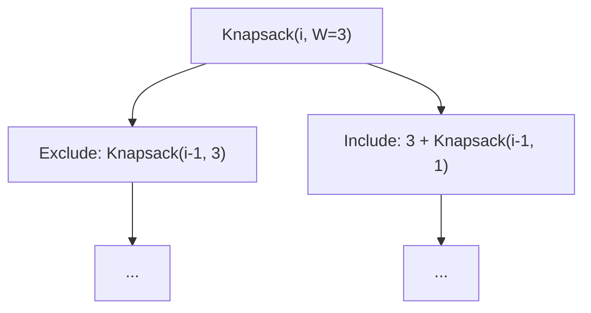
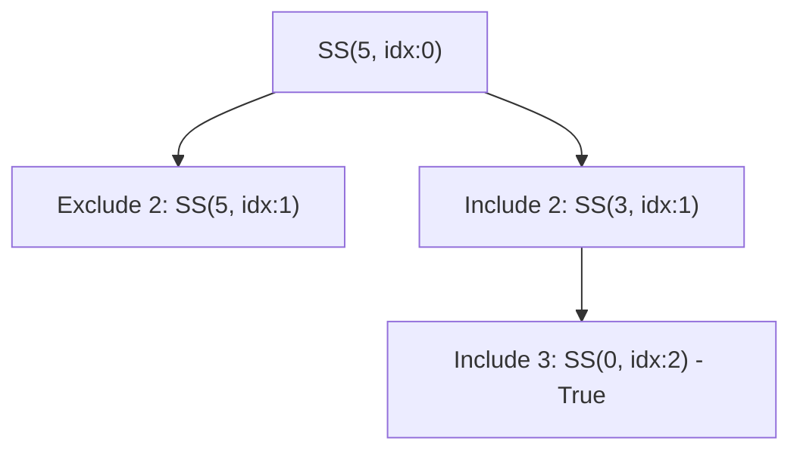

# 0/1 Knapsack Pattern

## Introduction
The 0/1 Knapsack pattern is a classic dynamic programming problem where you are given a set of items, each with a weight and a value. The goal is to maximize the total value of items included in a knapsack without exceeding a given weight capacity `W`. "0/1" implies that each item can either be picked (1) or not picked (0); you cannot break items.

## Core Recursion Tree
For an item with `weight=2, value=3` and remaining capacity `W=3`:

---

## Similar Problems

### 1. Subset Sum
**Problem**: Check if there's a subset of numbers that adds up to a target sum.
**Process**: At each step, either include the current number in the sum or exclude it.
**Recursion Tree (Target=5, arr=[2, 3])**:

### 2. Partition Equal Subset Sum
**Problem**: Can an array be partitioned into two subsets with equal sums?
**Process**: This is equivalent to finding a subset with sum equal to `total_sum / 2`.

### 3. Count Subsets with Given Sum
**Problem**: Count the number of subsets that sum to a target.
**Process**: instead of `OR`, we use `SUM` of recursive calls.

### 4. Minimum Subset Sum Difference
**Problem**: Partition the array into two subsets $S_1$ and $S_2$ such that $|sum(S_1) - sum(S_2)|$ is minimized.
**Process**: Find all possible subset sums and check which sum closest to `total_sum / 2` is achievable.

### 5. Target Sum
**Problem**: Assign `+` or `-` to each element to reach a target sum.
**Process**: This can be transformed into finding a subset with sum `(target + total_sum) / 2`.

### 6. Rod Cutting (Bounded)
**Problem**: Maximize profit by cutting a rod, where each length has a limited count.
**Process**: Similar to knapsack where `weight` is `length` and `value` is `price`.

### 7. Assign Tasks
**Problem**: Maximize total importance of tasks within a time limit.
**Process**: Classic Knapsack where `time` is `weight` and `importance` is `value`.
