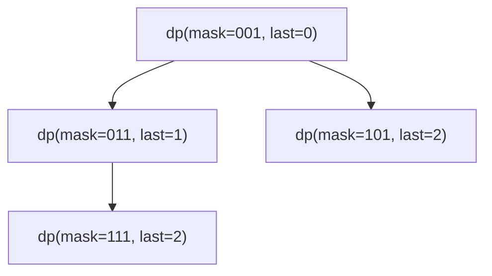
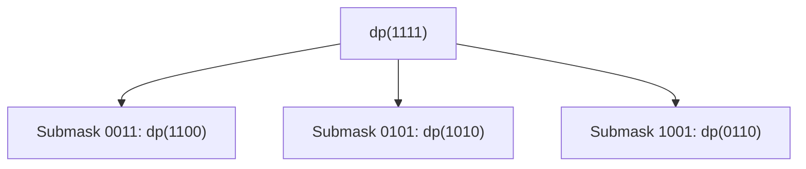
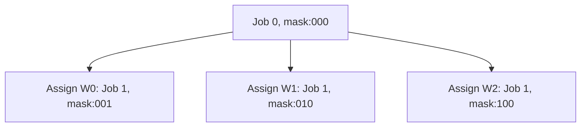
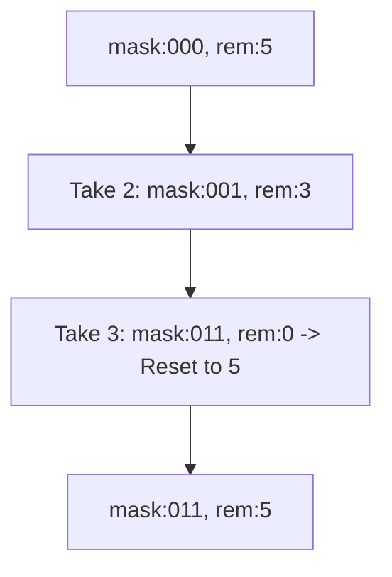
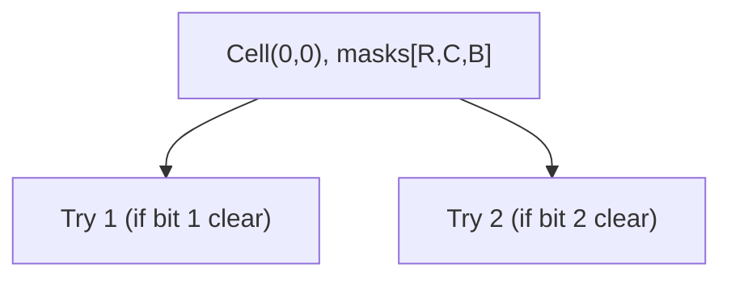
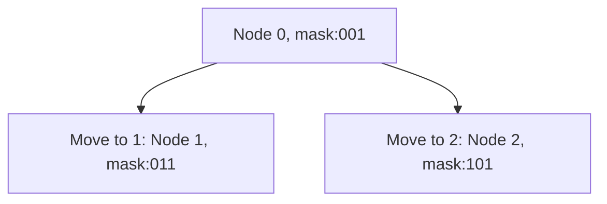

# Bitmask DP

## Introduction
Bitmask DP is useful for problems that involve small constraints (usually $N \le 20$) where the state requires keeping track of a subset of elements.

## Core Recursion Tree (TSP Generic)

---

## Similar Problems

### 1. Traveling Salesman Problem (TSP)
**Recursion Tree**: (Same as Core Recursion Tree above).

### 2. Minimum Incompatibility
**Recursion Tree (mask=1111, subset_size=2)**:

### 3. Assign Workers to Jobs
**Recursion Tree (Job 0, Workers {0,1,2})**:

### 4. Max Student Compatibility
**Recursion Tree**: (Similar to Assignment Worker tree).

### 5. Partition to K Equal Sum Subsets
**Recursion Tree (target=5, mask=000)**:

### 6. Sudoku Solver (Bitmask Optimized)
**Recursion Tree**:

### 7. Visit All Nodes
**Recursion Tree (BFS + Mask)**:

