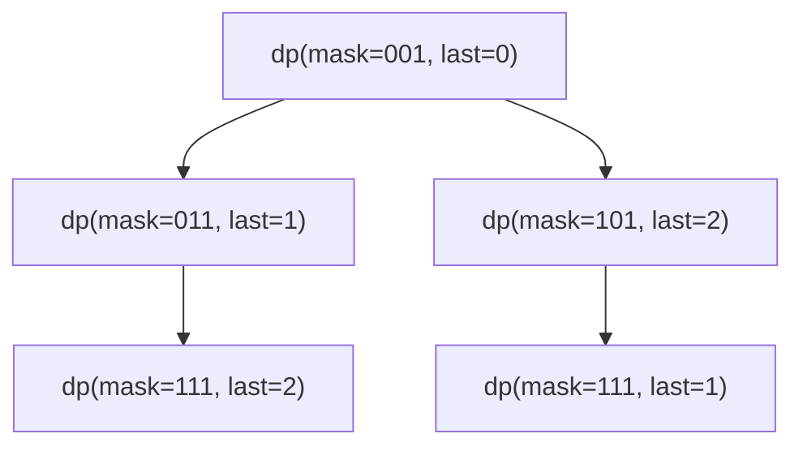

# Bitmask DP

## Introduction
Bitmask DP is useful for problems that involve small constraints (usually $N \le 20$) where the state requires keeping track of a subset of elements. A bitmask (integer) is used to represent the set of included elements (1 for included, 0 for excluded).

## Core Recursion Tree
For a state `dp(mask, last_node)` visiting nodes in a graph:

---

## Similar Problems

### 1. Traveling Salesman Problem (TSP)
**Problem**: Find the shortest possible route that visits every city exactly once and returns to the origin.
**Process**: `dp(mask, current_city)` stores the min cost to visit cities in `mask` ending at `current_city`.

### 2. Minimum Incompatibility
**Problem**: Partition an array into $k$ subsets of size $n/k$ such that each subset has unique elements, and minimize the sum of (max - min) of each subset.
**Process**: Use bitmask to represent remaining elements and iterate over possible valid submasks for the next subset.

### 3. Assign Workers to Jobs
**Problem**: Minimize the total cost/unfairness when assigning $N$ workers to $N$ jobs.
**Process**: `dp(mask, job_idx)` represents the min cost to assign workers in `mask` to the first `job_idx` jobs.

### 4. Max Student Compatibility
**Problem**: Match students into groups of two to maximize compatibility scores based on answers.
**Process**: Similar to assignment problem, use bitmask to keep track of matched students.

### 5. Partition to K Equal Sum Subsets
**Problem**: Check if an array can be partitioned into $k$ subsets with equal sums.
**Process**: `dp(mask)` stores the current sum of elements in `mask` modulo the target subset sum. 

### 6. Sudoku Solver (Bitmask Optimized)
**Problem**: Solve a Sudoku puzzle.
**Process**: Use 3 bitmasks (row, col, box) to quickly check if a number can be placed in $O(1)$.

### 7. Visit All Nodes
**Problem**: Find the shortest path in an undirected graph that visits all nodes.
**Process**: BFS where state is `(current_node, visited_mask)`.
