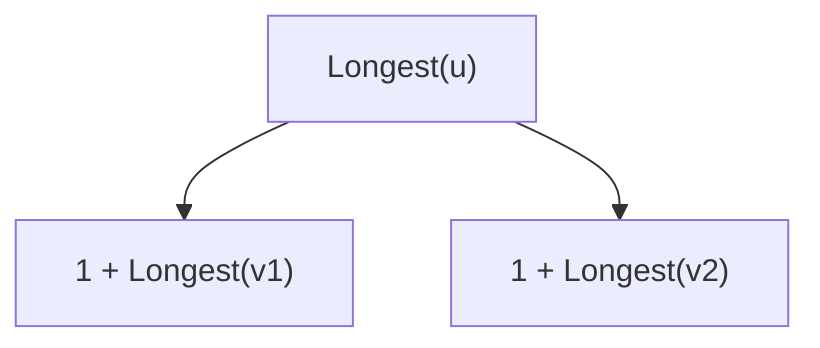
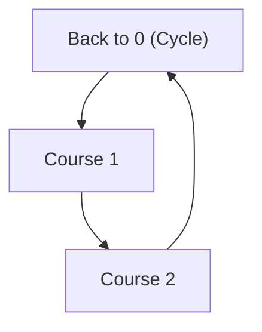
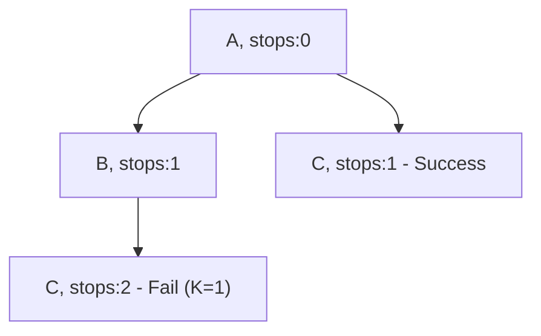
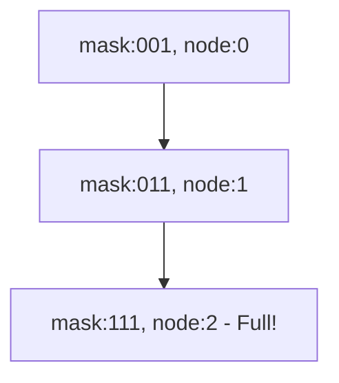
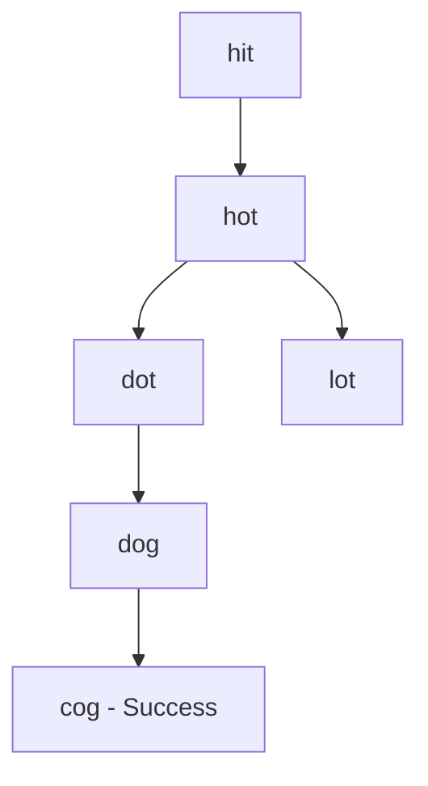

# DP on Graphs

## Introduction
General Graph DP problems involve finding shortest paths, counting paths, or finding specific subgraphs.

## Core Recursion Tree (DAG Longest Path)

---

## Similar Problems

### 1. Longest Path in a DAG
**Recursion Tree**: (Same as Core Recursion Tree above).

### 2. Shortest Path in DAG
**Recursion Tree**: (Same as Longest Path, but using `min`).

### 3. Course Schedule
**Recursion Tree (Cycle Detection)**:

### 4. Cheapest Flights Within K Stops
**Recursion Tree (Src:A, Dst:C, K:1)**:

### 5. Hamiltonian Path
**Recursion Tree (Mask=001, node=0)**:

### 6. Word Ladder II
**Recursion Tree (hit -> cog)**:

*(Visualization of BFS/DFS search path)*
