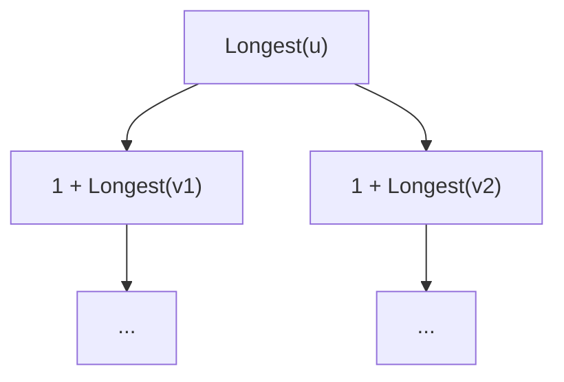

# DP on Graphs

## Introduction
General Graph DP problems are more complex than Tree DP because graphs can have cycles. These problems often involve finding shortest paths, counting paths, or finding specific subgraphs.

## Core Recursion Tree
For a Directed Acyclic Graph (DAG) finding the longest path starting from node `u`:

---

## Similar Problems

### 1. Longest Path in a DAG
**Problem**: Find the longest path from any node to any other node in a DAG.
**Process**: Perform Topological Sort, then use DP: `dp[v] = max(dp[v], dp[u] + weight(u, v))`.

### 2. Shortest Path in DAG
**Problem**: Find the shortest path from source to destination.
**Process**: Similar to longest path but use `min` instead of `max`. Or use Dijkstra for general graphs.

### 3. Course Schedule
**Problem**: Determine if you can finish all courses given pre-requisites.
**Process**: This is cycle detection in a graph. If no cycle, a topological order exists.

### 4. Cheapest Flights Within K Stops
**Problem**: Find the cheapest price from src to dst with at most $k$ stops.
**Process**: DP state `dp[stops][node]` = min cost to reach `node` using `stops` number of edges.

### 5. Hamiltonian Path
**Problem**: A path that visits every vertex exactly once.
**Process**: Use Bitmask DP: `dp[mask][u]` = True if there's a path visiting nodes in `mask` ending at `u`.

### 6. Word Ladder II
**Problem**: Find all shortest transformation sequences from `beginWord` to `endWord`.
**Process**: Use BFS to find shortest path distance, then DFS + DP to reconstruct all paths.
