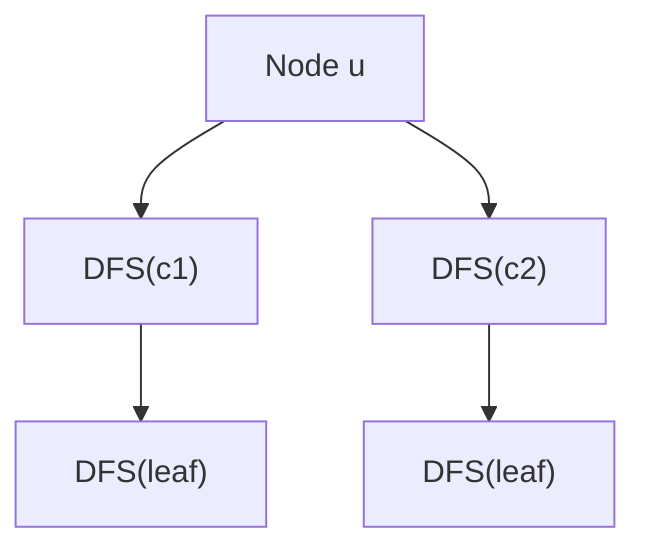

# DP on Trees

## Introduction
DP on Trees involves solving problems on tree data structures where the solution for a node depends on the solutions of its children. This is usually implemented using Post-Order Traversal (DFS).

## Core Recursion Tree
For a node `u` in a tree, computing its height/state based on its children `c1`, `c2`:

*(Processing happens bottom-up)*

---

## Similar Problems

### 1. Diameter of a Tree
**Problem**: Find the longest path between any two nodes in a tree.
**Process**: At each node, compute `max(left_height + right_height)` and return `1 + max(left_height, right_height)`.

### 2. Maximum Path Sum
**Problem**: Max path sum where nodes can have negative values.
**Process**: Similar to diameter, but handle cases where a path might not include children if their sum is negative.

### 3. Binary Tree Cameras
**Problem**: Minimum cameras to monitor all nodes.
**Process**: Return a state: `0: Needs cover`, `1: Has camera`, `2: Is covered`.

### 4. Distribute Coins in Binary Tree
**Problem**: Move coins so each node has exactly one.
**Process**: Return the surplus/deficit from each subtree. `moves += abs(surplus_l) + abs(surplus_r)`.

### 5. House Robber III
**Problem**: Rob nodes such that no two adjacent nodes are robbed.
**Process**: Return a pair `[rob_current, skip_current]`.
- `rob_current = val + skip_left + skip_right`
- `skip_current = max(left) + max(right)`

### 6. Max Independent Set
**Problem**: Largest set of non-adjacent vertices.
**Process**: Same logic as House Robber III, but with count 1 instead of node value.
