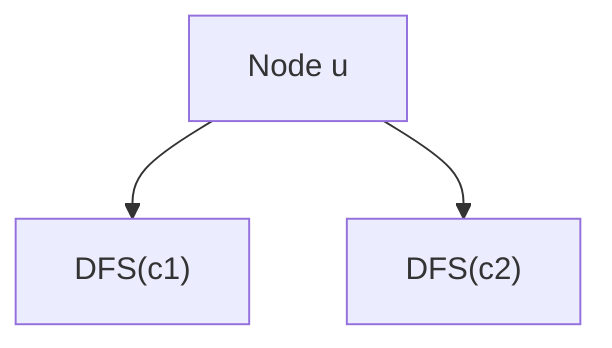
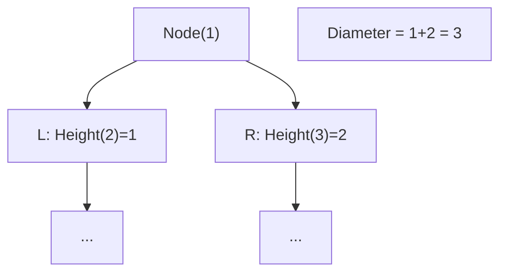
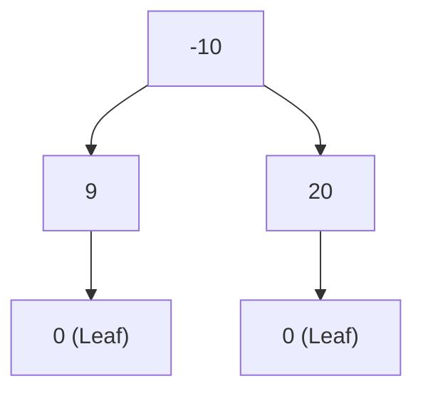
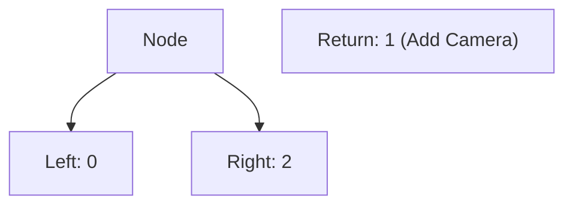
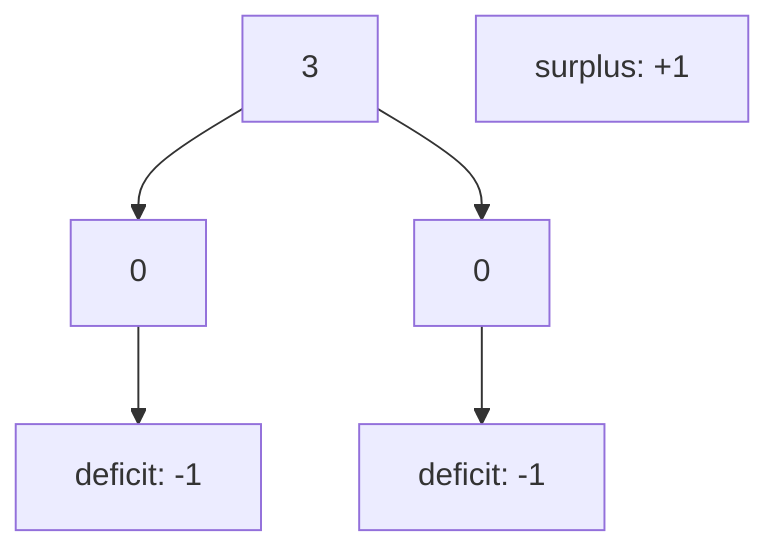
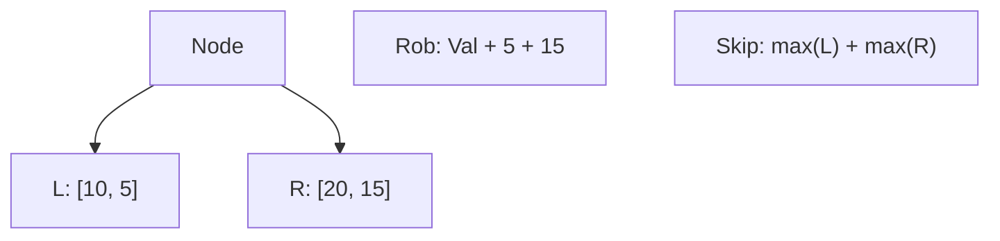

# DP on Trees

## Introduction
DP on Trees involves solving problems on tree data structures where the solution for a node depends on its children.

## Core Recursion Tree (Generic DFS)

---

## Similar Problems

### 1. Diameter of a Tree
**Recursion Tree**:

### 2. Maximum Path Sum
**Recursion Tree (Node values: [-10, 9, 20])**:

### 3. Binary Tree Cameras
**Recursion Tree (States: 0:Needs, 1:Has, 2:Covered)**:

### 4. Distribute Coins in Binary Tree
**Recursion Tree (Coins: [3, 0, 0])**:

### 5. House Robber III
**Recursion Tree (Pair: [Rob, Skip])**:

### 6. Max Independent Set
**Recursion Tree**: (Same logic as House Robber III with weights of 1).
