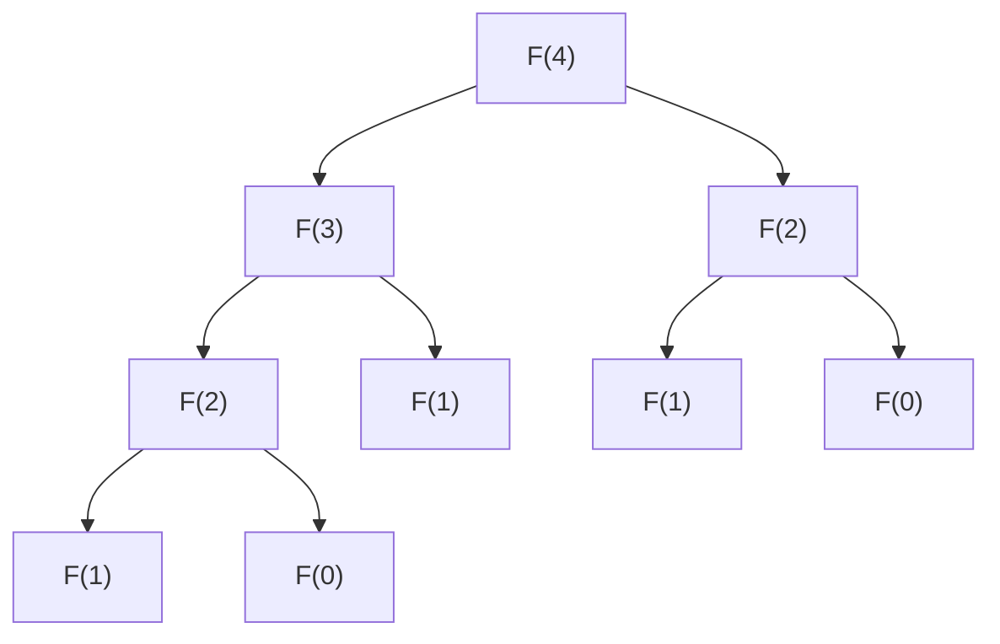
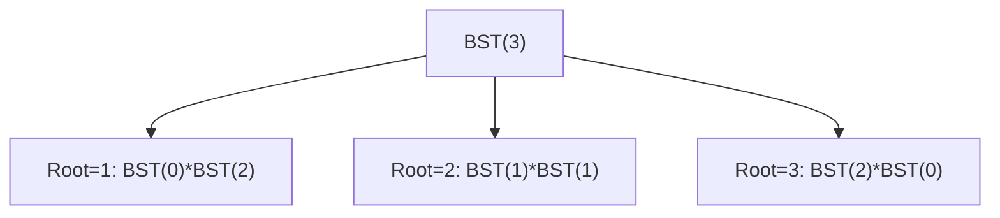

# Fibonacci / Simple Recurrence DP

## Introduction
This pattern covers problems that can be broken down into smaller subproblems following a linear recurrence relation, like $F(n) = F(n-1) + F(n-2)$. These are often the first step in learning DP.

## Core Recursion Tree
For Fibonacci $F(4)$:

*(Redundant calculations can be optimized with Memoization)*

---

## Similar Problems

### 1. Climbing Stairs
**Problem**: Distinct ways to reach the top of $N$ stairs by taking 1 or 2 steps.
**Process**: `ways(n) = ways(n-1) + ways(n-2)`. Identical to Fibonacci.

### 2. House Robber
**Problem**: Maximize loot from non-adjacent houses.
**Process**: `rob(i) = max(rob(i-2) + arr[i], rob(i-1))`.
- Branch 1: Rob current house (and thus skip previous).
- Branch 2: Skip current house.

### 3. Decode Ways
**Problem**: Count ways to decode a string of digits (e.g., '1' -> 'A', '12' -> 'L' or 'AB').
**Process**: `decode(i) = decode(i-1) [if single digit valid] + decode(i-2) [if double digit valid]`.

### 4. Tiling Problems
**Problem**: Number of ways to tile a $2 \times N$ board with $2 \times 1$ dominoes.
**Process**: `tile(n) = tile(n-1) [vertical] + tile(n-2) [two horizontal]`.

### 5. Catalan Numbers
**Problem**: Count unique BSTs with $N$ nodes or balanced parentheses pairs.
**Process**: $C_n = \sum_{i=0}^{n-1} C_i \cdot C_{n-1-i}$.

### 6. Paint Fence
**Problem**: Ways to paint $N$ posts with $K$ colors such that no more than two adjacent posts have the same color.
**Process**:
- Same color as previous: `ways(i-1) * 1` (but only if $i-1$ was different from $i-2$).
- Different color from previous: `ways(i-1) * (k-1)`.
