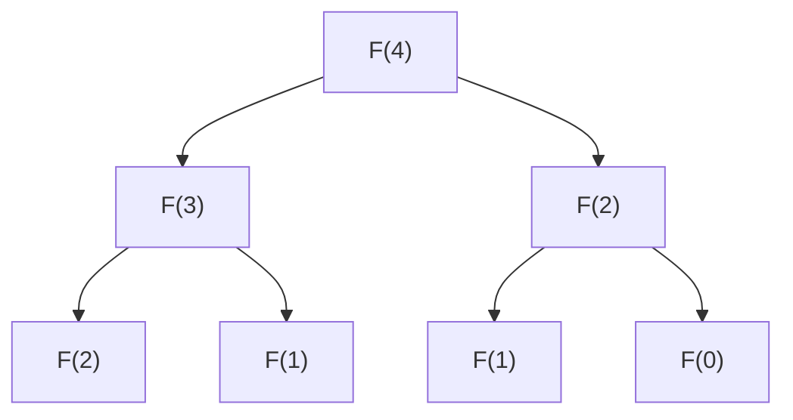
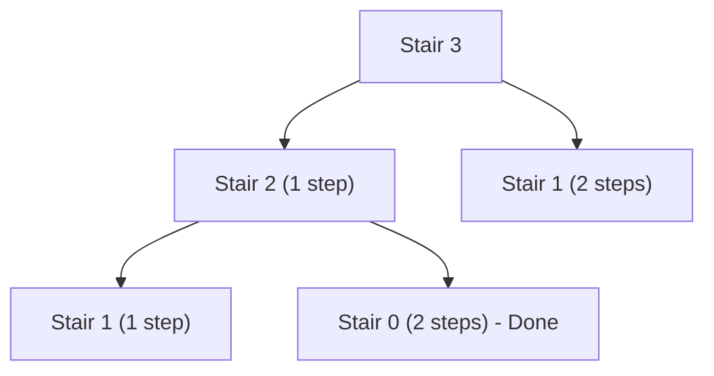
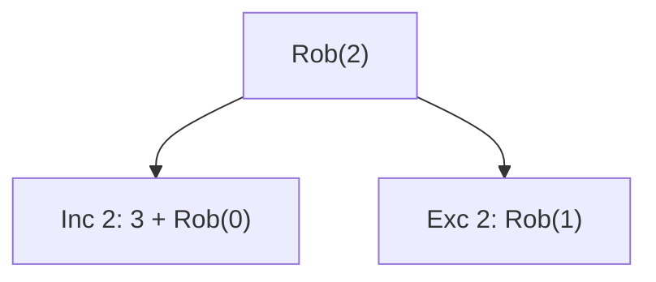
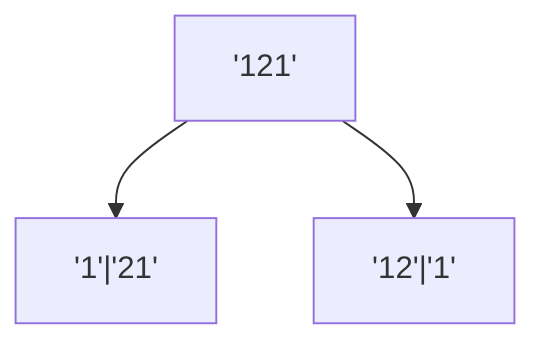
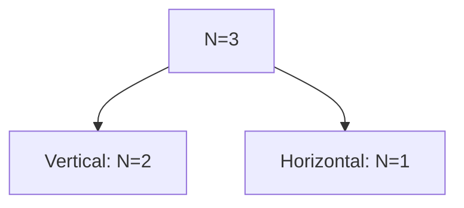
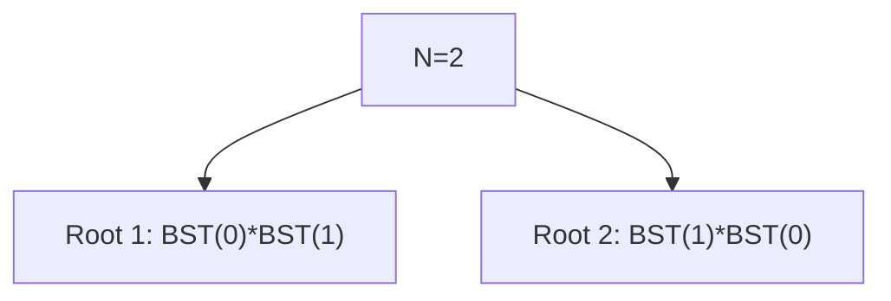
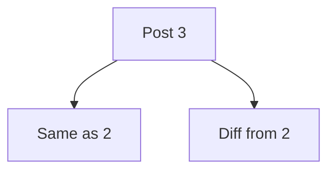

# Fibonacci / Simple Recurrence DP

## Introduction
This pattern covers problems following a linear recurrence relation, like $F(n) = F(n-1) + F(n-2)$.

## Core Recursion Tree (Fibonacci 4)

---

## Similar Problems

### 1. Climbing Stairs
**Recursion Tree (Stairs=3)**:

### 2. House Robber
**Recursion Tree (idx:2, arr:[1, 2, 3])**:

### 3. Decode Ways
**Recursion Tree ('121')**:

### 4. Tiling Problems
**Recursion Tree (N=3)**:

### 5. Catalan Numbers (BST Count)
**Recursion Tree (N=2)**:

### 6. Paint Fence
**Recursion Tree (3 posts, 2 colors)**:

*(Limited by rule: no 3 same in a row)*
