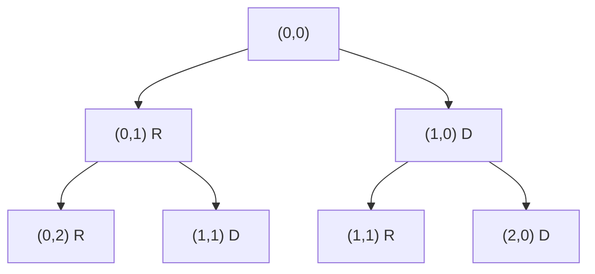

# Grid DP

## Introduction
Grid DP refers to dynamic programming problems on 2D matrices. The goal is often to find the number of paths, minimum/maximum path sum, or optimal arrangement from a start point to an end point.

## Core Recursion Tree
For a path from $(0,0)$ to $(2,2)$ moving only Right (R) or Down (D):

---

## Similar Problems

### 1. Unique Paths I/II
**Problem**: Count unique paths from top-left to bottom-right (II includes obstacles).
**Process**: `paths(r, c) = paths(r-1, c) + paths(r, c-1)`. If cell is an obstacle, `paths = 0`.

### 2. Minimum Path Sum
**Problem**: Find a path from top-left to bottom-right that minimizes the sum of values.
**Process**: `min_sum(r, c) = val(r, c) + min(min_sum(r-1, c), min_sum(r, c-1))`.

### 3. Dungeon Game
**Problem**: Minimum initial health to reach bottom-right. Health must always be > 0.
**Process**: Solve backwards from target. `dp[r][c] = max(1, min(dp[r+1][c], dp[r][c+1]) - grid[r][c])`.

### 4. Gold Mine
**Problem**: Maximize gold collected starting from any cell in first column and moving to last column.
**Process**: Allowed moves: `(r, c+1)`, `(r-1, c+1)`, `(r+1, c+1)`.

### 5. Cherry Pickup
**Problem**: Maximize cherries collected in two trips: TL to BR, then BR back to TL.
**Process**: Equivalent to two people moving simultaneously from TL to BR. State: `dp(r1, c1, r2, c2)`.

### 6. Maximal Square
**Problem**: Largest square of 1s in a binary matrix.
**Process**: `dp[r][c]` is side of largest square ending at $(r, c)$.
- `dp[r][c] = 1 + min(dp[r-1][c], dp[r][c-1], dp[r-1][c-1])` if `grid[r][c] == 1`.

### 7. Increasing Paths
**Problem**: Count all strictly increasing paths in a grid.
**Process**: DFS with Memoization from every cell. `paths(r, c) = 1 + sum(paths(neighbor)) [if grid[neighbor] > grid[r][c]]`.
