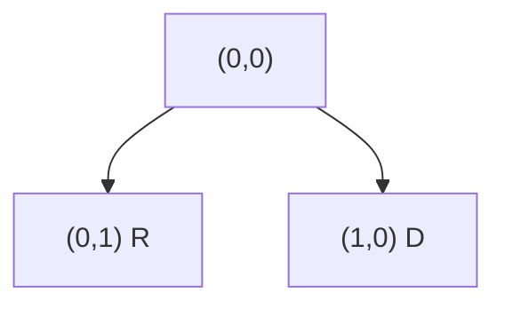
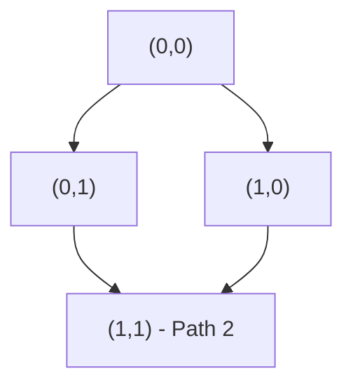
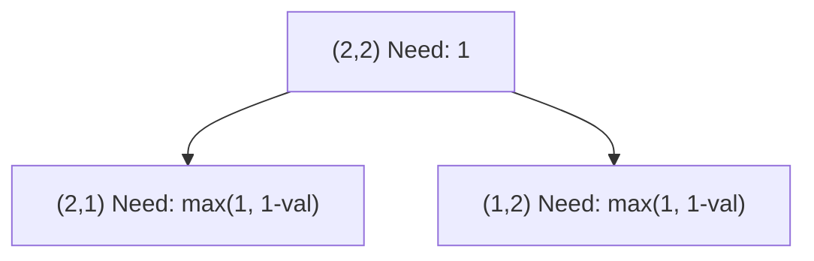
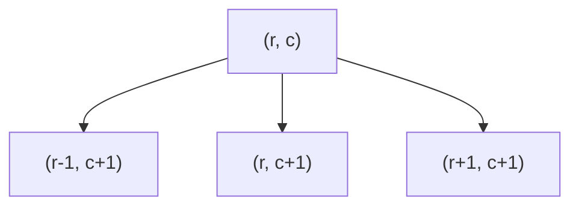
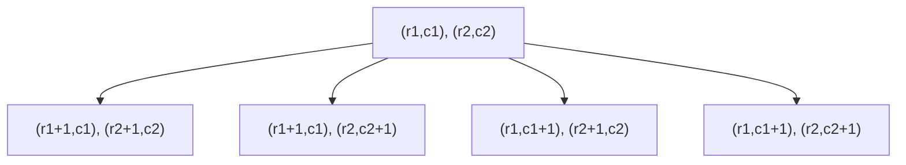
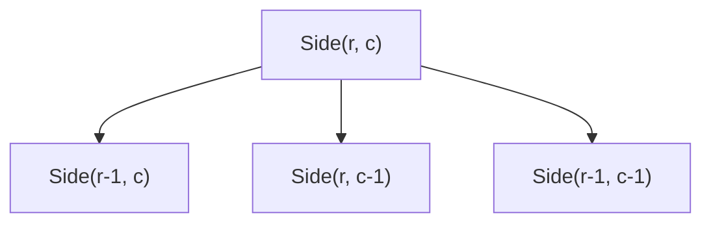
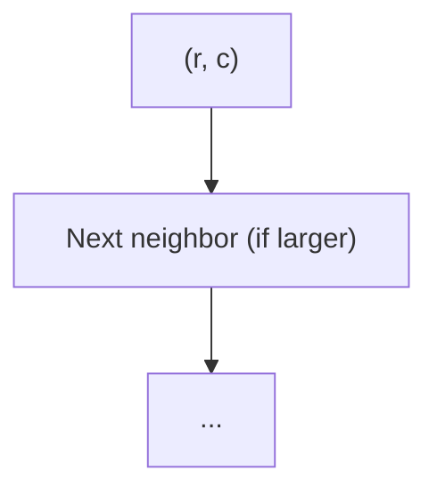

# Grid DP

## Introduction
Grid DP involves problems on 2D matrices, often finding paths or optimal arrangements.

## Core Recursion Tree (Path sum)

---

## Similar Problems

### 1. Unique Paths I/II
**Recursion Tree (2x2 Grid)**:

### 2. Minimum Path Sum
**Recursion Tree**: (Same as Unique Paths, but minimizing cumulative cell value).

### 3. Dungeon Game
**Recursion Tree (Reverse state)**:

### 4. Gold Mine
**Recursion Tree (Current: (r, c))**:

### 5. Cherry Pickup
**Recursion Tree (Person 1 at r1,c1; Person 2 at r2,c2)**:

### 6. Maximal Square
**Recursion Tree (Square side at r,c)**:

### 7. Increasing Paths
**Recursion Tree (Start at (r, c))**:

*(DFS exploration)*
