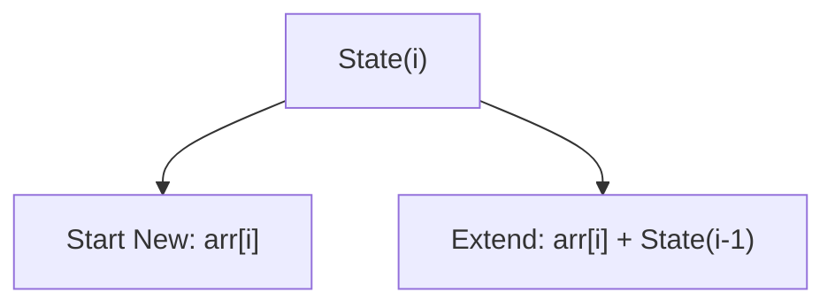
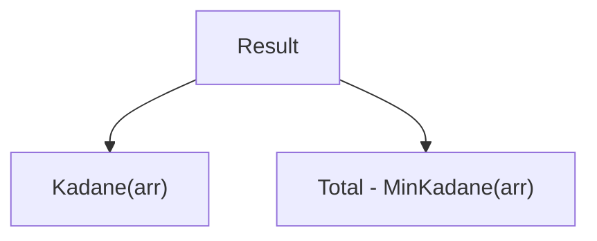
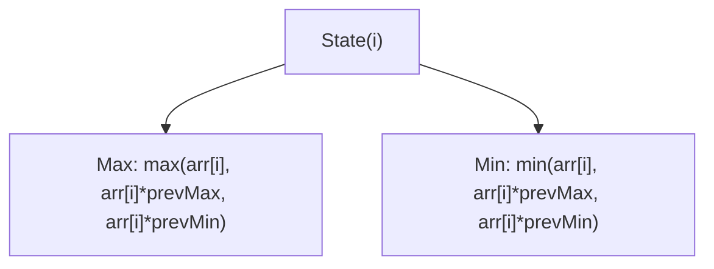
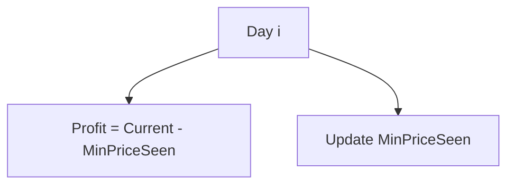
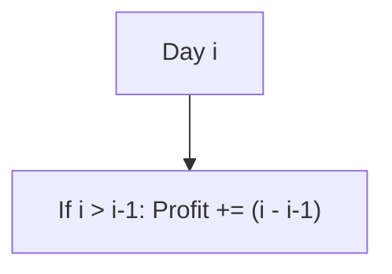
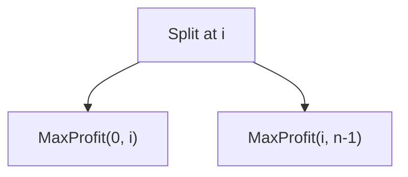
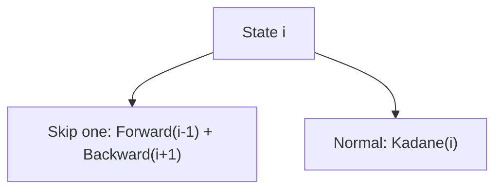

# Kadane's Algorithm

## Introduction
Kadane's Algorithm is an efficient method to find the maximum sum subarray.

## Core Recursion Tree (Max sum ending at i)

---

## Similar Problems

### 1. Maximum Circular Subarray Sum
**Recursion Tree**:

### 2. Maximum Product Subarray
**Recursion Tree (State at i)**:

### 3. Best Time to Buy and Sell Stock
**Recursion Tree (State: i)**:

### 4. Stock II
**Recursion Tree**:

### 5. Stock III (2 Transactions)
**Recursion Tree**:

### 6. Max Subarray One Deletion
**Recursion Tree (i-th element)**:

*(Visualization of skip-one logic)*
