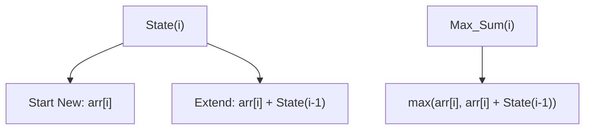

# Kadane's Algorithm

## Introduction
Kadane's Algorithm is an efficient method to find the maximum sum subarray within a one-dimensional numeric array. It is a linear-time optimization over a simple DP approach.

## Core Recursion Tree (Conceptual)
For each element, we decide to either extend the previous subarray or start a new one.

---

## Similar Problems

### 1. Maximum Circular Subarray Sum
**Problem**: Find the maximum sum subarray in a circular array.
**Process**: Result is `max(Kadane(arr), Total_Sum - Min_Kadane(arr))`.

### 2. Maximum Product Subarray
**Problem**: Find the subarray with the largest product.
**Process**: Maintain both `max_so_far` and `min_so_far` (to handle negative numbers which can flip signs).

### 3. Best Time to Buy and Sell Stock
**Problem**: Maximize profit from a single buy and sell.
**Process**: Maintain `min_price` seen so far and `max_profit = max(max_profit, current_price - min_price)`.

### 4. Stock II (Multiple Transactions)
**Problem**: Maximize profit with unlimited transactions.
**Process**: Greedy approach: sum all positive price differences between adjacent days.

### 5. Stock III (2 Transactions)
**Problem**: Maximize profit with at most two transactions.
**Process**: Use bidirectional Kadane/DP: find max profit for `[0...i]` and `[i+1...n-1]`.

### 6. Max Subarray with One Deletion
**Problem**: Max sum subarray allowing at most one element deletion.
**Process**: Use two arrays: `left[i]` (max sum ending at `i`) and `right[i]` (max sum starting at `i`). Result is `max(left[i-1] + right[i+1])`.
