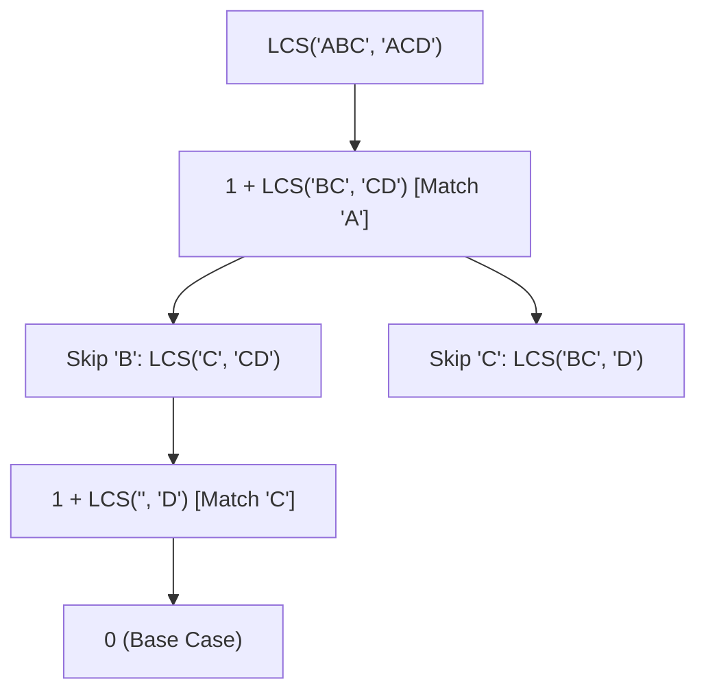

# Longest Common Subsequence (LCS)

## Introduction
The LCS pattern involves finding the longest subsequence present in two sequences in the same relative order. This is the foundation for diffing algorithms and version control systems.

## Core Recursion Tree
For strings $s_1 = "ABC", s_2 = "ACD"$:

---

## Similar Problems

### 1. Longest Common Substring
**Problem**: Find the longest string that is a substring (contiguous) of both.
**Process**: `dp[i][j] = 1 + dp[i-1][j-1]` if match, else `0`. Track global max.

### 2. Edit Distance
**Problem**: Min operations (Insert, Delete, Replace) to convert $s_1$ to $s_2$.
**Process**: 
- If match: `dp[i-1][j-1]`
- If mismatch: `1 + min(insert, delete, replace)`

### 3. Longest Palindromic Subsequence
**Problem**: Length of the longest subsequence in $s$ that is a palindrome.
**Process**: Result is `LCS(s, reverse(s))`.

### 4. Shortest Common Supersequence
**Problem**: Shortest string containing both $s_1$ and $s_2$ as subsequences.
**Process**: Length is `len(s1) + len(s2) - LCS(s1, s2)`.

### 5. Distinct Subsequences
**Problem**: Number of ways to pick indices from $s$ to form string $t$.
**Process**: 
- If match: `solve(i-1, j-1) + solve(i-1, j)` (Use char or skip it).
- If mismatch: `solve(i-1, j)` (Must skip).

### 6. Wildcard / Regex Matching
**Problem**: Pattern matching string and pattern (with `*`, `?`, `.`).
**Process**: Complex LCS where `*` allows skipping or repeated matching of characters.
