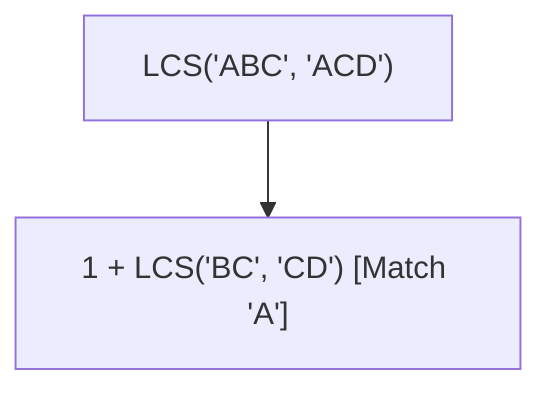
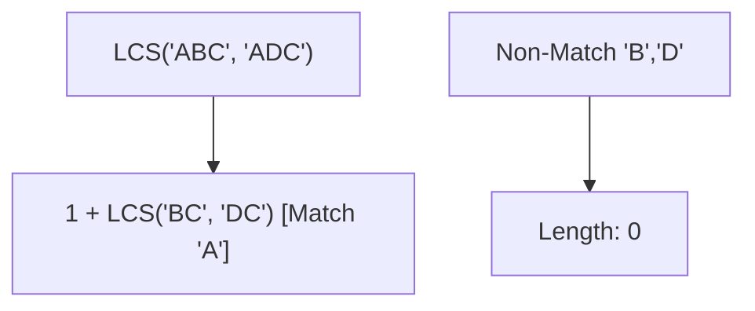
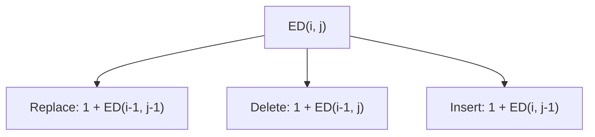
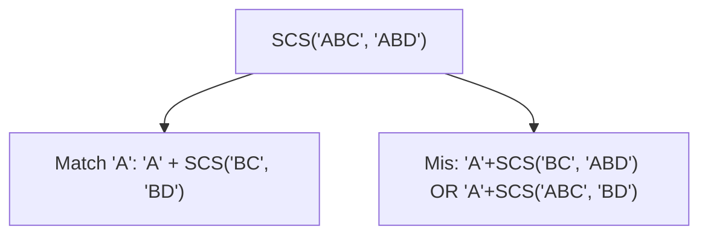
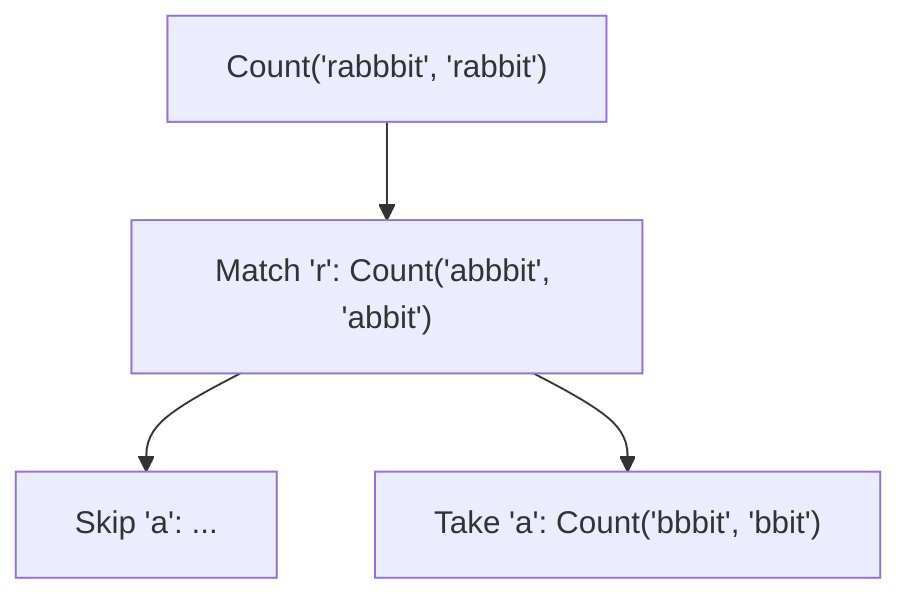
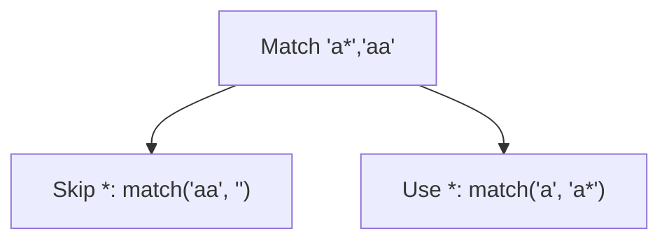
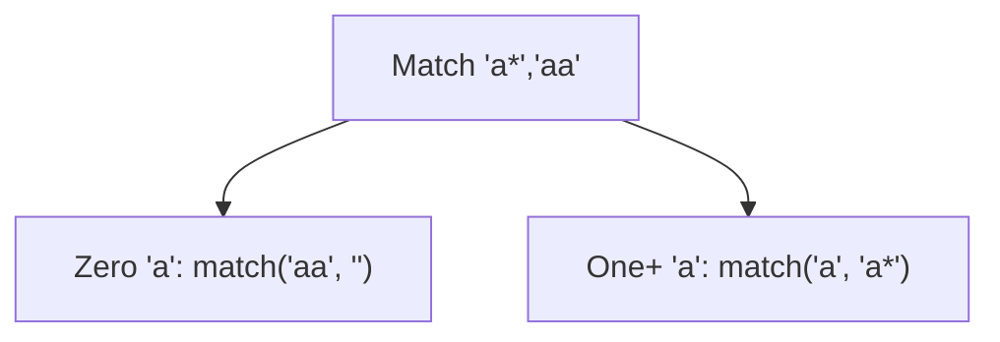

# Longest Common Subsequence (LCS)

## Introduction
The LCS pattern involves finding the longest subsequence present in two sequences.

## Core Recursion Tree (Match 'A')

---

## Similar Problems

### 1. Longest Common Substring
**Recursion Tree (Match 'A')**:

### 2. Edit Distance
**Recursion Tree (i: idx of s1, j: idx of s2)**:

### 3. Longest Palindromic Subsequence
**Recursion Tree**: (Same as LCS of string and its reverse).

### 4. Shortest Common Supersequence
**Recursion Tree**:

### 5. Distinct Subsequences
**Recursion Tree (s='rabbbit', t='rabbit')**:

### 6. Wildcard Matching
**Recursion Tree (s='aa', p='a*')**:

### 7. Regular Expression Matching
**Recursion Tree (s='aa', p='a*')**:

*(Preceding char dependency logic)*
