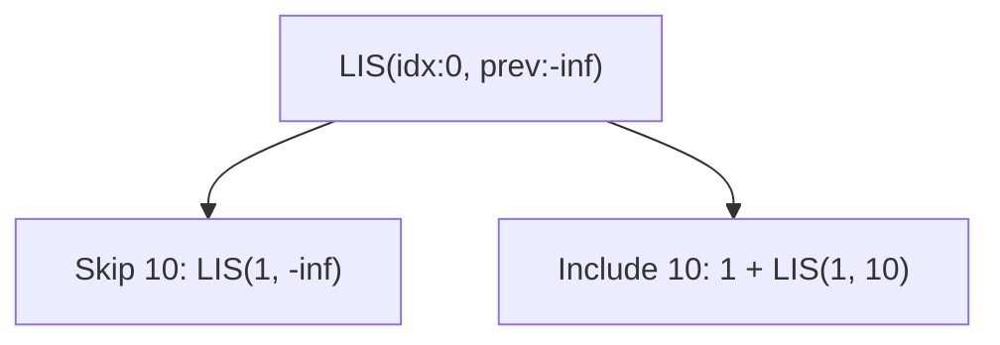
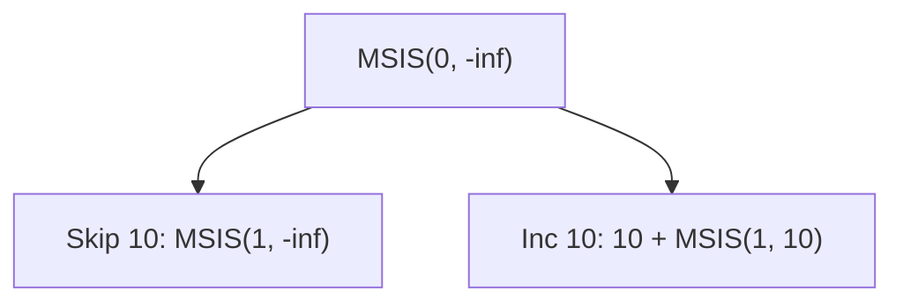
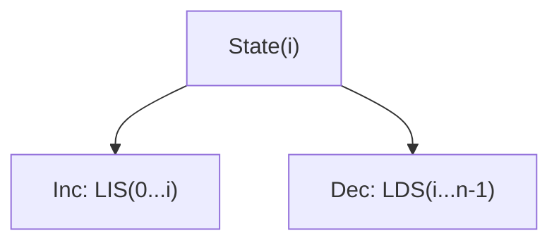
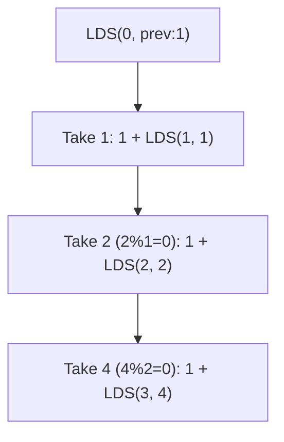

# Longest Increasing Subsequence (LIS)

## Introduction
The LIS pattern involves finding the length of the longest strictly increasing subsequence.

## Core Recursion Tree (idx:0, prev:-inf)

---

## Similar Problems

### 1. Maximum Sum Increasing Subsequence
**Recursion Tree (idx:0, prev:-inf)**:

### 2. Russian Doll Envelopes
**Recursion Tree**: (Sort width, then LIS on height tree same as above).

### 3. Longest Bitonic Subsequence
**Recursion Tree**:

### 4. Box Stacking
**Recursion Tree**: (MSIS logic on sorted rotations).

### 5. Building Bridges
**Recursion Tree**: (Sort North, LIS on South).

### 6. Largest Divisible Subset
**Recursion Tree (arr:[1, 2, 4])**:

*(Divide-and-conquer logic)*
