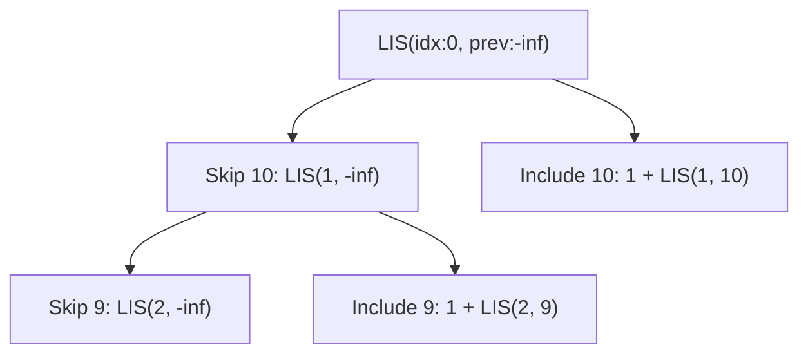

# Longest Increasing Subsequence (LIS)

## Introduction
The LIS pattern involves finding the longest subsequence of a sequence such that all elements are sorted in strictly increasing order. This is a classic $O(n^2)$ problem that can be optimized to $O(n \log n)$.

## Core Recursion Tree
For an array `[10, 9, 2, 5, 3, 7]` starting from index `i`:

*(The tree expands significantly; memoization or binary search optimization is usually applied)*

---

## Similar Problems

### 1. Maximum Sum Increasing Subsequence
**Problem**: Find an increasing subsequence such that the sum of its elements is maximized.
**Process**: `dp[i] = max(dp[i], dp[j] + arr[i])` if `arr[i] > arr[j]`.

### 2. Russian Doll Envelopes
**Problem**: Given $(w, h)$, an envelope fits inside another if both dimensions are strictly smaller. Maximize nested envelopes.
**Process**: Sort by width, then find LIS on height. (Handle ties by sorting height descending for same width).

### 3. Longest Bitonic Subsequence
**Problem**: Longest subsequence that first increases and then decreases.
**Process**: Result is `max(LIS_forward[i] + LIS_backward[i] - 1)`.

### 4. Box Stacking
**Problem**: Stack boxes to maximize height. A box $(w, h, d)$ can be on another if base is strictly larger.
**Process**: Generate all rotations, sort by base area, and find "Maximum Sum Increasing Subsequence" where weight is box height.

### 5. Building Bridges
**Problem**: Bridges are between $(n_i, s_i)$. Maximize non-crossing bridges.
**Process**: Sort by north coordinates $n_1, n_2...$, then find LIS on south coordinates $s_1, s_2...$.

### 6. Largest Divisible Subset
**Problem**: Largest subset where every pair $(a, b)$ satisfies $a\%b=0$ or $b\%a=0$.
**Process**: Sort the array, then use LIS logic with condition `arr[i] % arr[j] == 0`.
