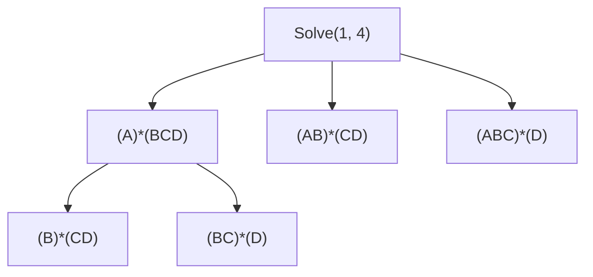

# Matrix Chain Multiplication (MCM)

## Introduction
The MCM pattern involves finding the most efficient way to parenthesize a sequence of matrices to minimize scalar multiplications. This is a classic "Interval DP" or "Partition DP" problem.

## Core Recursion Tree
For a chain of 4 matrices $A, B, C, D$:

*(Each node represents an interval `[i, j]` being split at `k`)*

---

## Similar Problems

### 1. Burst Balloons
**Problem**: Maximize coins by bursting balloons.
**Process**: `solve(i, j) = max(solve(i, k-1) + solve(k+1, j) + coins_from_k)`.
- Here $k$ is the *last* balloon to burst in the range `[i, j]`.

### 2. Palindrome Partitioning
**Problem**: Minimum cuts to make all substrings of a string palindromes.
**Process**: `solve(i, j) = 1 + min(solve(i, k) + solve(k+1, j))` if `string[i...j]` is not a palindrome.

### 3. Boolean Parenthesization
**Problem**: Count ways to parenthesize a boolean expression so it evaluates to `True`.
**Process**: `solve(i, j, isTrue)` returns the number of ways. Split at operators `&`, `|`, `^`.

### 4. Optimal Binary Search Tree
**Problem**: Arrange keys in a BST to minimize total search cost given access frequencies.
**Process**: `solve(i, j) = sum(freq[i...j]) + min(solve(i, k-1) + solve(k+1, j))` for all $k \in [i, j]$.

### 5. Stick Cutting / Minimum Cost to Cut a Stick
**Problem**: Given a stick of length $L$ and cut positions, minimize the cost of cutting.
**Process**: Similar to MCM, the cost of a cut at $k$ in interval `[i, j]` is `length(j) - length(i)`.

### 6. Scramble String
**Problem**: Check if one string is a scrambled version of another.
**Process**: Split strings at index $k$ and check `(s1_left, s2_left) AND (s1_right, s2_right)` OR `(s1_left, s2_right) AND (s1_right, s2_left)`.
