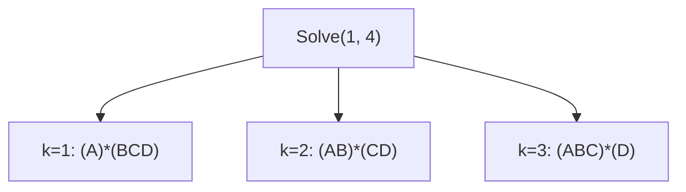
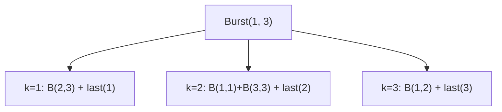
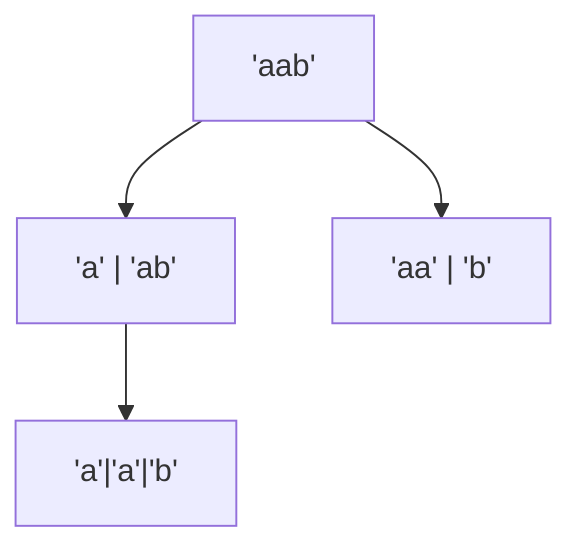
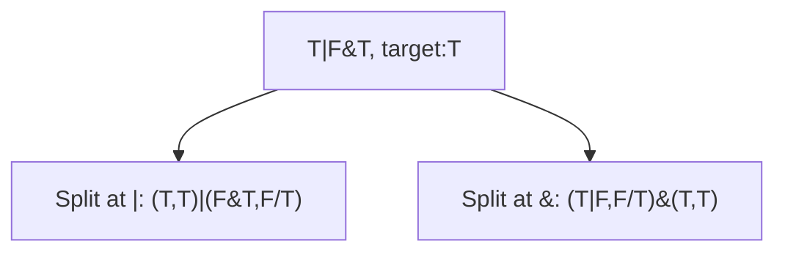
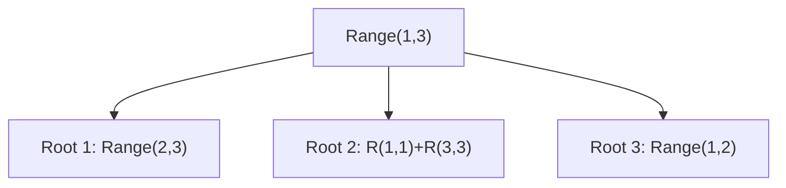
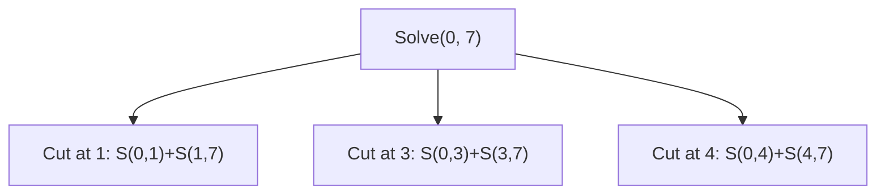

# Matrix Chain Multiplication (MCM)

## Introduction
The MCM pattern involves optimal parenthesization of a sequence of operations to minimize total cost.

## Core Recursion Tree (Split [1, 4] at k)

---

## Similar Problems

### 1. Burst Balloons
**Recursion Tree (Range [i, j], last burst k)**:

### 2. Palindrome Partitioning
**Recursion Tree (String 'aab')**:

### 3. Boolean Parenthesization
**Recursion Tree (Exp: T|F&T, target:True)**:

### 4. Optimal Binary Search Tree
**Recursion Tree (Keys: [1,2,3])**:

### 5. Stick Cutting
**Recursion Tree (Stick length 7, cuts [1,3,4,5])**:

*(Interval DP logic)*
