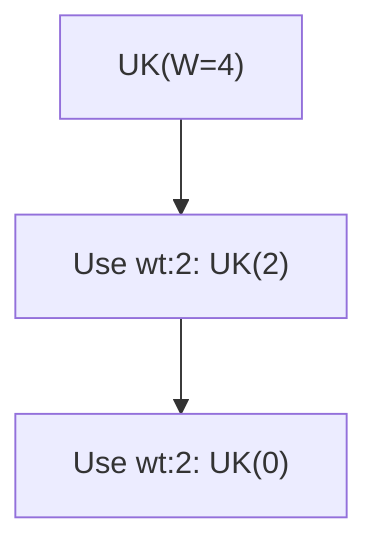
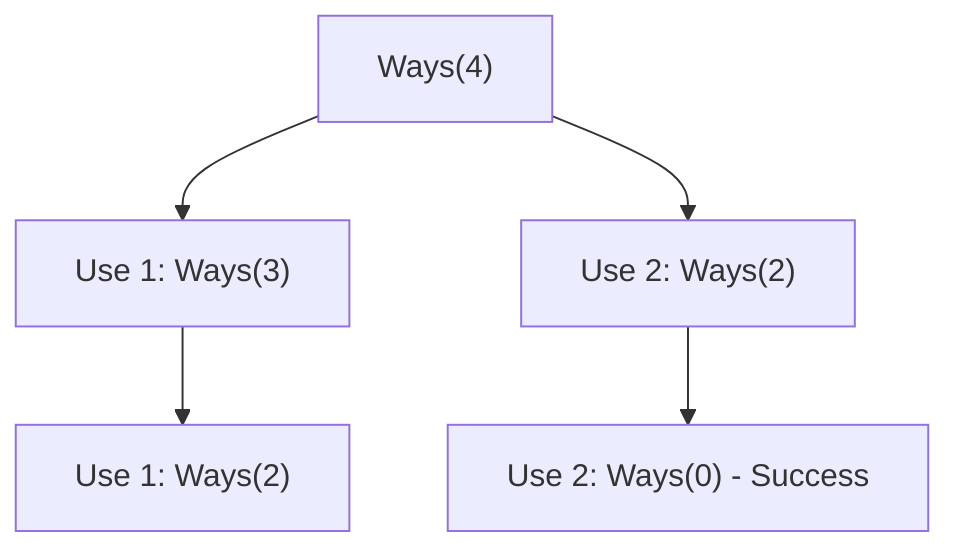
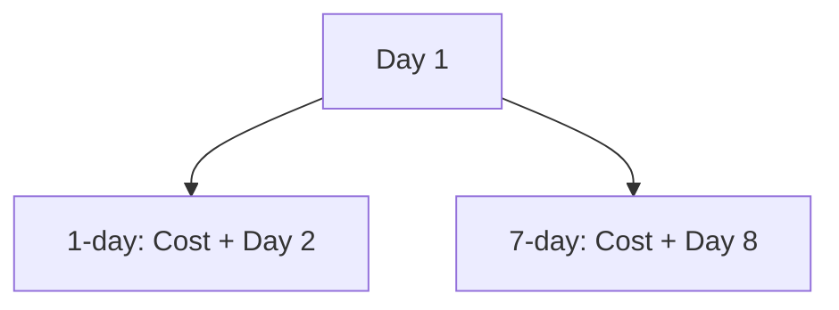
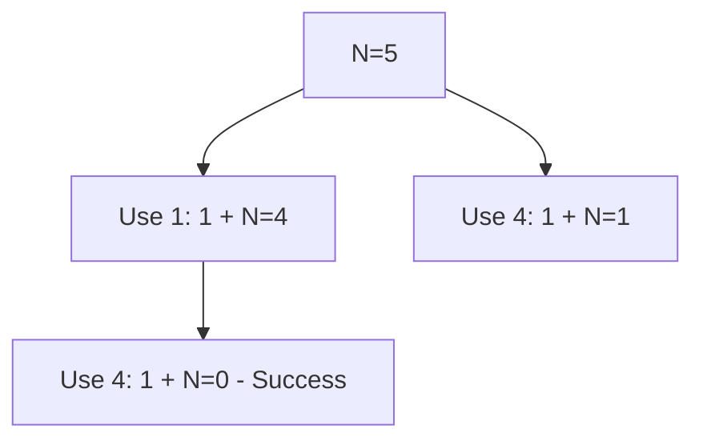
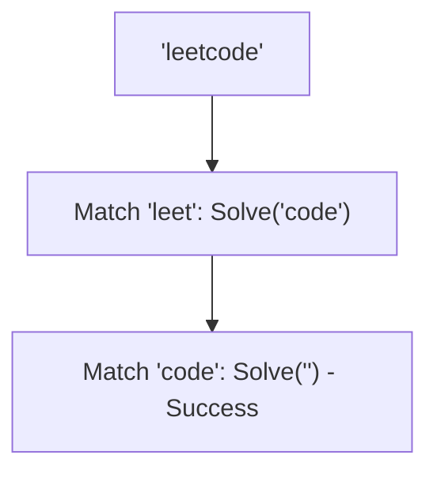

# Unbounded Knapsack Pattern

## Introduction
The Unbounded Knapsack pattern allows for the repetition of items.

## Core Recursion Tree (W:4, wt:2)

---

## Similar Problems

### 1. Coin Change (Ways)
**Recursion Tree (Amount:4, Coins:[1, 2])**:

### 2. Coin Change (Min Coins)
**Recursion Tree**: (Same as Ways, but taking `min(1 + recursive_call)`).

### 3. Rod Cutting (Unbounded)
**Recursion Tree**: (Same as UK generic).

### 4. Minimum Cost for Tickets
**Recursion Tree (Day 1, passes [1, 7])**:

### 5. Perfect Squares
**Recursion Tree (N=5, squares: [1, 4])**:

### 6. Word Break
**Recursion Tree (s:'leetcode', dict:['leet', 'code'])**:

*(Visualization of dictionary matching)*
