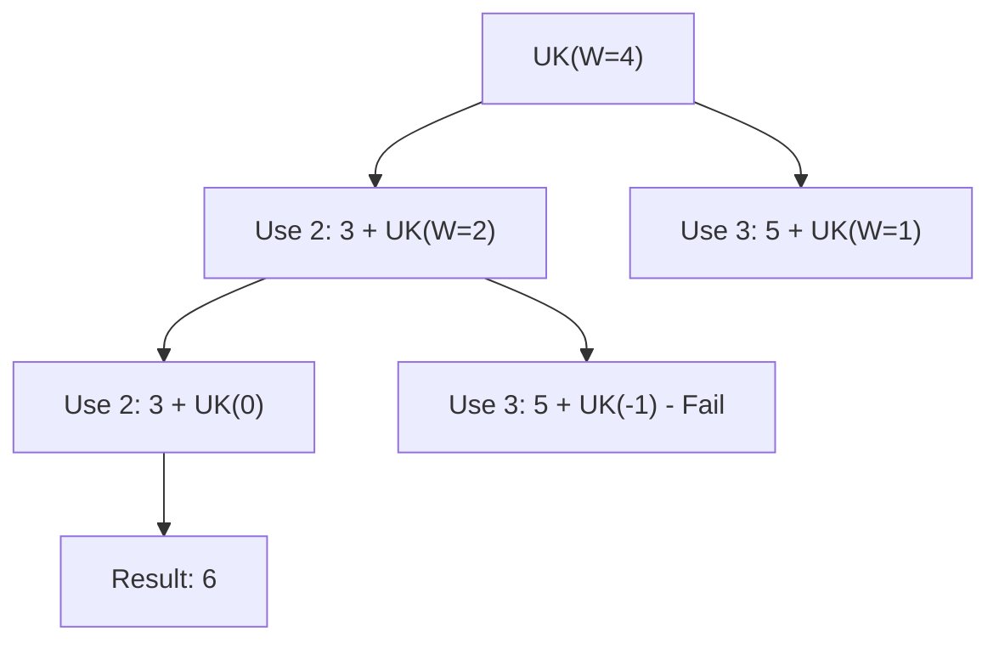

# Unbounded Knapsack Pattern

## Introduction
The Unbounded Knapsack pattern allows for the repetition of items. Given a set of items with weights and values, and a capacity `W`, the goal is to maximize the total value where each item can be chosen any number of times.

## Core Recursion Tree
For an item with `weight=2, value=3` and total capacity `W=4`:

*(Notice that we recurse with the SAME capacity - weight, but can use the same item again)*

---

## Similar Problems

### 1. Coin Change (Ways)
**Problem**: Count the total number of ways to make change for a target amount using unlimited coins.
**Process**: `ways(amount) = sum(ways(amount - coin))` for all coins.

### 2. Coin Change (Min Coins)
**Problem**: Find the minimum number of coins needed to make a target amount.
**Process**: `min_coins(amount) = 1 + min(min_coins(amount - coin))` for all coins.

### 3. Rod Cutting (Unbounded)
**Problem**: Maximize profit by cutting a rod into pieces, with unlimited pieces of each length available.
**Process**: Identical to Unbounded Knapsack where `length` is `weight` and `price` is `value`.

### 4. Minimum Cost for Tickets
**Problem**: Buy 1-day, 7-day, or 30-day passes to cover travel days with minimum cost.
**Process**: `cost(day) = min(pass_cost + cost(day + pass_duration))`.

### 5. Perfect Squares
**Problem**: Minimum number of perfect square numbers $(1, 4, 9, ...)$ that sum to $N$.
**Process**: `min_sq(n) = 1 + min(min_sq(n - i*i))` for all $i^2 \le n$.

### 6. Word Break
**Problem**: Can a string be segmented into a space-separated sequence of one or more dictionary words?
**Process**: `can_break(i) = OR(can_break(i + len(word)))` for all words in dictionary matching prefix `s[i:]`.
