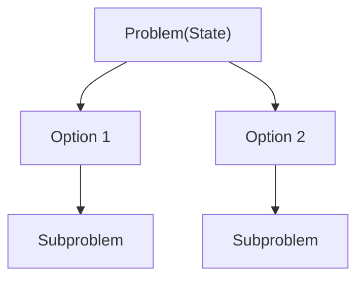

# DP Patterns & Recursion Foundation

Welcome to the definitive guide for mastering **Dynamic Programming** and **Recursion**. This repository is designed to take you from basic recursive thinking to advanced DP optimizations through structured patterns.

> "To understand recursion, one must first understand recursion."

---

## 🚀 Getting Started

If you are new to Dynamic Programming, we recommend starting with our **Recursion Foundations** to build the necessary intuition before diving into specific DP patterns.

### 🧩 [Recursion Foundations](/recursion/README.md)
Master the art of breaking down complex problems.
- [Easy Problems](/recursion/easy/README.md) - Basics of recursive calls.
- [Medium Problems](/recursion/medium/README.md) - Standard backtracking.
- [Hard Problems](/recursion/hard/README.md) - Complex recursive logic.

---

## 📂 DP Patterns

Dynamic Programming is best learned by identifying recurring patterns. We have categorized the most common DP problems into 11 logical patterns:

| Pattern | Description |
| :--- | :--- |
| **[0/1 Knapsack](/0_1_Knapsack_Pattern/readme.md)** | Picking items with limited capacity. |
| **[Unbounded Knapsack](/Unbounded_Knapsack_Pattern/readme.md)** | Items with unlimited repetition. |
| **[Fibonacci / Simple Recurrence](/Fibonacci_Simple_Recurrence_DP/readme.md)** | Problems following linear recurrence. |
| **[Longest Common Subsequence](/Longest_Common_Subsequence/readme.md)** | String comparison and matching. |
| **[Longest Increasing Subsequence](/Longest_Increasing_Subsequence/readme.md)** | Finding order in sequences. |
| **[Kadane's Algorithm](/Kadanes_Algorithm/readme.md)** | Efficient subarray optimizations. |
| **[Matrix Chain Multiplication](/Matrix_Chain_Multiplication/readme.md)** | Optimal parenthesization (Interval DP). |
| **[DP on Trees](/DP_on_Trees/readme.md)** | Optimization on tree structures. |
| **[DP on Graphs](/DP_on_Graphs/readme.md)** | Pathfinding and subgraph optimizations. |
| **[Grid DP](/Grid_DP/readme.md)** | Pathfinding and optimization in 2D grids. |
| **[Bitmask DP](/Bitmask_DP/readme.md)** | Optimization over small subsets ($N \le 20$). |

---

## 🛠️ The DP Workflow

Every DP solution follows this proven evolution:

1.  **Identify Recursion**: Define the state and base cases.
2.  **Add Memoization**: Store results to avoid redundant work (Top-Down).
3.  **Implement Tabulation**: Build the table iteratively (Bottom-Up).
4.  **Space Optimization**: Reduce the DP table size if possible.

---

## 📊 Visual Learning
Every problem in this documentation includes a **Mermaid Recursion Tree** to help you visualize how the state transitions work.

---
*Created with ❤️ for the developer community.*