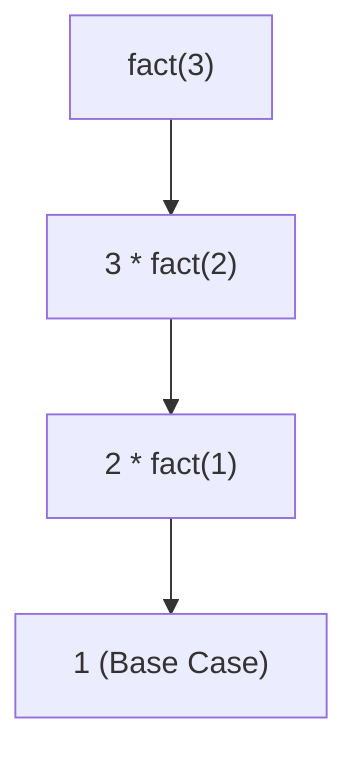
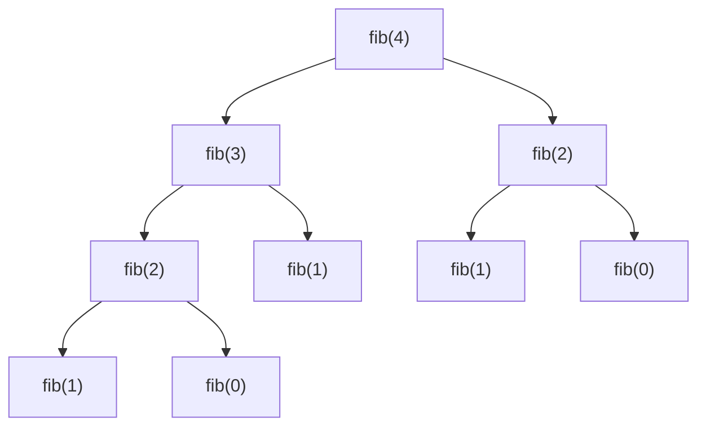
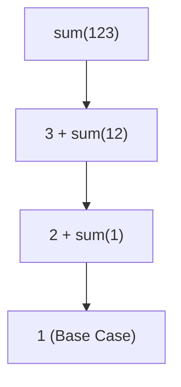

# Easy Recursion Problems - Detailed Guide

This folder contains 10 fundamental recursion problems. Understanding these is crucial for building the intuition required for complex backtracking and Dynamic Programming.

---

## 1. Factorial
**Description**: Calculate the product of all positive integers less than or equal to $n$.
**Process**: 
- Base Case: $n = 0$ or $n = 1$, return 1.
- Recursive Step: $n * \text{factorial}(n-1)$.

**Recursion Tree (for n=3)**:

---

## 2. Fibonacci
**Description**: Find the $n$-th number in the Fibonacci sequence (0, 1, 1, 2, 3, 5, 8, ...).
**Process**:
- Base Case: $n \le 1$, return $n$.
- Recursive Step: $\text{fib}(n-1) + \text{fib}(n-2)$.

**Recursion Tree (for n=4)**:

---

## 3. Sum of Digits
**Description**: Given a number, find the sum of its digits.
**Process**:
- Base Case: $n < 10$, return $n$.
- Recursive Step: $(n \pmod{10}) + \text{sum\_digits}(n // 10)$.

**Recursion Tree (for 123)**:

---

## 4. Power (x, n)
**Description**: Compute $x$ raised to the power $n$.
**Process**:
- Base Case: $n = 0$, return 1.
- Recursive Step: $x * \text{power}(x, n-1)$.

---

## 5. Reverse a String
**Description**: Invert the order of characters in a string.
**Process**:
- Base Case: Length of string is 0, return "".
- Recursive Step: $\text{reverse}(s[1:]) + s[0]$.

---

## 6. Palindrome Check
**Description**: Check if a string reads the same forwards and backwards.
**Process**:
- Base Case: Length $\le 1$, return True.
- Recursive Step: If $s[0] == s[-1]$, return $\text{is\_palindrome}(s[1:-1])$, else False.

---

## 7. Count Set Bits
**Description**: Count the number of '1's in the binary representation of an integer.
**Process**:
- Base Case: $n = 0$, return 0.
- Recursive Step: $(n \ \& \ 1) + \text{count\_bits}(n >> 1)$.

---

## 8. Array Sum
**Description**: Calculate the sum of all elements in an array.
**Process**:
- Base Case: Empty array, return 0.
- Recursive Step: $arr[0] + \text{sum}(arr[1:])$.

---

## 9. Binary Search (Recursive)
**Description**: Find the index of an element in a sorted array.
**Process**:
- Base Case: range is invalid or $arr[mid] == target$.
- Recursive Step: Recurse into left half if $target < arr[mid]$, else right half.

---

## 10. String Length
**Description**: Find the number of characters in a string without using `len()`.
**Process**:
- Base Case: String is empty, return 0.
- Recursive Step: $1 + \text{length}(s[1:])$.
