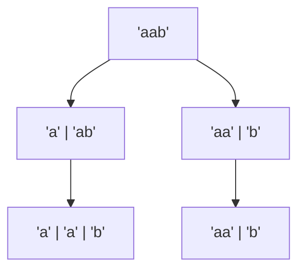

# Hard Recursion Problems - Detailed Guide

Hard recursion problems typically involve complex constraints, optimizing search spaces (pruning), or handling multiple recursive branches with memoization.

---

## 1. N-Queens
**Description**: Place $N$ queens on an $N \times N$ chessboard such that no two queens attack each other.
**Process**:
- Try placing a queen in each row.
- For each row, iterate through columns and check if it's "safe" (no queen in same column or diagonals).
- If safe, place queen and recurse to next row.
- Backtrack by removing queen.

---

## 2. Sudoku Solver
**Description**: Fill a 9x9 grid so each row, column, and 3x3 subgrid contains digits 1-9.
**Process**:
- Find an empty cell.
- Try digits 1-9. Check if valid.
- If valid, recurse. If the board is filled, return True.
- If no digit works, backtrack.

---

## 3. Word Search II
**Description**: Given a grid of characters and a list of words, find all words in the grid.
**Process**:
- Start DFS from each cell.
- Use a Trie (preferred for multiple words) or simple DFS for one word.
- Mark visited cells to avoid reuse in the same word.

---

## 4. Palindromic Partitioning
**Description**: Partition a string into all possible palindromes.
**Process**:
- For each possible prefix, check if it's a palindrome.
- If yes, add it to the current path and recurse for the remaining suffix.

**Recursion Tree (for "aab")**:

---

## 5. Wildcard Matching
**Description**: Implement pattern matching with `?` (any single char) and `*` (any sequence).
**Process**:
- If chars match or `?`, recurse `(i+1, j+1)`.
- If `*`, two choices: match empty sequence `(i, j+1)` or match one char and stay at `*` `(i+1, j)`.

---

## 6. Regular Expression Matching
**Description**: Implement matching with `.` (any char) and `*` (zero or more of preceding char).
**Process**:
- Handle `*` by checking if the preceding character matches.
- If it matches, we can skip the `*` part `(j+2)` or consume one char `(i+1)`.

---

## 7. Flatten a Nested List
**Description**: Convert a multi-level list into a single-level list.
**Process**:
- Iterate through elements.
- If element is a list, recurse. Else, append to result.

---

## 8. K-th Permutation Sequence
**Description**: Given $n$ and $k$, return the $k$-th permutation.
**Process**:
- Use the factorial property to determine the first digit without generating all permutations.
- Recurse for the remaining $n-1$ digits.

---

## 9. Rat in a Maze
**Description**: Find all paths from $(0,0)$ to $(n-1,n-1)$ in a maze with obstacles.
**Process**:
- Try moving in 4 directions (D, L, R, U).
- Check boundaries and if cell is a path (1).
- Mark visited to avoid cycles.

---

## 10. M-Coloring Problem
**Description**: Color a graph with $M$ colors such that no two adjacent vertices have the same color.
**Process**:
- For each vertex, try all $M$ colors.
- Check if the color is safe (no neighbor has the same color).
- Recurse for the next vertex.
