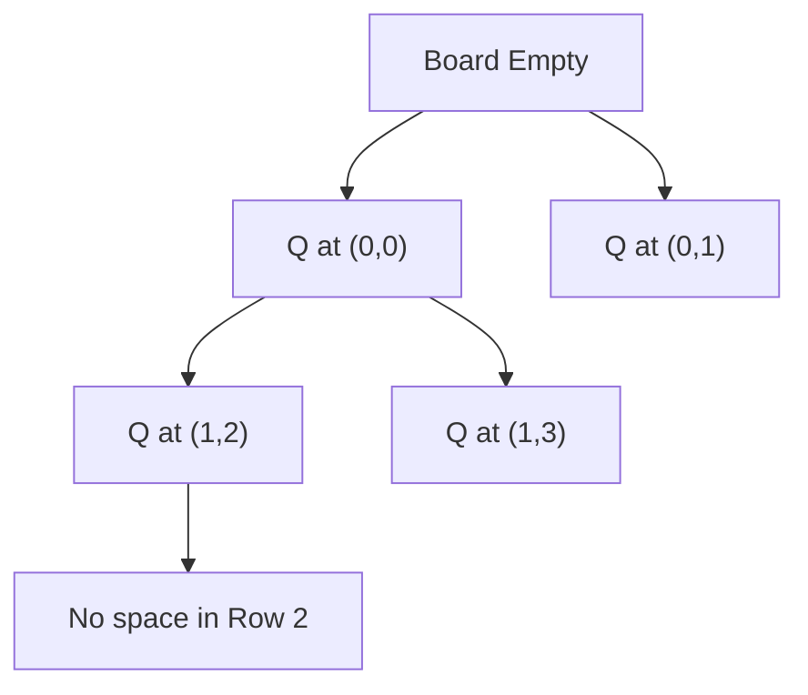
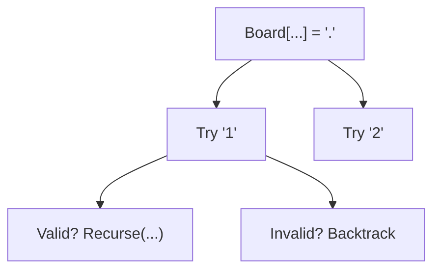
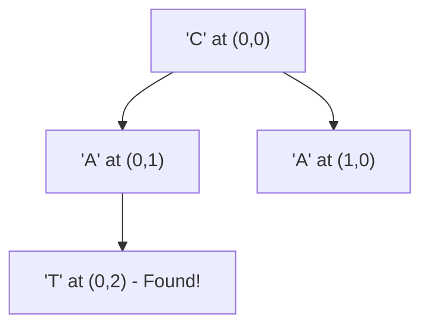
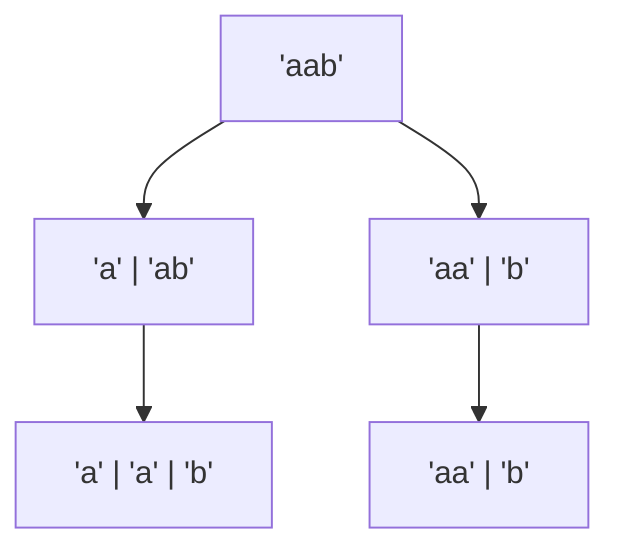
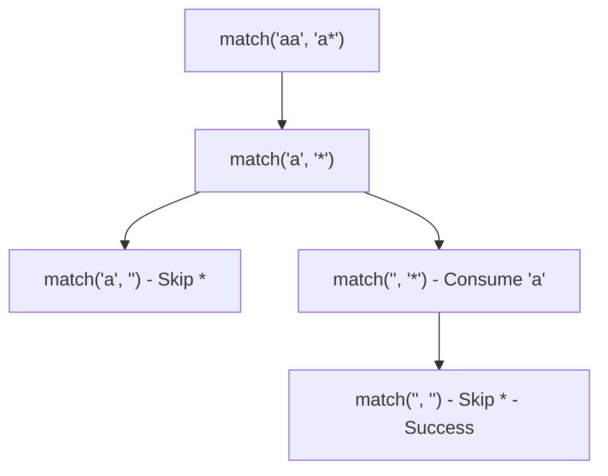
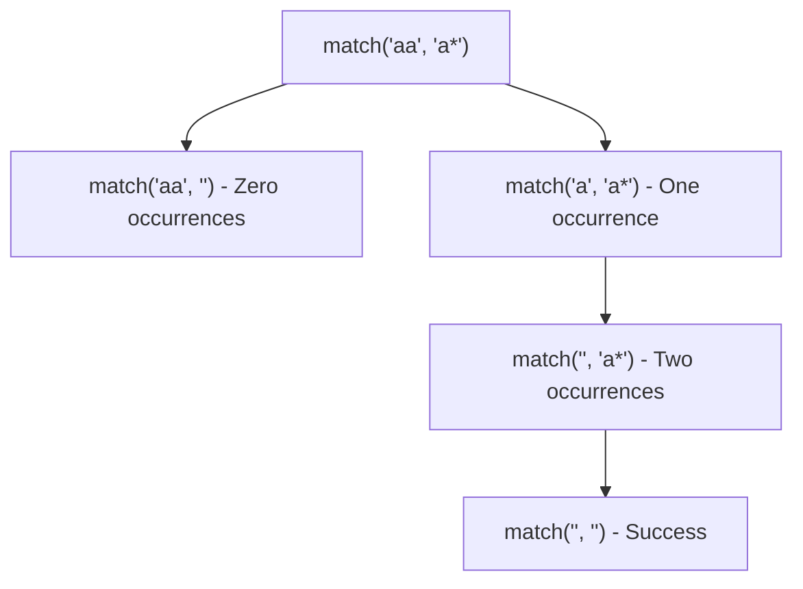
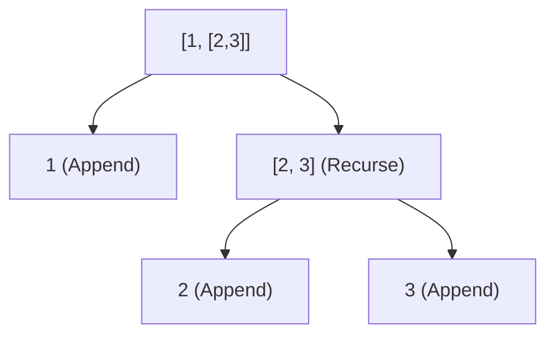
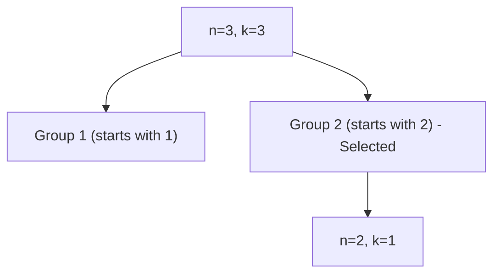
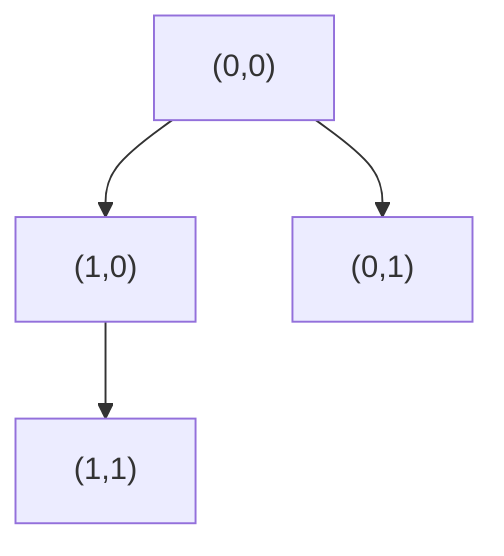
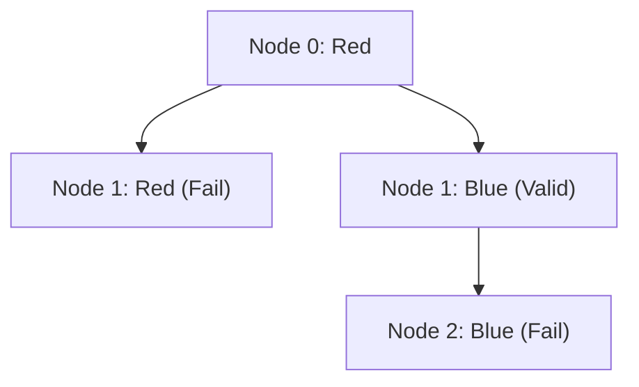

# Hard Recursion Problems - Detailed Guide

Hard recursion problems typically involve complex constraints, optimizing search spaces (pruning), or handling multiple recursive branches with memoization.

---

## 1. N-Queens
**Description**: Place $N$ queens on an $N \times N$ chessboard such that no two queens attack each other.
**Process**:
- Try placing a queen in each row.
- For each row, iterate through columns and check if it's "safe".
- Backtrack if no position works.

**Recursion Tree (Simplified for 4-Queens)**:

---

## 2. Sudoku Solver
**Description**: Fill a 9x9 grid so each row, column, and 3x3 subgrid contains digits 1-9.
**Process**:
- Find an empty cell. Try digits 1-9.
- If valid, recurse. Backtrack if dead end.

**Recursion Tree (Logic Branch)**:

---

## 3. Word Search II
**Description**: Given a grid of characters and a list of words, find all words in the grid.
**Process**:
- DFS from each cell. Mask visited cells with '#'.
- Check 4 neighbors.

**Recursion Tree (DFS search for 'CAT')**:

---

## 4. Palindromic Partitioning
**Description**: Partition a string into all possible palindromes.
**Process**:
- Check if prefix is palindrome. Recurse for remaining suffix.

**Recursion Tree (for "aab")**:

---

## 5. Wildcard Matching
**Description**: Implement pattern matching with `?` and `*`.
**Process**:
- If `*`, branches into `skip *` or `consume char`.

**Recursion Tree (s:'aa', p:'a*')**:

---

## 6. Regular Expression Matching
**Description**: Implement matching with `.` and `*`.
**Process**:
- `*` is more complex: zero or more of *preceding* char.

**Recursion Tree (s:'aa', p:'a*')**:

---

## 7. Flatten a Nested List
**Description**: Convert a multi-level list into a single-level list.
**Process**:
- If element is list, recurse. Else append.

**Recursion Tree ([1, [2, 3]])**:

---

## 8. K-th Permutation Sequence
**Description**: Find the $k$-th permutation using factorial logic.
**Process**:
- Narrow down the grouping using factorials.

**Recursion Tree (n=3, k=3 group choice)**:

---

## 9. Rat in a Maze
**Description**: Find paths in a maze with obstacles.
**Process**:
- 4-direction DFS with backtracking.

**Recursion Tree (Path search)**:

---

## 10. M-Coloring Problem
**Description**: Color vertices such that no adjacent vertices share a color.
**Process**:
- Try $M$ colors for each vertex.

**Recursion Tree (3 nodes, 2 colors)**:

 Riverside,
---
