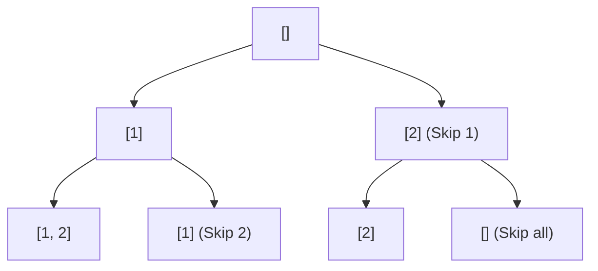
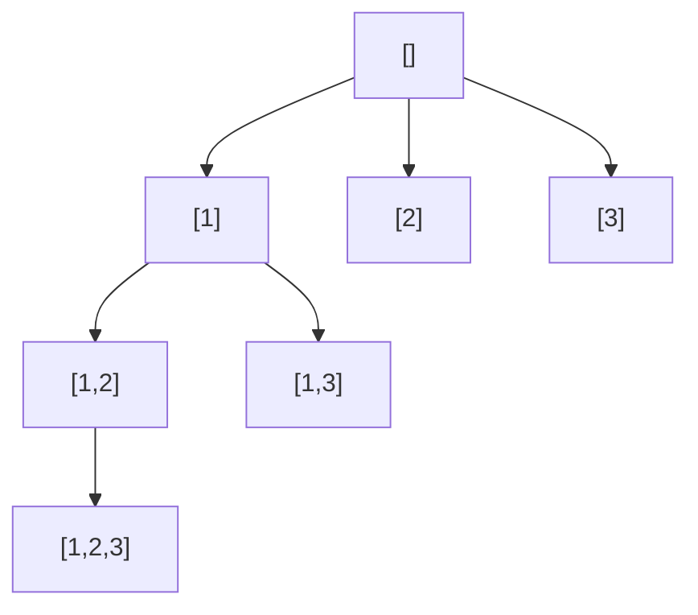
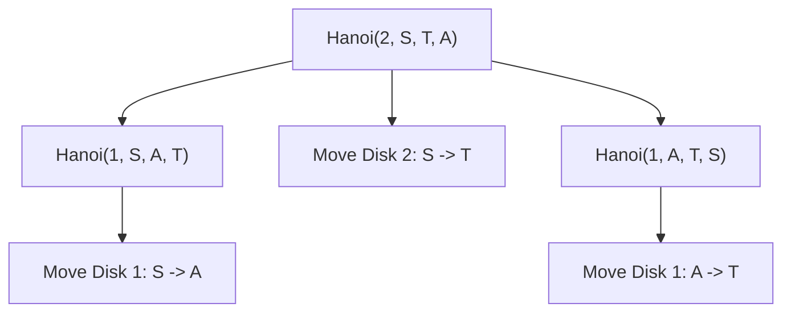
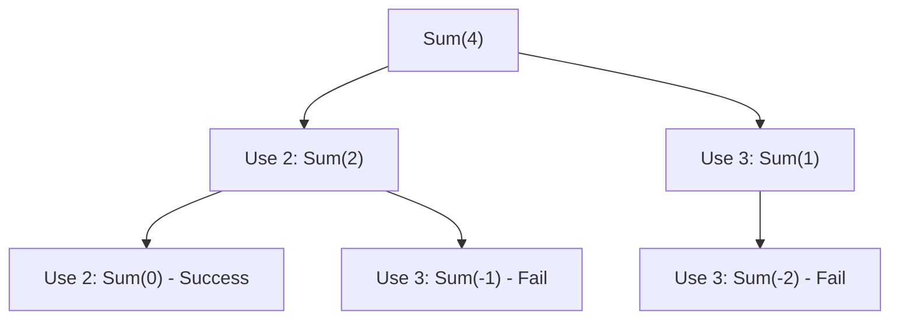
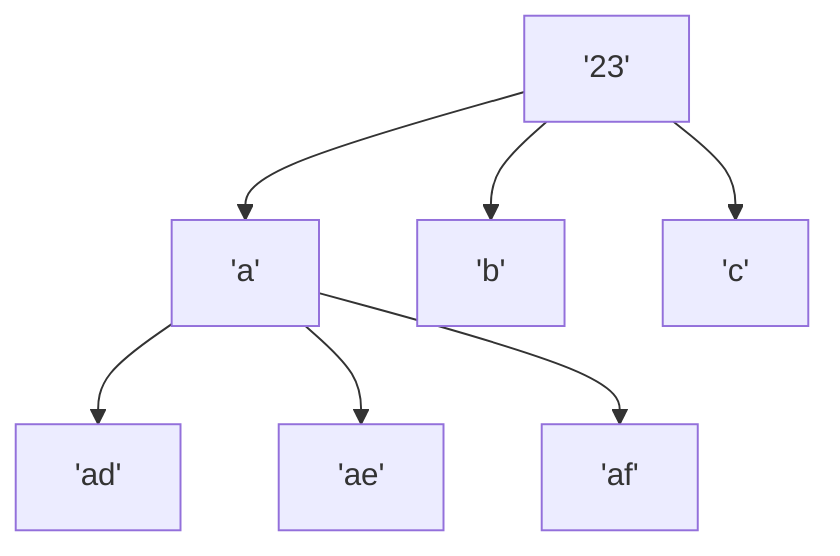
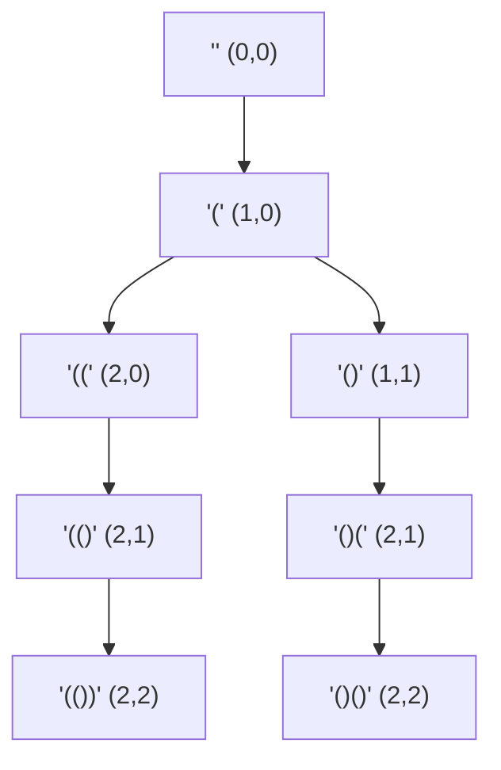
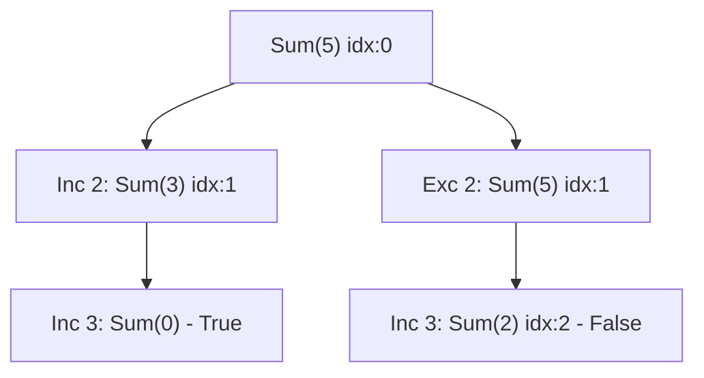
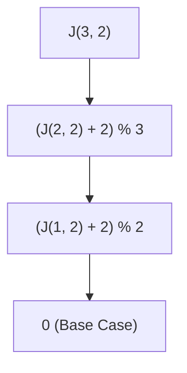
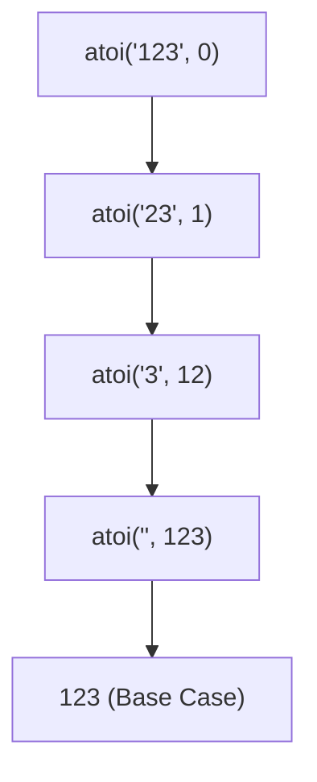
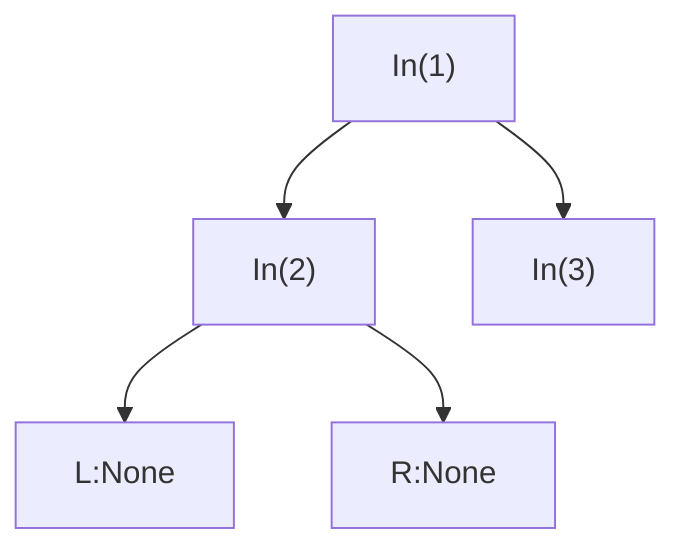

# Medium Recursion Problems - Detailed Guide

Medium problems often introduce **Backtracking**, where we explore multiple paths and "backtrack" when a path doesn't lead to a solution.

---

## 1. Subsets (Power Set)
**Description**: Generate all possible subsets of a given set of numbers.
**Process**:
- At each step, we have two choices for an element: either include it in the current subset or exclude it.
- **Backtracking Approach**: Iteratively add an element, recurse, then remove it (pop) to explore other branches.

**Recursion Tree (for [1, 2])**:

*(Visualizing inclusion/exclusion choices)*

---

## 2. Permutations
**Description**: Generate all arrangements of a given set of elements.
**Process**:
- For each position, try all available elements that haven't been used yet.
- Use a boolean array or check if the element is already in the current path.

**Recursion Tree (for [1, 2, 3] start)**:

---

## 3. Tower of Hanoi
**Description**: Move $n$ disks from source peg to target peg using an auxiliary peg, following specific rules.
**Process**:
1. Move $n-1$ disks from `source` to `aux` using `target`.
2. Move the $n$-th disk from `source` to `target`.
3. Move $n-1$ disks from `aux` to `target` using `source`.

**Recursion Tree (for n=2)**:

---

## 4. Combination Sum
**Description**: Find all unique combinations of numbers that sum to a target.
**Process**:
- Recurse by subtracting current element from target.
- Since we can reuse elements, the `start` index remains the same in the recursive call.

**Recursion Tree (Target: 4, [2, 3])**:

---

## 5. Letter Combinations of a Phone Number
**Description**: Map digits to letters (like on a phone keypad) and find all possible strings.
**Process**:
- Base Case: `index == length of digits`.
- Recursive Step: Loop through letters of `mapping[digits[index]]` and recurse for `index + 1`.

**Recursion Tree (for '23')**:

---

## 6. Generate Parentheses
**Description**: Generate all combinations of $n$ pairs of balanced parentheses.
**Process**:
- Maintain counts of `open` and `close` parentheses.
- Add `(` if `open < n`.
- Add `)` if `close < open`.

**Recursion Tree (for n=2)**:

---

## 7. Subset Sum
**Description**: Determine if there exists a subset with sum equal to $K$.
**Process**:
- At each element, either include it in the sum or exclude it.
- `solve(idx + 1, current_sum + arr[idx]) || solve(idx + 1, current_sum)`.

**Recursion Tree (Sum: 5, [2, 3])**:

---

## 8. Josephus Problem
**Description**: People stand in a circle; every $k$-th person is executed until one remains.
**Process**:
- Relates the solution of $n$ people to $n-1$ people.
- $f(n, k) = (f(n-1, k) + k) \pmod{n}$.

**Recursion Tree (n=3, k=2)**:

---

## 9. String to Integer (atoi)
**Description**: Recursively convert a string to its integer representation.
**Process**:
- Extract first digit, multiply current accumulated value by 10, add digit, and recurse with remaining string.

**Recursion Tree (for '123')**:

---

## 10. Binary Tree Traversals
**Description**: Visit all nodes in a tree (Pre-order, In-order, Post-order).
**Process**:
- In-order: `rec(left) -> print(root) -> rec(right)`.
- Pre-order: `print(root) -> rec(left) -> rec(right)`.
- Post-order: `rec(left) -> rec(right) -> print(root)`.

**Recursion Tree (In-order for [2, 1, 3])**:

*(Order: L -> Root -> R)*
