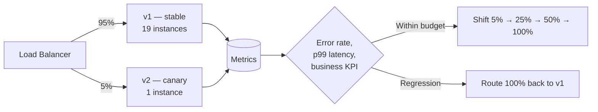
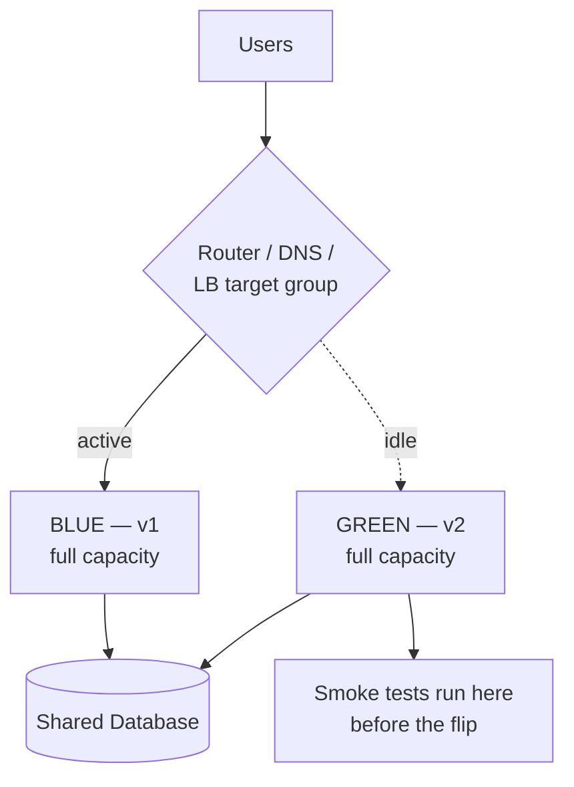
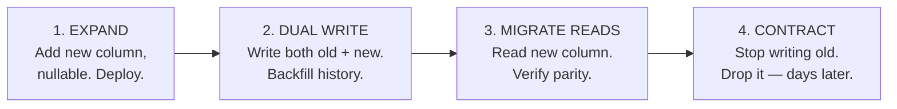
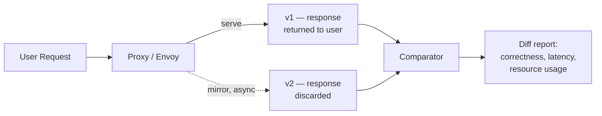
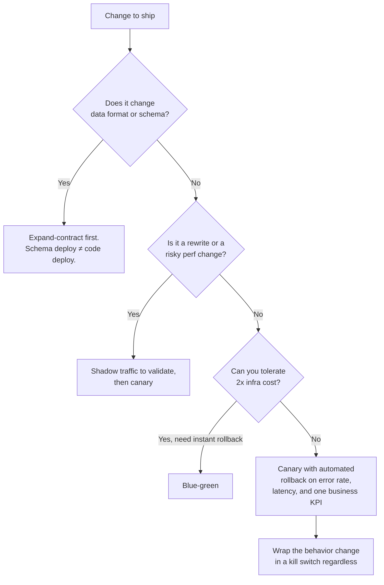

> [!NOTE]
> **📋 5-Minute Summary**
>
> **What this covers:** How to change a running system without breaking it — the progressive-delivery techniques that separate "we deploy on Fridays" teams from "we deploy 50 times a day" teams.
>
> **Key topics:**
> - **Canary releases** — route a small % of traffic to the new version, watch the metrics, decide
> - **Blue-green deployment** — two full environments, flip the router, instant rollback
> - **Feature flags** — decouple *deploy* from *release*; ship code dark, turn it on later
> - **Shadow traffic (mirroring)** — send real production traffic to the new version, discard the response
> - **Rollback vs roll-forward** — and why database migrations break the symmetry
> - **Automated rollback signals** — the metric that fires without a human in the loop
>
> **Key takeaway:** Every deploy is a hypothesis. The techniques below exist to make the hypothesis cheap to test and cheap to abandon. A staff engineer is judged less on the deploy mechanism than on naming the *signal* that triggers rollback and the *time budget* to act on it.

---
module: 04-advanced-topics
status: unread
tags: [04-advanced-topics, system-design, reliability, deployment]
---
# Deployment Safety and Progressive Delivery

---

## The core idea: deploy ≠ release

The single most useful distinction in this topic:

- **Deploy** — new code is running on production infrastructure.
- **Release** — that code is serving user traffic.

Traditional deployment fuses these: the moment the binary starts, it's live for everyone. Every technique on this page is a way to pull them apart, so that the blast radius of a bad change is a choice rather than an accident.

---

## 1. Canary Releases

Route a small fraction of traffic to the new version, compare it against the old, and promote or abort.



**A typical promotion schedule:**

| Stage | Traffic | Soak time | What you're catching |
|---|---|---|---|
| 1 | 1% | 15 min | Crash loops, startup failures, obvious 5xx |
| 2 | 5% | 30 min | Error-rate and latency regressions |
| 3 | 25% | 1 hour | Resource leaks, GC pressure, connection-pool exhaustion |
| 4 | 50% | 2 hours | Capacity and downstream saturation effects |
| 5 | 100% | — | — |

**What to compare:** Do *not* compare the canary against historical baselines — traffic patterns shift by hour and day. Compare the canary against a **control group** of old-version instances receiving traffic *at the same moment*. This is the difference between a canary analysis that works and one that pages you every Monday morning.

**Sizing the canary:** 1% of traffic catches an error that affects 100% of requests almost immediately. It will *never* catch an error that affects 0.1% of requests — you don't have the statistical power. Decide up front which class of bug you're hunting.

> 🎯 **Staff signal:** Don't just say "we'd do a canary deploy" — the real insight is that a canary is a *statistical test*, and most canaries are underpowered. I'd compare against a concurrent control group rather than yesterday's baseline, and I'd size the canary window from the error rate I need to detect: catching a 1-in-1000 failure at 1% traffic needs hours of soak, so for rare-but-severe bugs I'd use shadow traffic instead.

---

## 2. Blue-Green Deployment

Two complete production environments. One serves traffic ("blue"), the other is idle and receives the new version ("green"). Flip the router to release; flip it back to roll back.



| | Blue-green | Canary |
|---|---|---|
| Rollback speed | Instant (flip router) | Fast (shift traffic) |
| Cost | 2x infrastructure | ~1.05x |
| Blast radius at release | 100% at once | Gradual |
| Catches gradual regressions | No | Yes |
| Good for | Stateless apps, fast rollback needs | Risky changes, large fleets |

**The trap everyone misses:** blue and green share a database. Instant rollback of the *application* does not roll back a schema migration or the rows that green already wrote. Blue-green gives you a fast rollback only if your data layer is backward-compatible — which is what the next section is about.

---

## 3. Database migrations: why rollback isn't symmetric

Code rolls back in seconds. Data does not. This asymmetry is the source of most "we couldn't roll back" incidents.

**The expand-contract (parallel change) pattern:**



Each step is independently deployable and independently reversible. The rules that make it work:

1. **Never** deploy a schema change and the code that depends on it in the same release.
2. Additive changes only, until the old code is fully gone. Adding a nullable column is safe; renaming or dropping one is not.
3. The gap between EXPAND and CONTRACT is measured in **days**, not minutes — long enough that you're certain no old code is running.
4. Backfills run in batches with rate limiting. A single `UPDATE` over 200M rows takes a lock and takes down the site.

> 🎯 **Staff signal:** Don't just say "we'd roll back" — the real insight is that code and data roll back on completely different timescales, which is why I'd use expand-contract and treat the schema change as a separate deploy from the code that uses it. The migration is only reversible during the days between expand and contract, and that window is a deliberate design choice, not slack.

---

## 4. Feature Flags

A runtime switch that controls whether code paths execute — the cleanest way to separate deploy from release.

**Four distinct kinds, with very different lifecycles:**

| Kind | Purpose | Lifespan | Owner |
|---|---|---|---|
| **Release toggle** | Ship dark, enable later | Days–weeks; delete after | Engineering |
| **Experiment flag** | A/B test, % rollout | Duration of the experiment | Product / DS |
| **Ops toggle / kill switch** | Disable an expensive feature under load | Permanent | On-call |
| **Permission flag** | Entitlements, plan tiers | Permanent | Product |

```java
if (flags.isEnabled("new-ranking-algorithm", userId)) {
    return newRanker.rank(candidates);
}
return legacyRanker.rank(candidates);
```

**The costs nobody budgets for:**

- **Combinatorial explosion.** Every flag doubles the number of possible code paths. Ten independent flags is 1,024 configurations, and you test maybe three of them. Cap the number of *live* release toggles and enforce it.
- **Flag debt.** Release toggles that are never removed become permanent, undocumented branches. Give every release toggle an expiry date and fail the build when it passes.
- **Evaluation must be fast and fail-safe.** The flag service being down must never take your service down. Cache flag values locally, refresh asynchronously, and define the default for every flag when the config can't be fetched.
- **Consistency.** A user whose flag value flips mid-session sees a broken UI. Bucket by a stable hash of user ID so evaluation is deterministic.

> 🎯 **Staff signal:** Don't just say "we'd put it behind a feature flag" — the real insight is that flags are branches in production that no compiler checks, so I'd treat a release toggle as debt with an expiry date and keep only kill switches permanently. I'd also make flag evaluation local and fail-safe with an explicit default per flag, because a config service outage turning into a site outage is a self-inflicted dependency.

---

## 5. Shadow Traffic (Traffic Mirroring)

Duplicate real production requests to the new version. Serve the user from the old version; **discard the shadow response**. Compare the two offline.



**Why it's uniquely powerful:** you get 100% of production traffic — real payloads, real edge cases, real distribution — with **zero user-facing risk**. A canary at 1% might take a week to see the pathological request that crashes you; shadow traffic sees it in an hour.

**Where it's dangerous:** the shadow path must not cause side effects.

- Writes must go to a separate database, or be no-ops.
- Payments, emails, and push notifications must be stubbed. A mirrored charge is a real charge.
- Downstream services see 2x load — either they're provisioned for it, or the shadow path uses stubs.
- Non-idempotent downstream calls are the classic footgun.

**Best used for:** rewrites (comparing new service vs. old for output parity), major dependency or runtime upgrades, and performance validation under real traffic shape.

---

## 6. Automated rollback: naming the signal

Manual rollback is too slow. If a human must notice a dashboard, the outage is minutes long before anyone acts. Define the trigger in advance:

| Signal | Example threshold | Why this one |
|---|---|---|
| Error rate | 5xx > 0.5% over 2 min, vs. control | Catches crashes and unhandled paths |
| Latency | p99 > 1.5x control for 5 min | Catches leaks, lock contention, N+1s |
| Business KPI | Checkout rate drops > 2% | Catches *correct* code with wrong behavior |
| Saturation | CPU/memory/connections > 85% | Catches changes that won't survive peak |

The third row is the one that matters most and gets forgotten. A deploy can be perfectly healthy on every technical metric and still be a disaster — the page renders, returns 200, and no one can complete a purchase. **Always include at least one business metric in the rollback criteria.**

---

## Interview application

When asked "how would you deploy this change?", traverse:



**Say it:** "I'd separate the deploy from the release. The code ships dark behind a flag, then I'd ramp traffic 1% → 5% → 25% → 100% comparing against a concurrent control group, with automated rollback on error rate, p99 latency, and conversion. Because this change touches the schema, the migration goes out as its own deploy using expand-contract, and I'd keep the old column for a week — that's my actual rollback window, not the code deploy."

---

## Related

- [Chaos Engineering](02-chaos-engineering.md) — proving the system survives failures you injected on purpose
- [Observability](01-observability.md) — the metrics that make canary analysis possible
- [Blast Radius Isolation](05-blast-radius-isolation.md) — limiting who is affected when a change goes wrong anyway
