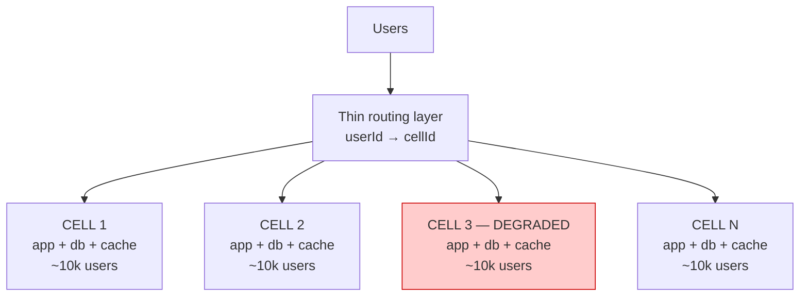
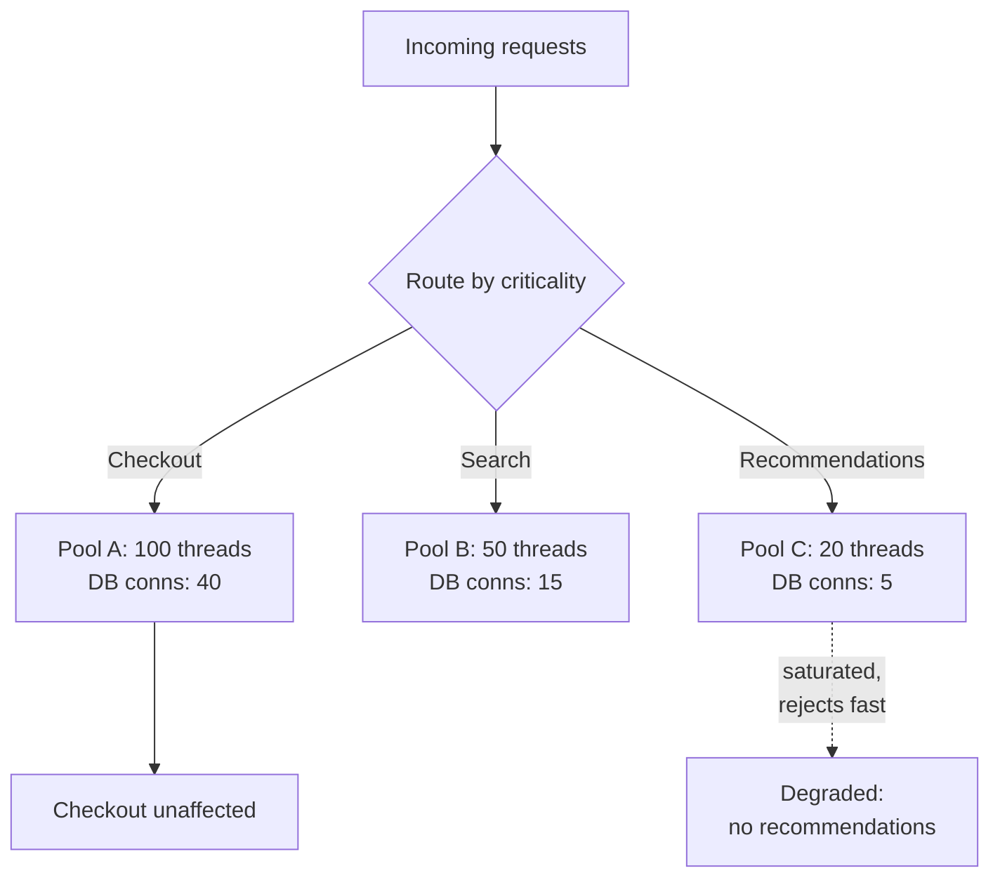
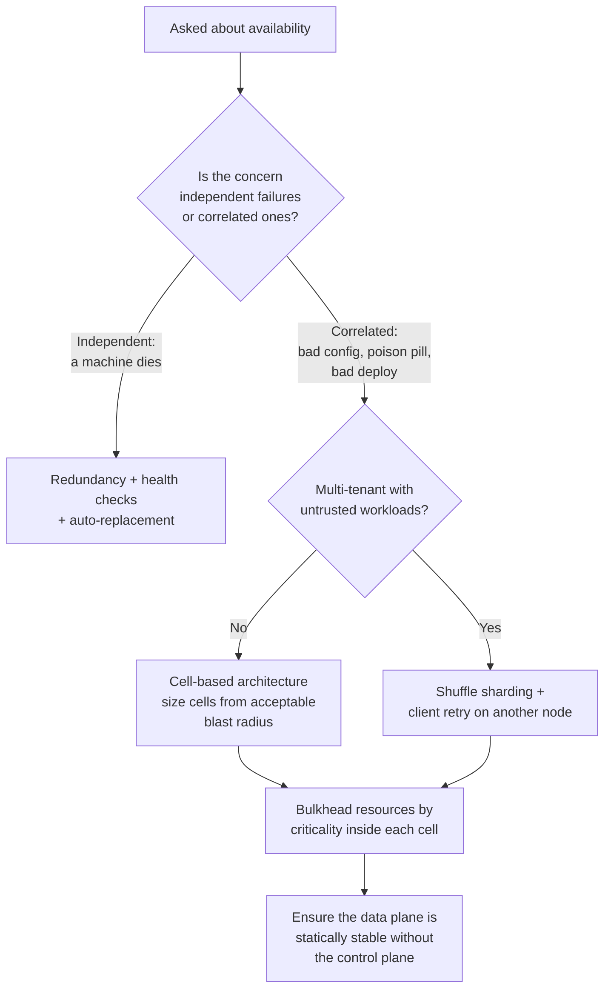

> [!NOTE]
> **📋 5-Minute Summary**
>
> **What this covers:** Architectural patterns that bound *how many users* an incident can affect. Availability isn't only about preventing failures — it's about ensuring a failure is partial rather than total.
>
> **Key topics:**
> - **Cell-based (cellular) architecture** — many small independent stacks instead of one big one
> - **Shuffle sharding** — give each customer a random *combination* of nodes, so no two share the same fate
> - **Bulkheads** — separate resource pools so one workload can't starve another
> - **The poison-pill problem** — one bad request that kills every server it touches
> - **Control-plane vs data-plane** — why the thing that manages your system must not be in its critical path
>
> **Key takeaway:** "Highly available" systems still fail. The design question a staff engineer answers is *"when this fails, what fraction of users notice?"* — and the answer should be a number you chose deliberately, not 100% by default.

---
module: 04-advanced-topics
status: unread
tags: [04-advanced-topics, system-design, reliability, isolation]
---
# Blast Radius Isolation

---

## The problem with one big system

A well-built, redundant, auto-scaling service is still a single failure domain. Redundancy protects against a machine dying. It does *not* protect against:

- A bad config push applied to every instance simultaneously
- A poison-pill request that crashes any server that processes it
- A single customer's traffic spike saturating a shared resource
- A schema migration or deploy that's wrong everywhere at once
- A cache stampede or retry storm that spreads across the fleet

In every one of these, redundancy actively *hurts* — the fault propagates to all your identical replicas at once. Redundancy handles independent failures; these are correlated ones.

**The reframe:** stop optimizing only for "how often does it fail" and start designing "when it fails, how many people notice."

---

## 1. Cell-Based Architecture

Instead of one large deployment serving all users, run **many complete, independent copies** ("cells"). Each cell has its own compute, its own database, its own cache. Users are partitioned across cells. Cells never talk to each other.



If cell 3 fails entirely, **1/N of users are affected and everyone else is completely unaffected** — not degraded, not slower. Unaffected.

**What this buys you:**

| Property | Mechanism |
|---|---|
| Bounded blast radius | A failure is capped at one cell's user population |
| Safe deploys | Deploy cell-by-cell; a bad release stops after cell 1 |
| Predictable scaling | Cells are a known-good unit; scale by adding cells, not by growing one |
| Load isolation | A noisy tenant saturates only their own cell |
| Testable capacity | You load-test one cell and know the number holds |

**What it costs:**

- **Routing becomes critical infrastructure.** The router must be simpler and more reliable than everything it routes to — it's now the shared failure domain. Keep it dumb: a lookup, not logic.
- **Cross-cell operations are painful.** Anything global — search across all users, aggregate analytics, a user moving between cells — needs a separate system. Choose the partition key so this is rare.
- **Per-cell overhead.** Each cell needs its own database, its own monitoring, its own on-call visibility. N cells means N times the operational surface unless automation is genuinely good.
- **Capacity fragmentation.** Cell 4 being full while cell 9 is idle wastes resources; you need rebalancing.

**Sizing a cell** is the key design decision, and it's a direct trade:

- *Smaller cells* → smaller blast radius, more overhead, more fragmentation.
- *Larger cells* → better efficiency, bigger blast radius.

Pick the size by asking what fraction of users you can afford to lose at once. If the answer is 5%, you need at least 20 cells. Then verify a cell is still large enough to be efficient and small enough to load-test honestly.

> 🎯 **Staff signal:** Don't just say "we'd use cells" — the real insight is that cell size *is* the availability decision: N cells means a worst-case incident affects 1/N of users, so I'd derive the cell count from the blast radius the business will accept rather than from infrastructure convenience. The routing layer then becomes the one true shared dependency, so it has to be dumber and more reliable than anything it fronts — a static mapping, not a service with business logic.

---

## 2. Shuffle Sharding

Cells help, but plain sharding still means every customer in a shard shares a fate. Shuffle sharding does something cleverer: assign each customer a **random subset** of nodes, so that two customers rarely share their *entire* set.

**Plain sharding**, 8 nodes, 2 nodes per customer, customers assigned to fixed pairs:

```
Nodes:      [1 2] [3 4] [5 6] [7 8]
Customer A: [1 2]
Customer B: [1 2]   ← A's poison pill kills B too
```

**Shuffle sharding** — each customer gets a random *combination*:

```
Nodes:      1  2  3  4  5  6  7  8
Customer A: ✓     ✓
Customer B:    ✓        ✓
Customer C: ✓              ✓
```

Now if customer A sends a poison pill that kills nodes 1 and 3: customer B is untouched, and customer C loses node 1 but still has node 5 — so with any retry logic, C stays up.

**The math is remarkable.** With 8 nodes choosing 2, there are C(8,2) = 28 possible combinations. The chance a given customer shares *both* nodes with a specific bad actor is 1/28 ≈ 3.6%. Scale it up — 100 nodes, 5 per customer — and there are C(100,5) = 75,287,520 combinations. Two customers overlapping completely is effectively impossible.

| Nodes | Shard size | Combinations | Chance of full overlap |
|---|---|---|---|
| 8 | 2 | 28 | 3.6% |
| 16 | 2 | 120 | 0.83% |
| 100 | 5 | 75,287,520 | 0.0000013% |

**The requirement that makes it work:** the client must **retry on a different node in its shard**. Shuffle sharding gives a customer *partial* redundancy; without retries, losing one of their nodes is still an outage for them. Shuffle sharding and retry-with-failover are one design, not two.

Assign shards deterministically — hash the customer ID to pick the combination — so it's stable across restarts and requires no coordination service.

> 🎯 **Staff signal:** Don't just say "we'd shard by customer" — the real insight is that plain sharding still lets one abusive tenant take down everyone in their shard, while shuffle sharding makes complete overlap combinatorially unlikely: 100 nodes choosing 5 gives 75 million combinations, so a poison pill degrades a handful of tenants instead of taking out a whole shard. It only works if clients retry on another node in their subset, so I'd treat the retry policy as part of the isolation design rather than a client detail.

---

## 3. Bulkheads

Named for a ship's watertight compartments: partition resources so exhaustion in one workload can't starve another.

**The failure it prevents:** one shared thread pool of 200 threads. A downstream dependency for a *non-critical* feature slows from 20ms to 10s. Requests pile up, all 200 threads block on it, and now the *critical* path — which never touched that dependency — can't get a thread. A minor feature took down checkout.



Partition anything that can be exhausted: thread pools, connection pools, memory budgets, rate-limit quotas, even separate service deployments for critical vs. best-effort paths.

**The trade-off:** partitioned pools are less efficient than one shared pool. Pool C sitting idle can't lend capacity to Pool A. You are deliberately buying isolation with utilization — and that's the right trade for anything on a revenue path.

Pair bulkheads with **circuit breakers** (stop calling a failing dependency) and **timeouts** (bound how long anything can hold a resource). Bulkheads limit the damage; circuit breakers and timeouts stop it recurring.

---

## 4. Control plane vs data plane

- **Data plane** — serves user requests. Must be simple and available.
- **Control plane** — manages the system: configuration, scaling, deploys, service discovery. Complex, changes often.

**The rule: the data plane must keep working when the control plane is down.**

Control planes are complex and change constantly, so they fail more often. If serving a user request requires a live call to the control plane, you've given the least reliable component veto power over the most important one.

**Static stability** is the property to aim for: the system holds its last-known-good state and keeps serving.

| Anti-pattern | Statically stable version |
|---|---|
| Fetch routing config per request | Cache config locally; refresh async; serve stale on failure |
| Look up service discovery per call | Local cache with a long TTL; keep the last-good endpoint list |
| Validate a feature flag remotely per request | Local evaluation from a cached snapshot with a per-flag default |
| Scale up only when the control plane responds | Pre-provision headroom; degrade rather than block |

A system whose data plane depends on a live control plane doesn't have a control-plane outage — it has a total outage.

---

## Interview application



**Say it:** "Redundancy handles a machine dying, but it doesn't help with a bad config push or a poison-pill request — those hit every identical replica at once. So I'd cell the system: independent stacks with their own database and cache, users partitioned across them, and no cross-cell calls. If we can lose at most 5% of users to one incident, that sets the floor at 20 cells. Deploys then go cell-by-cell, so a bad release stops at cell one. The routing layer becomes the only shared dependency, so it stays a static lookup — and I'd make sure the data plane serves from cached config so a control-plane outage doesn't become a full outage."

---

## Real-world reference points

- **AWS** builds most services on cells and availability-zone isolation; shuffle sharding originated in their Route 53 and API Gateway work.
- **Slack** moved to cell-based architecture per availability zone after AZ-level networking failures caused full outages.
- **Netflix** popularized bulkheads and circuit breakers via Hystrix, and now Resilience4j.
- **DoorDash** and **Salesforce** both publish on cellular architecture for tenant isolation.

---

## Related

- [Deployment Safety](04-deployment-safety.md) — cell-by-cell rollout is the payoff of this architecture
- [Chaos Engineering](02-chaos-engineering.md) — verifying isolation actually holds
- [Observability](01-observability.md) — per-cell metrics, so you can see *which* cell is unhealthy
