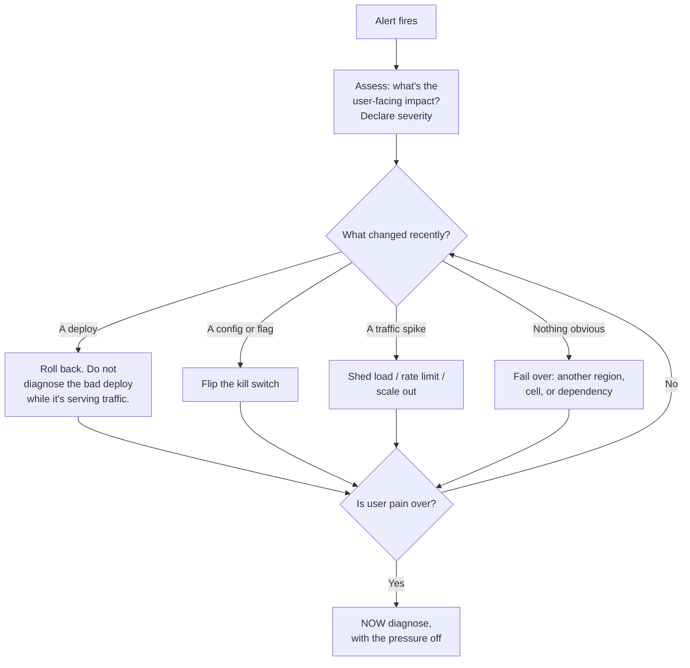

> [!NOTE]
> **📋 5-Minute Summary**
>
> **What this covers:** What happens during and after an outage — the incident-command roles, the mitigate-before-diagnose discipline, and blameless postmortems that actually change the system.
>
> **Key topics:**
> - **Incident roles** — Incident Commander, Ops Lead, Comms Lead, and why the IC doesn't debug
> - **Mitigate first, diagnose second** — stopping user pain before understanding root cause
> - **Severity levels** — what SEV1/2/3 mean and what each triggers
> - **Blameless postmortems** — the format, and why blame destroys the data you need
> - **Root cause analysis** — Five Whys, and why "human error" is never a root cause
> - **Action items** — the difference between a postmortem that changes things and one that's filed
>
> **Key takeaway:** MTTR matters more than MTBF. You cannot prevent all failures, so the differentiator is how fast you detect, mitigate, and learn. A postmortem whose action items don't change a system, a process, or an alert was theater.

---
module: 04-advanced-topics
status: unread
tags: [04-advanced-topics, system-design, reliability, incidents]
---
# Incident Response and Postmortems

---

## Why this belongs in a system design interview

Interviewers at senior and staff level frequently close with *"it's 3 AM and this system is down — what do you do?"* They're testing whether you've operated a system or only drawn one. The answer isn't a debugging trick; it's a process.

The governing metrics:

- **MTBF** (Mean Time Between Failures) — how often it breaks.
- **MTTD** (Mean Time To Detect) — how long before anyone knows.
- **MTTR** (Mean Time To Recover) — how long until users are okay again.

At scale you cannot drive MTBF to infinity. Dependencies fail, hardware fails, humans push bad config. So mature organizations optimize **MTTD + MTTR**, which is why observability, automated rollback, and cell-based isolation all pay off here.

---

## Incident roles

The core failure mode of an unstructured incident: eight engineers all debugging, nobody talking to stakeholders, two people making conflicting changes to production at the same time.

| Role | Owns | Explicitly does NOT |
|---|---|---|
| **Incident Commander (IC)** | Coordination, decisions, delegation | Debug. The IC's hands stay off the keyboard. |
| **Ops / Tech Lead** | Investigating and applying mitigations | Talk to stakeholders |
| **Comms Lead** | Status page, stakeholder and customer updates | Make technical decisions |
| **Scribe** | Timeline of what was observed and done, with timestamps | Anything else |

The IC role is the one people get wrong. The instinct of the most senior engineer present is to dive into the debugging — and then no one is coordinating, deciding, or tracking. **The IC's job is to be the single decision-maker and the single source of truth**, and that requires not being deep in a stack trace.

Two rules that prevent most compounded incidents:

1. **One person changes production at a time**, announced in the incident channel before doing it.
2. **Every change is announced and logged**, so that a mitigation attempt that made things worse can be identified and reversed.

---

## Mitigate first, diagnose second

The strongest instinct to suppress during an outage is the urge to understand it.



"What changed recently?" resolves the large majority of incidents, because most incidents are caused by a change. Roll back first and investigate the artifact afterwards, offline, with users unaffected.

> 🎯 **Staff signal:** Don't just say "I'd check the logs" — the real insight is that mitigation and diagnosis are separate phases and mixing them extends every outage. I'd roll back the most recent change before understanding it, because a rollback takes two minutes and root-causing a novel bug takes hours, and the user doesn't care which one we did. The only exception is when rollback itself is unsafe — a schema migration already applied — which is exactly why expand-contract matters.

---

## Severity levels

Severity should be defined by **user impact**, not by how alarming the graph looks.

| Sev | Definition | Response |
|---|---|---|
| **SEV1** | Major functionality broken for many users; data loss or security breach | Page immediately, all hands, exec comms, public status page |
| **SEV2** | Significant degradation, or total failure of a non-critical feature | Page on-call, IC assigned, internal comms |
| **SEV3** | Minor or cosmetic; a workaround exists | Ticket, handled in business hours |

Publishing this table in advance matters more than its exact contents: it removes the argument about *whether this is serious* from the moment when everyone is least able to have that argument well.

---

## Blameless postmortems

Every SEV1 and SEV2 gets a written postmortem, ideally within a few days while memory is fresh.

**Why blameless is a practical requirement, not a nicety:** if naming what you did leads to punishment, people stop naming it. You lose the timeline, and the timeline is the raw data. An organization that punishes individuals gets postmortems that are vague, late, and useless — and then repeats the incident.

The reframe: **if one person's mistake could take down production, the system failed, not the person.** The question is never "why did they run that command" but "why was it possible to run that command against production with no confirmation, no canary, and no automatic rollback."

**Postmortem template:**

```markdown
# Postmortem: [Short description] — YYYY-MM-DD

## Summary
2-3 sentences: what broke, who was affected, for how long.

## Impact
- Duration: HH:MM UTC to HH:MM UTC (X minutes)
- Users affected: N (X% of traffic)
- Business impact: failed orders / revenue / SLO budget consumed

## Timeline (all times UTC)
14:02  Deploy of v2.3.1 begins
14:07  Error rate rises to 3%; no alert fires (see AI-2)
14:19  Customer report arrives via support
14:24  On-call paged; incident declared SEV2; IC assigned
14:31  Rollback initiated
14:36  Error rate normal. User impact ends.
15:10  Root cause identified

## Root cause
The technical chain of causation. Not "a bug" — the specific mechanism.

## Detection
How did we find out? How long did it take? Should an alert have caught it?
(If a customer told you first, that is itself a finding.)

## What went well
Genuinely useful — reinforces the practices worth keeping.

## What went poorly

## Where we got lucky
The near-misses. If this had happened at peak instead of 14:00,
impact would have been 10x. Luck is not a control.

## Action items
| # | Action | Type | Owner | Due | Ticket |
|---|--------|------|-------|-----|--------|
| 1 | Add alert on error rate > 1% over 2 min | Detect | @x | date | LINK |
| 2 | Automated rollback on canary error budget | Mitigate | @y | date | LINK |
| 3 | Add null check in OrderParser | Prevent | @z | date | LINK |
```

---

## Root cause analysis: Five Whys

Keep asking why until you reach something you can actually change.

> The checkout API returned 500s. **Why?**
> A null pointer in the order parser. **Why?**
> A field the parser assumed was always present was missing. **Why?**
> An upstream service made the field optional in its latest release. **Why?**
> There is no schema-compatibility check between the two services. **Why?**
> Our contract testing covers only the mobile client, not service-to-service.

The null check fixes this bug. **The contract testing fixes the class of bug.** Stopping at the first "why" is what produces organizations that keep having the same outage in slightly different clothes.

Two rules:

1. **"Human error" is never a root cause.** It's a prompt to ask why the system permitted it.
2. **Look for several causes.** Incidents are usually a chain — a bug *and* a missing alert *and* a slow rollback. Each link is a separate action item, and the detection and mitigation ones often matter more than the bug itself.

---

## Action items that actually land

The most common way a postmortem fails is producing twenty vague action items that are never done.

- **Classify each as Prevent / Detect / Mitigate.** A postmortem with only Prevent items is a warning sign — you're betting on never having this bug again rather than on finding and fixing it faster next time.
- **Every item has one named owner, a ticket, and a due date.** "The team will improve monitoring" is not an action item.
- **Cap the count.** Three items that get done beat twenty that get filed.
- **Review completion.** If nobody checks, the ritual decays into paperwork.

---

## Interview application

**Say it:** "First I'd assess user impact and declare a severity so the response is proportionate, then explicitly separate mitigation from diagnosis — the first question is 'what changed', and if a deploy correlates I'd roll it back before understanding it, because rollback is minutes and root-cause is hours. Once users are okay, I'd diagnose with the pressure off. Afterwards, a blameless postmortem, and I'd push the action items past the immediate bug: the fact that we found out from a customer 12 minutes in is a bigger finding than the null pointer, so I'd want a detection item and an automated-rollback item alongside the code fix."

---

## Related

- [Observability](01-observability.md) — the detection half of MTTD + MTTR
- [Deployment Safety](04-deployment-safety.md) — automated rollback is the most reusable mitigation
- [Blast Radius Isolation](05-blast-radius-isolation.md) — making SEV1s into SEV2s by bounding who's affected
- [Chaos Engineering](02-chaos-engineering.md) — rehearsing incidents before they happen
