# Decision Trees — "Which One Do I Pick?"

> [!NOTE]
> **📋 5-Minute Summary**
>
> **What this covers:** Technology-selection decision trees for the moments in an interview where you must *choose* — SQL vs NoSQL, which consistency model, which cache strategy, push vs pull, sync vs async, and more. Each tree ends at a concrete choice with the one-line justification you'd say out loud.
>
> **Key concepts:**
> - These are *selection* trees (pick a technology/approach), not concept-recall maps — for topic recall see [../FLOWCHARTS.md](../FLOWCHARTS.md).
> - Every leaf names a default and the trigger that would change it — interviewers reward "I'd pick X, but switch to Y if Z."
> - Read a leaf as a starting position, not dogma; state your assumption, then commit.
>
> **Key takeaway:** In an interview, don't enumerate options — traverse the tree out loud to a decision, then justify. Indecision reads as junior; a defended default reads as senior.

---

## How to use these

Interviewers don't want a survey of every database. They want you to **pick one and defend it**. Each tree below encodes the discriminating questions in the order that actually matters, so you converge fast and can say *why*. The pattern to voice: **"Default X because [property]; I'd switch to Y if [trigger]."**

---

## 1. SQL vs NoSQL

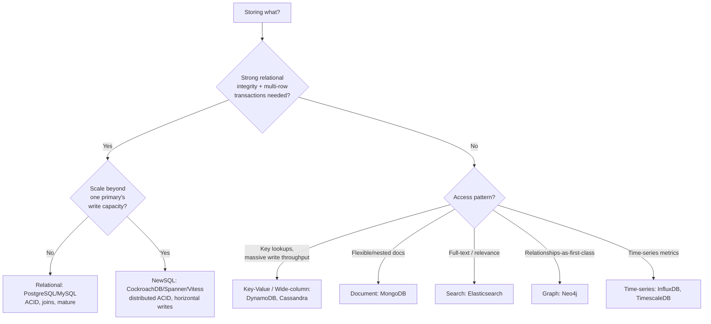

**Say it:** "Start relational — ACID, joins, and it scales further than people think with read replicas + partitioning. Only leave SQL when a *specific* pressure forces it: write throughput past one primary (→ Cassandra/DynamoDB), schema flexibility (→ document), or a query shape SQL is bad at (full-text → ES, traversals → graph)."

---

## 2. Consistency model

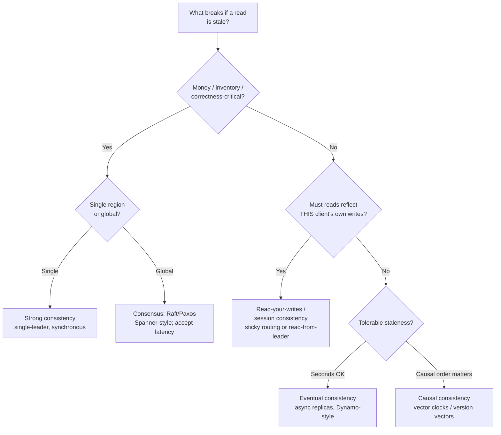

**Say it:** "Consistency is per-operation, not per-system. Checkout and balance reads need strong/linearizable; a like-count or feed can be eventually consistent. The common middle ground is session consistency — a user must see their own writes even if others see them a beat later."

---

## 3. Caching strategy (read path)

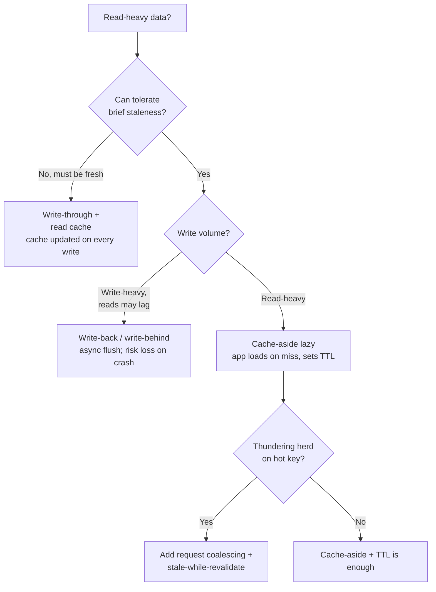

**Say it:** "Default cache-aside with a TTL — simplest, app controls it, cache failure just means a slower read not a wrong one. Add write-through only when staleness is unacceptable, and guard hot keys with request coalescing so a cache miss doesn't stampede the DB."

---

## 4. Push vs Pull (feeds, notifications, fan-out)

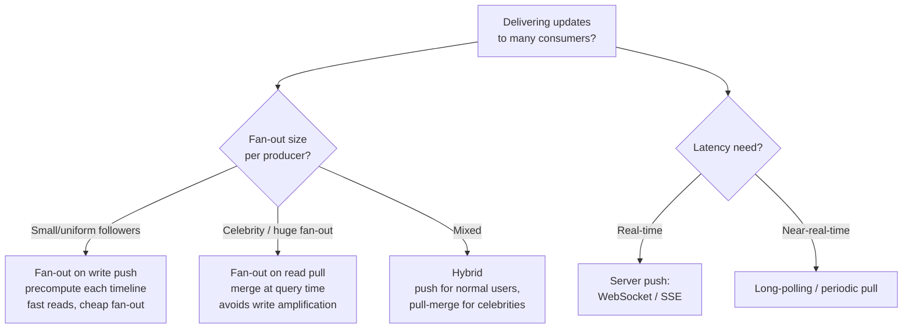

**Say it:** "Push (fan-out on write) makes reads O(1) but explodes for celebrities — one write becomes 100M inserts. So the real answer is hybrid: push for the median user, pull-and-merge for high-fan-out accounts, decided by a follower-count threshold."

---

## 5. Sync vs Async (request handling)

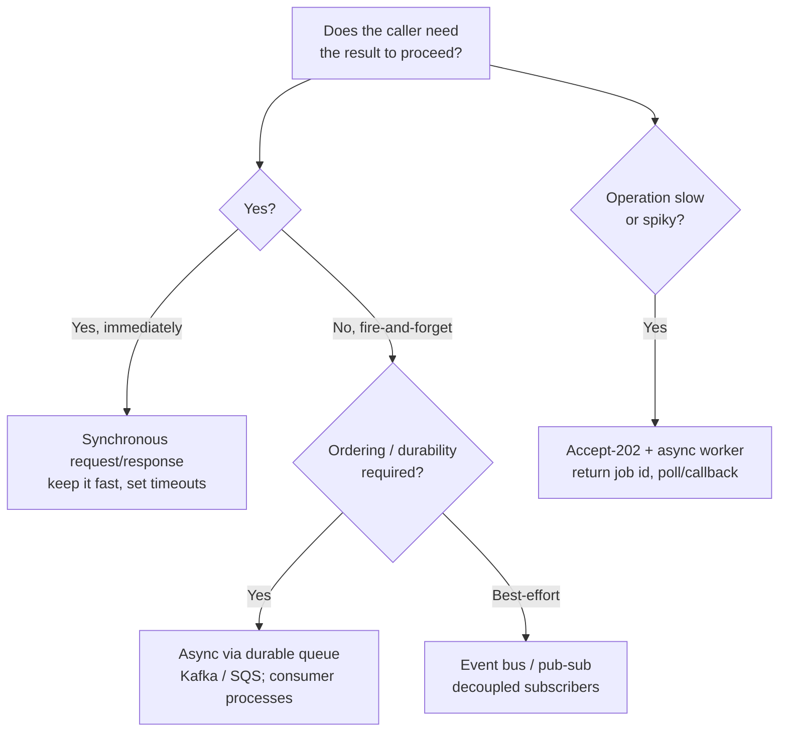

**Say it:** "If the user is blocked on the answer, sync. If it's slow (email, video encode, ML scoring) or spiky, return 202 Accepted with a job id and process on a durable queue — this decouples the burst from the workers and lets you retry."

---

## 6. Load balancing layer

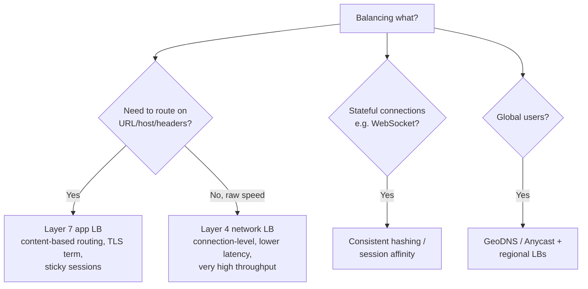

**Say it:** "L7 when I need to route by path/host or terminate TLS; L4 when I just need to spray connections at max throughput with minimal latency. Globally, GeoDNS or Anycast picks the nearest region, then a regional LB fans out."

---

## 7. Message delivery guarantee

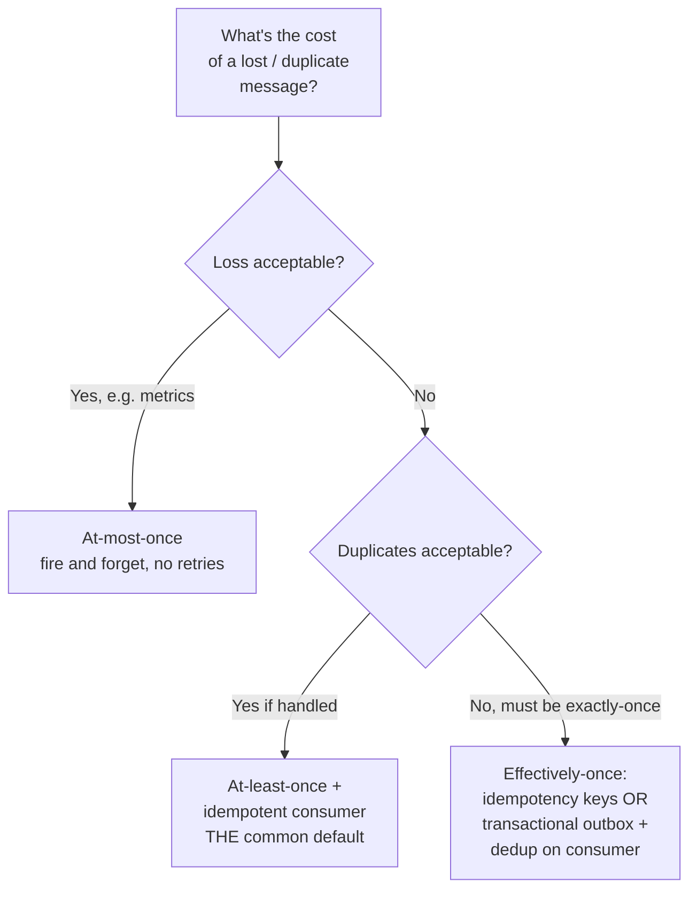

**Say it:** "There's no free exactly-once over a network. The practical answer is at-least-once delivery plus an idempotent consumer — dedup on a message/idempotency key — which *behaves* exactly-once. True transactional exactly-once (Kafka transactions) exists but costs throughput and scope."

---

## 8. Which partitioning / sharding key

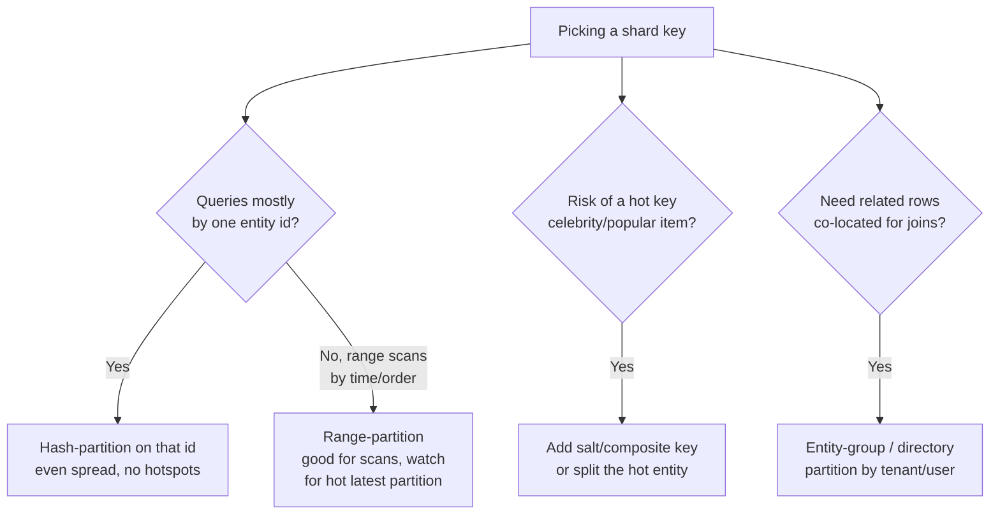

**Say it:** "Hash-partition on the id you filter by most — it spreads load evenly. Range-partitioning helps time-ordered scans but concentrates writes on the newest partition. The failure mode to preempt is a hot key: a celebrity or viral item, fixed by salting or splitting that entity."

---

## 9. Rate limiting algorithm

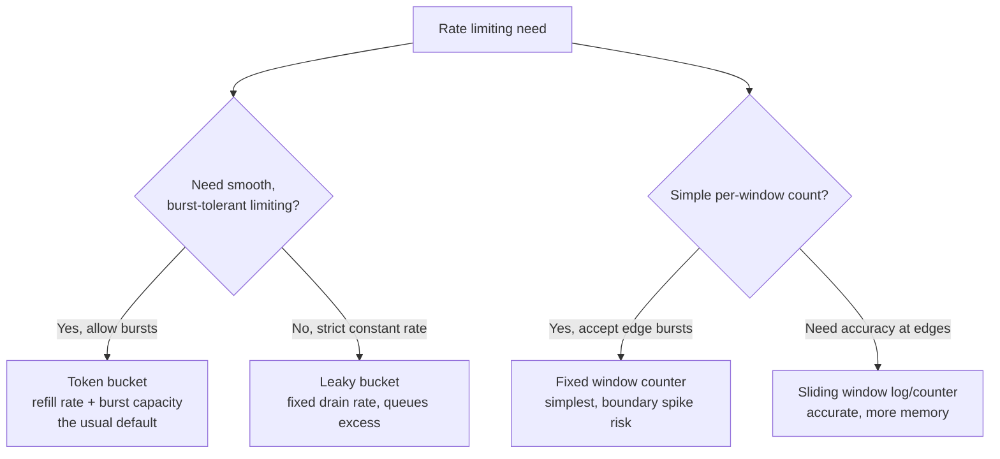

**Say it:** "Token bucket is the default — it enforces an average rate while permitting short bursts, which matches real traffic. Fixed-window is simplest but lets 2× the limit through at the window boundary; sliding window fixes that at the cost of more state."

---

## 10. Storage for a blob / file

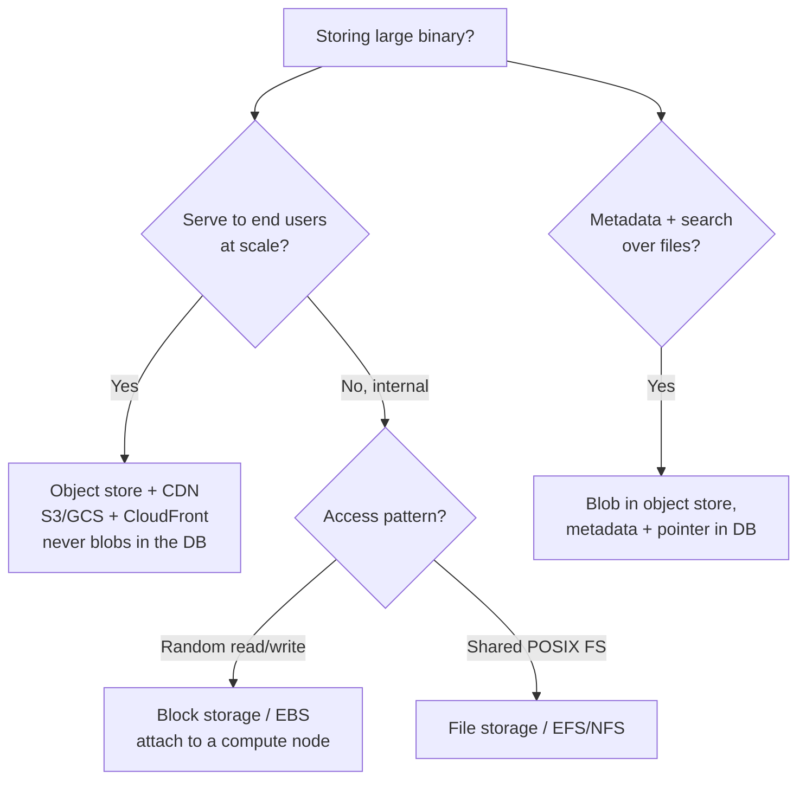

**Say it:** "Blobs go in object storage fronted by a CDN; the database holds only metadata and the object key. Putting large binaries in the DB bloats it, wrecks backups, and blows the cache — the classic anti-pattern."

---

## 11. Message broker / queue

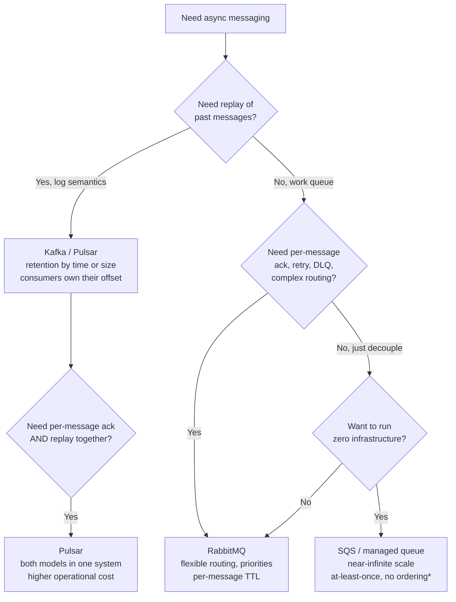

\* SQS FIFO queues give ordering and exactly-once processing, capped at 300 TPS per message group.

| | Kafka | RabbitMQ | SQS | Pulsar |
|---|---|---|---|---|
| Model | Distributed log | Broker/queue | Managed queue | Log + queue |
| Replay | Yes | No | No | Yes |
| Ordering | Per partition | Per queue | FIFO queues only | Per partition |
| Throughput | Very high | Moderate | High | Very high |
| Ops burden | High | Moderate | None | Highest |
| Best for | Event streaming, CDC | Task routing | Simple decoupling | Both, at cost |

**Say it:** "I'd use Kafka when consumers need to replay — event sourcing, CDC, or a new consumer that must read history. I'd use RabbitMQ or SQS for work queues where a message is consumed once and discarded. The deciding question isn't throughput, it's whether the message is an *event* others may re-read or a *task* someone performs once."

---

## 12. Search store

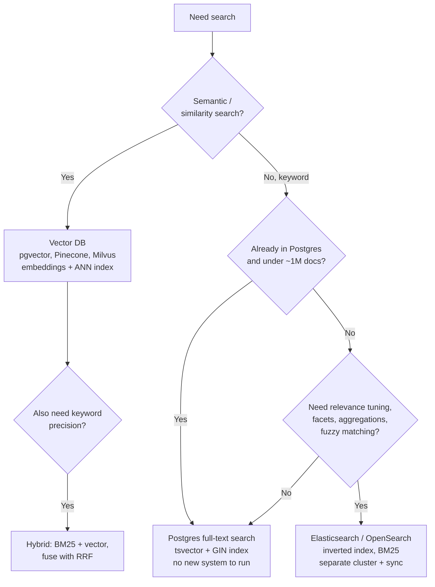

**Say it:** "I'd start with Postgres full-text search — it's free, transactional, and there's no sync lag. I'd move to Elasticsearch when I need relevance tuning, faceting, or fuzzy matching, and I'd accept the cost that comes with it: a second system, a CDC pipeline, and eventual consistency between the DB and the index. For semantic search I'd add vectors, and in practice hybrid retrieval beats either alone."

---

## 13. Distributed transaction strategy

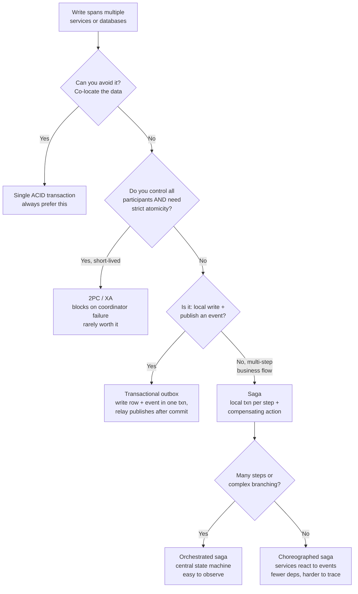

**Say it:** "First I'd try to make the transaction unnecessary by putting the data that must change together in one place. When I can't, I use the outbox pattern for the common case — write the row and the event in one local transaction so they can't diverge — and a saga for genuine multi-step flows, accepting that intermediate states are visible and every step needs a compensating action. I'd avoid 2PC: it holds locks across the network and blocks if the coordinator dies."

---

## 14. Stream vs batch processing

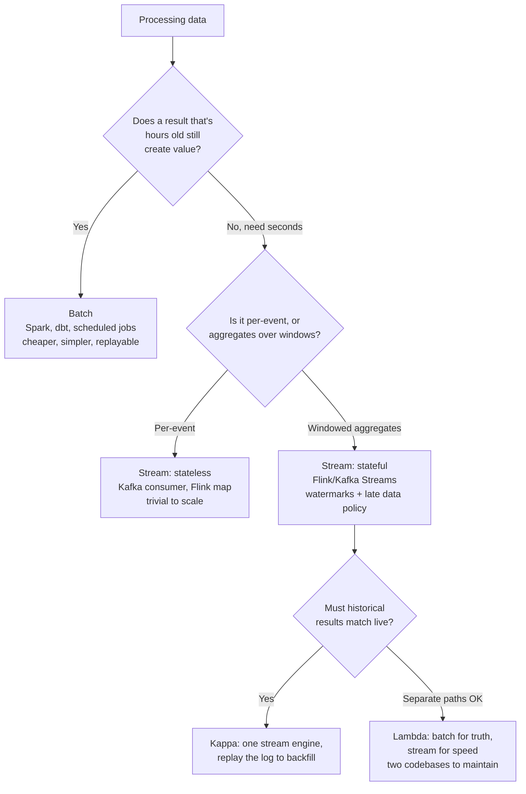

**Say it:** "The question I'd ask is what latency the business actually needs — batch is cheaper, easier to test, and trivially replayable, so I'd only pay for streaming when a result that's an hour old is worthless. If I do go streaming, I'd prefer a Kappa-style single pipeline and replay the log for backfills, because Lambda's two codebases inevitably drift and produce two different answers to the same question."

---

## 15. Monolith vs service split (where to draw the boundary)

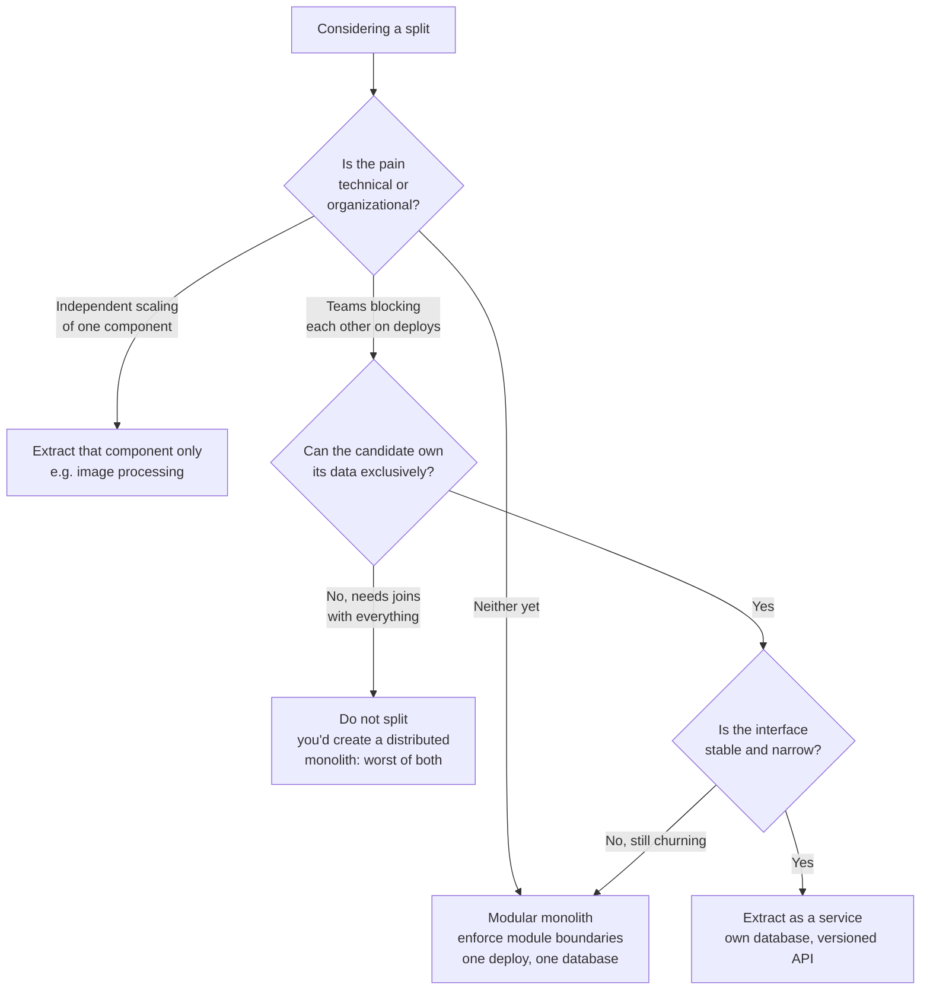

**Say it:** "I'd draw service boundaries around data ownership and team ownership, not around nouns. The test is whether the candidate service can own its data outright — if extracting it means chatty synchronous calls back for every join, I've built a distributed monolith and taken on network failure modes without gaining independence. I'd start as a modular monolith with enforced internal boundaries, because that makes the eventual extraction cheap while keeping deploys simple."

---

## 16. Multi-region topology

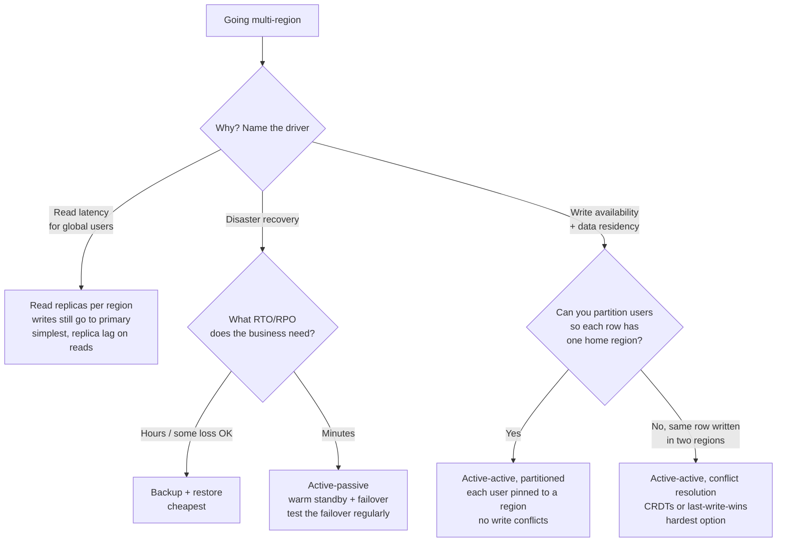

**Say it:** "I'd push hard on *why* before *how* — most 'multi-region' requirements are really read-latency requirements, and read replicas solve those at a fraction of the complexity. True active-active is only tractable when you can partition users so each record has a single home region that owns its writes. If the same row can be written in two regions at once, you've signed up for conflict resolution, and that's a business decision about which write wins, not a technical one."

---

## 17. Time-series storage

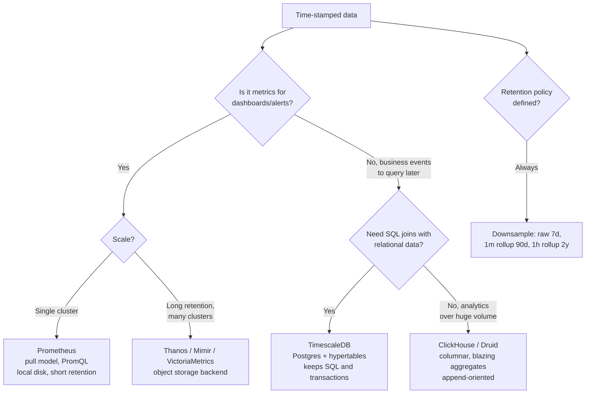

**Say it:** "Time-series data is append-heavy, queried by range, and almost never updated — which is why a columnar store with time partitioning beats a row store here. The design decision people forget is retention: I'd downsample aggressively, keeping raw data for days and rollups for years, because storing raw high-cardinality metrics forever is what actually blows the budget."

---

## 18. ID generation

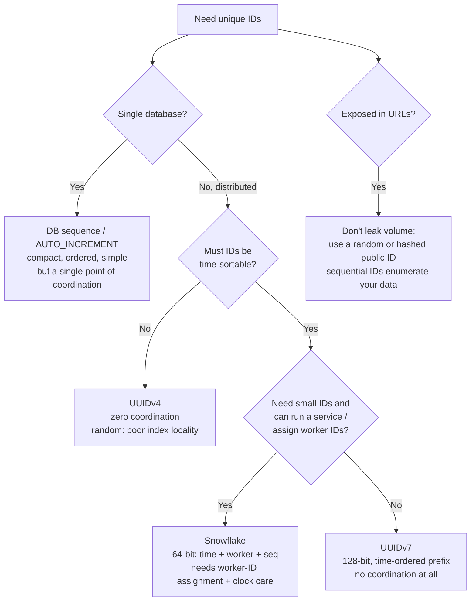

**Say it:** "My default in a distributed system is UUIDv7 — it needs no coordination and its time-ordered prefix keeps B-tree inserts local, which is exactly what UUIDv4 gets wrong: random IDs scatter writes across the index and destroy cache locality. I'd reach for Snowflake when 64 bits matters for index size at scale, accepting that I now have to assign worker IDs and handle clock skew. And I'd never expose a sequential ID publicly — it tells competitors my order volume and lets anyone enumerate my records."

---

## Related

- Concept-recall flowcharts for every topic: [../FLOWCHARTS.md](../FLOWCHARTS.md)
- The numbers behind these tradeoffs: [numbers-to-know.md](numbers-to-know.md)
- Cloud-service equivalents for each leaf: [cloud-services-cheat-sheet.md](cloud-services-cheat-sheet.md)
- How to roll out the choice you just made: [../04-advanced-topics/02-system-reliability/04-deployment-safety.md](../04-advanced-topics/02-system-reliability/04-deployment-safety.md)
- Bounding the damage when the choice is wrong: [../04-advanced-topics/02-system-reliability/05-blast-radius-isolation.md](../04-advanced-topics/02-system-reliability/05-blast-radius-isolation.md)
