# LLM System Design: A Production-Focused Guide

This book is a practical, production-grade guide to designing LLM systems — covering both the foundations and the applied case studies that senior engineers and architects encounter in the real world. It is written for engineers preparing for LLM system design interviews at top-tier companies and for practitioners building or scaling production LLM systems who need a structured framework for making defensible architectural decisions.

## How to Use This Book

Every chapter follows the same **5-step framework**:

1. **Context** — problem statement, real-world motivating examples, and a Quick Reference box with scale, key techniques, and cross-references.
2. **Step 1: Understand the Problem and Establish Design Scope** — simulated interviewer dialogue, functional and non-functional requirements, and back-of-the-envelope estimation.
3. **Step 2: Propose High-Level Design and Get Buy-In** — core architecture components, pipeline descriptions, and a Mermaid architecture diagram.
4. **Step 3: Design Deep Dive** — focused deep dives on the two or three hardest sub-problems, with trade-off tables and production failure modes.
5. **Step 4: Wrap Up / Step 5: Interviewer Curveballs** — final design summary, wrap-around concerns, and a structured FAQ with ideal answers and interviewer rubrics.

This structure mirrors a real system design interview. Readers preparing for interviews can use the simulated dialogues and FAQ sections as drill material. Practitioners building systems can use the trade-off tables, estimation templates, and architecture diagrams as design checklists.

## Book Structure

### Structure Overview

```mermaid
graph TD
    Root["LLM System Design"] --> P0["00-Reference-Guides"]
    Root --> P1["01-Foundations (Ch 1-5)"]
    Root --> P2["02-RAG-and-Search (Ch 6,7,11,12,15,17,21)"]
    Root --> P3["03-Agents-and-MCP (Ch 9,16,19,22,23)"]
    Root --> P4["04-Fine-Tuning-and-Prompting (Ch 8,10,25,26)"]
    Root --> P5["05-RealTime-and-Edge (Ch 14,18,31)"]
    Root --> P6["06-Regulated-and-Safety (Ch 13,20,30)"]
    Root --> P7["07-LLMOps-and-Optimization (Ch 24,27,28,29)"]

    style Root fill:#4f46e5,stroke:#312e81,stroke-width:2px,color:#ffffff
    style P0 fill:#64748b,stroke:#334155,stroke-width:1px,color:#ffffff
    style P1 fill:#0ea5e9,stroke:#0369a1,stroke-width:1px,color:#ffffff
    style P2 fill:#10b981,stroke:#047857,stroke-width:1px,color:#ffffff
    style P3 fill:#f59e0b,stroke:#b45309,stroke-width:1px,color:#ffffff
    style P4 fill:#8b5cf6,stroke:#6d28d9,stroke-width:1px,color:#ffffff
    style P5 fill:#ec4899,stroke:#be185d,stroke-width:1px,color:#ffffff
    style P6 fill:#ef4444,stroke:#b91c1c,stroke-width:1px,color:#ffffff
    style P7 fill:#14b8a6,stroke:#0f766e,stroke-width:1px,color:#ffffff
```

### 00-Reference-Guides
All quick-reference, cheat sheets, and interview prep materials, including the 30-day LLMOps sprint path, drill questions, mock interview templates, and ML coding patterns.

### 01-Foundations
The first five chapters establish the vocabulary, decision frameworks, and infrastructure components that every LLM system relies on.

### 02-RAG-and-Search
Retrieval-Augmented Generation, semantic search, multimodal asset search, and document extraction.

### 03-Agents-and-MCP
Autonomous agents, multi-agent orchestrators, tool use, and MCP-based integration platforms.

### 04-Fine-Tuning-and-Prompting
Model adaptation, prompt chaining, automated content generation, and deep customization.

### 05-RealTime-and-Edge
Streaming, voice-first agents, edge devices, and real-time processing.

### 06-Regulated-and-Safety-Critical
Healthcare, education, privacy, and compliance constraints.

### 07-LLMOps-and-Optimization
Lifecycle management, cost reduction, evaluation at scale, observability, and incident response.

## Chapter List

### 01-Foundations
- Chapter 1: A Framework for LLM System Design Interviews — A reusable 5-step interview response structure.
- Chapter 2: The LLM Stack and Core Patterns — Decision framework for choosing between prompt chaining, RAG, and agentic orchestration.
- Chapter 3: Data Pipelines and Vector Infrastructure — End-to-end ingestion, chunking, embedding, and hybrid retrieval design.
- Chapter 4: Serving, Scaling, and Optimizing LLMs — Multi-tier LLM serving infrastructure.
- Chapter 5: Evaluation, Guardrails, and Safety — Layered guardrail architecture.

### 02-RAG-and-Search
- Chapter 6: Design a Customer Support Chatbot — Intent classification, RAG-grounded responses.
- Chapter 7: Design an Enterprise Semantic Search Engine — Hybrid BM25 + dense retrieval at enterprise scale.
- Chapter 11: Design a Financial Document Extraction System — High-accuracy structured extraction.
- Chapter 12: Design a Personalized E-commerce Shopping Assistant — Real-time personalization with catalog retrieval.
- Chapter 15: Design a Multimodal Asset Search System — Cross-modal retrieval over images, video, and text.
- Chapter 17: Design a Legal Contract Review System — Clause extraction, risk identification.
- Chapter 21: Design an Advanced RAG Platform — Advanced retrieval pipelines.

### 03-Agents-and-MCP
- Chapter 9: Design an Autonomous Research Agent — Multi-step agentic planning with tool use.
- Chapter 16: Design an AI Data Analyst (Text-to-SQL and Insights) — Natural language to SQL translation.
- Chapter 19: Design an AI NPC Engine for Multiplayer Games — Real-time character dialogue generation.
- Chapter 22: Design a Multi-Agent Workflow Orchestrator — Agentic orchestration.
- Chapter 23: Design an MCP-Based Tool Integration Platform — Model Context Protocol architecture.

### 04-Fine-Tuning-and-Prompting
- Chapter 8: Design an AI Coding Assistant — Low-latency code completion.
- Chapter 10: Design an Automated Content Generation Pipeline — Batch and streaming content generation.
- Chapter 25: Prompt Engineering in Depth — Advanced prompting patterns.
- Chapter 26: Fine-Tuning and Adaptation — Model customization pipelines.

### 05-RealTime-and-Edge
- Chapter 14: Design a Real-Time Meeting Summarizer — Low-latency streaming transcription.
- Chapter 18: Design a Voice-First Real-Time Agent — End-to-end voice pipeline.
- Chapter 31: Edge and On-Device LLM Deployment — Running models on mobile/edge.

### 06-Regulated-and-Safety-Critical
- Chapter 13: Design an AI Tutor for Education — Adaptive instruction with safety controls.
- Chapter 20: Design a Healthcare Triage and Diagnostic Assistant — Strict compliance (HIPAA).
- Chapter 30: Privacy, Compliance, and Data Governance for LLM Systems — Audit trails and privacy constraints.

### 07-LLMOps-and-Optimization
- Chapter 24: LLMOps and Production Lifecycle Management — Full lifecycle LLMOps.
- Chapter 27: Evaluation at Scale — Offline and online metrics.
- Chapter 28: Cost Optimization as a Design Concern — Caching, routing, quantization.
- Chapter 29: Observability and Incident Response for LLM Systems — Tracing, span metrics, and debugging.