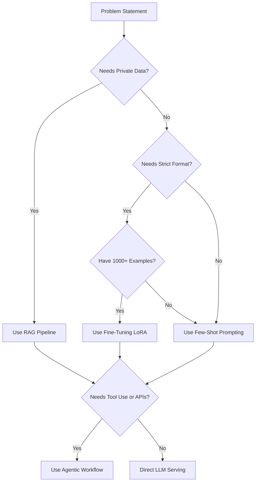

# LLM System Design Interview Cheat Sheet

> [!tip] Goal
> Drive the conversation, quantify your choices, explicitly state trade-offs, and anticipate failure modes. Always attach a "Why?" to every architectural decision.

---

## 1. The 5-Step Interview Framework

1.  **Understand the Problem & Establish Scope (5-10 mins)**
    *   **Ask clarifying questions:** Is this user-facing (interactive) or batch? Expected traffic (QPS)? Latency requirements (TTFT/TPOT)? Cost constraints?
    *   **Functional requirements:** "System must ingest PDFs, retrieve context, and generate an answer."
    *   **Non-functional requirements:** Latency (<2s p95 TTFT), Cost (<$0.01 per query), Freshness (index updated within 1h).
    *   **Back-of-the-Envelope (BotE):** Calculate expected data volume, token throughput, and rough GPU/Cost requirements.

2.  **High-Level Design & Buy-In (10 mins)**
    *   Propose core components (e.g., Client $\rightarrow$ API Gateway $\rightarrow$ Orchestrator $\rightarrow$ Retriever $\rightarrow$ LLM).
    *   Draw the data flow. *Check-in:* "Does this architecture look reasonable before we deep dive?"

3.  **Design Deep Dive (15-20 mins)**
    *   Pick 2-3 critical components (e.g., Retrieval Strategy, Cost Optimization, Guardrails).
    *   **Crucial:** Present 2-3 options per component, state trade-offs, and make a justified recommendation.

4.  **Wrap Up & Review (5 mins)**
    *   Summarize the final design. Address observability, cost tracking, and privacy (e.g., PII redaction).

5.  **Interviewer Curveballs (5-10 mins)**
    *   Anticipate failure modes: "What if the LLM hallucinates?", "What if traffic spikes 10x?", "What if the vector DB OOMs?"

---

## 2. Back-of-the-Envelope (BotE) Constants

Memorize these to quantify your designs instantly.

### LLM Sizing & Compute
*   **Token Ratio:** 1 Token $\approx$ 0.75 English words (or ~4 chars).
*   **VRAM per Billion Parameters:** $\approx$ 2 GB (in FP16/BF16).
*   **7B / 8B Model (BF16):** $\approx$ 14-16 GB VRAM $\rightarrow$ Fits on 1x A10G (24GB) or 1x L4 (24GB).
*   **70B Model (BF16):** $\approx$ 140 GB VRAM $\rightarrow$ Needs 2x A100 (80GB).
*   **KV Cache:** Grows linearly with batch size and context length. For a 70B model, 1 token $\approx$ 1MB cache per request.

### Latency Budgets
*   **Target TTFT (Time To First Token):** < 1.0s for interactive chat.
*   **Target TPOT (Time Per Output Token):** ~20-50ms (reading speed is ~5 tokens/sec = 200ms/token; generation must beat reading speed).

### Vector Database Sizing
*   **Embedding size:** Typically 768 or 1536 dimensions (float32 = 4 bytes per dim).
*   1536 dim $\times$ 4 bytes $\approx$ 6 KB per vector.
*   **1 Million vectors** $\approx$ 6 GB of RAM (Requires RAM to maintain fast ANN search).

---

## 3. Core Architectural Patterns

### Pattern 1: RAG (Retrieval-Augmented Generation)
*   **Use when:** The model needs access to private, real-time, or domain-specific data without retraining.
*   **Pipeline:** Query $\rightarrow$ Embedding $\rightarrow$ Vector DB Search $\rightarrow$ Reranker (Cross-Encoder) $\rightarrow$ Context Construction $\rightarrow$ LLM.
*   **Optimization:** **Hybrid Search** (Dense Vector + BM25 Keyword) is critical for exact SKU/ID matching.

### Pattern 2: Agentic Workflow / Multi-Agent Orchestration
*   **Use when:** Tasks require multi-step reasoning, external actions (API calls), or dynamic decision making.
*   **Pipeline:** Orchestrator (Supervisor) $\rightarrow$ Delegates to specialized worker agents (e.g., Code Execution, Web Search) $\rightarrow$ Verification.
*   **Mitigations:** Strict JSON schemas, execution timeouts, loop-detection budgets, and human-in-the-loop for destructive actions.

### Pattern 3: Fine-Tuning (LoRA / QLoRA)
*   **Use when:** RAG isn't enough. You need to enforce a specific output format, inject tone/style, or distill a large model into a smaller, cheaper one.
*   **Pipeline:** Curate dataset (1k-10k high-quality pairs) $\rightarrow$ Deduplicate (MinHash) $\rightarrow$ LoRA training $\rightarrow$ Eval on holdout.
*   **Serving Optimization:** **Adapter Multiplexing** (serve multiple LoRA adapters on a single frozen base model in GPU RAM, switching per request).

---

## 4. Architecture Decision Flowchart

When the interviewer asks "How would you solve this?", trace through this logic tree before proposing an architecture:

---

## 5. Cost Optimization Cascade

Top-tier candidates don't just say "use a smaller model." They design a multi-layer cost optimization pipeline:

1.  **Semantic Cache:** (Hits $\sim$40% of queries). Cosine similarity threshold $\approx$ 0.92. *Cost: Zero token generation.*
2.  **Routing Classifier:** (Small ML model, e.g., MiniLM). Routes simple queries to a cheap 8B model, complex queries to the 70B/Frontier model.
3.  **Prompt Compression:** (e.g., LLMLingua). Drops low-information tokens from long retrieval contexts on cache misses.
4.  **Continuous Batching & Speculative Decoding:** For self-hosted models, maximizes GPU throughput and minimizes latency.

---

## 6. Evaluation, Guardrails, & Compliance

### Evaluation Strategies
*   **Offline:** LLM-as-a-Judge (using GPT-4/Claude to score outputs based on a rubric), RAG metrics (Recall@K for retrieval, Faithfulness for generation).
*   **Online:** User thumbs up/down, implicit feedback (did they copy the code?), A/B testing with shadow deployments.

### Safety Guardrails
*   **Input Stage:** Prompt injection classifiers, PII redaction (NER + Regex *before* the LLM sees the prompt).
*   **Output Stage:** Deterministic checks (e.g., Regex for valid JSON, blocked-word lists), secondary LLM check for hallucination or toxicity.

### Alignment Methods (The "Why")
*   **SFT (Supervised Fine-Tuning):** Best for format/schema adherence.
*   **DPO (Direct Preference Optimization):** Best for production alignment tuning. Cheaper and more stable than RLHF. Requires 2 GPU model copies.
*   **RLHF (Reinforcement Learning from Human Feedback):** Best for frontier models needing to explore novel response distributions. High infrastructure cost.

---

## 7. Critical Failure Modes & Mitigations

| Failure Mode | Mitigation Strategy |
| :--- | :--- |
| **Hallucinations** | Grounding with RAG, lower temperature, prompt engineering (Chain-of-Thought, "say I don't know if context is missing"), self-correction loops. |
| **Prompt Injection** | Input classification (guardrail models), strict role prompting, sandboxing tools (MCP). |
| **High Latency (TTFT)** | Semantic caching, smaller models, speculative decoding, continuous batching (vLLM/TGI). |
| **GPU OOM (Out of Memory)** | Quantization (INT8/INT4), limit max context length, KV cache paging (PagedAttention). |
| **Stale RAG Context** | Document lifecycle management: event-driven index updates, soft-deletes in vector DB. |

## 8. The "Why?" Rule
In your interview, never just state a technology choice. Always attach a "Why" clause.
*   *Weak:* "I will use a 7B model."
*   *Strong:* "I will route simple classification queries to an 8B model instead of GPT-4 because it reduces our cost-per-token by 20x while maintaining 95% accuracy on this specific task, reserving the expensive frontier model only for complex reasoning."
