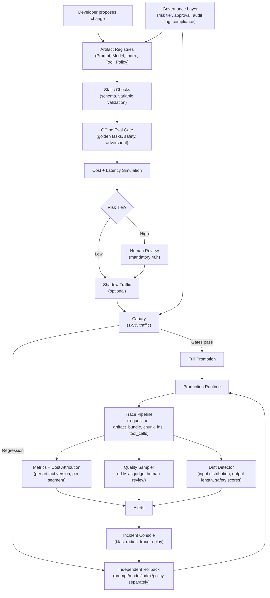

# LLMOps Fast-Learning Path

> [!important] How to Use This File
> This is your **entry point** if you want to learn LLMOps as fast as possible.
> It tells you **exactly which chapters to read, which sections to skip, and in what order**.
> Total time investment: **5–6 hours** to reach production-ready LLMOps knowledge.

---

## What is LLMOps?

LLMOps = operational lifecycle management for LLM systems. It extends MLOps by treating **prompts, retrieval indexes, tool schemas, guardrail policies, and provider versions** as first-class behavior-changing artifacts — not just model checkpoints. A prompt edit with no code change can regress quality, spike cost, or violate safety policy.

**Core concerns:**
- How do you ship a prompt change safely?
- How do you know when a model upgrade breaks production quality?
- How do you attribute a cost spike to the artifact that caused it?
- How do you reproduce a specific response 7 months later for a regulator?
- How do you roll back just the prompt without touching the model or index?

---

## LLMOps Lifecycle (Full Picture)



---

## The 5-Day Learning Sprint (~5.5 hours total)

### Day 1 — Framework + Stack + Patterns (90 min)

| File | What to Read | What to Skip |
|---|---|---|
| cheat-sheet.md | **All of it** (20 min) — your vocabulary anchor | Nothing |
| Chapter 1 | Functional + Non-Functional Requirements, BotE estimation, Trade-off tables | Simulated Dialogue, Step 4 Wrap Up |
| Chapter 2 | Core Patterns section, Architecture Diagram, Trade-off table | BotE arithmetic, Simulated Dialogue |

**Day 1 outcome:** You understand the 5-step framework, pattern decision tree (RAG vs. prompt chain vs. agentic), and key estimation constants.

---

### Day 2 — Data, Serving, and Safety Infrastructure (90 min)

| File | What to Read | What to Skip |
|---|---|---|
| Chapter 3 | Chunking strategies, Hybrid retrieval (BM25 + dense), ACL enforcement, Index lifecycle | BotE calculations |
| Chapter 4 | Continuous batching, KV cache + PagedAttention, quantization trade-off table | Low-level GPU math |
| Chapter 5 | Layered guardrail architecture, LLM-as-Judge pipeline, red-teaming | Simulated Dialogue |

**Day 2 outcome:** You understand how retrieval indexes work (and fail), how models are served at scale, and how the evaluation + safety layer operates.

---

### Day 3 — LLMOps Core (The Most Important Day) (90 min)

**Read Chapter 24 — ALL of it.** This is the entire point.

Focus areas within Ch 24:
1. **Artifact versioning table** — the 6 artifact types and why each must be versioned independently
2. **Evaluation gates table** — Low vs. High risk tier thresholds
3. **Artifact Bundle JSON** — the minimum unit of reproducibility
4. **Trace field spec** — what every production trace must contain
5. **Incident workflow (7 steps)** — blast radius → rollback → replay → postmortem
6. **Advanced techniques** — trace replay, counterfactual eval, synthetic regression generation, segment-level monitoring, policy simulation

**Day 3 outcome:** You understand the full LLMOps lifecycle end-to-end.

---

### Day 4 — Eval, Cost, and Observability at Scale (60 min)

| File | What to Read | What to Skip |
|---|---|---|
| Chapter 27 | Eval pipeline architecture, LLM-as-judge calibration, CI/CD gate integration, drift detection | Benchmark-specific sections |
| Chapter 28 | Semantic caching architecture, model cascade/routing, cost attribution by artifact version | GPU right-sizing math |
| Chapter 29 | Distributed tracing design, SLO burn-rate alerting, incident runbooks, PII-safe logging | Full postmortem templates |

**Day 4 outcome:** You can design a complete observability + eval + cost-control system.

---

### Day 5 — Compliance, Review, and Drilling (60 min)

| File | What to Read | What to Skip |
|---|---|---|
| Chapter 30 | PII detection + de-identification pipeline, GDPR/HIPAA controls, audit log design, right-to-deletion | Country-specific legal details |
| cheat-sheet.md | Re-read fully, quiz yourself on each section | — |
| mind-map.md | Mermaid diagrams only (scan in 15 min) | Prose descriptions (redundant with chapters) |

**Day 5 outcome:** You understand compliance requirements and can reproduce the full LLMOps mental model from memory.

---

## Key Concepts Per Chapter (LLMOps Lens)

| Chapter | LLMOps-Specific Value | Skip If... |
|---|---|---|
| Ch 1 | BotE estimation templates; cost-latency-safety trade-off framework | Already know how to estimate token costs and GPU counts |
| Ch 2 | Pattern routing decision tree; model tiering; provider failover | Already know RAG vs. agentic distinction |
| Ch 3 | Index lifecycle (freshness, rebuild triggers); ACL in retrieval | Not building a retrieval system |
| Ch 4 | Continuous batching; KV cache paging; quantization cost/quality | Only using managed APIs (no self-hosted serving) |
| Ch 5 | Guardrail architecture; LLM-as-judge calibration; red-team integration | — Never skip for LLMOps |
| **Ch 24** | **Full LLMOps lifecycle** | — Never skip |
| Ch 27 | Automated eval pipeline; drift detection; CI/CD gate design | — Never skip |
| Ch 28 | Cost attribution per artifact version; semantic cache design | — Never skip |
| Ch 29 | Distributed tracing for LLM; SLO alerting; incident runbooks | — Never skip |
| Ch 30 | PII de-identification pipeline; audit log design; GDPR delete flows | Not working in a regulated domain |
| Ch 25 | Prompt versioning, A/B testing, injection defense | Already covered in Ch 24 at sufficient depth |
| Ch 26 | Adapter multiplexing, continual learning | Only relevant if running fine-tuned models in production |
| Ch 31 | Edge quantization, on-device runtimes | Only if deploying on-device — skip otherwise |
| Ch 6–23 | Domain-specific case studies | Read only if you need a domain example: Ch 6, Ch 20, Ch 11 |

---

## Anti-Pattern Quick Reference

| Anti-Pattern | Root Cause | Prevention |
|---|---|---|
| **Silent quality regression after prompt edit** | No eval gate on prompt changes | Prompt registry + mandatory offline eval before any merge |
| **Audit cannot reproduce a historical response** | No artifact bundle stored with trace | Store prompt_version + model_version + index_version + chunk_ids per request |
| **Cost spike from prompt change** | No per-version cost attribution | Tag every trace with artifact versions at ingest |
| **Benchmark improvement != production improvement** | Different distributions | Maintain private golden set from real production queries |
| **LLM-as-judge drift** | Judge model changes over time | Track judge-human Cohen's kappa quarterly; re-calibrate |
| **Prompt sprawl** | No ownership or deprecation policy | Require owner_email + changelog + deprecation_date on every registration |
| **Coupled rollbacks compound incidents** | Artifacts versioned together | Every artifact type must be independently revertible |
| **Guardrail threshold change causes policy regression** | No pre-deployment simulation | Run policy simulation against historical traffic before deploying new thresholds |
| **Segment regression hidden by global average** | Only monitoring aggregate metrics | Break down metrics by language, tenant tier, query intent, document type |
| **Model upgrade fails silently under provider alias** | Provider changes model under moving alias | Pin versioned endpoints; monitor for provider-side drift with canary probes |
| **Eval suite too slow → teams bypass it** | All changes trigger exhaustive eval | Tier evals: smoke (60s), standard, exhaustive — scope by risk tier |

---

## Consolidated LLMOps Decision Tables

### Artifact Versioning — What to Track

| Artifact | Version Fields | Risk of Missing |
|---|---|---|
| Prompt | SHA-256 of template bytes, few-shot set ID, variable schema | Single word change can shift task-success by 5–15% |
| Model | Provider ID, model name, snapshot date, adapter checkpoint hash, tokenizer version | Same name at different dates = different alignment and context window |
| Retrieval Index | Source snapshot timestamp, embedding model ID, chunking strategy, ACL revision | Stale index silently serves outdated facts |
| Tool Schema | Name, argument types, permissions, endpoint version, implementation hash | Schema rename can shift tool-call success by 10–20% |
| Guardrail Policy | Policy rule set hash, threshold values, classifier model version | Threshold change can allow harmful outputs through |
| Inference Config | Temperature, max_tokens, top-p, frequency_penalty, stop sequences | Temperature alone shifts benchmark pass rates by 3–8% |

---

### Eval Gate Thresholds — Risk-Tiered

| Gate | Low Risk | High Risk |
|---|---|---|
| Task success rate | >= 80% | >= 92% |
| Policy violation rate | <= 0.5% | <= 0.1% |
| Cost delta | <= 10% increase | <= 2% increase |
| p95 TTFT | <= 3000ms | <= 2000ms |
| Unsupported claim rate | <= 10% | <= 2% |
| Human review | Optional | Mandatory (2+ reviewers, 50+ outputs) |
| Shadow traffic | Optional | Required (min 24h or 100K requests) |
| Canary | 5%, auto-promote after 1h | 1%, manual-only after 48h |

---

### Cost Optimization Cascade

1. **Semantic Cache** (~40% hit rate, cosine similarity >= 0.92) → zero token cost
2. **Routing Classifier** (small MiniLM) → route simple queries to 8B model (20x cheaper)
3. **Prompt Compression** (LLMLingua) → drop low-information tokens from long contexts
4. **Continuous Batching + Speculative Decoding** → maximize GPU throughput on self-hosted models

---

### Minimum Viable Audit Trace

Every production request must store:

```json
{
  "request_id": "globally-unique-join-key",
  "user_id": "...", "tenant_id": "...",
  "artifact_bundle": {
    "prompt_version": "support.v42",
    "model_version": "provider/model-2026-05-01",
    "index_version": "kb_2026_05_29_0800",
    "tool_schema_versions": {"crm.lookup": "v7"},
    "guardrail_policy": "support_policy.v18",
    "inference_config": {"temperature": 0.2, "max_output_tokens": 500}
  },
  "retrieved_chunk_ids": ["c1", "c7", "c12"],
  "tool_calls": [{"tool": "refund.lookup", "args": {}, "result": {}, "status": "success"}],
  "guardrail_decisions": [{"rule": "pii_check", "decision": "allowed"}],
  "output_hash": "sha256:...",
  "latency_ms": {"retrieval": 120, "ttft": 840, "total": 2200},
  "cost_usd": 0.018,
  "timestamp_utc": "2026-05-29T08:00:00Z"
}
```

**What you lose if you omit each field:**
- No `retrieved_chunk_ids` → cannot reconstruct what the model knew
- No `tool_calls` → cannot explain agent behavior
- No `output_hash` → cannot prove stored response matches what was delivered
- No `artifact_bundle` → cannot attribute regression to specific artifact
- No `tenant_id` → cannot assess blast radius per customer

---

## Files to Skip for LLMOps (Keep the Folder Lean)

| File | Decision | Reason |
|---|---|---|
| `glossary.md` | **Use as dictionary only** (Ctrl+F) | 779 lines of A–Z definitions; don't read sequentially |
| `mind-map.md` | **Scan Mermaid diagrams only** | Prose duplicates README; diagrams are useful |
| Ch 6–23 (all case studies) | **Skip unless domain-specific** | LLMOps concepts are directly in Ch 24, 27–29 |
| Ch 25 | **Targeted sections only** | Prompt pattern taxonomy not needed for ops knowledge |
| Ch 26 | **Adapter Multiplexing + Continual Learning only** | LoRA training mechanics are pre-production |
| Ch 31 | **Skip entirely** unless on-device is your use case | Not relevant to core LLMOps production concerns |

---

## Interview Cheat Codes

**Q: "How do you safely deploy a prompt change in production?"**
> Registry → immutable version → offline eval (golden tasks + safety) → cost simulation → shadow mode → canary (1–5%) → promotion only if quality, safety, cost, and latency gates pass → independent rollback available at every stage.

**Q: "What's the difference between LLMOps and MLOps?"**
> MLOps versions model checkpoints. LLMOps versions prompts, retrieval indexes, tool schemas, guardrail policies, and inference configs — each changes behavior without model training. Regression detection is statistical (not deterministic) because LLM outputs are non-deterministic.

**Q: "A model upgrade passes benchmarks but worsens production quality. What do you do?"**
> Pause the canary. Run domain-specific evals on production query distribution. Segment failures by language, intent, context length. Gate promotion on domain task-success rate and product analytics, not benchmark delta.

**Q: "What's the minimum trace needed for auditability?"**
> Request ID, full artifact bundle (all 6 artifact types), retrieved chunk IDs (full candidate set), tool call args + results, guardrail decisions, output hash, per-stage latency, cost in USD, UTC timestamp. Stored in append-only tamper-evident store. Retention = regulatory requirement (e.g., 7 years for financial services).
