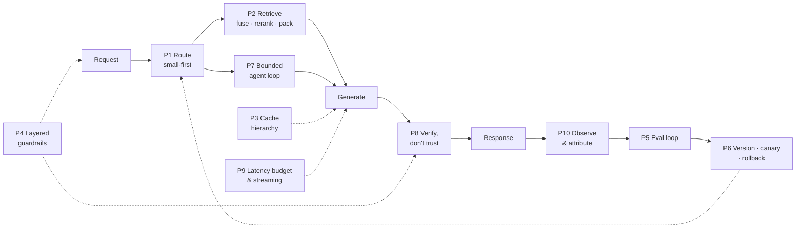

# The 10 Patterns

Every chapter is **3–5 of these patterns, tuned for one domain**. Learn the 10 patterns and you've already learned most of the book. When you read a chapter, ask yourself: *which patterns is it using, and what did it tune?*

---

## P1 — Route small-first
**Idea:** A cheap classifier (<10ms) sends each request to the cheapest path that can handle it: FAQ or cache, then a small model, then a frontier model, then a human.
**Why:** 70–80% of traffic is easy. Routing cuts cost 50–70%.
**Watch out:** The router itself drifts. Calibrate it on shadow traffic and fall back to the bigger model when confidence is low.
**Seen in:** Ch 2, 4, 6, 8, 19, 28, 31

## P2 — Retrieve → fuse → filter → rerank → pack
**Idea:** Run BM25 and dense retrieval in parallel. Merge them with RRF (k=60). Apply the ACL filter, then a cross-encoder rerank of the top ~50 down to the top 3–10. Then pack the context with stable citation IDs.
**Why:** BM25 catches exact IDs and rare terms. Dense catches paraphrases. The reranker fixes precision.
**Watch out:** Filter on ACL **before** reranking, never after generation. Chunking decides your recall ceiling.
**Seen in:** Ch 3, 6, 7, 12, 15, 16 (schema retrieval), 21

## P3 — Cache hierarchy
**Idea:** Exact cache, then semantic cache (cosine ~0.92), then prefix/KV cache, then embedding cache.
**Why:** The cheapest token is the one you never generate.
**Watch out:** Never semantically cache user-specific answers. Tag every entry with model/prompt version so you can invalidate it.
**Seen in:** Ch 2, 4, 8, 28 (+ [[N3 - Context Engineering and Prompt Caching]])

## P4 — Layered, risk-tiered guardrails
**Idea:** Input guard (injection, PII, topic) runs in parallel, then a risk-tier router, then the model, then the output guard (groundedness, PII, policy). How deep the checks go depends on the risk tier.
**Why:** No single layer catches everything. Stacking layers multiplies their catch rates.
**Watch out:** Latency. Run checks in parallel, use small classifiers, and do output checks async on low-risk routes.
**Seen in:** Ch 5, 13, 19, 20, 23, 30

## P5 — Eval loop
**Idea:** An offline golden set gates each release. An LLM judge scores 1–5% of online traffic. Red-team on a schedule. Calibrate the judge against humans (kappa ≥ 0.7).
**Why:** You can't unit-test a distribution. Regression is a statistical question.
**Watch out:** A judge that drifts, benchmarks that are contaminated, global averages that hide a segment regressing.
**Seen in:** Ch 5, 10, 24, 27 (+ [[N8 - Evaluating Agents]])

## P6 — Version everything, roll out progressively, roll back independently
**Idea:** Prompt, model, index, tool schema and policy are each a content-addressed artifact. Roll out shadow → canary 1–5% → full. Use a blue-green alias swap for indexes.
**Why:** Behavior changes without a code deploy. "Same name, different bytes" causes incidents you can't reproduce.
**Watch out:** Coupled rollbacks, where reverting the model also reverts a prompt fix.
**Seen in:** Ch 3, 10, 24, 25, 26, 28

## P7 — Bounded agent loop
**Idea:** Plan first, then run ReAct per step. Budgets (tokens, steps, cost, wall-clock) are enforced **structurally**, not by asking in the prompt. Add loop detection. Workers hand off typed artifacts. Code runs in a sandbox. Approval gates are keyed to **reversibility**.
**Why:** Agents fail by looping, drifting, and burning money, not by crashing.
**Watch out:** Every tool is an attack surface ([[N7 - Agent Security and the Lethal Trifecta]]).
**Seen in:** Ch 9, 16, 22, 23 (+ [[N6 - Agent Architecture 2026]])

## P8 — Verify, don't trust
**Idea:** Constrain the output to a schema, then check it deterministically: arithmetic, citation string match, SQL AST, closed code lists. On failure, repair based on the error class instead of blindly retrying.
**Why:** "The LLM advises, the deterministic system decides."
**Watch out:** Verification adds latency, so tier it by risk.
**Seen in:** Ch 11, 16, 17, 20, 21, 25

## P9 — Latency budget per stage + stream + degrade
**Idea:** Break the SLO into a millisecond budget for each stage. Stream everything on the critical path. Always have a fallback.
**Why:** Users feel TTFT, not total time.
**Watch out:** Tail latency adds up across stages. Budget for p95, not the mean.
**Seen in:** Ch 4, 8, 14, 18, 21, 31

## P10 — Observe and attribute at write time
**Idea:** Use OpenTelemetry spans for each stage (retrieval, rerank, generation, tool, guardrail). Tag cost at ingestion. Break metrics down by segment. Alert on SLO burn rate.
**Why:** The main failure mode is **silent degradation**. Separate spans tell you whether bad chunks were retrieved or good chunks were badly synthesized.
**Watch out:** Broken trace propagation across queues. Logging costs and PII.
**Seen in:** Ch 24, 28, 29 (+ [[N10 - AI Gateway, Structured Outputs, and Programmatic Prompting]])

---

## Chapter × Pattern grid

| Ch | Topic | P1 | P2 | P3 | P4 | P5 | P6 | P7 | P8 | P9 | P10 |
|---|---|---|---|---|---|---|---|---|---|---|---|
| 1 | Framework | · | · | · | · | · | · | · | · | · | · |
| 2 | Stack & patterns | ● | ● | ● | ● | | | ● | | | ● |
| 3 | Data & vectors | | ● | | | | ● | | | | |
| 4 | Serving | ● | | ● | | | | | | ● | |
| 5 | Eval & guardrails | | | | ● | ● | | | ● | | |
| 6 | Support bot | ● | ● | | ● | | | | | | |
| 7 | Enterprise search | | ● | | ● | | ● | | | ● | |
| 8 | Coding assistant | ● | ● | ● | | | | | | ● | |
| 9 | Research agent | | ● | | | | | ● | ● | | |
| 10 | Content pipeline | | | | ● | ● | ● | | ● | | |
| 11 | Financial extraction | | | | | | | | ● | | |
| 12 | Shopping assistant | ● | ● | | | | | | | ● | |
| 13 | AI tutor | | | | ● | | | | ● | | |
| 14 | Meeting summarizer | | | | | | | | | ● | |
| 15 | Multimodal search | | ● | | | | | | | ● | |
| 16 | Text-to-SQL | | ● | | ● | | | ● | ● | | |
| 17 | Legal review | | ● | | | | | | ● | | |
| 18 | Voice agent | ● | | | ● | | | | | ● | |
| 19 | NPC engine | ● | ● | ● | ● | | | | | ● | |
| 20 | Healthcare triage | | | | ● | | | | ● | | ● |
| 21 | Advanced RAG | ● | ● | | | ● | | | ● | ● | |
| 22 | Multi-agent | | | | ● | | | ● | ● | | ● |
| 23 | MCP platform | | | | ● | | | ● | | | ● |
| 24 | LLMOps | | | | | ● | ● | | | | ● |
| 25 | Prompt engineering | | ● | | ● | ● | ● | | ● | | |
| 26 | Fine-tuning | | | | | ● | ● | | | | |
| 27 | Eval at scale | | | | | ● | ● | | | | |
| 28 | Cost | ● | | ● | | | ● | | | | ● |
| 29 | Observability | | | | | | | | | | ● |
| 30 | Privacy | | ● | | ● | | | | | | ● |
| 31 | Edge | ● | | | | | ● | | | ● | |

Ch 1 is the meta-framework that wraps all of the patterns.

## The one sentence to remember
> **Route cheaply, retrieve hybrid, bound the agent, verify deterministically, and observe everything, because LLM systems fail silently.**
