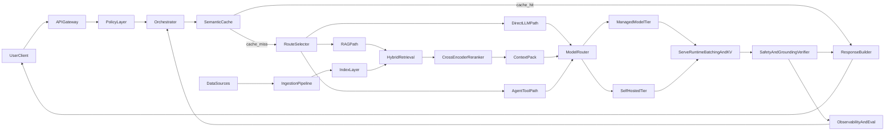

# Chapter 1: A Framework for LLM System Design Interviews

## Context

> [!info] Quick Reference
> - **Pattern:** Interview Framework
> - **Scale:** 1.5M DAU, 18M requests/day
> - **Key Techniques:** 5-step framework, back-of-envelope estimation, trade-off tables
> - **Primary Concerns:** Scope discipline, cost-latency-safety balance, rollback design
> - **Cross-references:** Chapter 2 (pattern selection), Chapter 3 (retrieval), Chapter 5 (safety)

**Problem statement:** Build a repeatable framework for answering any LLM system design interview question with production-grade technical depth in 40-45 minutes.

### Real-World Examples

- A fintech team designs an internal LLM assistant and must justify why RAG is safer than fine-tuning for policy updates every week. Because compliance policies change frequently, fine-tuning would require a new training run and deployment cycle for every update — a process taking days to weeks. RAG allows new policy documents to be indexed in minutes and immediately reflected in answers, with a clear audit trail of which document version grounded each response.
- A healthcare startup interview asks for a triage bot design where abstention and escalation logic matter more than fluent prose. In clinical settings, a confident but wrong answer is far more dangerous than a clearly-stated "I don't know." The design must include calibrated confidence thresholds, explicit escalation paths to human reviewers, and audit logs sufficient to satisfy HIPAA and clinical liability requirements — none of which are addressed by optimizing generation quality alone.

---

## Step 1: Understand the Problem and Establish Design Scope

### Functional Requirements

- Provide a reusable **5-step response structure** for any LLM system design prompt. Without a repeatable skeleton, interview answers tend to drift into feature lists rather than defensible architecture; the 5-step structure forces scoping before architecture, estimation before component selection, and trade-off justification before deep dives.
- Force explicit design choices for **retrieval**, **model routing**, and **safety controls**. These three areas are where LLM system design diverges most sharply from classical distributed-systems design; leaving them implicit signals that the candidate has not operated such systems in production.
- Include concrete fallback paths for low-confidence, high-risk, and degraded-runtime states. Production LLM systems fail partially — a retrieval tier may degrade while the model tier stays healthy; safety controls must account for all partial-failure combinations, not just the happy path.
- Produce outputs that are implementable and measurable, not conceptual only. An answer that says "add caching" without specifying cache key strategy, TTL policy, invalidation trigger, and hit-rate target is not actionable; every design choice must be tied to a metric that signals whether it is working.

### Non-Functional Requirements

- **Interview execution:** reach credible high-level design in <= 10 minutes. This forces prioritization: spend the first 5 minutes on scoping and estimation, then use the next 5 to sketch the end-to-end pipeline with named components. If you spend more than 10 minutes before getting explicit buy-in from the interviewer, you risk spending the bulk of your time on the wrong sub-problem.
- **Latency discipline:** include **TTFT** and **TPOT** budgets, not just total latency. Time-to-first-token governs perceived responsiveness in streaming interfaces, while tokens-per-output-token governs reading throughput for long responses; optimizing only total latency can mask a terrible user experience where the first character arrives after 3 seconds even though the full response completes at 5 seconds.
- **Cost visibility:** show token economics and serving cost envelope. Token pricing differs 5–10x between input and output for most managed models, and between model tiers; failing to separate these and project daily cost at realistic traffic means the design cannot be evaluated for economic viability.
- **Scalability:** demonstrate burst handling and bottleneck containment. LLM workloads have sharp daily and event-driven traffic peaks — a 12x peak multiplier is common in consumer products — and the system must identify which component saturates first (GPU queue, retrieval IOPS, connection pool) and show how it is isolated from cascading failure.
- **Safety and compliance:** include guardrails, auditability, and deterministic escalation. Guardrails alone are insufficient without an audit-complete trace of inputs, retrieved context, model outputs, and policy decisions; regulators and incident responders need a full causal chain, and the escalation path must be deterministic rather than model-generated to avoid loops.

### Back-of-the-Envelope Estimation

Assume a representative production assistant:

- **DAU:** 1.5M
- **Requests/day:** 18M
- **Average input tokens:** 1,600
- **Average output tokens:** 280
- **RAG usage:** 65%
- **Peak multiplier:** 12x avg traffic

#### Throughput

- Peak QPS: `~2,500`
- Target capacity planning: `3,000-3,500 QPS` (peak + failover margin)

#### Token Volume and API Cost

- Cost/day formula:

#### Latency Budget (Interactive Path)

- Gateway + auth: 80ms
- Retrieval + rerank: 250ms
- Scheduler/queue: 150ms
- **TTFT:** 900ms
- Decode (TPOT ~28 ms/token for first 120 tokens streamed): ~3.4s full body
- Post-check + formatting: 220ms
- **p95 end-to-end:** ~5.0s

> **Why 900ms TTFT:** This is the upper bound before users perceive a noticeable pause in conversational interfaces; research on interactive systems places the "feels instant" thr...

#### Context and Vector Storage Sizing

- Corpus chunks: 300M
- Embedding dim: 1536, float32 (`~6KB/vector`)

> **Why 1536-dim:** OpenAI's `text-embedding-3-small` and similar production embedding models use 1536 dimensions, balancing semantic richness against the memory footprint of la...

- Raw vector footprint: `~1.8TB`
- + metadata/index overhead/replicas (x2.2 to x3): **4.0-5.5TB**

#### Self-hosted VRAM Planning (Order-of-Magnitude)

- Small inference tier (7B class, quantized): ~16-24GB VRAM/GPU
- Mid tier (13B-34B quantized/mixed): ~40-80GB VRAM/GPU
- Large tier (70B class): multi-GPU (>=160GB aggregate VRAM) with tensor parallelism

---

## Step 2: Propose High-Level Design and Get Buy-In

### Core Architecture Components

- **Client + Gateway:** auth, rate limits, tenant isolation, trace IDs. The gateway is the only component that sees 100% of traffic; it is the right place to enforce per-tenant quota, inject correlation IDs for distributed tracing, and shed load via token-bucket rate limiting before expensive downstream components are hit. Placing rate limiting deeper in the stack (e.g., at the model router) means already-paid retrieval and embedding costs are wasted on requests that will ultimately be rejected.
- **Policy Layer:** prompt policy, data policy, risk class, output schema constraints. The policy layer translates business rules into machine-enforceable constraints: which data sources a tenant may access, which model capabilities are permitted (e.g., code execution disabled for certain risk classes), and what output schema the response must conform to. Centralizing this logic prevents individual route authors from implementing inconsistent or incomplete policy checks in application code.
- **Orchestrator:** route selection (`direct`, `RAG`, `tool`, `agentic`). The orchestrator is the control-flow brain of the system; it classifies each request's complexity and intent, then dispatches to the cheapest execution mode that satisfies the SLO. A simple factual query routed to a direct LLM path costs ~10x less than the same query routed through RAG, so even a 60%-accurate complexity classifier meaningfully reduces token spend at scale.
- **Retrieval Stack:** query rewrite, hybrid search, **cross-encoder reranking**.

> **Why cross-encoder reranking:** Bi-encoder (embedding) retrieval scores queries and documents independently, so the scores are not calibrated to the specific query-document pair.

- **Model Router:** selects provider/model tier by complexity, SLO, and cost budget. A well-designed router applies a scoring function across candidate models that weights latency headroom, token cost, and task-match quality; for most production workloads, routing 70–80% of traffic to a small or mid-tier model and reserving the large tier for complex queries reduces serving cost by 50–70% with minimal quality regression on simple intents.
- **Serving Runtime:** **continuous batching**, prefix/KV Cache|KV cache, streaming transport. The serving runtime is where raw model capacity is translated into actual throughput; continuous batching and KV caching are not optional performance tweaks but baseline requirements for economically viable self-hosted serving — without them, GPU utilization on real traffic patterns typically falls below 40%.

> **Why continuous batching:** Static batching holds a batch open until all sequences finish, which means short completions wait idle for the longest sequence in the batch.

- **Cache Hierarchy:** retrieval cache, **semantic cache**, response cache.

> **Why semantic cache:** An exact-match response cache misses paraphrased but semantically identical queries.
- **Safety Stack:** input filter, runtime policy checks, output verifier. The safety stack must operate at three distinct points — on the raw user input (to block jailbreak and injection attempts before any compute is spent), at runtime during tool and retrieval steps (to prevent mid-execution policy violations), and on the final output (to catch hallucinations, PII leakage, and policy-violating content before delivery). A single output-only filter is insufficient because it cannot prevent wasted compute or detect retrieval-layer data leakage.
- **Observability/Eval:** latency histograms (TTFT/TPOT), cost/query, quality and safety metrics. Observability in LLM systems must cover both infrastructure dimensions (P50/P95/P99 TTFT, TPOT, queue depth, GPU utilization) and semantic dimensions (retrieval Recall@K, citation precision, safety policy violation rate, user-reported thumbs-down rate); infrastructure metrics alone cannot detect a silent quality regression where the system is fast and cheap but increasingly wrong.

### Pipeline A: Data Ingestion / Indexing Pipeline

1. Ingest source documents/events and normalize to canonical schema.
2. Parse layout-aware text (headers, tables, code blocks, entities).
3. Chunk using policy (fixed, semantic, or **parent-child chunking**).

> **Why parent-child chunking:** Fixed-size chunks retrieve precise text but lose surrounding context; returning a 512-token child chunk often truncates the evidence needed for a complete an...
4. Generate embeddings and index vectors + lexical terms + ACL metadata.
5. Run index QA (coverage, parser failure rate, duplicate chunks).
6. Promote index version via alias swap; keep rollback alias hot.

### Pipeline B: Inference / Query Pipeline

1. Receive request; apply auth, quota, and policy checks.
2. Classify intent/complexity and choose execution mode.
3. Retrieve/rerank context (if needed) with token budget packing.
4. Route to model tier and execute with streaming output.
5. Apply output guardrails and grounding verification.
6. Return response + citations + trace; emit telemetry to eval loop.

### Mermaid Architecture Diagram

---

## Step 3: Design Deep Dive

Focus areas for this chapter:

1. **Interview Scoping for LLM Systems**
2. **Cost-Latency-Quality-Safety Trade-off Engine**
3. **Production Failure Modes and Mitigations**

### 1) Interview Scoping for LLM Systems

A high-signal interview answer starts with 6 non-negotiable clarifications:

- **Risk class:** low-risk assistant vs regulated domain. This single answer determines whether you need deterministic safety classifiers, human-in-the-loop checkpoints, full audit logging, and regulatory compliance layers (HIPAA, SOC 2, EU AI Act). A general productivity assistant can afford probabilistic guardrails; a medical or financial tool cannot.
- **Grounding contract:** citation required, optional, or prohibited. If citations are required, every answer must be traceable to a specific retrieved chunk and document version — this changes the retrieval pipeline, the response format, and the evaluation metrics. If citations are prohibited (e.g., creative or conversational contexts), adding RAG infrastructure is overhead that should not be defaulted into the design.
- **Freshness SLA:** static corpus, hourly, near-real-time. A static corpus can be embedded once and indexed offline with no update infrastructure. Hourly freshness requires an incremental ingestion pipeline, index versioning, and alias-swap promotion. Near-real-time freshness requires streaming ingestion, write-ahead log tailing, and substantially more complex rollback logic — each tier roughly doubles infrastructure complexity.
- **Latency SLO:** TTFT and p95 completion targets. Most conversational products target TTFT under 1 second and p95 completion under 5 seconds; exceeding these drives measurable drop-off in session completion rates. Getting the explicit SLO from the interviewer lets you immediately rule out model sizes and architectures that cannot fit within the budget.
- **Cost envelope:** max cost/query and monthly ceiling. At scale, a 1-cent-per-query difference accumulates to hundreds of thousands of dollars monthly; knowing the ceiling determines whether managed APIs are viable at all, whether a cheaper routing tier is needed for low-complexity queries, and whether caching targets are economically justified.
- **Fallback contract:** abstain, escalate, or degrade mode. The fallback contract must be agreed explicitly because it affects every layer: a system that must always return an answer (degrade mode) needs cached summaries and truncation policies, while a system that must abstain for low-confidence inputs needs calibrated uncertainty scores and a user-visible "I cannot answer this" path with minimal latency.

### 2) Cost-Latency-Quality-Safety Trade-off Engine

#### Retrieval Strategy

| Approach | Strengths | Weaknesses | Use When |
|---|---|---|---|
| Keyword (BM25) | Very fast (sub-10ms at 300M doc scale), no embedding cost, exact token match for IDs and code symbols, zero GPU dependency | Completely misses semantic paraphrases — "cardiac arrest" and "heart attack" return disjoint result sets; Recall@10 typically 0.55–0.65 on natural-language queries | Lookup-heavy workloads where exact terminology is stable: legal citations, SKU/ID lookups, code symbol search, structured log queries |
| Dense Vector | High semantic recall (Recall@10 typically 0.70–0.80), handles synonym and paraphrase variation naturally, language-agnostic when using multilingual embedding models | ANN index adds 50–150ms query latency; re-embedding the full corpus when model changes costs thousands of GPU-hours; misses exact rare tokens like serial numbers or version strings | Natural-language question answering, cross-lingual retrieval, or any domain where user phrasing varies significantly from document terminology |
| Hybrid + Rerank | Fusion of BM25 and dense retrieval lifts Recall@10 to 0.80–0.88; adding a cross-encoder reranker further lifts to 0.85–0.92; best of both exact-match and semantic coverage | Requires running two retrieval paths plus a reranking inference pass (~60ms GPU); more index infrastructure to operate and tune; alpha fusion weight must be calibrated per domain | Default choice for enterprise production systems where missed evidence has downstream accuracy or compliance consequences — the precision/recall gain almost always justifies the infrastructure cost |

> **Why Hybrid + Rerank as the default enterprise baseline:** BM25 alone achieves Recall@10 of 0.55–0.65; dense-only reaches 0.70–0.80; hybrid fusion lifts this to 0.80–0.88; adding a cross-encoder reranker further lift...

#### Chunking Strategy

| Approach | Strengths | Weaknesses | Use When |
|---|---|---|---|
| Fixed-size chunking | Simple to implement, fully predictable chunk count and embedding cost, easy to tune chunk size and overlap parameters in one place | Hard cuts at byte boundaries frequently split sentences and paragraphs mid-thought, degrading both embedding quality and citation coherence; overlap adds redundant storage (typically 10–20% overhead) without solving the boundary problem | Appropriate for MVP and prototyping phases, or for highly homogeneous corpora (e.g., structured product descriptions, database records) where semantic boundary loss is minimal |
| Semantic chunking | Groups text into semantically coherent units using sentence boundary detection and embedding similarity, improving both retrieval relevance and answer coherence | Produces variable chunk sizes and counts, making storage and cost prediction harder; the boundary-detection model adds pipeline latency (~20–50ms per document) and an additional dependency to maintain | Well-suited for narrative documents, policy and compliance text, knowledge-base articles, and any content where paragraph-level meaning units are naturally variable in length |
| Parent-child chunking | Small child chunks (128–256 tokens) enable high-precision retrieval without drowning the context window in irrelevant text; each child links back to a larger parent chunk (512–1024 tokens) that provides full evidential context, improving both answer completeness and citation accuracy | Requires storing and indexing two granularity levels per document, doubling index footprint; the metadata linking children to parents and tracking version consistency adds pipeline and ops complexity | Optimal for large documents (technical manuals, legal contracts, research papers) and long-context QA tasks where both retrieval precision and sufficient surrounding context are required simultaneously |

#### Model Hosting Strategy

| Approach | Strengths | Weaknesses | Use When |
|---|---|---|---|
| Managed APIs | Zero infrastructure bootstrapping, available in days, handles capacity scaling automatically, and includes managed safety filters from the provider; ideal for unpredictable or bursty traffic where provisioning GPUs ahead of demand is impractical | Provider-imposed rate limits (e.g., 10K–60K RPM tiers) create hard throughput ceilings; variable latency during peak provider load; recurring token cost becomes the dominant cost driver at scale (often $0.01–$0.15/1K tokens for frontier models) and cannot be amortized | Best for early-stage products, low-volume enterprise pilots, or routes with highly variable traffic that does not justify committed GPU capacity; also valuable as a burst/failover path in hybrid architectures |
| Self-hosted | Token cost converts to fixed GPU infrastructure cost, which breaks even vs managed APIs at roughly 2–5M tokens/day for mid-tier models; full control over model version, quantization, batching policy, and data residency; no external rate limits | Requires GPU ops expertise to manage VRAM budgets, driver updates, OOM failures, and multi-GPU tensor parallelism; adds on-call burden; cold-start time for spinning up new replicas is minutes, not seconds; upgrades require re-validation of safety and quality metrics | Appropriate for high-volume, stable-traffic routes where the daily token volume is high enough to amortize GPU hardware costs and the team has mature ML infrastructure operations capability |
| Hybrid (managed + self-hosted) | Self-hosted handles predictable base load at low unit cost; managed APIs absorb burst traffic above the self-hosted capacity ceiling; provides geographic failover if one provider or data center has an outage | Requires a model router that understands the capacity state of both tiers and can make real-time dispatch decisions; must maintain feature and quality parity between the two serving paths; adds complexity to policy enforcement and audit logging that must span both environments | The default architecture for mature production systems at significant scale — the economics and resilience benefits almost always outweigh the routing complexity once daily traffic exceeds ~1M tokens |

#### Caching Strategy

| Approach | Strengths | Weaknesses | Use When |
|---|---|---|---|
| No cache | Eliminates all cache-related bugs (staleness, invalidation races, threshold mis-tuning); every request sees the freshest model response; simplest system to reason about and debug | Every request pays full token and compute cost; at 18M requests/day even a 20% cache hit rate saves millions of tokens daily; lack of caching is the single largest low-effort cost optimization left on the table in most production systems | Appropriate only during early prototyping and for workloads with near-zero query repetition (e.g., unique per-user generative content); not acceptable in any cost-sensitive production deployment |
| Semantic cache | Embeds incoming queries and matches against a cached query embedding store using cosine similarity; for FAQ-like workloads with moderate intent repetition, achieves 20–40% cache hit rates, proportionally reducing model calls, TTFT, and token cost | Similarity threshold requires careful calibration: too tight misses paraphrases and provides low hit rates; too loose returns stale or semantically adjacent-but-wrong answers, degrading quality; stale entries must be invalidated when underlying documents change, adding coupling between the retrieval and cache layers | Highly effective for enterprise assistants, internal helpdesks, and product FAQs where a relatively small set of intents accounts for a large share of queries; less effective for open-ended generative tasks |
| KV/prefix cache | Reuses attention key-value tensors for repeated prompt prefixes (system prompts, few-shot examples, shared context preambles) at the serving runtime layer; eliminates the prefill computation for the shared prefix, reducing TTFT by 30–60% for long-template workloads without any application-layer changes | Consumes VRAM proportional to the number of distinct cached prefixes and their lengths — at scale, aggressive prefix caching can crowd out VRAM needed for active inference batches; eviction policy tuning requires careful profiling of prefix reuse patterns per deployment | Essential for workloads with long shared system prompts (e.g., 2K–8K token instruction templates), multi-turn sessions with long conversation histories, or any deployment where the same prompt prefix appears across many requests |

### 3) Production Bottlenecks and Mitigations

- **Provider rate limiting**
  - Symptom: burst traffic returns 429/5xx errors; naively implemented retries with fixed backoff cause retry storms that amplify load on both the provider and internal queues, turning a transient rate limit into a sustained outage window.
  - Mitigation: implement token-bucket rate limiting at the API gateway before requests reach the provider, so quota is enforced client-side; use exponential backoff with full jitter on retries to spread retry load over time; configure a secondary provider as a failover route so that when the primary hits its rate ceiling, traffic is automatically shifted rather than queued indefinitely.

- **GPU OOM during long prompts**
  - Symptom: inference worker crashes or returns 500 errors specifically on requests with long input contexts or when batch sizes grow during traffic spikes; the failure is non-deterministic and hard to reproduce in load testing at average traffic volumes.
  - Mitigation: enforce hard maximum input token limits per route at the gateway before any GPU compute is scheduled; implement dynamic batch sizing in the serving runtime that reduces batch size as context length grows (since KV cache memory scales with sequence length); define a prompt truncation policy that prioritizes the system prompt and most recent retrieved chunks, silently dropping the lowest-relevance chunks when the token budget is exceeded.

- **Queue saturation / head-of-line blocking**
  - Symptom: TTFT p95 spikes to 3–5x the baseline value despite high GPU utilization; the GPU is working hard but requests wait a long time before their first token because a few long-running requests occupy all batch slots and block shorter, simpler requests behind them.
  - Mitigation: implement priority lanes that separate requests by complexity class (e.g., simple direct completions vs multi-step RAG vs agentic tasks) so that fast-path requests are never blocked behind long-running ones; enforce bounded queue depths with explicit shed policies that return 503 with retry-after headers rather than allowing unbounded queueing that drives TTFT to minutes.

- **Stale embeddings / index drift**
  - Symptom: retrieval Recall@K and citation precision metrics degrade gradually over weeks without any infrastructure change; source documents have been updated but the embedding index reflects the old versions, causing the model to cite outdated or contradicted information.
  - Mitigation: tag each vector in the index with the embedding model version and document content hash; detect stale vectors by comparing document content hashes at query time or via background audit jobs; maintain a shadow index for incremental re-embedding of changed documents and promote it via alias swap so that the transition is instantaneous and the old index remains available for rollback.

- **DB/metadata connection exhaustion**
  - Symptom: ACL checks and metadata lookups (document ownership, tenant permissions, citation metadata) become the p95 bottleneck rather than the model or retrieval tier; database connection pool queues grow under load and metadata lookup latency exceeds the retrieval latency budget.
  - Mitigation: deploy read replicas for metadata and ACL stores to distribute read load; configure connection pool limits explicitly and monitor pool wait time as a first-class SLO metric; cache frequently-accessed metadata (tenant permissions, document ACLs) with short TTLs (30–300 seconds) using an in-process or Redis cache to eliminate round-trips for hot keys.

- **Agentic hallucination loops**
  - Symptom: an agent issues repeated tool calls with slightly mutated inputs, accumulating tool results without making progress toward a final answer; in production this manifests as requests that consume 10–50x the expected token budget and eventually time out, without ever returning a useful response.
  - Mitigation: enforce strict per-task step budgets (e.g., 6–10 tool invocations maximum, calibrated by task class) in the orchestrator, not in the model prompt; implement loop detection by hashing each tool call's (tool_name, key_arguments) tuple and flagging duplicates within a session; on budget exhaustion or loop detection, trigger a deterministic terminal action (abstain with explanation, or escalate to human review) rather than allowing the model to continue.

### Advanced Techniques to Explicitly Mention in Interviews

- **Continuous batching** for GPU throughput stability. Unlike static batching — which holds a batch open until every sequence finishes and wastes GPU cycles waiting for long outputs — continuous batching admits new requests into the batch at every decode step. This raises effective GPU utilization from 30–50% under realistic traffic patterns to 60–80%, directly reducing the GPU count (and cost) required to serve a given RPS target.
- **KV caching** for repeated prefixes/system prompts. The key-value attention tensors for a repeated prefix (system prompt, few-shot examples, or shared preamble) can be computed once and stored in VRAM, eliminating the prefill step for subsequent requests that share that prefix. For workloads with 2K–8K token system prompts, this reduces TTFT by 30–60% with no change to the application layer.
- **Semantic caching** with freshness-aware invalidation. A semantic cache stores query embeddings alongside cached responses and serves a cached answer when a new query's embedding exceeds a cosine similarity threshold; freshness-aware invalidation links each cache entry to the document versions it was grounded on, so that when source documents are updated, the corresponding cache entries are invalidated proactively rather than serving stale answers until TTL expiry.
- **Cross-encoder reranking** for high-precision context selection. After bi-encoder retrieval produces a candidate set of 20–50 chunks, the cross-encoder scores each `(query, chunk)` pair jointly, producing a calibrated relevance score that the bi-encoder's independent embeddings cannot provide; this lifts Recall@5 by 5–12 percentage points, meaning the top chunks passed to the model contain the correct evidence more reliably, directly improving answer accuracy.
- **Parent-child chunking** for large documents. Fine-grained child chunks (128–256 tokens) enable high-precision retrieval by keeping each indexed unit semantically tight, while the parent chunk (512–1024 tokens) provides the surrounding context needed for a complete answer; serving the parent to the model while indexing the child is the key insight that resolves the classic precision-vs-context tension in RAG systems.
- **LoRA adapters** for domain specialization without full model fine-tuning. LoRA inserts small trainable rank-decomposition matrices into the attention layers of a frozen base model, updating only 0.1–1% of total parameters; this reduces training compute by 10–100x compared to full fine-tuning and allows multiple domain adapters to share a single base model checkpoint at serving time, making it economical to maintain separate adapters for finance, legal, and medical domains without multiplying GPU serving costs.

> **Why LoRA over full fine-tuning:** Full fine-tuning updates all model weights, requiring weeks of GPU time and GBs of storage per domain variant.

### Applied Framework Insights

- Treat system design answers as **budget allocation** problems (token, latency, risk, cost). Every architectural decision consumes some portion of a finite budget: adding a cross-encoder reranker costs ~60ms of the latency budget and some GPU capacity, but returns precision gains that may reduce downstream model output length, recovering some token budget. Framing choices this way forces explicit trade-off reasoning rather than additive "and we also add..." answers that ignore resource constraints.
- Every component must justify itself with a measurable metric. A component that cannot be evaluated — because its success or failure has no observable signal — is a component that will silently degrade without detection. The justification discipline also helps during interviews: if you cannot name the metric a component improves, you probably should not include it in the design, because it signals you have not thought through whether the component is actually necessary.
- Always include rollback and degrade modes; production systems fail in partial ways, not binary ways. A retrieval tier may become unavailable while the model tier remains healthy; the correct response is not a full outage but a degrade to direct-LLM mode with a user-visible disclaimer that citations are unavailable. Similarly, if a new index version has a higher parser failure rate, the rollback path (alias repoint to the prior index version) must be tested and documented before the promotion, not designed after the incident.

---

