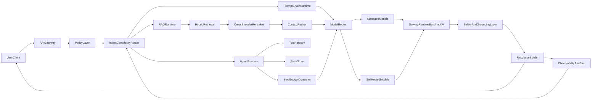

# Chapter 2: The LLM Stack and Core Patterns

## Context

> [!info] Quick Reference
> - **Pattern:** Multi-pattern platform (prompt chain + RAG + agentic)
> - **Scale:** 16M requests/day, pattern split 50/35/15%
> - **Key Techniques:** Intent routing, model tiering, continuous batching, semantic caching
> - **Primary Concerns:** Pattern selection, managed vs self-hosted, router drift
> - **Cross-references:** Chapter 1 (framework), Chapter 3 (retrieval), Chapter 4 (serving)

**Problem statement:** Design a production LLM stack and decision framework for choosing between **prompt chaining**, **RAG**, and **agentic orchestration** under strict latency, cost, and safety constraints.

### Real-World Examples

- A SaaS company routes invoice classification to a small model, customer policy Q&A to RAG, and dispute-resolution workflows to an agentic path.
- An enterprise migration uses managed APIs for launch, then moves stable high-volume routes to self-hosted GPUs for unit-cost reduction.

---

## Step 1: Understand the Problem and Establish Design Scope

### Functional Requirements

- Support three execution patterns in one platform:
  - **Prompt chaining** for deterministic workflows,
  - **RAG** for grounded, citation-backed answers,
  - **Agentic flows** for tool-heavy, multi-step tasks.
- Route requests dynamically across model tiers and providers.
- Enforce policy checks and deterministic fallback behavior.
- Provide traceable outputs with quality and cost telemetry.

### Non-Functional Requirements

- **Latency:** Route-specific TTFT (time to first token), TPOT (time per output token), and end-to-end p95 targets. A single global latency budget is insufficient because prompt-chain routes target sub-2.5s p95 while agentic routes may legitimately require 12s p95—blending these into one metric masks regression in both directions. Latency budgets should be set per route class and enforced by the API gateway as a timeout, not just measured after the fact.
- **Scale:** The system must absorb burst traffic of at least 10x average QPS (185 QPS average → 2,200 QPS burst) without cascading failures. This requires the gateway, router, retrieval service, and model serving layer each to be independently auto-scalable, with no synchronous dependency chain that can bottleneck the entire stack when one component receives burst traffic.
- **Cost:** Per-route token budgets (enforced at the gateway before model calls) and monthly envelope controls (tracked per tenant and per route). Without per-route cost enforcement, a single misconfigured agentic route can exhaust the monthly budget in hours. Monthly envelope controls must trigger graduated responses—alert at 70% consumed, restrict to minimum SLO at 90%, enforce hard stop at 100%.
- **Reliability:** Graceful degradation under provider failures and rate limits, defined as: a provider failure causes automatic routing to the fallback tier within 30 seconds, and a rate-limit event causes request queuing or tier downgrade rather than an error response to the client. Reliability is measured by the percentage of requests that receive any valid response (even degraded quality) rather than an error—target 99.9% valid-response rate including degraded fallbacks.
- **Security/compliance:** Tenant isolation ensures that no tenant's data (prompts, retrieved context, or model outputs) is accessible to another tenant through shared caching, logging, or inference infrastructure. Audit logs capture every request, routing decision, model call, and policy check with a tamper-evident trail. Output policy enforcement must be applied to 100% of responses before delivery, not sampled—safety checks cannot be probabilistic when the failure mode is a policy violation.​

### Back-of-the-Envelope Estimation (Platform Mix)

Assume:

- **Requests/day:** 16M
- Pattern split:
  - Prompt chain: 50%
  - RAG: 35%
  - Agentic: 15%
- Per-request token profile:
  - Prompt chain: 700 input / 140 output
  - RAG: 2,200 input / 280 output
  - Agentic: 4,800 input / 500 output

#### Throughput

- Peak QPS (12x burst): `~2,220`
- Capacity target with failover margin: `~2,800 QPS`

#### Token Volume

- **Total input/day:** `~29.44B`

- **Total output/day:** `~3.888B`

#### Latency Envelope by Pattern

- Prompt chain: TTFT 400-800ms, p95 full response 1.5-2.5s
- RAG: TTFT 700-1200ms, p95 full response 3-5s
- Agentic: TTFT 900-1500ms, p95 full response 6-12s (bounded by tool fan-out)

#### Cost Formula

- Key implication: agentic path is lower volume but high cost/query due to multi-step calls and larger outputs.

#### VRAM Planning for Model Tiers (Order-of-quantized): ~16-24GB VRAM
- Balanced route tier (13B-34B): ~40-80GB VRAM
- Complex route tier (70B): >=160GB aggregate VRAM with multi-GPU parallelism

---

## Step 2: Propose High-Level Design and Get Buy-In

### Core Architecture Components

- **API Gateway + Policy Layer:** Handles authentication, per-tenant quota enforcement, and request classification before any model call occurs. Placing policy enforcement here rather than inside model runtimes means that rate-limit decisions, tenant isolation checks, and abuse detection add only 1–5ms of overhead and never require a model invocation—critical when blocking malformed or unauthorized traffic at the edge.
- **Intent and Complexity Router:** Determines which of the three execution paths (prompt chain, RAG, or agentic) will handle the request, and at which model tier. This is the highest-leverage component in the stack—misclassification here cascades into quality failures, cost overruns, and latency violations across every downstream system.
- **Prompt Runtime:** Manages template versioning, schema-constrained output generation (e.g., JSON mode or grammar-constrained decoding), and chain-step execution. Centralizing this in a dedicated runtime rather than ad hoc per-service code enables consistent rollback, A/B testing of prompt versions, and token-budget enforcement across all callers.
- **Retrieval Runtime:** Combines sparse (BM25) and dense (embedding) retrieval, applies **cross-encoder reranking** to re-score the top candidates, and packs the highest-relevance chunks into the context window. Separating retrieval from the model serving layer allows independent scaling—retrieval throughput can scale horizontally on CPU, while model inference stays on GPU.
- **Agent Runtime:** Implements the planner/executor loop, maintains a tool registry with capability manifests, persists intermediate state across steps, and enforces hard step and token budgets. Without explicit step budgets and loop-detection logic, agentic workflows degrade into runaway tool-call chains that exhaust cost limits and never converge.
- **Model Router:** Selects the appropriate provider and model tier for each request using a composite policy over SLO requirements, estimated token cost, provider health signals, and route-level risk class. This layer decouples execution patterns from specific model choices—swapping a model or provider requires only a config change here, not changes in the RAG or agent runtimes.
- **Serving Runtime:** Handles response streaming, **continuous batching** to maximize GPU utilization, and prefix/KV Cache|KV cache management to reduce TTFT for repeated prompt prefixes. This layer translates high-level completion requests into optimized GPU kernel schedules and is where the majority of hardware efficiency is won or lost.
- **Safety Runtime:** Executes input classifiers, runtime content policy checks, and output grounding validators before and after model generation. Running safety checks as a dedicated runtime rather than post-processing inside the serving layer allows independent scaling, independent failure handling, and audit logs decoupled from model outputs.
- **Observability + Eval:** Collects TTFT/TPOT histograms per route, per-query cost breakdowns, quality scores, and safety violation rates. Feeding this telemetry back into the Intent Router (via the observability loop in the diagram) enables automated detection of router drift and route quality regressions without requiring manual log inspection.

### Pipeline A: Stack Preparation / Data and Runtime Setup

1. **Register prompts, schemas, tool contracts, and policy rules.** Every prompt template, output schema, tool manifest, and policy rule is version-controlled and deployed through a registry with immutable identifiers. This ensures that a quality regression can be traced to an exact prompt version and rolled back in under 5 minutes without re-deploying application code.
2. **Build retrieval assets (indexes, embeddings, metadata filters).** Embedding generation, chunking, metadata extraction, and index construction are run as a separate offline pipeline. Keeping this decoupled from the serving path means a new document corpus can be indexed and alias-swapped into production without disrupting live queries.
3. **Configure model catalog by route tier (fast/balanced/complex).** The catalog maps intent classes to candidate models with their VRAM footprints, cost per 1M tokens, and SLO targets. Maintaining this as a central config rather than hard-coded client logic enables circuit-breaker-style downgrades during provider incidents without application changes.
4. **Set route-level token and latency budgets with fallback chains.** Each route defines a primary model choice, a fallback model, a maximum input token count, and a p95 latency target. Fallback chains ensure that a single provider outage degrades to a slower or less capable model rather than returning an error—a critical property when serving external customers.
5. **Publish runtime config via versioned release and rollback handles.** Runtime configuration (budgets, routing rules, model catalog) is published to a distributed config store with a version tag. Any component reading the config can roll back to the previous version within one minute if a canary evaluation detects quality or cost regressions.

### Pipeline B: Runtime Query Execution

1. **Validate request, apply auth and policy constraints.** The gateway verifies the bearer token, checks per-tenant request-per-minute and token-per-day quotas, and runs a lightweight input classifier (typically a fine-tuned BERT-class model under 50ms) that blocks clearly malicious or policy-violating payloads before any routing or retrieval occurs.
2. **Classify intent and complexity score.** The intent router assigns a route class (e.g., structured extraction, knowledge retrieval, or multi-step workflow) and a complexity score based on token count, detected entity types, and presence of tool-requiring phrases. This double-signal classification reduces false-escalation to expensive tiers by roughly 20–30% compared to intent class alone.
3. **Route to prompt-chain, RAG, or agentic execution graph.** The routing decision is logged with the intent class, complexity score, selected tier, and expected cost before execution begins. This pre-execution trace is critical for post-hoc router audits—if a route misfires, the signal that caused the decision is immediately queryable.
4. **Execute with bounded token/time budgets and streaming enabled.** The runtime enforces hard token limits on the input (truncating or rejecting over-length prompts) and on the output (halting generation at the configured max). Streaming is enabled by default so that the API gateway begins forwarding tokens to the client within milliseconds of the first decode step, keeping TTFT within SLO even when full generation takes seconds.
5. **Apply safety and grounding validators.** After generation, output safety classifiers check for policy violations and hallucinated citations. For RAG routes, a grounding check verifies that factual claims in the response are attributable to retrieved chunks. Failing safety checks either truncate the response, append a disclaimer, or trigger a full abstain depending on the route's configured risk policy.
6. **Return response + trace metadata; feed telemetry into evaluation loop.** Each response is returned with a structured trace payload including route taken, model used, token counts, latency breakdown, and safety check outcomes. The evaluation loop aggregates this telemetry to compute per-route quality pass-rates, cost efficiency, and safety violation rates—driving the weekly router recalibration process.

### Mermaid Architecture Diagram

---

## Step 3: Design Deep Dive

Focus areas for this chapter:

1. **Pattern Selection: RAG vs Agent**
2. **Prompt Chaining Design**
3. **Model Routing and Tiering**

### 1) Pattern Selection: Prompt Chaining vs RAG vs Agentic

| Pattern | Strengths | Failure Modes | Best Fit |
|---|---|---|---|
| Prompt Chaining | Lowest latency (p95 under 2.5s) and cost (often 5–10x cheaper than agentic per query), and fully deterministic because each step's inputs and outputs are schema-controlled. | Breaks down when the task requires knowledge that changes faster than prompt release cycles, or when the answer requires reasoning over more information than fits in the context window. | Form extraction, structured transformations, classification pipelines, templated report generation—any workflow where the logic is known at design time and does not require live data lookup. |
| RAG | Grounds responses in a verifiable, up-to-date corpus, reducing hallucination rates by 40–70% versus prompt-only for knowledge-intensive tasks. Enables citations that let users audit model claims. | Retrieval misses (high embedding recall cutoff but low precision) cause confident but wrong answers. Index drift—where the embedding index lags document updates by hours or days—silently degrades answer quality with no visible error. | Enterprise Q&A over policy documents or product catalogs, support copilots needing accurate citations, search assistants where freshness and factual grounding matter more than conversational fluency. |
| Agentic | Handles tasks that genuinely require multi-hop reasoning or real-world side effects—querying APIs, writing files, triggering workflows—where no static prompt chain can be pre-enumerated at design time. | Without explicit step and token budgets, tool-call loops can run indefinitely; a single agent invocation can easily consume 50,000+ tokens and dozens of API round-trips. Tail latency is unbounded without hard timeouts, and debugging failures requires inspecting full multi-step execution traces. | Research agents that must synthesize from heterogeneous live sources, workflow automation that requires conditional branching across external systems, dispute-resolution or triage workflows where decision paths cannot be fully enumerated in advance. |

**Decision Rule:**
- **Start with prompt chaining.** Before considering retrieval or tool use, determine whether the task can be solved with knowledge baked into model weights and a well-engineered prompt. If the answer only changes when a human rewrites the prompt template (i.e., knowledge update frequency is days to weeks), prompt chaining is sufficient and the operational simplicity benefit is significant.
- **Add RAG if external knowledge freshness or citations are required.** The two independent triggers for RAG are: (1) the correct answer changes faster than the prompt can be redeployed (hours to days), or (2) the user or a downstream system needs a verifiable source citation that can be audited. If neither condition holds, RAG adds retrieval latency, index maintenance cost, and new failure modes with no quality benefit.
- **Escalate to agentic only if multi-hop tool orchestration is genuinely unavoidable.** "Unavoidable" means the task requires real-world side effects (writing to external systems) or conditional branching across more than 2–3 decision points that cannot be pre-enumerated in a static chain. If you can enumerate the steps at design time, it is a prompt chain, not an agent. The burden of proof for escalating to agentic should be a documented failure case from prompt chaining or RAG, not an architectural preference.

> **Why this escalation order:** Each step up in pattern adds significant latency, cost, and operational complexity.

### 2) Prompt Chaining Design

High-quality chaining requires control-plane rigor:

- **Step-level contracts:** Each step declares its expected input schema (JSON or typed fields) and output schema. If step N's output fails schema validation, the chain fails fast with a structured error rather than propagating malformed data into step N+1, where it would silently corrupt downstream reasoning. Validation should be performed by a cheap deterministic function, not by another model call.
- **Chain-level guards:** The chain enforces a maximum number of steps, a cumulative token budget across all steps, and a wall-clock timeout. These are independent limits because a chain can blow through the token budget in two steps or exhaust the timeout across many short steps. Without both, a single long-running chain can starve other requests sharing the same serving worker pool.
- **Validation hooks:** Between steps, deterministic validators (regex, JSON schema checks, business-rule assertions) catch obviously wrong intermediate outputs before they are passed to the next model call. These hooks add under 1ms each and prevent wasted inference on provably invalid intermediate states.
- **Model specialization:** Route classification, intent detection, and text normalization steps to small, fast models (7B quantized, under 100ms TTFT). Reserve larger models (34B+) exclusively for the synthesis or reasoning step that cannot be simplified. In practice this reduces per-chain cost by 40–60% versus running every step on the largest model.

**Why this matters:** A single monolithic prompt that chains all logic in one call forces the model to hold all intermediate reasoning in the context window simultaneously, inflating token counts and TTFT. A well-structured chain where each step produces a compact schema-validated output can cut total prompt tokens by 30–50%, because intermediate noise is stripped between steps rather than accumulated. Multi-step chains also unlock independent model selection per step, and each step's output becomes a discrete audit point for quality evaluation—something that cannot be done when all reasoning is folded into a single opaque completion.

### 3) Model Routing and Tiering

| Routing Strategy | Strengths | Weaknesses | Use When |
|---|---|---|---|
| Static route map | Simplest possible implementation—a lookup table keyed on route name or regex pattern. Zero runtime overhead, no model calls, fully predictable in load tests. | Cannot adapt when query distributions shift; a product launch that changes query phrasing can misroute 15–30% of traffic overnight without any alert firing. | Suitable only for early MVP with a single known query type or an internal tool where the query distribution is fully controlled and rarely changes. |
| Rule-based dynamic routing | Classification signals (token count, keyword match, intent class score) are human-readable and auditable. When a regression occurs, the rule that fired can be identified and corrected in minutes. Requires no labeled training data to deploy. | Rules require manual maintenance as query distributions evolve. Each new product feature may require new rules, and rule interactions can produce unexpected edge cases that take multiple on-call rotations to surface and fix. | The right default for most production systems. The combination of transparency, debuggability, and low deployment risk outweighs the manual tuning cost for the vast majority of LLM-serving use cases. |
| Learned router model | A small classification model (typically a fine-tuned encoder, 30–100M parameters) trained on labeled examples can learn subtle signals—semantic framing, implicit domain, query structure—that rules cannot express. Achieves 5–15% better routing accuracy than hand-tuned rules on complex multi-intent corpora. | Requires weeks of labeled data from a live system before training is meaningful. When quality regresses, the root cause is opaque without SHAP/attribution tooling. Requires its own eval pipeline, retraining infrastructure, and shadow-mode testing before each update. | Reserved for organizations that already run robust offline eval, have 60+ days of labeled routing data, and have encountered a measurable quality ceiling from rule-based routing that justifies the infrastructure investment. |

> **Why rule-based dynamic routing for most production systems:** A learned router requires labeled training data showing which tier produced acceptable quality per request class—data that takes weeks to accumulate from a l...

Suggested route policy signals:

- **Intent class and complexity score:** The combination of intent class (e.g., structured extraction vs. open-ended Q&A) and complexity score (derived from token count, entity density, and multi-hop keywords) is the primary signal. Using only one of these produces systematic errors—a short but semantically complex query will be under-routed if token count is the sole signal.
- **Required grounding strictness:** Routes serving regulated or safety-critical content should have a flag that forces both retrieval augmentation and grounding validation, regardless of complexity score. This prevents a low-complexity request in a high-risk domain from bypassing the RAG path because its token count looks simple.
- **Current provider health/rate-limit status:** The router queries a provider health sidecar that tracks recent error rates, 429 frequency, and latency percentiles per model. A provider in degraded state should be deprioritized before requests start failing, not after the first 429 wave arrives.
- **Cost budget remaining for route/time window:** Per-route and per-tenant daily cost envelopes should be enforced by the router, not downstream. When a budget threshold is approaching (e.g., 80% consumed), the router can automatically downgrade to a cheaper model tier, preventing cost overruns without requiring an emergency code change.

### 4) Protocol Layer for Tool-Using Systems

Modern agentic systems increasingly need a standard way to discover tools, retrieve contextual resources, and reuse prompt workflows across applications. Without a protocol layer, every product team implements tool invocation differently—inconsistent schemas, no shared permission model, duplicated retry logic, and no unified audit surface. Treat this as a first-class architectural layer between the AI host and external systems, not as ad hoc function-calling code embedded inside each product's inference loop.

Model Context Protocol (MCP) is the most important pattern to know here:

- **Host:** The AI application that owns the conversation context, makes all model API calls, and manages the user-facing approval UX for sensitive tool actions. The host is responsible for deciding which tools are offered to the model and enforcing the permission boundaries—the model itself cannot self-authorize access to external systems.
- **Client:** The host-side connection to a single MCP server. A host can maintain multiple clients simultaneously, one per external integration. The client handles transport-level concerns (connection lifecycle, retries, serialization) so the host's reasoning loop stays clean.
- **Server:** A lightweight integration surface that exposes tools, resources, and prompts over a standard protocol. Servers are stateless by design—they expose capabilities but do not persist conversation state. This makes them independently deployable and auditable units.
- **Tools:** Actions the model can request to perform side effects in the world—querying a database, creating a support ticket, sending an email, or calling an external API. Each tool has a typed schema that the model reads to form valid invocations; poorly specified schemas are the leading source of malformed tool calls.
- **Resources:** Contextual data blobs the model can read to enrich its reasoning—files, configuration schemas, live records, or documentation pages. Resources flow into the context window as read-only content; the model cannot modify them directly, which is a critical safety boundary.
- **Prompts:** Reusable parameterized prompt templates or multi-step workflows exposed by a server. These allow organizations to centralize and version approved prompt patterns rather than letting individual engineers write ad hoc system prompts for each integration.

> **Why standardize tools, resources, and prompts behind MCP:** Without a shared protocol like MCP, scaling from 5 tools to 50 tools requires rewriting discovery, invocation, and permission logic in every client.

System design implication: MCP standardizes discovery and invocation, but production still needs a server registry, permission model, approval gates, result sanitization, tool-call audit logs, and defenses against prompt injection through resources or tool descriptions. A malicious or poorly designed MCP server can expose tool descriptions or resource content that manipulates the model's reasoning—treating server output as trusted input is a security antipattern. See Chapter 23 for the full platform design.

### Additional Trade-offs

#### Managed vs Self-hosted Serving

| Approach | Strengths | Weaknesses |
|---|---|---|
| Managed API | Operational simplicity—no GPU infrastructure to provision, patch, or monitor. Teams can reach production in days rather than weeks. Provider handles model updates, hardware failure, and horizontal scaling. Cost is proportional to usage, making it ideal for unpredictable or low-volume early traffic where reserved GPU capacity would sit idle. | Per-token pricing becomes expensive at high volume; at 29B input tokens/day (this chapter's estimate), managed API costs can reach $20,000–$60,000/day depending on model tier and provider. Rate limits are shared across tenants and can trigger unexpectedly during marketing-driven traffic spikes, causing 429 storms that static retry logic cannot absorb. |
| Self-hosted | At sufficient volume (typically 1B+ tokens/day per model), self-hosted GPU clusters reduce per-token costs by 60–80% versus managed APIs. Full control over hardware allocation means no shared rate limits and no exposure to provider pricing changes. Enables custom kernels, quantization profiles, and fine-tuned model weights that managed APIs do not support. | Requires GPU provisioning, CUDA driver management, model weight distribution, inference server operation (vLLM, TGI, or equivalent), and on-call coverage for hardware failures and OOM crashes. GPU OOM events during long-prompt or high-batch periods require automatic batch-size shrinking or request rejection logic that must be built and maintained. Operational burden typically requires 2–4 dedicated ML infrastructure engineers. |
| Hybrid | Combines managed API for burst capacity and low-volume routes with self-hosted for stable, high-volume routes—capturing both cost efficiency and operational resilience. Provider outages fall back to managed, and cost-optimized routes run self-hosted. Achieves 30–50% cost reduction over pure managed while maintaining SLO coverage. | Adds routing-layer complexity: the model router must track provider health across both managed and self-hosted endpoints, enforce failover order, and handle the latency gap between tiers (self-hosted p99 can differ from managed p99 by 200–800ms). Policy compliance must be enforced identically across both paths, which requires synchronized configuration management. |

#### Cache Strategy

| Cache | Strengths | Weaknesses | Use Case |
|---|---|---|---|
| No cache | Eliminates the risk of returning stale or semantically mismatched cached responses. Every request generates a fresh completion, guaranteeing that model outputs reflect the current prompt state. Zero implementation complexity—no cache infrastructure, threshold tuning, or invalidation logic. | Every request pays full prefill cost and TTFT. At 29B input tokens/day, removing caching could add $5,000–$15,000/day in additional API costs and increase average TTFT by 300–600ms on templated routes. Cache-eligible traffic in production is typically 20–40% of volume, so not caching is purely a cost and latency regression for steady-state workloads. | Appropriate only during initial prototyping before query distribution is understood, or for routes with strict correctness requirements and no tolerance for near-match errors (e.g., legal or financial record retrieval). |
| Semantic cache | For support and FAQ workloads, 20–40% of queries are semantic near-duplicates of previously answered questions. A semantic cache with a cosine similarity threshold of 0.92–0.95 can serve these from cache in under 10ms, eliminating the model call entirely and delivering 100x TTFT improvement for hit traffic. Reduces cost proportionally to hit rate. | A threshold set too low (e.g., 0.85) returns stored responses to semantically related but factually distinct queries—a dangerous failure mode in domains where similar phrasing means different things. Cached responses also become stale when underlying knowledge updates (product changes, policy revisions) without automatic invalidation, requiring source-version-aware TTL management. | High-repeat-intent routes: customer support Q&A, product FAQ copilots, HR policy assistants, and any use case where the same question recurs across many users within a short time window. Should not be applied to agentic or multi-turn sessions where context uniqueness is the norm. |
| KV/prefix cache | Eliminates redundant GPU computation for prompt prefixes that are identical across requests—system prompts, instruction headers, and fixed RAG context. On a 70B model with a 2K-token shared prefix, KV caching saves 200–400ms of TTFT per request that hits the cache. Requires no quality trade-off because the attention computation is deterministic for the same prefix. | Consuming VRAM to store KV tensors for cached prefixes competes directly with active batch slots, reducing maximum batch size. A 2K-token prefix KV cache for a 70B fp16 model consumes roughly 200–400MB of VRAM per cached layer, and eviction policies must be tuned carefully or cache thrashing degrades net throughput. | Templated prompts with long system prefixes (>500 tokens), multi-turn conversation sessions where the early context is reused across turns, and RAG routes that include a fixed large instruction block before the retrieved chunks. Most effective when the shared prefix represents >20% of total token count per request. |

> **Why KV/prefix cache for templated prompts:** System prompts and instruction prefixes are processed on every request, consuming prefill time even though their attention states are identical each time.

> **Why not semantic cache for high-risk routes:** A semantic cache returns a stored answer when a new query is "close enough" to a cached query.

### Production Bottlenecks and What Breaks First

- **Provider rate limiting:** Managed API providers assign per-tenant rate limits in tokens-per-minute and requests-per-minute. A 12x traffic burst (2,220 QPS against a limit provisioned for 185 QPS) generates a wave of 429 responses that triggers naive retry logic simultaneously across all clients—producing a retry storm that amplifies the original burst load and extends the incident duration from minutes to tens of minutes.
  - Mitigation: Implement token-bucket rate limiting at the gateway before requests reach the provider, so excess requests are queued or shed locally rather than sent to the provider and rejected. Add circuit breakers that open after 5% of requests return 429/5xx within a 30-second window, routing traffic to the fallback provider. Use jittered exponential backoff with a full-jitter strategy (random sleep between 0 and the backoff ceiling) to prevent retry synchronization across clients.

- **Router misclassification drift:** Query distributions shift as product behavior changes and users learn the system. A router calibrated on week-1 traffic can accumulate 15–20% misclassification on week-8 traffic if not recalibrated. Systematic false-downgrade (complex queries routed to cheap tier) is particularly dangerous because it produces confident but incorrect outputs with no error signal—the request completes successfully, so no alert fires.
  - Mitigation: Run a weekly router eval against a held-out labeled set that covers all route classes with at least 100 examples each. Compute a route confusion matrix that shows false-downgrade and false-escalation rates by pair. Maintain a router rollback policy: any config change that increases false-downgrade rate by >3% is automatically reverted within 1 hour of detection.

- **Database/metadata connection exhaustion:** Every request performs synchronous lookups for authentication, ACL checks, and route policy before the model call begins. At 2,800 QPS, even a 5ms average lookup adds 14 seconds of aggregate wait per second of throughput. When the database connection pool fills (typically at 5–15x normal load), requests queue for a connection and p95 TTFT spikes from 50ms to 500–1500ms for the metadata-lookup phase alone.
  - Mitigation: Size connection pools for peak QPS by load testing at 2–3x projected peak before launch. Add read replicas for ACL and policy data (which are read-heavy and write-infrequently). Implement a TTL metadata cache (5–30 second TTL) for policy data that changes less often than per-second—this reduces database read load by 80–95% for static policy configurations.

- **Stale vector embeddings/index skew:** When documents are updated in the source system but the embedding index is not rebuilt, the RAG route continues to retrieve outdated chunks and generate answers grounded in stale facts. This failure is invisible in serving metrics—TTFT, TPOT, and error rates all look healthy—and surfaces only through user reports or citation audits days after the index diverged from the source.
  - Mitigation: Track embedding model version and document hash alongside each vector in the index. Run shadow index tests after every embedding model update by comparing retrieval results between old and new index on a standard query set before alias-swapping. Implement alias-based index rollback: the RAG runtime reads from an alias that points to the active index, so rollback is an alias update (seconds) rather than a full index rebuild (hours).

- **Agentic hallucination loops:** Without explicit convergence detection, an agent can enter a loop where each tool call produces a result that appears to require another tool call, with no terminal condition reached. This pattern is not random—it is typically triggered by tool schemas that return ambiguous responses or by planner prompts that do not distinguish between "evidence found" and "evidence not found" outcomes. A looping agent can exhaust a 100,000-token budget in under 10 minutes of real time.
  - Mitigation: Enforce hard step limits (e.g., max 15 steps per invocation) in the agent runtime, not via prompt instruction. Implement loop signature detection: if the same tool is called with the same arguments (or cosine-similar arguments) within the last 5 steps, treat it as a loop and force a terminal action. Define deterministic exit policies—on budget breach or loop detection, the agent must either abstain (return a structured "could not complete" response) or escalate to a human queue, never retry the same path.

- **GPU OOM in self-hosted tiers:** Long prompt inputs combined with large batch sizes can exhaust GPU VRAM mid-batch, causing the inference worker to crash and drop all in-flight requests. VRAM consumption scales with prompt length times batch size times the model's KV cache size per token, meaning that a normal average prompt length can produce OOM events in the tail if a few long-context requests land in the same batch during peak load.
  - Mitigation: Enforce strict per-request input token caps (e.g., reject requests over 8,192 tokens at the gateway) before they reach the serving worker, preventing the largest inputs from entering the batch. Implement dynamic batch shrinking: if the serving worker detects VRAM pressure above 90%, it reduces active batch size by 25% for the next scheduling interval before OOM occurs. Configure a route downgrade policy: if the self-hosted tier reports sustained VRAM pressure, the model router automatically shifts marginal traffic to the managed API fallback until pressure normalizes.

### Advanced Techniques to Name and Use Correctly

- **Continuous batching** for throughput and queue stability. In continuous batching, the GPU processes a fixed number of token slots per step, and as soon as one sequence completes its generation, a new request takes its slot without waiting for the remaining sequences to finish. This eliminates the GPU idle time inherent in static batching, where all slots stay occupied until the longest sequence completes. At 2,800 QPS with variable-length completions, continuous batching typically raises effective GPU utilization from 30–50% (static) to 60–80%, directly reducing the number of GPU replicas required to serve the load.

> **Why not static batching:** Static batching holds the batch until all requests finish, meaning short completions idle while waiting for the longest sequence.

- **KV caching** to reduce TTFT on repeated prefixes. When multiple requests share an identical prompt prefix—a system prompt, a set of instructions, or a fixed RAG preamble—the attention key-value tensors computed during prefill for that prefix are stored in GPU VRAM. Subsequent requests that match the prefix skip its recomputation and begin decoding from the cached state, reducing TTFT by 200–500ms on long prefixes. This technique is most impactful when prompt templates are standardized and the shared prefix exceeds 500 tokens.
- **Semantic caching** with freshness- and policy-aware invalidation. A semantic cache intercepts queries before the LLM call, encodes the query into an embedding, and performs approximate nearest-neighbor search against a cache index. Hits above a similarity threshold (typically 0.92–0.95) return the stored response directly. Invalidation must account for both TTL expiry and source-version changes—when a policy document is updated, all cache entries referencing queries that would have retrieved that document must be invalidated or the cache will serve stale answers.
- **Cross-encoder reranking** for precision in RAG route. Bi-encoder retrieval (dense or sparse) ranks candidates by approximate similarity to the query, which optimizes for recall but not precision—many returned candidates are topically related but do not directly answer the question. A cross-encoder reranker processes each (query, candidate) pair jointly through a full attention pass, producing a precise relevance score that reorders the top-K candidates before context packing. This two-stage approach achieves 10–20% better answer quality (measured by citation precision) than bi-encoder retrieval alone at the cost of 50–150ms additional latency.
- **Parent-child chunking** where large documents need both recall and precise citation. Document chunks are stored at two granularities: large parent chunks (500–2000 tokens) for retrieval recall and small child chunks (50–200 tokens) for precise attribution. Retrieval operates on the child chunks to find specific evidence, but the context window receives the surrounding parent chunk to give the model sufficient context to reason accurately. Without this, either recall suffers (too small chunks miss document-level context) or citations are imprecise (too large chunks make it impossible to attribute specific claims).
- **LoRA adapters** for domain adaptation without full fine-tune overhead. Low-Rank Adaptation injects trainable rank-decomposed weight matrices into the attention layers of a frozen base model. A typical LoRA adapter for a 7B model is 10–50MB rather than the 14GB of full model weights, can be trained on 1,000–10,000 domain examples in hours on a single GPU, and can be swapped at serving time by hot-loading the adapter weights on top of the shared base. This enables per-tenant or per-domain specialization without maintaining a separate full model copy for each use case.

### Applied Stack Insights

- **Treat execution patterns as economic and reliability decisions, not just model choices.** The choice between prompt chaining, RAG, and agentic is primarily a decision about cost envelope, failure modes, and operational complexity. A RAG route that costs 3x more per query than a prompt chain is justified only if retrieval-grounded quality is demonstrably required—not because RAG is architecturally "more complete." Optimize for the simplest pattern that passes the quality bar.
- **Route-specific budgets outperform one-size-fits-all architecture.** A single global latency budget (e.g., "all requests must complete in under 5s") will either be too tight for legitimate agentic workflows or too loose to surface TTFT regressions in prompt-chain routes. Per-route budgets with independent alert thresholds allow the team to tighten constraints on fast routes (prompt chain: p95 under 2.5s) without forcing the agentic path into unreachable targets.
- **Every optimization must be measured against quality and safety regressions.** Switching from full-precision to INT4 quantization on a production model may improve throughput by 30% but degrade answer quality on long-context reasoning by 5–10%—a trade-off that only eval data can surface. Every infrastructure optimization (caching, batching, model downgrade, quantization) should be gated on an eval run covering quality, safety, and grounding metrics before rollout.

---

