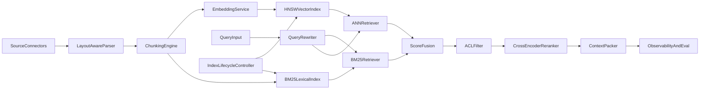

# Chapter 3: Data Pipelines and Vector Infrastructure

## Context

> [!info] Quick Reference
> - **Pattern:** Ingestion pipeline + hybrid retrieval
> - **Scale:** 5M documents, 300M+ chunks, 500 QPS retrieval
> - **Key Techniques:** Parent-child chunking, BM25 + dense hybrid, cross-encoder reranking, blue-green index swap
> - **Primary Concerns:** Recall@K targets, embedding freshness, ACL enforcement, index lifecycle
> - **Cross-references:** Chapter 2 (RAG pattern), Chapter 5 (eval), Chapter 7 (enterprise search case study)

**Problem statement:** Design scalable ingestion, embedding, indexing, and hybrid retrieval infrastructure that preserves relevance under fast-changing enterprise corpora.

### Real-World Examples

- A global knowledge base with PDFs, wikis, and tickets sees recall drop after parser upgrades; chunking and index lifecycle become the real bottleneck.
- A legal search product improves citation accuracy by moving from fixed chunks to parent-child chunking plus cross-encoder reranking.

---

## Step 1: Understand the Problem and Establish Design Scope

### Functional Requirements

- Ingest documents from heterogeneous sources (PDF, HTML, Markdown, structured DB exports).
- Parse layout-aware content preserving tables, headers, code blocks, and section hierarchy.
- Chunk documents with configurable strategies (fixed, semantic, parent-child).
- Generate embeddings and maintain both vector and lexical indexes.
- Support hybrid retrieval (BM25 + dense vector) with cross-encoder reranking.
- Enforce document-level ACLs at retrieval time.

### Non-Functional Requirements

- **Freshness:** incremental indexing within 30 minutes of source update.
- **Scale:** 300M+ chunks indexed, 500+ retrieval QPS at p95 < 120ms.
- **Consistency:** zero-downtime index updates via alias swaps.
- **Cost:** embedding cost bounded to < $800/day at steady state.
- **Durability:** index rollback within 5 minutes on quality regression.

### Back-of-the-Envelope Estimation

#### Corpus Sizing

- Documents: 5M, average 8 pages, ~2,400 tokens/page
- Chunks (avg 512 tokens, 50% overlap): `~375M chunks`

#### Embedding Compute

- Model: `text-embedding-3-small` (1536-dim, $0.02/1M tokens)
- Incremental cost: `~$2.76/day`

#### Vector Storage

- With HNSW index overhead + metadata + replicas (x2.5): **~5.6TB**
- HNSW memory for search: ~60-80GB RAM per shard (serving-layer requirement)

#### Retrieval Throughput

- Target: 500 QPS hybrid retrieval
- Per-query: BM25 lookup (~15ms) + ANN search (~25ms) + reranker on top-50 (~60ms) + ACL filter (~10ms)
- p95 target: **< 120ms** end-to-end retrieval

> **Why < 120ms retrieval p95:** The retrieval stage is one component within a larger inference pipeline that must hit a TTFT of 700–1,200ms for a RAG path.

#### Ingestion Throughput

- Daily new chunks: `~57,600 chunks/day` (incremental)
- Full re-index (375M chunks at 500 chunks/sec): **~8.7 days** → requires parallelized pipeline

---

## Step 2: Propose High-Level Design and Get Buy-In

### Core Architecture Components

The architecture separates concerns across two independent pipelines—ingestion and retrieval—connected by shared versioned indexes. This separation allows each pipeline to scale independently: ingestion throughput can be increased without touching the retrieval path, and retrieval latency can be tuned without affecting the ingestion queue. Both pipelines share the Index Lifecycle Controller, which enforces the quality gate and alias swap protocol as the coordination point.

- **Source Connectors:** CDC listeners for database sources (capturing row-level changes via log tailing), scheduled crawlers for web-based sources (Confluence, Jira, internal wikis), and webhook receivers for event-driven sources (document management systems that emit update events). Each connector is responsible for deduplicating events—a document update that triggers multiple CDC events must result in only one re-embedding job, keyed by content hash to avoid redundant embedding API calls.
- **Parser Layer:** Layout-aware extraction that goes beyond raw text extraction to preserve structural information: tables are extracted as Markdown tables rather than linearized rows, headers are preserved as section metadata, and code blocks are detected and tagged with language identifiers. Uses format-specific parsers (PyMuPDF for PDFs, BeautifulSoup for HTML, python-docx for Word documents) because a single generic parser produces significantly lower extraction quality than purpose-built parsers for each format.
- **Chunking Engine:** Configurable strategy selector that reads a per-source chunking configuration and applies the appropriate strategy (fixed, semantic, or parent-child) to each document. Tags every output chunk with `doc_id`, `source_type`, `section_path`, `chunk_index`, `parent_id` (if applicable), `acl_groups`, `chunk_strategy`, and `content_hash`—this metadata is the foundation for both ACL filtering at retrieval time and provenance tracing during quality audits.
- **Embedding Service:** Batched embedding generation that groups chunks into batches of 100–500 tokens total to maximize throughput per API call, with exponential backoff retry logic for rate limit errors and a dead-letter queue for chunks that fail after three retries. Enforces a daily cost circuit breaker that pauses the embedding queue if projected daily spend exceeds the $800 cap, alerting on-call before any cost overrun occurs.
- **Index Manager:** Dual-write coordinator that sends each chunk's vector to the HNSW index and the raw text plus metadata to the BM25/Elasticsearch index atomically within the same pipeline step. Tracks write success for both destinations independently—a failure in either index triggers a retry and, if retries are exhausted, routes the chunk to the dead-letter queue rather than silently dropping it from one index but not the other (which would create a split-brain inconsistency between the two retrieval channels).

> **Why HNSW for the vector index:** HNSW (Hierarchical Navigable Small World) builds a multi-layer proximity graph that achieves sub-linear query time at high recall, making it the dominant pro...
- **Retrieval Service:** Hybrid search orchestrator that runs BM25 and ANN queries in parallel, applies RRF fusion, enforces ACL filtering, and invokes the cross-encoder reranker on the fused candidate set. The service exposes a single retrieval API with a pluggable strategy interface so that callers can request different retrieval configurations (e.g., BM25-only for exact-match queries, hybrid for semantic queries) without the caller needing to know which indexes are consulted.
- **Index Lifecycle Controller:** Versioned index manager that assigns monotonically increasing version numbers to each index build, stores quality gate results alongside each version, manages the named alias that production traffic resolves against, and provides a one-call rollback API that re-points the alias to the previous version without any data movement. The controller also enforces the rule that no two index versions with different `embedding_model_version` values can be deployed to the same alias—preventing cross-model contamination at the infrastructure level.
- **Observability:** Instrumentation layer tracking parser success rate per document type (alerting on > 2% failure), embedding API latency and cost per day (alerting on projection > $800), index freshness lag histogram (alerting on p95 > 30 minutes), and live retrieval Recall@K and MRR sampled from a held-out benchmark query set run hourly against the production index. These four signals together cover the end-to-end pipeline: if any one stage degrades silently, at least one of these metrics will catch it before users file a quality complaint.

### Pipeline A: Document Ingestion Pipeline

1. Source connector detects new/updated documents via CDC or scheduled crawl.
2. Parser extracts text with layout preservation; routes failures to dead-letter queue.
3. Chunking engine applies configured strategy; tags each chunk with doc_id, section, position, ACL.
4. Embedding service generates vectors in batches (rate-limited to stay within cost envelope).
5. Index writer dual-writes vectors to HNSW index and text to BM25 index.
6. Quality gate samples random chunks and validates embedding coherence and parse fidelity.
7. Index lifecycle controller promotes new version via alias swap once quality gate passes.

### Pipeline B: Hybrid Retrieval Pipeline

1. Query arrives; ACL context resolved from auth token.
2. Query rewriter expands/reformulates query for both lexical and semantic channels.
3. BM25 retriever returns top-100 lexical matches; ANN retriever returns top-100 dense matches.
4. Score fusion (reciprocal rank fusion or weighted combination) produces merged top-100 candidate set.
5. ACL filter removes unauthorized chunks.
6. Cross-encoder reranker scores top-50 candidates; returns top-K (typically 5-10) with scores.
7. Context packer assembles chunks within token budget; returns with chunk metadata and citations.

### Mermaid Architecture Diagram

---

## Step 3: Design Deep Dive

Focus areas for this chapter:

1. **Chunking Strategies**
2. **Hybrid Retrieval Architecture**
3. **Vector Index Lifecycle Management**

### 1) Chunking Strategies

Chunking determines retrieval granularity and directly impacts recall, precision, and cost.

#### Chunking Trade-off Table

| Approach | Strengths | Weaknesses | Best For |
|---|---|---|---|
| Fixed-size (512 tokens, 50% overlap) | Predictable chunk count simplifies index sizing and cost estimation; trivial to implement and parallelize across workers | Splits arbitrarily at token boundaries, frequently cutting mid-sentence or mid-table, which degrades embedding coherence and forces the reranker to work harder | Homogeneous, paragraph-structured text where semantic precision is less critical; suitable for MVP or proof-of-concept indexing |
| Semantic (sentence/paragraph boundary) | Preserves natural meaning units so each chunk's embedding captures a coherent idea, improving ANN precision by 5–15% over fixed-size on narrative corpora | Variable chunk sizes make token budget planning difficult and can produce chunks ranging from 50 to 1,500 tokens, widening the tail latency distribution in context assembly | Narrative documents such as policy manuals, knowledge-base articles, and HR documentation where sentence integrity matters |
| Parent-child | Dense child embeddings improve ANN retrieval precision; expanding to the parent for generation provides enough surrounding context to avoid truncated answers; empirically improves citation precision by 10–20% | Requires storing both child and parent texts plus a `parent_id` join, adding roughly 1.8x storage overhead; pipeline complexity increases because both chunk tiers must be maintained in sync | Long-form technical or legal documents where evidence is localized to a sentence but the answer requires the full surrounding section for coherent generation |
| AST/symbol-aware | Preserves function and class boundaries, ensuring code chunks are syntactically complete and embeddable as coherent units; avoids the common failure of splitting a function across two chunks | Requires language-specific parsers (tree-sitter, libcst, etc.) and parsing infrastructure for each supported language; maintenance burden scales with the number of languages in the corpus | Code repositories, API documentation, or any corpus where code snippets are the primary retrieval target |

**Parent-child chunking in detail:**
- **Parent chunk:** 1,500-2,000 tokens covering a full section or subsection.
- **Child chunk:** 256-512 tokens, each linked to parent via `parent_id`.

> **Why 256–512 tokens for child chunks:** Embedding models lose discriminative power on very long sequences because the pooled representation averages across too many tokens.

- **Retrieval:** search child chunks for precision; expand to parent for full context assembly.
- **Storage overhead:** ~1.8x compared to flat chunking.
- **When to use:** any corpus where answer evidence spans multiple paragraphs but retrieval must be precise.

#### Parsing Failures and Mitigations

- **PDFs with scanned images:** Scanned PDFs have no embedded text layer, so text extraction returns empty strings silently, creating empty chunks that pollute the index with zero-information vectors. Route these through an OCR pipeline (Tesseract for speed, DocTR or AWS Textract for layout-sensitive documents) before the chunking stage; tag the output with `source_type=ocr` so quality audits can filter and benchmark OCR-derived chunks separately.
- **Complex tables:** Naive line-by-line extraction collapses table structure, destroying column alignment and making the resulting text semantically incoherent. Convert tables to structured Markdown format using tools such as Camelot (PDF) or BeautifulSoup (HTML), and embed the entire table together with its caption as a single chunk; this preserves the relational meaning of cell values and improves retrieval precision for data-lookup queries by 15–30%.
- **Code blocks:** Fixed-token chunking applied to code frequently splits a function at an arbitrary line, embedding half a method body as one chunk and the other half as another—neither chunk is semantically complete. Detect code fences or indentation blocks, preserve the original language tag, and enforce function or class boundaries as hard split points; use AST-based splitting (tree-sitter) when the code language is known, falling back to line-count heuristics for unknown languages.
- **Dead-letter queue for unparseable documents:** Any document that causes an unhandled parser exception should be routed to a dead-letter queue rather than silently dropped, because silent drops create invisible coverage gaps that degrade recall without triggering any alert. Instrument the queue depth and emit an alert whenever the parse failure rate exceeds 2% of documents processed in a 30-minute window; schedule periodic manual review of the dead-letter queue to identify systematic parser bugs or document format variants that warrant a parser fix rather than individual document triage.

### 2) Hybrid Retrieval Architecture

#### Retrieval Strategy Trade-off Table

| Approach | Recall@10 | p95 Latency | Infra Cost | Best For |
|---|---|---|---|---|
| BM25 only | 0.55–0.65, acceptable for structured corpora with controlled vocabulary but fails badly on paraphrase queries | ~15ms; operates entirely on inverted index with no GPU dependency, making it the cheapest option to scale horizontally | Low: standard Elasticsearch or OpenSearch cluster, no GPU; cost scales with document volume, not query complexity | Exact-match requirements such as product IDs, legal citation numbers, error codes, or any domain where keyword overlap between query and document is high |
| Dense vector only | 0.70–0.80; captures semantic similarity well but recall is bounded by embedding model quality and can miss rare domain terms absent from training data | ~25ms including ANN scan on an HNSW index; highly sensitive to `ef_search` setting—lower values reduce latency but also reduce recall by up to 10 points | Medium: HNSW index requires 60–80GB RAM per shard at 375M vectors; GPU embedding at query time adds cost if not cached | Semantic or paraphrase queries where exact keyword overlap is low, such as "how do I reset my password" matching "account recovery procedure" |
| Hybrid (BM25 + dense) | 0.80–0.88; RRF fusion reliably outperforms either channel alone because it hedges coverage: BM25 catches keyword matches that dense misses and vice versa | ~40ms; involves two parallel retrieval calls plus a lightweight fusion step; parallelization on separate hardware limits the combined latency to the slower of the two retrievers | Medium-High: requires both an Elasticsearch/OpenSearch cluster and an HNSW vector index; operational complexity increases but infra cost is manageable at this scale | General-purpose enterprise search where queries span both structured identifiers and open-ended semantic questions across the same corpus |
| Hybrid + cross-encoder reranker | 0.85–0.92; cross-encoder's full attention over `(query, chunk)` pairs catches relevance nuances that bi-encoder embeddings cannot; the gain is most pronounced when the top fusion candidates include near-miss paraphrases | ~100ms; the reranker dominates latency—top-50 at 1.2ms/pair on GPU consumes ~60ms alone; the remaining ~40ms covers retrieval, fusion, and ACL filtering | High: dedicated GPU pool for reranker (4–8 GPUs at 500 QPS); if the reranker pool is undersized, it becomes the throughput bottleneck for the entire retrieval path | High-precision RAG applications where citation accuracy is a product requirement, such as legal search, compliance Q&A, or medical documentation retrieval |

**Score fusion methods:**
- **Reciprocal Rank Fusion (RRF):** `score = sum(1 / (k + rank_i))`. Simple, robust, no tuning needed. Default recommendation.

> **Why RRF as the default over weighted linear combination:** Linear combination requires normalizing scores across BM25 and dense retrievers whose raw score distributions are incompatible—BM25 scores are corpus-frequen...

- **Weighted linear combination:** `score = alpha * bm25_norm + (1-alpha) * dense_norm`. Requires tuning alpha per corpus. Use when one channel dominates.

**Cross-encoder reranking:**
- Reranker takes `(query, chunk)` pairs and produces relevance scores.
- Typical model: ~110M params, ~1.2ms/pair on GPU.
- Reranking top-50 candidates: `~60ms` on dedicated GPU.

> **Why top-50 candidates for reranking:** Reranking fewer than 20 candidates risks the relevant document not being in the set (recall ceiling too low); reranking more than 100 at 1.2ms/pair pushes la...

- Quality lift: +5-12% Recall@5 over fusion alone.
- **Throughput bottleneck:** at 500 QPS, reranking requires dedicated GPU pool (~4-8 GPUs for reranker alone).

**ACL-aware retrieval:**
- Pre-filter approach: inject ACL predicates into index query. Faster but requires ACL-indexed metadata.
- Post-filter approach: retrieve broadly, then filter. Simpler but wastes retrieval budget on unauthorized chunks.
- **Recommended:** pre-filter for low-cardinality ACLs (< 1K groups); post-filter + over-retrieve for high-cardinality.

> **Why pre-filter below 1K groups:** With a small number of ACL groups, the filter predicate in the vector query adds minimal overhead (~5–10ms) because the ANN index can prune candidates using ...

### 3) Vector Index Lifecycle Management

#### Index Lifecycle Trade-off Table

| Strategy | Update Latency | Risk | Rollback Speed | Best For |
|---|---|---|---|---|
| In-place upsert | Seconds to minutes per batch; each upsert is immediately visible to live queries, which means a bad batch affects users before you can react | High: a partially applied update leaves the index in an inconsistent state with no safe rollback path; there is no previous version to restore because the old vectors have been overwritten | None: the original state is gone once overwritten; recovery requires a full rebuild from source, which may take hours or days on a large corpus | Development and testing environments only, where fast iteration matters more than correctness guarantees and the index can be rebuilt cheaply |
| Blue-green alias swap | Minutes to hours depending on corpus size; the new index is built entirely in the background before any traffic is shifted, so users experience no degradation during build | Low: the old index remains fully intact and queryable throughout the entire build process; the alias flip is an atomic operation that takes effect in milliseconds | Instant: re-pointing the alias back to the old index version takes a single API call and requires no data movement; old index is kept hot for 24 hours as a rollback target | Production default for any corpus where correctness and zero-downtime updates are required; the 2x storage cost during the swap window is the only meaningful trade-off |
| Shadow index + canary eval | Hours to days for large corpora; involves building a full shadow index, routing a percentage of live traffic to it, and measuring quality metrics before committing | Minimal: the live index is never touched until canary evaluation confirms the new index meets or exceeds quality gates; any regression aborts the rollout automatically | Instant: canary routing is a traffic-split configuration change; at the first sign of regression, traffic is shifted back to the production index without any index operation | High-stakes corpora such as legal, medical, or financial search where even a temporary quality regression has business or compliance consequences that outweigh the higher operational overhead |

**Blue-green index lifecycle:**
1. Build new index version in background with updated embeddings/chunks.
2. Run automated quality gate: sample 200 benchmark queries, measure Recall@10, MRR, citation precision.

> **Why 200 benchmark queries for the quality gate:** Fewer than 100 queries produce high variance in Recall@K estimates, making it easy for a regression to fall within sampling noise.

3. If quality gate passes (no regression > 2% on any metric), swap alias to new index.
4. Keep old index hot for 24h as rollback target.
5. If quality regresses post-swap, revert alias within 5 minutes.

> **Why alias swap over in-place upsert:** In-place upserts modify a live index, meaning a failed write can leave the index in a partially updated state with no safe rollback path.

**Embedding version management:**
- Tag every chunk with `embedding_model_version` and `index_version`.
- Never mix embeddings from different model versions in one index (cosine distances are incomparable).
- On model upgrade: full re-embed into shadow index → canary eval → alias swap.

**Index freshness monitoring:**
- Track `source_updated_at` vs `indexed_at` per document.
- Alert if p95 freshness lag exceeds SLA (30 minutes).
- Dashboard: freshness histogram, parse failure rate, embedding queue depth.

### Production Bottlenecks and Mitigations

- **Embedding queue backlog**
  - Symptom: freshness SLA violation; documents stuck in queue.
  - Mitigation: horizontal scaling of embedding workers, priority queue for high-value sources, batch size tuning.

- **ANN recall degradation at high compression**
  - Symptom: Recall@10 drops below 0.80 as index grows.
  - Mitigation: tune HNSW `ef_construction` and `M` parameters; consider IVF-PQ only for cost-constrained scenarios.

> **Why tune `M` and `ef_construction` before switching to IVF-PQ:** Higher `M` (connections per node) and `ef_construction` (candidate pool during graph build) improve graph quality and recall at the cost of memory and build ...

- **Metadata DB saturation from ACL filter queries**
  - Symptom: retrieval p95 spikes from metadata lookups.
  - Mitigation: read replicas, connection pooling, cache hot ACL groups with short TTL (60s).

- **Parser failures on edge-case documents**
  - Symptom: dead-letter queue grows; coverage gaps in index.
  - Mitigation: fallback to raw text extraction, alerting on failure rate, periodic manual review.

- **Stale embeddings after schema/content drift**
  - Symptom: retrieval quality degrades silently over weeks.
  - Mitigation: scheduled quality audits (weekly Recall@K sampling), triggered re-embedding on schema changes.

### Advanced Techniques

- **Parent-child chunking** for large document retrieval with precise grounding. Index dense child chunks (256–512 tokens) for high-precision ANN retrieval, then expand each retrieved child to its parent (1,500–2,000 tokens) for context assembly. This decouples the granularity used for retrieval from the granularity used for generation, delivering both precision in ranking and completeness in the answer. The trade-off is roughly 1.8x storage overhead and a metadata join at retrieval time.
- **Cross-encoder reranking** as a quality amplifier applied after hybrid fusion. Unlike bi-encoders that embed query and document independently, cross-encoders perform full attention across the concatenated `(query, chunk)` pair, capturing fine-grained lexical and structural relevance signals that bi-encoder cosine similarity misses. The typical gain is +5–12% Recall@5 over fusion alone, but it requires a dedicated GPU pool and adds ~60ms to retrieval latency at 500 QPS with top-50 reranking.
- **Semantic caching** for repeated or near-duplicate retrieval patterns. Hash the query embedding vector (e.g., using locality-sensitive hashing) and cache the top-K result set with a TTL of 60–300 seconds. On cache hit, retrieval latency drops from ~100ms to under 5ms. Effective when query diversity is low—enterprise knowledge bases often see the same 200–500 queries accounting for 40–60% of daily traffic—but requires cache invalidation logic tied to index updates to avoid serving stale results after a document changes.
- **Matryoshka embeddings** for variable-precision search across different latency tiers. Models trained with Matryoshka Representation Learning (MRL) embed documents into vectors where the first N dimensions already form a useful lower-dimensional representation. This enables a two-stage retrieval: a fast coarse pass using 128-dim truncated vectors to narrow 375M chunks to a candidate set of 1,000, followed by a fine-grained rerank using the full 1,536-dim vectors on that candidate set. The coarse pass can run 3–5x faster than full-dimensional ANN, reducing overall retrieval latency without sacrificing final recall.
- **Incremental HNSW** for near-real-time index updates without a full rebuild. Standard HNSW supports online insertion of new vectors by traversing the existing graph and adding edges at the appropriate layers. This allows new documents to become searchable within seconds of embedding, rather than waiting for a full rebuild cycle. The limitation is that deleted documents require a tombstone-based soft delete—actual graph compaction requires a periodic background rebuild—so index quality degrades slightly over time if deletions are frequent, making a weekly full rebuild advisable even when using incremental updates.

---

