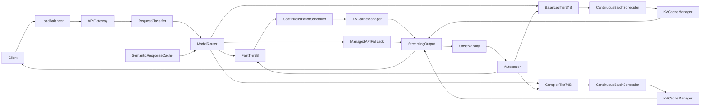

# Chapter 4: Serving, Scaling, and Optimizing LLMs

## Context

> [!info] Quick Reference
> - **Pattern:** Multi-tier LLM serving with optimization stack
> - **Scale:** 20M requests/day, 7B/34B/70B model tiers
> - **Key Techniques:** Continuous batching, speculative decoding, KV/prefix caching, quantization (INT4/INT8)
> - **Primary Concerns:** TTFT/TPOT budgets, GPU OOM, autoscaling, tail latency
> - **Cross-references:** Chapter 2 (model routing), Chapter 8 (coding assistant serving), Chapter 18 (voice agent latency)

**Problem statement:** Engineer low-latency, high-throughput LLM serving with predictable TTFT/TPOT, bounded cost/query, and graceful degradation under traffic spikes.

### Real-World Examples

- A coding assistant launch hits 12x expected traffic; continuous batching and KV Cache|TTFT from 2.1s to 900ms without additional GPUs.
- A support assistant outage reveals retry storms from provider 429s; queue isolation and deterministic degrade modes restore stability within minutes.

---

## Step 1: Understand the Problem and Establish Design Scope

### Functional Requirements

- Serve multiple model tiers (7B, 34B, 70B) with automatic routing by request complexity and SLO.
- Support streaming responses with token-level delivery.
- Handle managed API failover when self-hosted capacity is exhausted.
- Enforce per-tenant and per-route token budgets and rate limits.

### Non-Functional Requirements

- **Latency:** TTFT p95 < 800ms (interactive), TPOT p95 < 40ms/token.

> **Why 800ms TTFT and 40ms TPOT:** 800ms is the practical ceiling for interactive response before users perceive a noticeable pause.
- **Throughput:** sustain 3,500 QPS peak with < 5% error rate.
- **Cost:** self-hosted unit cost < 60% of equivalent managed API cost at steady state.

> **Why 60% as the self-hosted cost target:** At parity with managed API pricing, the operational complexity of running a self-hosted GPU fleet (on-call burden, OOM risk, model upgrade friction) is not j...
- **Availability:** 99.9% uptime with graceful degradation under overload.
- **GPU utilization:** target > 70% average utilization across serving fleet.

> **Why 70% and not higher:** At >85–90% utilization, any traffic spike immediately saturates the queue because there is no spare capacity to absorb variance.

### Back-of-the-Envelope Estimation

#### Traffic Profile

- Requests/day: 20M
- Peak QPS: `~3,470` (15x average)
- Token mix: 60% short (200 output tokens), 40% long (800 output tokens)

#### GPU Capacity Planning (Self-Hosted)

- 7B quantized (INT4): ~18GB VRAM, ~120 tokens/sec/GPU
- 34B quantized (INT8): ~40GB VRAM, ~45 tokens/sec/GPU
- 70B (FP16, tensor parallel across 2xA100): ~160GB VRAM, ~25 tokens/sec/GPU

**Peak throughput demand (tokens/sec):**
- Route split at peak: 50% fast (7B), 35% balanced (34B), 15% complex (70B)
- Total fleet: **~3,500-7,000 GPUs** (order-of-magnitude for peak; autoscaling reduces steady-state to ~30% of this)

#### KV Cache Memory

- 70B model, 128K context window, 80 layers, 128 heads, 128 head-dim:
  - 4K context: `~20.5GB KV cache per request`
  - Concurrent batch of 16 requests: `~328GB` → requires careful memory management

#### Cost Comparison

- Managed API (GPT-4 class): ~$30/1M input tokens, ~$60/1M output tokens
- Self-hosted 70B (amortized GPU + ops): ~$8-12/1M output tokens at scale
- Breakeven: self-hosted wins when sustained volume > ~2M output tokens/day per GPU

---

## Step 2: Propose High-Level Design and Get Buy-In

### Core Architecture Components

- **Load Balancer + API Gateway:** TLS termination, tenant auth, rate limiting, request classification.
- **Request Classifier:** estimates complexity/length to select model tier and queue priority.
- **Model Router:** routes to self-hosted tier or managed API fallback based on capacity and SLO.
- **Serving Runtime (per tier):** continuous batching scheduler, KV cache manager, streaming output handler.
- **Autoscaler:** GPU fleet autoscaling based on queue depth, utilization, and latency signals.
- **Cache Hierarchy:** prefix/KV cache (VRAM), semantic response cache (Redis), session prompt cache.
- **Managed API Gateway:** rate-limited client for external provider failover.
- **Observability:** TTFT/TPOT histograms, GPU utilization, queue depth, cache hit rate, error rate by tier.

### Pipeline A: Model Deployment Pipeline

1. Model artifact (weights + tokenizer + config) versioned in model registry.
2. Quantization and optimization applied (GPTQ/AWQ for INT4/INT8, or FP16 for large tier).

> **Why AWQ/GPTQ for quantization:** Both AWQ (Activation-aware Weight Quantization) and GPTQ apply calibration data to minimize the quality loss from reducing weights to INT4 or INT8 precision ...
3. Serving config generated: max batch size, max sequence length, KV cache budget per GPU.
4. Canary deployment to shadow traffic (5% of production load).
5. Quality gate: compare output quality, latency, and error rate against baseline.
6. Gradual traffic shift (5% → 25% → 50% → 100%) with automatic rollback triggers.

### Pipeline B: Request Serving Pipeline

1. Request arrives at gateway; auth, rate limit, and quota checks applied.
2. Request classifier estimates token count and complexity → assigns model tier and priority.
3. Model router checks self-hosted capacity (queue depth < threshold); falls back to managed API if overloaded.
4. Serving runtime adds request to continuous batch scheduler.
5. Scheduler groups requests by sequence length, manages KV cache allocation, begins prefill.
6. Tokens streamed to client as generated; TTFT and TPOT tracked per request.
7. On completion: response logged, telemetry emitted, cache updated if eligible.

### Mermaid Architecture Diagram

---

## Step 3: Design Deep Dive

Focus areas for this chapter:

1. **Continuous Batching and Scheduling**
2. **KV Cache Management**
3. **Autoscaling and Overload Protection**

### 1) Continuous Batching and Scheduling

Traditional static batching wastes GPU cycles waiting for the longest sequence in a batch to complete. **Continuous batching** (also called iteration-level or in-flight batching) admits new requests and retires completed ones at every decode step.

**How it works:**
- Scheduler maintains a running batch of active requests.
- At each decode iteration, completed requests are evicted and new requests are admitted.
- Prefill (prompt processing) and decode (token generation) can be interleaved or separated.

#### Batching Strategy Trade-off Table

| Strategy | GPU Utilization | TTFT Impact | Complexity | Best For |
|---|---|---|---|---|
| Static batching | 30-50%; GPU idles between batch completions because new requests cannot be admitted until the entire batch finishes | High — every request waits for the slowest sequence in the batch before the next batch begins, causing 2-5x TTFT inflation under load | Low — straightforward to implement; no per-step scheduling logic required | Dev/testing environments and research workloads where throughput consistency matters more than interactive latency |
| Continuous batching | 60-80%; GPU remains occupied as completed requests are evicted and new ones admitted at every decode step | Low — requests are admitted as soon as a slot opens, typically within one decode step (~10-50ms), so TTFT tracks queue depth rather than batch-fill time | Medium — requires per-step scheduler, dynamic sequence length tracking, and careful KV cache slot management | Production default for interactive serving; widely deployed in vLLM, TGI, and TensorRT-LLM |
| Chunked prefill | 70-85%; prefill work is broken into fixed-size chunks interleaved with decode steps, keeping GPU busy without stalling ongoing requests | Very low — decode requests continue generating tokens between prefill chunks, so long-prompt prefill no longer causes TTFT spikes for concurrent short requests | High — requires prefill chunking logic, careful interleaving scheduler, and careful memory budgeting per chunk | High-throughput serving deployments with mixed short/long prompt traffic where TTFT consistency under load is a hard SLO |
| Disaggregated prefill/decode | 80-90%; prefill and decode stages run on separate GPU pools, each optimized for its own compute pattern (matrix-multiply heavy vs. memory-bandwidth heavy) | Lowest achievable — prefill nodes are never blocked by decode backlog, and decode nodes are never stalled by large prefill jobs; sub-200ms TTFT is achievable even at high concurrency | Very high — requires separate fleet management, inter-node KV cache transfer (typically over NVLink or InfiniBand), and coordinated scheduling across two GPU pools | Hyperscale platforms (internal deployments at frontier AI labs) where the engineering investment is justified by sustained traffic at tens of thousands of QPS |

**Scheduling policies:**
- **FCFS (first-come first-served):** simple, fair, but head-of-line blocking from long prompts.
- **Shortest-job-first (SJF):** lower average latency but starvation risk for long requests.
- **Priority queues:** route-level isolation, SLO-based priority, with starvation timeout.
- **Recommended:** priority queues with SLO-based preemption and starvation guard (max wait 5s).

> **Why priority queues over FCFS:** In a mixed workload where short interactive requests share a queue with long batch requests, FCFS allows a single 32K-token prompt to block hundreds of 2K-to...

### 2) KV Cache Management

The KV cache stores computed key/value attention states for previously processed tokens. It is the primary memory bottleneck in LLM serving.

**Memory anatomy for 70B model, single request, 4K context:**
- Per-layer KV: `2 (K+V) * head_dim * num_heads * 2 bytes (FP16)`
- 80 layers, 128 heads, 128 head-dim: `~5.2MB/token`
- 4K context: `~20.5GB` per concurrent request
- Batch of 32: `~656GB` → exceeds single-node capacity

#### KV Cache Optimization Trade-off Table

| Technique | Memory Savings | Quality Impact | Complexity | Best For |
|---|---|---|---|---|
| No optimization (FP16 full) | Baseline — 100% VRAM consumed by full-precision KV tensors; maximum batch size is determined purely by available VRAM divided by per-request KV footprint | None — full floating-point fidelity is preserved for every attention computation | None — no additional code or calibration required; ships with every framework by default | Small models (7B and below) or low-concurrency deployments where VRAM is not the primary constraint |
| KV cache quantization (INT8) | ~50% reduction — halves per-request KV footprint, doubling effective batch size on the same hardware (e.g., from 16 to 32 concurrent requests on 80GB A100 with 70B model) | Minimal — benchmark evaluations show <0.5% degradation on MMLU and HumanEval; perceptually indistinguishable in generation quality | Low — most production frameworks (vLLM, TGI, TensorRT-LLM) expose a single flag to enable INT8 KV quantization with no calibration step required | Default choice for 34B and 70B models in production where memory pressure limits batch size and throughput |
| PagedAttention (vLLM) | Variable — primarily reduces memory waste from fragmentation rather than compressing data; in practice reduces wasted VRAM by 15-40% compared to pre-allocated contiguous buffers, allowing 10-30% more concurrent requests | None — purely a memory allocation strategy; attention computation remains numerically identical to naive contiguous allocation | Medium — requires the serving engine to implement virtual memory paging logic for KV blocks; production-ready implementations exist in vLLM and derivatives | Production serving engines handling high request concurrency with variable sequence lengths; effectively required for any system targeting > 50 concurrent requests per GPU |
| Sliding window attention | Proportional to window size — a 4K window on a 128K-context model reduces KV memory by ~97% for tokens beyond the window, making long-context models practical on single-GPU hardware | Degrades on tasks requiring long-range dependencies — question answering across a 50K-token document may suffer catastrophically if the answer is outside the window; retrieval-augmented patterns mitigate this by pre-positioning relevant content | Medium — requires model architecture support (Mistral-style sliding window layers) and careful window size tuning per use case to avoid quality regressions | Use cases with strong locality (e.g., code completion where context is the recent file, or chat where recent turns are most relevant) and where retrieval can substitute for long-range attention |
| Multi-query / grouped-query attention | 4-8x per head — MQA collapses all attention heads to a single shared KV head, reducing KV size by num_heads factor; GQA (e.g., Llama 3's 8-group heads) achieves 4-8x reduction while preserving more of MHA's quality | Built into model architecture — there is no runtime quality trade-off; the trade-off was made during pre-training, and the architecture ships with this characteristic baked in | None at serving time — the savings are automatic once you serve a model pre-trained with MQA or GQA; no runtime configuration is needed | All newer large models; Llama 3, Mistral, Gemma, Falcon, and most post-2023 open-weight models use GQA as the default attention variant |

**PagedAttention (vLLM):**
- Manages KV cache as virtual memory pages (blocks of token slots).
- Eliminates fragmentation from pre-allocated contiguous buffers.
- Enables memory sharing for beam search and parallel sampling.
- Production default in vLLM, TensorRT-LLM, and similar serving engines.

**Prefix caching:**
- Cache KV states for common system prompts and instruction prefixes.
- If system prompt is 2K tokens and repeats across 90% of requests, prefix cache saves ~10.4GB recomputation per request (70B model).
- TTFT reduction: skip prefill for cached prefix → TTFT drops by 200-400ms.
- Invalidation: version-tag prefixes; invalidate on prompt template change.

### 3) Autoscaling and Overload Protection

#### Autoscaling Signals

| Signal | Scaling Direction | Lag | Notes |
|---|---|---|---|
| Queue depth (requests waiting) | Scale up when queue exceeds 2x the serving batch capacity, indicating that incoming work is outpacing current throughput | Seconds — queue depth is observable in real time and reacts immediately to traffic spikes, making it the fastest-responding signal for scale-up decisions | Most responsive signal; use as the primary trigger for reactive scale-up, with a threshold around 1.5x batch capacity to get ahead of queue growth before TTFT degrades |
| GPU utilization | Scale up when smoothed utilization exceeds 85% for > 60s; scale down when below 50% for > 5 minutes | Minutes — raw utilization is noisy due to prefill vs. decode phase differences; must be smoothed over at least 60-second windows to avoid triggering on transient spikes | Use a smoothed moving average (60s window) with separate thresholds for up vs. down to prevent thrashing; never use instantaneous utilization as a scaling signal |
| TTFT p95 | Scale up when p95 TTFT breaches 80% of the SLO budget (e.g., 640ms for an 800ms SLO), providing headroom for scale-up lag | Minutes — TTFT reflects the cumulative effect of queue depth, batch scheduling, and GPU load; it is a lagging indicator but directly tied to whether the SLO is being met | Use as a corroborating signal alongside queue depth; if TTFT is breaching the threshold but queue depth is normal, the root cause may be a routing or cache problem rather than capacity |
| Request error rate (timeouts, OOM) | Scale up immediately (emergency path) and trigger circuit-breaker fallback to managed API simultaneously | Immediate — errors surface within seconds of the underlying problem; treat error rate > 2% as an emergency scale-up trigger | Integrate with circuit-breaker logic so that when error rate spikes the system simultaneously scales up self-hosted capacity and routes overflow to managed API, rather than doing one or the other |
| Cost budget remaining | Scale down or cap when projected spend for the billing period exceeds budget thresholds (e.g., 80% of monthly budget with > 30% of month remaining) | Hours — cost signals are inherently slow-moving and should never gate latency-critical scale-up decisions; use only for scale-down or as a cap on maximum fleet size | Prevents runaway spend during traffic anomalies or DDoS events; configure hard fleet size maximums in the autoscaler to enforce an absolute cost ceiling regardless of other signals |

**Overload protection mechanisms:**
- **Admission control:** reject or defer requests when queue exceeds threshold (e.g., 2x batch capacity).
- **Load shedding:** drop low-priority requests first; serve cached/degraded responses for others.
- **Circuit breaker to managed API:** when self-hosted error rate > 5%, overflow to managed provider.
- **Token budget enforcement:** hard-reject requests exceeding max input/output token limits.
- **Graceful degradation:** reduce max output tokens, skip reranking, serve cache-only summaries.

### Production Bottlenecks and Mitigations

- **GPU OOM during long-context requests**
  - Symptom: CUDA OOM errors, request failures on long prompts. Typically manifests as a spike in 500-class errors specifically correlated with requests exceeding a certain token count, while short requests continue to succeed on the same GPU.
  - Mitigation: Enforce a dynamic max sequence length per batch that is computed from available VRAM at scheduling time rather than set as a static config value. Implement a prompt truncation policy (e.g., truncate from the middle, preserving the system prompt and the most recent user turn) as a last resort before rejection. Enable KV cache quantization (INT8) to halve per-request KV footprint. Add per-request VRAM pre-check in the scheduler so long-context requests are only admitted when sufficient VRAM is available, rather than allowing them to OOM mid-generation.

- **Queue saturation and head-of-line blocking**
  - Symptom: TTFT spikes affect all requests simultaneously, including short ones, when one or a few long-prompt requests enter the queue. The characteristic pattern is a sudden step-change in TTFT p50 (not just p95), because even the median request is now waiting behind a blocked queue.
  - Mitigation: Implement priority queues that route interactive requests (< 2K tokens, latency-sensitive) to a high-priority lane that is served before long-context batch requests. Enable chunked prefill so that large prompts do not monopolize a full decode iteration and block other requests' token generation. Apply sequence-length-based bucketing so that requests are grouped by similar prompt length, reducing the probability that a 32K-token prompt shares a batch slot with a 500-token request.

- **Provider 429 storms during failover**
  - Symptom: During a self-hosted outage or scale-down, all overflow traffic is simultaneously redirected to the managed API. The managed API returns HTTP 429 rate-limit errors at high volume, causing a cascading retry storm that amplifies traffic and extends the outage.
  - Mitigation: Pre-configure token bucket rate limiting on the managed API client set to 80% of the provider's per-minute rate limit, so overflow traffic is smoothed rather than burst-sent. Implement jittered exponential backoff (base 1s, max 30s, jitter 0-100%) to prevent synchronized retry waves. Add request prioritization so that during managed API overflow, only high-priority interactive requests are forwarded to the managed provider and batch requests are queued or rejected with a retryable error. Pre-warm the managed API connection pool and maintain a circuit breaker that opens at > 10% error rate to prevent retry amplification.

- **KV cache fragmentation**
  - Symptom: GPU VRAM reports 60% utilization, but effective batch size has dropped to half its normal value and request queuing is growing. This discrepancy indicates that available VRAM is fragmented into non-contiguous blocks too small for new request KV allocations.
  - Mitigation: Deploy PagedAttention (vLLM) which replaces contiguous pre-allocated KV buffers with virtual memory pages, eliminating external fragmentation. For serving engines that do not support PagedAttention, implement periodic cache compaction during low-traffic windows by migrating KV tensors to consolidate free blocks. Right-size the page block size (typically 16-32 token slots) for your workload's typical sequence length distribution—pages that are too large waste memory for short sequences, while pages that are too small increase per-page metadata overhead.

- **Autoscaler thrashing**
  - Symptom: GPU replicas are provisioned and terminated repeatedly over short intervals (5-15 minutes), causing startup overhead to consume a significant fraction of each replica's useful lifetime. During thrashing, new replicas may not fully warm their model weights before being terminated, leading to periodic TTFT spikes from cold-start serving.
  - Mitigation: Enforce a cooldown period of at least 5-10 minutes between scale-down events; scale-up can remain aggressive. Use smoothed signals (60-second moving average for utilization, 5-minute window for TTFT p95) rather than instantaneous values to prevent thrashing on traffic variability. Set a minimum fleet size floor that is never scaled below, regardless of low utilization—this floor should be sized to handle at least the average-minus-1-sigma traffic level, ensuring baseline serving capacity is always available. Separate scale-up and scale-down policies with different thresholds (scale up at 85% utilization, scale down at 50%) to create hysteresis.

- **Model version mismatch during canary**
  - Symptom: Users in the canary group experience inconsistent outputs across multiple requests in the same session, because some requests are routed to the new model version and others to the old version. Multi-turn conversations are particularly affected, as the model's response style or capability profile may differ between versions.
  - Mitigation: Implement sticky routing by session ID during canary windows, so every request from a given session is consistently routed to the same model version for the duration of the canary. Label responses with a `model-version` header so that quality monitoring can attribute outputs to the correct version and detect regressions. Set rollback triggers on quality gate metrics (e.g., automatic rollback if output quality score drops > 3% relative to baseline on shadow traffic evaluation) so that a bad canary can be reversed within minutes without manual intervention.

### Advanced Techniques

- **Speculative Decoding|Speculative decoding:** A small draft model (typically 1-7B parameters) generates a candidate sequence of k tokens, and the large verifier model processes all k candidates in a single forward pass to accept or reject each one. When the acceptance rate exceeds 70%—meaning the draft model's predictions match what the large model would have generated—wall-clock throughput improves by 2-3x because the expensive verifier model performs far fewer sequential decode steps. The technique is most effective for interactive use cases (coding assistants, chat) where the output vocabulary is predictable; it degrades or provides no benefit for highly creative or open-ended generation tasks where the draft model's acceptance rate falls below 50%.

> **Why use speculative decoding with a small draft model:** Autoregressive decode is fundamentally sequential and memory-bandwidth bound, not compute bound.

- **Continuous batching with chunked prefill:** Rather than processing an entire prompt's prefill in one blocking pass before decode begins, chunked prefill breaks the prefill stage into fixed-size chunks (e.g., 512 or 1024 tokens per chunk) and interleaves them with decode steps for ongoing requests. This prevents a single 32K-token prompt from stalling the decode phase for all other concurrent requests—a problem that causes TTFT spikes of 500ms-2s in systems using naive continuous batching without chunking.

> **Why use chunked prefill in continuous batching:** In a naive continuous batching setup, a large prefill job temporarily saturates the GPU's compute capacity, causing decode iterations for all other batched r...

- **LoRA adapter serving:** The base model weights are loaded once per GPU and shared across all tenants. Per-request, a small adapter matrix (50-200MB for rank-16 to rank-64 adapters applied to Q/K/V/O projection layers) is loaded and applied on top of the base weights. Hot-swapping between adapters adds approximately 2-5ms per request switch, which is negligible relative to generation time. The key challenge arises with high adapter diversity: if 50 different tenants have 50 different adapters and batch sizes per adapter are small (1-2 requests), the adapter caching mechanism must evict and reload frequently, and the effective batching gains are reduced.

> **Why serve LoRA adapters on a shared base model:** Running 50 separate fine-tuned model instances would require 50x the VRAM and operational overhead.

- **Tensor parallelism:** Models exceeding single-GPU VRAM (typically 70B+ class in FP16 or 34B+ in FP16 without quantization) are sharded across multiple GPUs by splitting weight matrices along the tensor dimension. Each GPU holds a shard of every layer's weights and performs its shard's computation; results are all-reduced across GPUs after each layer. For a 70B model in FP16 requiring ~160GB, a 2xA100 (160GB total) configuration is the minimum; 4xA100 provides headroom for KV cache and larger batch sizes. Tensor parallelism introduces inter-GPU communication overhead (typically 5-15% latency overhead on NVLink), so it should not be applied unless single-GPU fitting is impossible after quantization.

> **Why tensor parallelism rather than pipeline parallelism for over-VRAM models:** The alternative to tensor parallelism for over-VRAM models is pipeline parallelism (split layers across GPUs), which introduces pipeline bubbles and is gener...

- **Quantized KV cache (INT8):** The KV cache tensors—which are intermediate activations, not model weights—are stored in INT8 precision rather than FP16. Because these tensors represent attention keys and values that are only read and written during a single forward pass, quantization artifacts do not accumulate across layers the way they might in weight quantization. Empirically, INT8 KV cache achieves less than 0.5% quality degradation on standard benchmarks while providing exactly 50% memory reduction, which directly translates to doubling the maximum concurrent batch size on the same GPU hardware.

> **Why quantize the KV cache to INT8:** The KV cache is typically the dominant consumer of GPU VRAM in production serving (not the weights, which are static).

---

