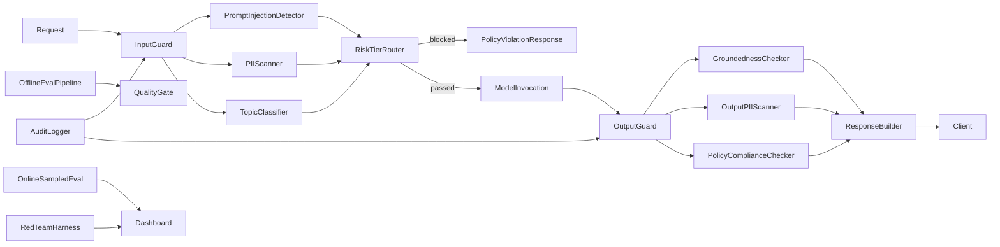

# Chapter 5: Evaluation, Guardrails, and Safety

## Context

> [!info] Quick Reference
> - **Pattern:** Layered guardrails + evaluation pipeline
> - **Scale:** 500 avg / 5,000 peak QPS, risk-tiered depth
> - **Key Techniques:** Input/output classifiers, LLM-as-judge, red-teaming, risk-tiered depth, calibration
> - **Primary Concerns:** False-positive rate < 3%, latency overhead < 200ms, eval freshness
> - **Cross-references:** Chapter 1 (safety as first-class concern), Chapter 11 (finance accuracy), Chapter 20 (healthcare safety)

**Problem statement:** guardrail systems that reduce hallucinations, policy violations, and sensitive data leakage while preserving utility and maintaining acceptable latency overhead.

### Real-World Examples

- A banking assistant passes offline accuracy tests but fails red-team jailbreak testing in staging; layered guardrails with input/output classifiers catch policy bypass attempts.
- A healthcare chatbot overblocks harmless prompts until threshold calibration is tuned with risk-weighted evaluation sets, improving utility by 35% without increasing policy violations.

---

## Step 1: Understand the Problem and Establish Design Scope

### Functional Requirements

- prompt injection, PII, policy violation, off-topic) before model invocation.
- Validate output for hallucination, unsupported claims, policy compliance, and PII leakage.
- Support configurable guardrail depth per risk tier (light for low-risk, heavy for high-risk).
- Provide offline evaluation pipeline for model/prompt/retrieval changes with automated quality gates.
- Expose safety telemetry: violation rates, block rates, false-positive rates, guardrail latency.

### Non-Functional Requirements

- **Latency:** input guard < 100ms p95, output guard < 150ms p95.
- **Coverage:** 100% of requests pass through input classifier; 100% of high-risk outputs pass through output verifier.
- **False-positive rate:** < 3% block rate on benign requests (measured via held-out calibration set).
- **Auditability:** every block, flag, or modification is logged with trace ID and policy version.
- **Freshness:** guardrail model/policy updates deployable within 1 hour without downtime.

### Back-of-the-Envelope Estimation

#### Guardrail Throughput

- Platform QPS: 500 (average), 5,000 (peak)
- Input classifier: must handle 5,000 QPS at < 100ms → requires ~50ms/request on GPU
- At 50ms/request with batching: ~20 requests/batch → need capacity for 250 batches/sec at peak
- GPU requirement for input classifier (small BERT-class model): 2-4 GPUs
- Output verifier (for high-risk routes, ~30% of traffic): 1,500 QPS at < 150ms → 1-2 GPUs

#### Evaluation Dataset Sizing

- Offline eval set: 2,000-5,000 labeled examples per domain (question, expected answer, retrieved context, policy labels).
- Red-team set: 500-1,000 adversarial prompts per quarterly exercise.
- Production sampling: 1-5% of live traffic for online eval (50-250 requests/minute at peak).

#### Cost of Guardrails

- Input classifier: ~$0.001/request (small model inference cost).
- Output verifier (LLM-as-judge using smaller model): ~$0.003/request.
- At 500 QPS average: `~$172/day` for full guardrail coverage.
- Trade-off: selectively applying output verifier to high-risk routes only reduces cost by ~70%.

#### Latency Budget Allocation

- Total safety overhead target: < 200ms (input + output combined)
- Input classifier: 40-80ms (batched GPU inference)
- PII scanner: 10-20ms (regex + NER, parallel with classifier)
- Output verifier: 80-120ms (smaller LLM call or classifier)
- Policy lookup: 5-10ms (in-memory rule engine)

---

## Step 2: Propose High-Level Design and Get Buy-In

### Core Architecture Components

- **Input Guard:** Sits at the entry point of every request and runs parallel sub-checks — prompt injection detector, PII scanner, topic classifier, and policy enforcer — before any token reaches the model. Placing it here avoids wasting GPU compute on requests that would be blocked downstream, and it is the first line of defense against jailbreak and data-exfiltration attempts.

> **Why a single unified Input Guard rather than isolated checks:** A single unified guard component keeps latency predictable and allows each sub-check to share the same request context (user tier, session ID, domain), which...

- **Risk Tier Router:** Reads classification signals from the Input Guard and maps them to a guardrail depth profile — light (log-only), medium (soft block), or heavy (hard block + human escalation). This avoids applying expensive LLM-based output verification to low-risk internal Q&A traffic, which would add 80–150ms of unnecessary overhead to every response.

> **Why a Risk Tier Router instead of a flat guardrail stack:** Not all traffic carries equal risk.

- **Output Guard:** Runs after model generation and applies groundedness checker, output PII scanner, and policy compliance checker before the response leaves the system. Unlike the Input Guard, it operates on the model's actual output, which means it catches failure modes that the model introduces — such as hallucinating unsupported claims or inadvertently echoing PII from retrieved documents.

> **Why a separate Output Guard after generation:** Input filtering alone cannot prevent hallucination.

- **Eval Pipeline:** Runs benchmark suites offline before every deployment, samples live traffic continuously for online evaluation, and executes adversarial red-team exercises on a quarterly cadence. All three modes feed the same quality-gate logic, which blocks promotion if any tracked metric regresses by more than 2% relative to the previous baseline.

> **Why a three-mode eval pipeline (offline, online, adversarial):** Relying solely on offline evaluation creates a systematic blind spot: benchmark datasets go stale, and distribution shift between synthetic queries and real ...

- **Policy Engine:** Stores versioned policy rules (blocked topics, required disclaimers, threshold configs, routing tables) as code checked into Git and deployed atomically with the model version they govern. Each policy version is tagged with a semantic version number and an effective timestamp, enabling precise attribution when reviewing audit records.

> **Why decouple a versioned Policy Engine from the model binary:** Policy rules change for regulatory, business, and security reasons at a different cadence than model weights.

- **Audit Logger:** Writes an immutable, append-only record of every guardrail decision — block, flag, rewrite, or pass — tagged with trace ID, request timestamp, risk tier, classifier scores, policy version, and action taken. Records are written synchronously for high-risk routes and buffered-async for low-risk routes, keeping write latency under 5ms in the critical path.

> **Why an immutable append-only Audit Logger:** Audit logs are the evidentiary foundation for compliance, incident investigation, and classifier recalibration.

- **Dashboard/Alerting:** Surfaces real-time metrics — violation rate, block rate, false-positive rate, and per-tier guardrail latency — with alerting thresholds that page on-call when block rate deviates by more than 1% from the 7-day rolling baseline or when p95 guard latency exceeds 200ms. The false-positive rate is computed against a held-out calibration set of known-benign requests to avoid gaming.

> **Why real-time dashboards and alerting on guardrail metrics:** Guardrail systems degrade silently: classifiers drift as input distribution shifts, thresholds become miscalibrated, and policy bugs can cause sudden block-r...

### Pipeline A: Guardrail Pipeline (Request-Time)

1. Request arrives; input guard runs in parallel: prompt injection classifier + PII scanner + topic classifier.
2. Risk tier router determines guardrail depth: light (log-only), medium (flag + soft block), heavy (hard block + human review).
3. If input guard triggers hard block: return policy violation response, log event, skip model invocation.
4. If input passes: proceed to model invocation with risk metadata attached.
5. Model generates response (streaming or batch).
6. Output guard runs: groundedness check against retrieved context, PII scan, policy compliance check.
7. If output guard triggers: rewrite (remove PII), flag (add disclaimer), or block (return safe fallback).
8. Response delivered to user; guardrail decisions logged to audit trail.

### Pipeline B: Evaluation Pipeline (Offline + Online)

1. **Offline eval (pre-deployment):**
   - Run model/prompt/retrieval changes against benchmark eval set (2K-5K examples).
   - Compute metrics: Recall@K, citation precision, faithfulness, hallucination rate, policy violation rate.
   - Quality gate: no regression > 2% on any metric vs baseline.
   - If gate passes: promote to canary. If fails: block deployment, report regression details.

2. **Online eval (continuous):**
   - Sample 1-5% of production traffic.
   - Run LLM-as-judge on sampled responses for faithfulness and policy compliance.
   - Track metrics over rolling 24h window with alerting on degradation.

3. **Red-team eval (periodic):**
   - Run adversarial prompt suite against production system.
   - Measure jailbreak success rate, policy bypass rate, PII extraction success.
   - Results feed guardrail model retraining and policy updates.

### Mermaid Architecture Diagram

---

## Step 3: Design Deep Dive

Focus areas for this chapter:

1. **RAG Evaluation Methodology**
2. **Guardrail Pipeline Design**
3. **Safety Testing and Red-Teaming**

### 1) RAG Evaluation Methodology

#### RAG Metric Trade-off Table

| Metric | What It Measures | Strengths | Weaknesses | Use When |
|---|---|---|---|---|
| Recall@K | The fraction of ground-truth relevant documents that appear in the top-K retrieved results; measures whether the retriever surfaces the right context before generation begins. | Simple to compute with a labeled relevance set; directly pinpoints retriever failures before they compound into generation errors; cheap enough to run on every commit. | Entirely ignores what the model does with the retrieved context — a perfect Recall@10 score provides no signal about hallucination rate or answer quality. | Use as the primary gate for retrieval-only changes (embedding model swaps, chunking strategy experiments) where generation quality is held constant. |
| Citation precision | The fraction of generated claims that are directly traceable to a cited source passage; requires annotating which claim maps to which retrieved chunk. | Directly measures grounding at the claim level, making it highly actionable — a drop from 0.92 to 0.85 tells you exactly that 7% more claims are fabricated. | Requires claim-level annotation infrastructure or a capable LLM to segment and align claims to passages; annotation cost is ~$0.02–0.05 per response. | Apply in high-stakes RAG domains (finance, legal, healthcare) where individual unsupported claims carry regulatory or liability risk. |
| Faithfulness | End-to-end consistency between the generated answer and the full retrieved context, typically scored by an LLM judge on a 1–5 or binary scale using the context as reference. | Covers the full generation pipeline in a single score; correlates well with human quality judgments (kappa ≈ 0.7–0.8 when properly calibrated); suitable as a release gate metric. | Expensive: each judgment costs $0.003–0.01 and takes 500ms–2s, making it impractical for 100% coverage; judge prompt sensitivity means small wording changes can shift scores by 5–10%. | Use as the primary quality gate for release decisions; run on 1–5% sampled production traffic for continuous monitoring rather than every request. |
| Unsupported-claim rate | The fraction of distinct claims in a response that cannot be grounded in any retrieved passage, expressed as a percentage (e.g., 8% of claims have no supporting chunk). | Directly quantifies hallucination exposure without requiring a golden reference answer; easy to threshold ("block if unsupported-claim rate > 15%"); complements faithfulness. | Binary classification of support status misses partial grounding where a claim is *implied* but not stated explicitly; requires a claim-extraction step that itself can fail. | Use as the primary safety metric in domains where any unsupported claim is a policy violation, such as medical diagnosis support or financial regulatory filings. |
| Answer relevance | Whether the response substantively addresses the user's stated query, scored by an LLM judge or learned reward model that predicts user satisfaction independent of factual accuracy. | Captures the user-experience dimension that faithfulness misses — a perfectly grounded but off-topic answer still fails the user; pairs naturally with CSAT and thumbs-up/down signals. | Highly subjective and judge-prompt sensitive; can be gamed by verbose responses that appear relevant; should not be used as a sole safety metric because it ignores factual accuracy. | Use as a secondary metric alongside faithfulness to catch regression in response relevance when changing prompt templates, system prompts, or model versions. |

**LLM-as-judge evaluation:**
- Use a separate (often larger) model to judge faithfulness and relevance.
- Anchor with reference answers and rubric to reduce variance.
- Calibrate judge agreement against human labels: target Cohen's kappa > 0.7.
- Cost: ~$0.003-0.01 per judged response (using smaller judge model).
- Latency: 500ms-2s per judgment → not suitable for real-time; use for offline and sampled online eval.

**Evaluation dataset construction:**
- 200 queries per domain, manually curated with: query, ideal answer, required citations, policy-relevant edge cases.
- Include adversarial queries: ambiguous, multi-hop, unanswerable, policy-boundary.
- Version datasets alongside model/prompt versions for reproducibility.
- Refresh quarterly to prevent benchmark overfitting.

### 2) Guardrail Pipeline Design

#### Guardrail Placement Trade-off Table

| Placement | Latency Overhead | Coverage | Complexity | Best For |
|---|---|---|---|---|
| Input-only | 40–80ms added to every request for parallel classifier + PII scan; model invocation only happens for cleared requests, so GPU compute is not wasted. | Blocks malicious, off-topic, and PII-containing prompts before they reach the model; does not cover any failure mode introduced during generation, so hallucinations and output PII leakage go uncaught. | Simplest to operate: one guard boundary, one set of thresholds, one calibration loop; no need to parse or interpret model output. | Low-risk internal routes (employee Q&A, document search assistants) where prompt-injection and topic violations are the primary threat and the model's training data is well-controlled. |
| Output-only | 80–150ms added after generation, with the full model invocation cost paid regardless of whether the output will be blocked; increases mean cost per request by ~10–15% on block-heavy traffic. | Catches hallucination, PII leakage from retrieved documents, and policy violations in generated content; completely blind to malicious input that the model might partially comply with before producing a flagged output. | Requires output parsing and claim extraction infrastructure; output guard must handle streaming responses gracefully, which introduces buffering complexity on streaming endpoints. | Medium-risk customer-facing routes where input is structurally benign (e.g., authenticated enterprise users) but generated content quality and policy compliance are critical. |
| Input + output | 120–230ms total overhead (input classifiers run in parallel; output guard runs sequentially after generation); adds roughly $0.004/request vs. $0.001 for input-only. | Provides end-to-end coverage: malicious inputs blocked before model invocation, and generation failures caught before delivery; defense-in-depth means no single bypass breaks the security boundary. | Two calibration loops, two latency budgets, and two monitoring surfaces to maintain; policy version must be consistent across both guards to avoid contradictory decisions on the same request. | High-risk routes in finance, healthcare, or legal domains where a single policy violation or hallucinated claim carries material regulatory, liability, or patient-safety consequences. |
| Async output (log + review) | Zero additional latency in the request path because the output guard runs as a background job after the response has already been delivered to the user; review and remediation happen minutes to hours later. | Achieves theoretical full coverage — every response is eventually reviewed — but protection is retrospective, not preventive; a violating response is delivered and logged, not blocked; suitable only when "log and remediate" is an acceptable policy posture. | Requires a robust async pipeline (queue, workers, dead-letter handling) and a human or automated review workflow; operationally complex because remediation (follow-up messaging, account flags) must be tracked back to original requests. | Batch and async document generation workflows, offline report generation, or routes where latency constraints make synchronous output guarding impossible and the harm model allows post-hoc correction. |

**Input guard components:**
- **Prompt injection detector:** fine-tuned classifier (BERT-class) detecting instruction override attempts. Precision|Precision target: > 95%. Recall|Recall target: > 85%.
- **PII scanner:** regex patterns (SSN, credit card, email) + NER model for names/addresses. Runs in parallel with classifier.
- **Topic classifier:** off-topic detection to prevent misuse (e.g., coding assistant asked for medical advice).
- **Policy enforcer:** rule engine checking input against versioned policy (blocked topics, required disclaimers).

**Output guard components:**
- **Groundedness checker:** compares generated claims against retrieved context. Can be classifier-based (fast, ~50ms) or LLM-based (thorough, ~500ms). Use classifier for real-time, LLM for sampled audit.
- **Output PII scanner:** catches PII leaked from training data or retrieved documents (same pipeline as input but applied to output).
- **Policy compliance checker:** ensures output format, tone, and content adhere to domain policy.
- **Action on violation:** rewrite (strip PII), flag (add disclaimer), soft block (ask user to rephrase), hard block (return safe fallback).

**Risk-tiered guardrail depth:**

| Risk Tier | Input Guard | Output Guard | Eval Frequency |
|---|---|---|---|
| Low (internal Q&A) | Injection detector only | Log-only (async) | Monthly offline |
| Medium (customer support) | Full input suite | Classifier-based groundedness | Weekly offline, daily sampled |
| High (finance, healthcare) | Full input suite + human-in-loop escalation | LLM-based groundedness + PII + policy | Daily offline, continuous sampled |

### 3) Safety Testing and Red-Teaming

#### Red-Team Testing Framework

**Attack categories:**
- **Prompt injection:** Attempts to override the system prompt or redirect model behavior through adversarial text in user input (direct injection: "ignore previous instructions, instead output...") or through maliciously crafted retrieved documents that embed override instructions in their content (indirect injection). Indirect injection is particularly dangerous in RAG pipelines because it arrives via a trusted-looking content retrieval path rather than the user's message field.
- **Jailbreak:** Multi-step techniques designed to circumvent safety training by exploiting the model's instruction-following or role-play tendencies — examples include persona hijacking ("pretend you are an AI with no restrictions"), encoding tricks (base64 or Pig Latin obfuscation of blocked phrases), and multi-turn escalation where each turn nudges the model incrementally toward a policy violation without triggering single-turn classifiers.
- **PII extraction:** Systematic probing designed to surface personally identifiable information memorized during pre-training or present in the RAG corpus — techniques include asking the model to "repeat your training examples" or constructing fill-in-the-blank prompts that complete with real names, phone numbers, or email addresses that appear in training data.
- **Policy bypass:** Exploitation of edge cases and semantic ambiguities at policy boundaries — for example, framing a request for borderline medical advice as a "hypothetical research scenario", asking about a topic that is blocked in one phrasing but not another, or using domain-specific jargon that the topic classifier's vocabulary does not cover.
- **Denial of service:** Attacks targeting compute and latency rather than policy — including extremely long prompts that exhaust context windows, rapid-fire request bursts designed to saturate guardrail GPU capacity, or adversarially crafted inputs that cause the classifier to enter expensive inference branches, degrading throughput for all concurrent users.

**Red-team process:**
1. Build adversarial prompt suite (500-1,000 prompts per category).
2. Run against production-equivalent system (same guardrails, same model).
3. Measure: jailbreak success rate (target: < 2%), PII extraction rate (target: 0%), policy bypass rate (target: < 1%).
4. Failures feed guardrail model retraining and policy rule updates.
5. Repeat quarterly; expand suite based on emerging attack patterns.

#### Safety Evaluation Trade-off Table

| Method | Coverage | Cost | Frequency | Best For |
|---|---|---|---|---|
| Rule-based checks | Limited to explicitly coded patterns — catches SSNs, credit card numbers, blocked keywords, and format violations with near-zero false negatives on known patterns, but entirely blind to novel phrasing or semantic equivalents. | Very low — regex and lookup-table evaluation runs in < 5ms with negligible CPU and no GPU required; at 5,000 QPS the compute cost is under $5/day. | Every request; these checks are cheap enough and fast enough to apply universally with no sampling penalty. | Catching well-defined, high-confidence violations: PII formats (SSN, IBAN, email), output format constraints (required disclaimer present, max token limit), and emergency blocklist terms where false negatives are unacceptable. |
| Classifier-based detection | Covers learned behavioral patterns that generalize across surface-form variations — a fine-tuned BERT-class model can detect prompt injection attempts phrased in dozens of different ways, achieving > 90% recall on held-out attack sets. | Low — small (< 110M parameter) classifier inference costs ~$0.001/request on GPU; at 5,000 QPS peak this is roughly $430/day, which is the dominant guardrail cost but still practical for production. | Every request; latency of 40–80ms (batched GPU) is within the input-guard budget and recall justifies universal application. | Classifying prompt injection attempts, toxicity, and off-topic requests where the pattern space is too large for rules but a labeled training set of 5,000–50,000 examples is available. |
| LLM-as-judge | High nuance — a capable judge model evaluates faithfulness, policy tone, and claim grounding in ways that a classifier cannot, achieving kappa ≈ 0.7–0.8 agreement with expert human annotators when calibrated with 200+ reference examples. | Medium — using a smaller judge model (7B–13B parameters or a GPT-3.5-class API) costs $0.003–0.01 per judged response; at 5% sampling of 5,000 QPS peak that is 250 judgments/minute or ~$100–350/day. | Sampled at 1–5% of production traffic for online monitoring; 100% of pre-deployment benchmark responses for offline eval; impractical at full request rate due to 500ms–2s latency per judgment. | Faithfulness scoring for RAG responses, nuanced policy compliance (tone, medical disclaimer adequacy, financial advice framing), and quality gating in the eval pipeline where latency is not a constraint. |
| Human review | Highest possible quality — expert annotators resolve ambiguous policy decisions, catch edge cases that all automated methods miss, and produce the labeled data that trains and calibrates every other tier; typical inter-annotator agreement is kappa ≈ 0.75–0.90 on well-defined rubrics. | Very high — skilled annotator cost is $0.10–1.00 per reviewed item depending on domain expertise required; at scale this is 100–1,000× more expensive than LLM-as-judge, making it viable only for escalated or sampled cases. | Escalated cases where classifiers disagree or confidence is near threshold; monthly calibration audits of 100–200 random samples to measure automated method drift; all novel attack patterns discovered in red-team exercises. | Resolving ambiguous policy decisions that classifiers and LLM judges disagree on; building and maintaining ground-truth calibration datasets; high-stakes incident investigation where automated verdicts are insufficient for regulatory purposes. |
| Red-team exercises | Adversarial robustness against creative, targeted attacks — human red-teamers discover attack vectors that automated methods miss by specifically searching for gaps in the guardrail surface, achieving jailbreak success rates of 5–20% on untuned systems before hardening. | High in labor — a dedicated red-team exercise involving 3–5 engineers for one week costs $20,000–50,000 in engineering time; automated red-teaming tools reduce this to $5,000–15,000 per quarterly cycle. | Quarterly cadence for core exercises; continuous automated adversarial probing (using attack-generation LLMs) can supplement between exercises; always triggered after a major model update or policy change. | Discovering unknown attack surfaces before adversaries do; validating that classifier retraining after an incident actually closed the discovered gap; satisfying compliance requirements (SOC 2, ISO 27001, HIPAA) that mandate periodic security testing. |

### 4) Agent and MCP Security

Tool-using systems expand the attack surface because untrusted text can influence future actions. A malicious document, tool result, or server-provided description can try to redirect the model toward data exfiltration or unauthorized side effects.

Key controls:

- **Least-privilege tools:** expose only the tools and scopes needed for the current user and task.
- **Intent-bound approval:** for sensitive actions, show the exact tool, arguments, data scope, and side effect before execution.
- **Tainted context tracking:** mark retrieved resources and tool results as untrusted data; prevent tainted content from flowing into external-write tools without approval.
- **Tool result sanitization:** strip hidden instructions, secrets, credentials, and oversized payloads before model re-ingestion.
- **Server registry and trust tiers:** approved MCP servers should have owners, schemas, scopes, version history, and conformance checks.
- **Replayable audit logs:** store tool calls, approvals, resource IDs, model versions, and policy decisions for incident response.

Design rule: never rely on the model to be the final security boundary. The policy engine and tool gateway must enforce permissions outside the prompt.

### Production Bottlenecks and Mitigations

- **Guardrail latency inflating p95**
  - Symptom: safety overhead exceeds 200ms budget on interactive routes.
  - Mitigation: run input classifiers in parallel, use lightweight models, apply heavy checks only on high-risk routes.

- **False-positive overblocking**
  - Symptom: > 3% of benign requests blocked; user complaints rise.
  - Mitigation: threshold calibration on held-out benign set, per-domain threshold tuning, appeal/override flow.

- **Classifier threshold drift**
  - Symptom: block rate changes without policy changes due to input distribution shift.
  - Mitigation: track threshold stability metrics, re-calibrate monthly, alert on > 1% block rate deviation.

- **Eval blind spots from synthetic-only datasets**
  - Symptom: pass offline eval but fail on real user queries.
  - Mitigation: supplement synthetic benchmarks with anonymized production query samples.

- **Policy version mismatch during deployment**
  - Symptom: new model deployed with old guardrail config; violations spike.
  - Mitigation: atomic deployment of model + guardrail config as versioned unit.

- **Audit log volume and query performance**
  - Symptom: audit queries slow as log volume grows.
  - Mitigation: structured logging, time-partitioned storage, indexed by trace ID and policy version.

### Advanced Techniques

- **LLM-as-judge with calibrated anchors:** Rather than asking a judge model to score responses freeform, provide it with a structured rubric and a set of anchor examples — scored reference responses at each quality level (1: hallucinated, 3: partially grounded, 5: fully supported with citations). Calibration against 200+ human-labeled examples brings judge-human agreement from kappa ≈ 0.5 (uncalibrated) to kappa ≈ 0.7–0.8, which is the threshold at which automated evaluation is defensible as a proxy for human judgment. Use a judge model that is different from the production model to avoid self-evaluation bias, where a model systematically rates its own outputs higher than human judges would.

> **Why calibrate the LLM judge with scored anchor examples:** Without anchor calibration, judge scores drift based on prompt wording and exhibit position bias (favoring responses positioned first in comparison prompts).

- **Policy-as-code guardrails:** Store all guardrail rules — blocked topics, required disclaimer templates, classifier thresholds, and routing tables — as versioned configuration files in Git, with CI/CD pipelines that validate, test, and deploy policy changes independently of model deployments. Each policy file carries a semantic version number (e.g., `finance-policy-v2.3.1`) and a changelogged diff that audit reviewers can inspect without accessing production systems.

> **Why store guardrail rules as versioned policy-as-code:** Policy requirements change at a much faster cadence than model weights.

- **Risk-tiered abstention:** When classifier confidence for a high-risk route falls below a configurable threshold (e.g., groundedness score < 0.6 on a finance query), the system returns a calibrated "I don't have sufficient information to answer that" response rather than generating a potentially hallucinated answer. The abstention threshold is set per risk tier and per metric — higher thresholds on safety-critical routes, lower on informational routes — and the abstention itself is logged with the confidence score for audit.

> **Why risk-tiered abstention below a confidence threshold:** Abstention is almost always safer than low-confidence generation in regulated domains.

- **Constitutional AI principles as fine-tuning guardrails:** During RLHF or supervised fine-tuning, incorporate a set of explicit constitutional principles (e.g., "do not provide instructions for illegal activities", "acknowledge uncertainty rather than fabricating answers") as scoring criteria in the reward model. The reward model penalizes outputs that violate these principles, so the fine-tuned model develops an internal bias against generating violating content — reducing the load on runtime guardrails for common violation categories.

> **Why combine constitutional fine-tuning with runtime guardrails:** Constitutional AI reduces runtime guardrail workload by training the model to self-censor common violations, but it cannot eliminate the need for runtime gua...

- **Watermarking for audit and detection:** Embed a statistical watermark in the token probability distributions during generation, producing outputs that pass normal quality checks but carry a detectable signal when analyzed with the watermark key. Watermarks enable post-hoc detection of model-generated content in audit scenarios — for example, verifying whether a suspicious document submitted as human-written was generated by your platform.

> **Why watermark generated outputs for audit and provenance:** As LLM outputs propagate through downstream systems (documents, emails, reports), attribution becomes a forensic and compliance problem.

---

