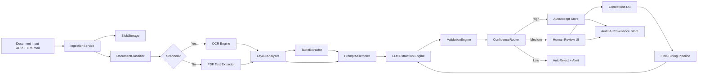

# Chapter 11: Design a Financial Document Extraction System

## Context

> [!info] Quick Reference
> - **Pattern:** OCR-to-LLM document extraction pipeline
> - **Scale:** 2M documents/day, < 5s latency, 99.5%+ per-field accuracy
> - **Key Techniques:** Layout detection (DETR), table structure recognition, constrained decoding, 5-layer hallucination prevention
> - **Primary Concerns:** Digit transposition errors, cross-document bleed, arithmetic consistency, compliance audit trail
> - **Cross-references:** Chapter 7 (document parsing), Chapter 17 (legal contracts), Chapter 5 (guardrails)

**Problem statement:** Design a production system that ingests millions of financial documents (invoices, bank statements, contracts, tax forms), extracts structured fields with >99.5% per-field accuracy, and outputs validated JSON—where a single hallucinated number can trigger regulatory violations or erroneous payments.

### Real-World Examples

- A payments company processes 3M vendor invoices/day. Their regex-based extraction fails on 40% of non-standard layouts. An OCR-to-LLM pipeline with layout-aware table extraction and constrained JSON decoding achieves 99.7% field accuracy, reducing manual review from 45% to 3% of documents.
- A bank's loan processing system extracts income figures from scanned tax returns. The LLM hallucinates "$85,000" as "$850,000" on a blurred document, approving a loan that defaults. Adding cross-field verification (income × tax rate ≈ reported tax) and confidence-gated human review catches the error class entirely.

---

## Step 1: Understand the Problem and Establish Design Scope

### Functional Requirements

- Ingest PDFs (digital-native and scanned), images (TIFF, JPEG, PNG), and structured electronic formats (EDI, XML).
- Extract document-type-specific fields into a predefined JSON schema per document class.
- Detect and extract tables (line items, transaction histories) preserving row-column relationships.
- Assign per-field confidence scores; route low-confidence documents to human review.
- Support 50+ document templates with zero-shot generalization to unseen layouts.

### Non-Functional Requirements

- **Accuracy|Accuracy:** 99.5%+ per-field extraction accuracy across all document types. 99.9%+ for monetary fields after validation.
- **Latency:** End-to-end <5s per document (OCR + classification + extraction + validation).
- **Throughput:** Sustain 2M documents/day (~23 docs/sec average, 100 docs/sec peak).
- **Auditability:** Full provenance trail—every extracted value links to bounding box coordinates in the source document.
- **Availability:** 99.9% uptime with queue-based decoupling (documents never lost).

### Back-of-the-Envelope Estimation

#### Traffic Profile

- Documents/day: 2M
- Peak docs/sec (4x): `~92`
- Fields/day: `2M × 15 = 30M field extractions`
- Digital-native PDFs: 1.2M/day (text-layer extraction, no OCR needed)
- Scanned documents: 800K/day (require full OCR pipeline)

#### Compute Budget per Document (5s SLO)

| Stage | Budget | Notes |
|---|---|---|
| Document ingestion + classification | 200ms | Page count detection, format conversion, doc-type classifier |
| OCR (scanned only, 40% of docs) | 1,500ms | Layout-aware OCR (Tesseract/PaddleOCR), multi-page |
| Text extraction (digital PDFs) | 100ms | PDF text layer + coordinate extraction |
| Layout detection + table parsing | 800ms | Object detection model for tables, headers, footers |
| LLM extraction (field mapping) | 1,800ms | ~2K input tokens, ~500 output tokens, 7B model |
| JSON validation + cross-field checks | 200ms | Schema validation, arithmetic checks, format verification |
| Confidence scoring + routing | 100ms | Per-field confidence aggregation, threshold check |
| **Total (scanned)** | **~4,700ms** | Within 5s SLO |
| **Total (digital)** | **~3,200ms** | Comfortable margin |

#### GPU Fleet Sizing

- LLM extraction: 7quantized model (INT4), ~120 tokens/sec/GPU
- Output tokens/doc: ~500
- continuous batching (6x efficiency): `~0.7s effective per doc`
- Layout detection model: ~10 GPUs (lightweight object detection)
- OCR: CPU-bound, ~200 CPU cores for peak scanned volume
- Total GPU fleet: **~80 GPUs** (steady-state ~35 with autoscaling)

#### Storage

- Average document size: 2MB (PDF/image)
- Daily ingestion: `2M × 2MB = 4TB/day`
- 90-day retention (regulatory): ~360TB
- Extracted JSON: ~2KB/doc → 4GB/day → negligible
- Audit trail (bounding boxes + provenance): ~10KB/doc → 20GB/day

---

## Step 2: Propose High-Level Design and Get Buy-In

### Core Architecture Components

- **Document Ingestion Service:** Accepts uploads (API, SFTP, email), normalizes format, assigns document ID, and queues for processing. This service is the sole entry point and must be idempotent—if a document is submitted twice (network retry, duplicate upload), exactly one processing job should be created, enforced via a content hash deduplication check before enqueue.

> **Why a single ingestion service fronted by a message queue:** Placing all ingestion behind a single service with a message queue decouples the upload rate from the processing rate.

- **Document Classifier:** A lightweight CNN or vision transformer (e.g., fine-tuned on 50+ document classes) classifies each document as invoice, bank statement, loan contract, or tax form, then selects the appropriate extraction schema for that class. Classification accuracy matters because schema mismatch causes all downstream field mappings to fail—a misclassified tax form treated as an invoice will produce zero valid fields.

> **Why a dedicated document classifier rather than prompting the LLM to infer document type:** Using a dedicated classifier rather than prompting the LLM to infer document type separates concerns and saves tokens.

- **OCR Engine:** Layout-aware OCR (PaddleOCR or Tesseract with preprocessing) processes scanned documents and produces text tokens plus their bounding box coordinates (x, y, width, height) on the page. This stage is bypassed entirely for digital-native PDFs, where pdfplumber or PyMuPDF extracts the text layer and character-level coordinates directly from the PDF's internal structure at ~100ms per document.

> **Why OCR must emit bounding box coordinates, not just text:** Bounding box coordinates are not optional metadata—they are the foundation of source grounding (Layer 1 of hallucination prevention).

- **Layout Analyzer:** An object detection model (DETR or Faster R-CNN fine-tuned on financial document layouts) identifies structural regions—tables, key-value blocks, headers, footers, logos, and signature zones—and outputs their bounding boxes and semantic labels. The model is fine-tuned on a corpus of at least 100K annotated financial document pages to handle the wide variation in vendor templates.

> **Why a dedicated layout analyzer on top of OCR:** Raw OCR text loses spatial structure.

- **Table Extractor:** A specialized Table Structure Recognition (TSR) module processes the regions flagged as tables by the layout analyzer, predicting row separators, column separators, and cell boundaries to reconstruct the full row-column grid. It handles complex layouts including merged header cells, borderless tables (where whitespace defines structure), multi-line cell content, and tables that span page boundaries.

> **Why a specialized Table Structure Recognition model rather than OCR alone:** General OCR reads text in a single left-to-right, top-to-bottom pass and cannot reconstruct table structure.

- **LLM Extraction Engine:** Takes the assembled prompt (OCR text, layout structure as serialized key-value and table blocks, and the target JSON schema) and generates structured JSON with per-field values. Inference uses a 7B quantized model with grammar-constrained decoding to guarantee that every token produced continues a parse-valid JSON sequence matching the schema, eliminating the possibility of malformed output.

> **Why an LLM for field extraction rather than template or regex rules:** The LLM is the only component capable of zero-shot generalization to unseen vendor templates.

- **Validation Engine:** Applies three independent validation passes after extraction: (1) JSON schema conformance using jsonschema; (2) cross-field arithmetic checks (line item totals must sum to subtotal; subtotal plus tax must equal invoice total within rounding tolerance); (3) format and business-rule checks (dates must be parseable and logically ordered, account numbers must pass checksum algorithms, currencies must be in the allowed enum). Fields that fail validation are flagged with specific failure codes before confidence routing.

> **Why a separate validation engine with cross-field arithmetic checks:** Even with constrained decoding guaranteeing structural validity, a model can produce a structurally valid but arithmetically impossible output—a total that d...

- **Confidence Router:** Aggregates per-field confidence scores (combining LLM token log-probabilities, OCR word confidence, and validation pass/fail signals) into a document-level confidence score, then routes each document to one of three queues: auto-accept (>0.95), human review (0.80–0.95), or full manual extraction (<0.80). The router also performs per-field routing for high-value documents—even a high-confidence document goes to human review if any monetary field has confidence below 0.90.

> **Why three-way confidence routing rather than a binary accept/reject:** A binary accept/reject decision is wasteful.

- **Human Review UI:** Displays the source document with bounding box overlays highlighted for every extracted field, shows the extracted value alongside the raw OCR text for that region, and indicates the confidence score and any validation failures per field. Reviewers correct individual fields without re-extracting the entire document, and corrections are stored with reviewer ID and timestamp for downstream fine-tuning.

> **Why the review UI overlays bounding boxes on the source document:** Showing reviewers only the extracted fields without the source document context forces them to mentally re-read the document to verify values—increasing revi...

- **Audit & Provenance Store:** An append-only store that links every extracted field value to its source bounding box coordinates, OCR confidence score, LLM model version, extraction timestamp, and (if applicable) the reviewer ID who confirmed or corrected the value. No records are ever deleted or modified; corrections are stored as new entries linked to the original extraction event.

> **Why an append-only audit and provenance store:** Financial regulators (e.g., under Sarbanes-Oxley, PSD2, or Basel III requirements) require complete audit trails for any automated financial data processing.

### Pipeline A: Document Processing Pipeline

1. Document arrives via API/SFTP/email → ingestion service assigns a UUID, deduplicates via content hash, stores the original binary in blob storage (S3/GCS), and places a processing job on the queue with the blob reference and detected MIME type.
2. Document classifier reads the first page as an image (for visual classification) and the MIME type, determines document type (invoice, statement, contract, tax form) and page count, and attaches the appropriate JSON schema definition to the job.
3. For scanned docs: OCR engine applies preprocessing (deskew, denoise, binarize) then runs PaddleOCR to produce a word-level list of `{text, confidence, bbox}` tuples. For digital PDFs: pdfplumber extracts text tokens with character-level bounding boxes directly from the PDF object tree, bypassing OCR entirely.
4. Layout analyzer runs the DETR-based detection model on each page image and produces a list of region annotations: `{region_type, page, bbox, confidence}` covering tables, key-value blocks, headers, footers, and signature zones.
5. Table extractor runs TSR on each region annotated as a table, produces a structured grid of `{row, col, content, bbox}` tuples, merges multi-page table continuations by matching column headers, and serializes each table into markdown for prompt injection.
6. Prompt assembler combines the OCR key-value pairs, serialized tables, remaining free text, document type, and target schema into the structured extraction prompt format, keeping total prompt length under the model's 8K token context window by truncating low-priority free text last.
7. LLM extraction engine runs grammar-constrained inference, producing a JSON object guaranteed to conform to the target schema. Token log-probabilities for each field value are captured alongside the output for confidence scoring.
8. Validation engine runs three passes: JSON schema conformance, cross-field arithmetic checks with a 0.5% rounding tolerance, and format/business-rule checks. Each failing check attaches a failure code and the specific field(s) implicated.
9. Confidence router computes the document-level confidence score and per-field confidence scores, then routes to auto-accept (>0.95), human review (0.80–0.95), or full manual extraction (<0.80). High-value documents (total amount >$10K) apply a stricter monetary-field threshold of 0.92 regardless of document-level score.
10. Results are written to the output store with full provenance: every field value links to its source bounding box, OCR confidence, LLM model version, and extraction timestamp. An event is published to downstream consumers (payment systems, accounting APIs) only after successful provenance write.

### Pipeline B: Model Training & Improvement Pipeline

1. Human review corrections are collected in a corrections database with the original extraction, the reviewer-supplied correct value, and the field-level diff. Each correction is tagged with the document type and the specific failure mode (wrong value, hallucinated value, missed field, format error) to enable targeted analysis.
2. Corrections are joined with the original document image and OCR output to form training tuples: `(document_image, ocr_text, layout_regions, correct_json)`. Tuples where the correction was a reviewer error (caught by subsequent audit) are excluded from training data.
3. A weekly LoRA fine-tuning run on the extraction model processes all corrections accumulated since the last run. The LoRA adapter targets the attention and MLP layers most responsible for value extraction (identified via activation analysis), leaving the model's general language understanding intact.
4. A quality gate compares the new model checkpoint against the frozen baseline on a held-out test set stratified by document type. The new checkpoint must show ≥0.2% improvement in per-field exact-match accuracy with no regression on any individual document class before promotion.
5. Canary deployment routes 5% of live traffic to the new model while the baseline handles the remaining 95%. Field-level accuracy is measured against human review outcomes for 24 hours; the deployment is promoted if accuracy meets or exceeds the baseline and rolled back automatically if any accuracy metric drops more than 0.1%.
6. Gradual rollout advances in 10% increments every 4 hours, with continuous monitoring of the per-field accuracy, human review routing rate, and arithmetic validation failure rate. A drop in any metric triggers an automatic halt and Slack alert to the ML engineering on-call.

### Mermaid Architecture Diagram



---

## Step 3: Design Deep Dive

Focus areas:

1. **OCR-to-LLM Pipeline (Layout Detection, Table Extraction, Field Mapping)**
2. **Structured Output Enforcement (JSON Schema, Constrained Decoding, Validation)**
3. **Hallucination Prevention for Financial Data**

### 1) OCR-to-LLM Pipeline

The pipeline must bridge the gap between raw pixels and structured financial data. Each stage introduces potential error that compounds downstream.

**OCR strategy by document type:**

| Document Source | OCR Approach | Word-Level Accuracy | Notes |
|---|---|---|---|
| Digital-native PDF | Direct text extraction (pdfplumber/PyMuPDF) | 99.9%+ | No OCR needed; extract coordinates from PDF internals |
| Clean scan (300+ DPI) | Tesseract/PaddleOCR with preprocessing | 98-99% | Deskew, binarize, denoise before OCR |
| Low-quality scan (<200 DPI) | PaddleOCR + super-resolution preprocessing | 94-97% | Upscale with ESRGAN before OCR; flag for human review |
| Photographed documents | Document-specific model (DocTR/TrOCR) | 90-95% | Perspective correction, shadow removal required |
| Handwritten fields | TrOCR fine-tuned on financial handwriting | 85-92% | Always route to human review for monetary amounts |

**Layout detection architecture:**

The layout analyzer uses an object detection model (Faster R-CNN or DETR fine-tuned on financial documents) to identify structural regions:

- **Key-value blocks:** "Invoice Number: INV-2024-001" → detect label-value pairs using spatial proximity heuristics; labels and values within ~20px vertical alignment and <200px horizontal separation are grouped. This structured representation prevents the LLM from needing to parse free text to find field associations.
- **Tables:** Detect the outer bounding box of tables, then apply a secondary TSR model for internal row/column segmentation. The two-model approach lets each model specialize: the detector handles "is this a table?" while the TSR model handles the finer "where are the rows and columns?"
- **Headers/footers:** Identify recurring text blocks that appear at the same vertical position across multiple pages (company name, page numbers, document title), enabling template matching for known vendor layouts and cross-page context stitching.
- **Signatures/stamps:** Detect but do not extract content from signature and stamp regions. Their presence is recorded as a boolean completeness signal (e.g., `signature_present: true`) required by some compliance workflows to confirm a document is fully executed.

**Table extraction pipeline:**

Tables are the hardest structural element. Financial documents contain line items, transaction histories, and amortization schedules with complex layouts.

1. **Table detection:** Object detection model identifies table bounding boxes.
2. **Row/column segmentation:** TSR (Table Structure Recognition) model predicts row and column separators. Handles borderless tables using whitespace analysis.
3. **Cell content extraction:** Map OCR words to cells using spatial overlap with predicted cell boundaries.
4. **Header association:** Classify first row(s) as headers; map column semantics (Description, Quantity, Unit Price, Total).
5. **Multi-page table merging:** Detect continuation tables across pages using header matching and column alignment.

**Prompt assembly for LLM extraction:**

The prompt must convey document structure, not just raw text. The format:

```text
Document Type: Invoice
Schema: {invoice_number: string, date: date, vendor_name: string, ...}

=== KEY-VALUE PAIRS ===
[Label: "Invoice Number", Value: "INV-2024-001", Position: (120, 45)]
[Label: "Date", Value: "March 15, 2024", Position: (120, 72)]
...

=== TABLE: Line Items ===
| Description | Qty | Unit Price | Total |
|---|---|---|---|
| Widget A | 100 | $12.50 | $1,250.00 |
| Widget B | 50 | $8.75 | $437.50 |

=== RAW TEXT (remaining) ===
Payment Terms: Net 30 ...

Extract all fields matching the schema as JSON.
```

#### OCR-to-LLM Trade-off Table

| Approach | Accuracy | Latency | Generalization | Complexity |
|---|---|---|---|---|
| OCR → regex/template matching | 85-92% per field; fails completely on any layout not in the template library, requiring weeks of engineering per new vendor | <500ms; purely deterministic, no model inference | None — a new vendor layout breaks the system entirely until a template is hand-coded | Low to build; high to maintain as the template library grows to hundreds of rules |
| OCR → LLM (text only, no layout) | 93-96% per field; table cell values are frequently misattributed to the wrong column because spatial structure is lost in linearization | ~2s; one LLM inference call with ~2K tokens, no object detection overhead | Good for simple key-value documents; degrades significantly on multi-column tables and complex invoices | Medium; OCR pipeline plus LLM, but no layout detection or TSR models to build and maintain |
| OCR → layout-aware LLM (structured prompt) | 97-99% per field; table structure preserved in the prompt eliminates most cross-column confusion; source grounding enables error detection | ~3s; adds ~800ms for layout detection and TSR on top of OCR and LLM inference | Strong; the LLM maps semantically equivalent labels across layouts, handling ~80% of novel vendor templates without retraining | High; three additional ML models (layout detector, TSR, OCR) each requiring monitoring, retraining, and versioning |
| Vision-Language Model (end-to-end, no OCR) | 95-98% on clean documents; degrades to 85-90% on low-quality scans, and below 80% on dense multi-page tables — the model loses positional precision at scale | 3-5s; requires processing full-resolution page images through a large vision encoder (typically 7B-72B parameters) | Best zero-shot on novel layouts; VLMs generalize visual patterns without needing document-type-specific training | High computational cost; VLMs are 5-10x more expensive per document than a 7B text model; no bounding box provenance without additional grounding heads |
| Hybrid: OCR + layout + LLM + VLM fallback | 99%+ per field; OCR pipeline handles 90% of documents reliably, VLM catches the 10% where layout parsing fails; combining both verification channels catches nearly all error types | 4-5s for the VLM fallback path; the majority of documents complete on the 3s OCR+LLM path | Best overall; each approach covers the other's blind spots, and the system degrades gracefully when one component fails | Very high; two complete pipeline paths to build, monitor, and maintain; requires routing logic to decide which path each document takes |

### 2) Structured Output Enforcement

Financial extraction demands perfectly structured output. A missing closing brace or a string where a number belongs is unacceptable.

**JSON schema enforcement layers:**

1. **Schema definition per document type:**

```json
{
  "type": "object",
  "properties": {
    "invoice_number": {"type": "string", "pattern": "^[A-Z]{2,4}-\\d{4,}$"},
    "total_amount": {"type": "number", "minimum": 0},
    "currency": {"type": "string", "enum": ["USD", "EUR", "GBP", "JPY"]},
    "line_items": {
      "type": "array",
      "items": {
        "type": "object",
        "properties": {
          "description": {"type": "string"},
          "quantity": {"type": "integer", "minimum": 1},
          "unit_price": {"type": "number", "minimum": 0},
          "total": {"type": "number", "minimum": 0}
        },
        "required": ["description", "quantity", "unit_price", "total"]
      }
    }
  },
  "required": ["invoice_number", "total_amount", "currency", "line_items"]
}
```

2. **Constrained decoding at inference time:**

Rather than hoping the LLM produces valid JSON, enforce it during generation:

- **Grammar-constrained decoding:** Use a context-free grammar (CFG) that mirrors the JSON schema. At each token position, mask logits to only allow tokens that continue a valid parse. Libraries: Outlines, llama.cpp grammar mode, vLLM guided decoding.
- **Finite-state machine (FSM) approach:** Track the parser state during decoding. When inside a string value for `total_amount`, only allow digit tokens, decimal points, and the closing quote.
- **Structured output APIs:** OpenAI/Anthropic structured output modes that guarantee schema conformance.

3. **Post-generation validation pipeline:**

Even with constrained decoding, validate:

- JSON schema conformance (jsonschema library).
- Type coercion: parse "$1,250.00" → 1250.00 (strip currency symbols, commas).
- Date normalization: "03/15/2024", "March 15, 2024", "15-Mar-24" → ISO 8601.
- Enum matching: fuzzy-match extracted values to allowed enum sets.

#### Structured Output Trade-off Table

| Technique | Conformance Rate | Latency Overhead | Quality Impact | Complexity |
|---|---|---|---|---|
| Free-form generation + regex parsing | 70-85% conformance; models frequently add markdown fences, prose explanations, or trailing commas that break JSON parsers, especially on edge cases with unusual field values | None at inference time; all cost is paid in regex maintenance and error-handling code for the 15-30% of responses that fail | High failure rate in production; every parse failure requires a retry or fallback, adding latency variance and compute cost unpredictably | Low to start; rapidly grows complex as more edge cases require special-casing in the parsing layer |
| Prompt engineering ("output valid JSON") | 85-95% conformance; reliability depends heavily on model size and instruction-following capability — a 7B model may achieve only 85%, while a 70B model reaches 95% | None; the instruction consumes ~10 tokens of prompt budget but adds zero inference overhead | Model-dependent and inconsistent; the same prompt may fail 5% of the time in one model version and 15% after a model update, creating silent regressions | Low; just a prompt addition, but requires careful monitoring as model versions change |
| Constrained decoding (grammar/FSM) | 99.9%+ conformance by construction; the FSM makes it physically impossible to generate a token that would violate the grammar, so invalid output cannot occur | 5-15% slower decoding throughput due to logit masking at each step — masking eliminates ~90% of the vocabulary at most positions, requiring an extra matrix operation per token | Slight reduction in field value accuracy (~0.5-1%) because the most probable token is sometimes masked; the model is forced to the second-best token, which may be a valid format but a slightly less confident value | Medium; requires integrating a grammar library (Outlines, llama.cpp grammar mode) with the inference server and defining a CFG per schema |
| Function calling / tool use API | 98-99% conformance; cloud provider APIs (OpenAI, Anthropic) enforce schema server-side, so clients receive only valid responses or explicit errors | Minimal — typically <50ms additional latency over standard generation; schema enforcement is handled inside the provider's inference stack | Good quality; the model is trained specifically for structured output, so function-calling-tuned models often produce higher-quality field values than grammar-constrained open models | Low on the client side; providers handle the complexity, but you're locked into their API and schema language capabilities |
| Constrained decoding + post-validation | 100% structural conformance; arithmetic and semantic validation is layered on top of structural guarantees, catching the errors constrained decoding cannot prevent (valid structure, wrong value) | 10-20% slower total pipeline; 5-15% from constrained decoding plus ~10ms for arithmetic checks and format validation | Best overall; structural guarantees eliminate parse failures, and semantic validation catches the remaining error classes | High; requires constrained decoding infrastructure, per-schema grammar definitions, and a validation rule engine with domain-specific arithmetic and format rules |

### 3) Hallucination Prevention for Financial Data

In financial extraction, a hallucinated digit is not a minor quality issue—it's a potential compliance violation or erroneous payment. The system must treat hallucination as a safety problem.

**Hallucination taxonomy for document extraction:**

| Hallucination Type | Example | Frequency | Severity |
|---|---|---|---|
| Digit transposition | "$1,250" → "$1,520" | 2-3% of fields | Critical for amounts |
| Fabricated field | Model invents an invoice number not present in document | 1-2% | High |
| Cross-document bleed | Value from a previous document in batch appears in current extraction | <0.5% | Critical |
| OCR error propagation | OCR reads "8" as "6" → LLM faithfully extracts wrong value | 3-5% on low-quality scans | High |
| Normalization error | "$1,250.00" parsed as "$125,000" (misplaced decimal) | 1-2% | Critical for amounts |

**Multi-layer hallucination prevention:**

**Layer 1 — Source grounding:**
- Every extracted value must trace to specific bounding box coordinates in the source document.
- During extraction, require the LLM to output both the value and its source location: `{"total_amount": 1250.00, "total_amount_source": "page1, bbox(320, 415, 420, 435)"}`.
- Post-extraction: OCR the specific bounding box region independently and compare against extracted value. Mismatch → flag for review.

**Layer 2 — Cross-field verification:**
- Arithmetic checks: `sum(line_item.total) == subtotal`, `subtotal + tax == total_amount`.
- Rate checks: `tax_amount / subtotal ≈ expected_tax_rate ± 1%`.
- Date logic: `due_date > invoice_date`, `payment_terms_days == due_date - invoice_date`.
- Relationship checks: `vendor_name` in extracted text must appear in raw OCR output (not fabricated).

**Layer 3 — Confidence scoring:**
- Per-field confidence derived from:
  - LLM token-level log-probabilities (average log-prob of tokens comprising the field value).
  - OCR confidence for the source bounding box region.
  - Validation pass/fail signals (arithmetic check passed → boost confidence).
- Composite confidence: `conf = 0.4 × llm_logprob + 0.3 × ocr_confidence + 0.3 × validation_score`.

**Layer 4 — Human review routing:**

| Confidence Band | Action | Expected Volume |
|---|---|---|
| > 0.95 | Auto-accept | 85% of documents |
| 0.80 – 0.95 | Human review (reviewer sees flagged fields only) | 12% of documents |
| < 0.80 | Full manual extraction | 3% of documents |

**Layer 5 — Batch-level anomaly detection:**
- Track field value distributions per vendor/document type.
- Flag statistical outliers: invoice total 10x historical average for that vendor → review.
- Detect cross-document bleed: if same unique identifier (invoice number) appears in two consecutive extractions → flag.

#### Hallucination Prevention Trade-off Table

| Technique | Error Reduction | Latency Cost | Human Review Load | Implementation Effort |
|---|---|---|---|---|
| Source grounding (bbox verification) | 40-50% reduction in hallucinated values; the technique specifically catches cases where the LLM generates a value that does not appear anywhere in the OCR output — i.e., pure fabrication rather than OCR-error propagation | +200ms to re-OCR the specific bounding box region at higher resolution for comparison; this can be parallelized with the validation pipeline to minimize wall-clock impact | Reduces review load by converting vague "low confidence" flags into specific, actionable "extracted value does not match source text" flags, enabling reviewers to verify in seconds rather than re-reading the entire document | Medium; requires extracting and storing bounding box coordinates per field during LLM inference, implementing independent re-OCR logic, and building the character-level comparison pipeline |
| Cross-field arithmetic checks | 20-30% reduction in monetary field errors; catches all cases where individual line item errors propagate to totals, and all cases of digit transposition that change a sum — but cannot catch errors where both the line items and the total are consistently wrong (e.g., consistently off by 10x) | +10ms; purely computational, no model inference; arithmetic on ~15 fields per invoice is negligible | Eliminates the entire class of "total doesn't match line items" errors from human review — reviewers see only arithmetic failures where something is genuinely inconsistent, not marginal floating-point differences | Low; a straightforward rules engine with document-type-specific formulas (sum of line items = subtotal; subtotal + tax = total; tax / subtotal ≈ expected rate); requires only the extracted JSON, no additional ML |
| Confidence-gated routing | Not an error prevention mechanism — a detection and containment strategy; routes ~12-15% of documents to human review, where human accuracy is ~99.9%, effectively achieving that accuracy for the routed subset | +50ms for aggregating per-field confidence scores, computing composite scores, and evaluating routing thresholds across all fields; can be parallelized with provenance storage | Routes 12-15% of documents to human review; the key design choice is the threshold — lowering from 0.95 to 0.90 reduces review load by ~40% but allows ~0.5% more errors through to auto-accept | Medium; requires capturing and storing per-field token log-probabilities during LLM inference (not available in all inference frameworks), implementing OCR confidence aggregation, and calibrating thresholds empirically against held-out labeled data |
| Dual extraction (run twice, compare) | 60-70% reduction in field errors; when two independent extraction runs disagree on a value, one is almost certainly wrong — and the disagreement signal is highly correlated with actual errors (~85% precision for flagging) | +100% compute cost; each document requires two full LLM inference passes at the same latency as the original, effectively doubling the GPU fleet requirement and doubling per-document inference cost | Reduces human review to only the ~10-20% of documents where the two extraction runs disagree on at least one field, which is a much more targeted review queue than confidence-gated routing | Low implementation complexity (run the same pipeline twice with different temperature or prompt variations) but high infrastructure cost; rarely justified except for a subset of very high-value documents (e.g., invoices >$100K) |
| Ensemble (two models, majority vote) | 50-60% reduction in errors; two differently-trained models have largely independent error patterns — a digit transposition error in model A is unlikely to produce the same wrong digit in model B | +80% compute overhead rather than +100%; the two models can run concurrently if GPU capacity permits, adding only ~200ms for the slower model's completion rather than the full inference time of a second pass | Requires human review only for the ~15-25% of documents where models disagree, similar to dual extraction but with the additional benefit that agreement between two architecturally different models is a stronger quality signal | High; requires training and maintaining two separate extraction models with different architectures or training data, coordinating their deployment, and building a field-level comparison and merging layer |

### Production Bottlenecks and Mitigations

- **OCR quality variance across document sources**
  - Symptom: The same pipeline achieves 99% word-level accuracy on clean 300 DPI scans but drops to 88% on faxed documents or documents photographed with poor lighting — an 11-point gap that translates directly into extraction errors on monetary fields.
  - Mitigation: Assign a per-source quality score at ingestion by measuring the median OCR word confidence for a sample of that source's historical documents. Sources with median confidence below 0.85 automatically receive super-resolution preprocessing (Real-ESRGAN upscaling before OCR) and have all monetary fields routed to human review regardless of extraction confidence, effectively treating them as a lower-trust input class.

> **Why per-source OCR confidence calibration rather than a single global threshold:** A single OCR quality threshold applied uniformly to all sources either over-routes clean documents (expensive reviewer time) or under-routes degraded documen...

- **Table extraction failure on complex layouts**
  - Symptom: Merged header cells, nested tables within line items, or borderless tables that use only whitespace for column separation cause the TSR model to misalign rows and columns — a row of "$1,250 | 10 | $125" may be parsed as three separate single-cell rows, associating none of the values with the correct column header.
  - Mitigation: Ensemble two table detection approaches: the neural TSR model and a rule-based whitespace-alignment parser. When their outputs disagree on column count or cell boundaries, fall back to passing the table image directly to a VLM (e.g., GPT-4V) with a prompt asking for the table as a markdown grid. This fallback applies to fewer than 5% of tables but catches the cases where structural parsing fails most spectacularly.

> **Why ensemble TSR with a rule-based parser and VLM fallback:** A neural TSR model trained on well-structured tables generalizes poorly to the adversarial long tail of financial document formats.

- **LLM context window overflow on multi-page documents**
  - Symptom: A 20-page loan contract with 300 words per page contains approximately 90K characters or ~22K tokens — exceeding the 8K context window of a 7B model. Fields mentioned only in the appendix (e.g., prepayment penalty clauses on page 19) are never seen by the extraction model, resulting in silently missed fields with no error or confidence signal.
  - Mitigation: Implement a two-level extraction strategy. First, use the document classifier's page-level segmentation to identify which pages contain which schema fields (trained on 10K annotated contracts). Second, run extraction independently on each relevant page or section, using only the sub-schema for that section. Third, merge the per-section JSON extractions, resolving conflicts (e.g., an interest rate mentioned on page 3 and page 47 must match) using a lightweight reconciliation prompt with only the conflicting fields.

> **Why a segment-then-reconcile strategy for multi-page documents:** Naively chunking documents and running a single extraction pass per chunk loses cross-page field references and produces duplicate or conflicting values for ...

- **Cross-document contamination in batch processing**
  - Symptom: When multiple documents are processed in the same GPU worker process (a common optimization for throughput), the KV cache state from document N can influence the softmax attention weights for document N+1, particularly for rare tokens like specific account numbers or invoice IDs that appear in both documents' contexts — causing values from a previous document to appear in the current extraction.
  - Mitigation: Enforce document isolation at the inference level: clear the KV cache completely between documents and never include multiple documents in a single inference call. Use a dedicated process per document (process-level isolation) during high-accuracy mode, accepting the 15-20% throughput loss. Flag any extracted value (account number, invoice ID, vendor name) that also appears in the immediately preceding document's extraction as a potential contamination event for review.

> **Why enforce per-document KV cache isolation during batch processing:** KV cache contamination is insidious because it produces plausible-looking extractions — the contaminating values are real financial data from a real document...

- **Schema evolution when new document types appear**
  - Symptom: A new vendor begins submitting invoices in an EDI 810 format with vendor-specific extension fields (e.g., a `project_code` field not in the standard invoice schema). The extraction model correctly extracts all schema-defined fields but silently ignores the project code — which the downstream payment system requires for cost center allocation, causing payment rejections.
  - Mitigation: Run zero-shot discovery mode on the first 100 documents from each new vendor or format: prompt the LLM to extract both the schema-mandated fields AND any additional key-value pairs it detects that are not in the schema. Human reviewers confirm which discovered fields should be promoted to schema-level fields. Discovered fields accumulate in a "candidate fields" registry; any candidate that appears in >80% of documents from a vendor triggers a schema update proposal.

> **Why run zero-shot discovery mode on new document types:** Purely schema-driven extraction creates a closed-world assumption — the system can only find what it's looking for.

- **Confidence calibration drift**
  - Symptom: At launch, the 0.95 confidence threshold auto-accepts 85% of documents with a 0.3% error rate. After three months, the same threshold auto-accepts only 70% of documents — a 15% increase in human review load with no corresponding increase in error rate. The model's confidence distribution has shifted rightward (lower confidence on average) due to changes in document quality, vendor mix, or model fine-tuning.
  - Mitigation: Weekly calibration using human review outcomes as ground truth. For each document reviewed by a human, record whether the extracted fields were correct. Fit a Platt scaling logistic regression that maps raw composite confidence scores to calibrated probabilities that equal the empirical accuracy rate. Recalibrate thresholds so that the 0.95 tier corresponds to documents with measured 95%+ accuracy — which may require a raw score of 0.92 or 0.97 depending on the current distribution.

> **Why weekly Platt scaling recalibration of confidence thresholds:** Confidence scores from LLM token log-probabilities are not naturally calibrated to accuracy percentages.

---

