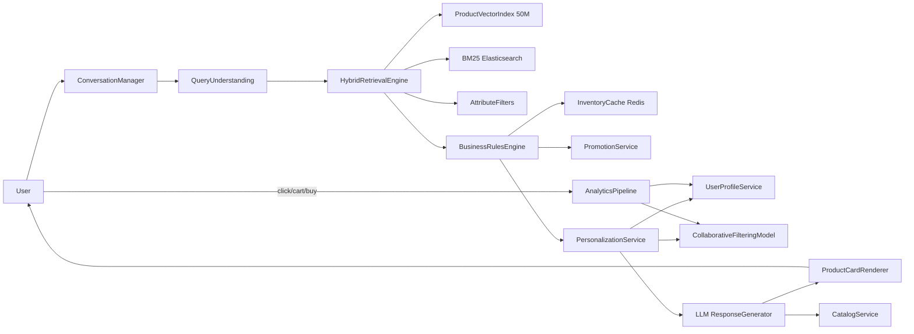

# Chapter 12: Design a Personalized E-commerce Shopping Assistant

## Context

> [!info] Quick Reference
> - **Pattern:** Real-time personalized recommendation assistant
> - **Scale:** 50M product catalog, real-time inventory cache (30s TTL)
> - **Key Techniques:** Long-term + short-term user profile fusion, hybrid retrieval (semantic + BM25 + structured), business constraint layers
> - **Primary Concerns:** Inventory staleness, margin target enforcement, cold-start users, A/B revenue attribution
> - **Cross-references:** Chapter 3 (hybrid retrieval), Chapter 2 (RAG pattern)

**Problem statement:** Design a conversational shopping assistant that merges real-time user behavior, purchase history, and a 50M-product catalog to deliver personalized, inventory-aware product recommendations through natural language—while optimizing for revenue per session, not just answer quality.

### Real-World Examples

- A fashion retailer deploys a chat assistant. Users who engage with it convert at 3.2x the rate of browse-only users. But the assistant recommends out-of-stock items 18% of the time, causing frustration and cart abandonment. Adding real-time inventory filtering and availability-aware ranking drops OOS recommendations to <1% and lifts revenue per session by 22%.
- An electronics marketplace integrates collaborative filtering signals into the assistant's retrieval layer. When a user asks "best laptop for video editing under $1500," the system retrieves not just semantically matching laptops but also the laptops most purchased by users with similar browsing history. Click-through rate on recommendations jumps from 12% to 31%.

---

## Step 1: Understand the Problem and Establish Design Scope

### Functional Requirements

- Multi-turn conversational interface with context retention across a shopping session.
- Product search and recommendation grounded in the live 50M-product catalog.
- Support query types: discovery, comparison, transactional, and post-purchase (order status, returns).
- Personalized ranking based on user history, preferences, and collaborative signals.
- Business constraint enforcement: inventory availability, seller eligibility, margin targets, promotional campaigns.
- Product cards with images, prices, ratings, and direct add-to-cart actions within the chat.

### Non-Functional Requirements

- **Latency:** TTFT < 1.5s for all query types. Product card rendering < 2s including image fetch.
- **Throughput:** 10M DAU × 4 queries/session = 40M queries/day (~460 QPS avg, ~2,300 QPS peak).
- **Personalization quality:** Click-through rate on recommended products > 25%. Revenue per assisted session > 1.5× unassisted.
- **Inventory accuracy:** <1% of recommended products out of stock at time of recommendation.
- **Availability:** 99.9% uptime. Graceful degradation: fall back to non-personalized search if personalization service is down.

### Back-of-the-Envelope Estimation

#### Traffic Profile

- DAU: 10M
- Sessions/day: ~12M (some users have multiple sessions)
- Queries/day: `12M × 4 = 48M`
- Peak QPS (5x): `~2,780`
- Average input tokens/query: 200 (user query + conversation context + retrieved product data)
- Average output tokens/query: 150 (response with product mentions + reasoning)
- Total output tokens/day: `48M × 150 = 7.2B tokens`

#### Retrieval Budget per Query

| Stage | Budget | Notes |
|---|---|---|
| Query understanding + rewriting | 50ms | Intent classification, entity extraction, query expansion |
| Embedding generation | 20ms | User query → vector (cached model, batch inference) |
| Candidate retrieval (ANN + filters) | 80ms | Top-200 candidates from vector index + attribute filters |
| Business constraint filtering | 30ms | Inventory check, seller eligibility, promotional rules |
| Personalized reranking | 100ms | User-product scoring model, collaborative signals |
| Product data assembly | 50ms | Fetch top-10 product details from catalog service |
| LLM generation | 800ms | ~200 input tokens + 150 output tokens, 7B model |
| Product card rendering | 200ms | Image CDN fetch, price formatting, availability badge |
| **Total** | **~1,330ms** | Within 1.5s TTFT SLO |

#### GPU Fleet Sizing

- LLM: 7B quantized (INT4), ~150 tokens/sec/GPU
- Output tokens/query: 150
- With continuous batching (6x): `~0.17s effective per query`
- Embedding model: bi-encoder, ~5 GPUs (high-throughput batch inference)
- Reranking model: cross-encoder, ~30 GPUs (per-pair scoring)
- Total GPU fleet: **~510 GPUs** (steady-state ~200 with autoscaling)

#### Catalog Index

- 50M products × 768-dim embeddings × 4 bytes (FP32) = ~150GB vector index
- With HNSW (1.5x overhead): ~225GB → fits in memory across 4 nodes (64GB each)
- Structured attribute index (Elasticsearch): ~500GB for full catalog with facets
- Real-time inventory: Redis cluster, ~50M keys × 100 bytes = ~5GB

---

## Step 2: Propose High-Level Design and Get Buy-In

### Core Architecture Components

- **Conversation Manager:** Maintains session state, conversation history, extracted preferences, and cart context across multiple turns. This component is stateful per session and is responsible for compressing older turns into a structured preference summary (budget, must-haves, deal-breakers) once the session exceeds four turns, preventing context-window overflow while preserving actionable user intent.

- **Query Understanding Module:** Performs intent classification (discovery/comparison/transactional/post-purchase), entity extraction (brand, category, price range, attributes), and query rewriting for retrieval. It transforms ambiguous conversational queries—such as "something like those shoes I bought last month"—into structured retrieval queries by resolving cross-turn references and filling in implicit constraints from session history.

- **Retrieval Engine:** Executes hybrid search combining semantic (vector/ANN) retrieval, keyword (BM25) retrieval, and structured attribute filtering, then merges results with Reciprocal Rank Fusion (RRF). This multi-signal approach ensures both intent-level recall (semantic) and exact-match precision (keyword) are covered, since a query like "Samsung QN90C" requires keyword match while "best OLED TV for bright rooms" is better served by embedding similarity.

- **Personalization Service:** Scores retrieval candidates using a fused signal of the user's long-term preference embedding, the current session embedding, collaborative filtering scores, and explicit conversation-derived constraints. Running this as a separate microservice allows it to degrade gracefully—if the service is unavailable, the system falls back to unscored retrieval rather than returning an error.

- **Business Rules Engine:** Applies hard and soft constraints post-retrieval and pre-reranking: hard filters remove out-of-stock or ineligible products, while soft boosts adjust ranking scores for margin targets and active promotions. Separating business logic from ML scoring makes rules auditable and enables non-ML engineers to modify promotion configurations without touching model code.

- **LLM Response Generator:** Takes the top-10 ranked product candidates plus conversation context and user preference state, then generates a conversational response that references specific products by name and key differentiator. The LLM is strictly grounded—it receives only verified catalog attributes in its prompt and is instructed to avoid any claim not present in the provided product data, reducing hallucinated spec comparisons.

- **Product Card Renderer:** Enriches LLM output with structured product cards (image, price, rating, availability badge, add-to-cart CTA) by post-processing the generated text to detect product references and inject card components. This keeps the LLM focused on language generation rather than UI formatting, and allows the card design to be updated without model retraining.

- **User Profile Service:** Serves user embeddings (long-term and session), preference vectors, and real-time behavioral features from a low-latency store (Redis + feature store). The service applies incremental updates every five minutes from clickstream events, balancing freshness against the cost of continuous model inference.

- **Catalog Service:** Provides enriched product metadata—titles, descriptions, structured attributes, pricing, inventory status, and reviews—as the authoritative source for both the retrieval index and LLM prompt assembly. All product data passed to the LLM is fetched from this service at response-generation time to ensure accuracy, rather than relying on potentially stale data embedded in retrieval index records.

- **Analytics & Feedback Pipeline:** Captures click, add-to-cart, and purchase events attributed to assistant recommendations via a Kafka event stream, then feeds attributed conversion data back into personalization model training and A/B experiment evaluation. The pipeline distinguishes between direct attribution (click → purchase in session) and assisted attribution (view → subsequent search → purchase within 24 hours) to avoid understating the assistant's revenue impact.

### Pipeline A: Query Processing & Response Pipeline

1. User sends message → conversation manager appends to session history, extracts accumulated preferences (budget, brand, category).
2. Query understanding module classifies intent and extracts entities. Rewrites query for retrieval (e.g., "something like those shoes I bought last month" → "running shoes similar to [Nike Pegasus 40]").
3. Retrieval engine executes hybrid search:
   - Semantic: embed rewritten query → ANN search over product embedding index → top-200 candidates.
   - Keyword: BM25 search over product titles/descriptions → top-100 candidates.
   - Structured: filter by extracted constraints (price range, category, brand).
   - Merge and deduplicate → ~300 unique candidates.
4. Business rules engine filters: remove out-of-stock, banned sellers, region-restricted products. Apply promotional boosts.
5. Personalization service scores remaining candidates using user-product affinity model. Rerank to top-10.
6. LLM response generator receives: conversation history + top-10 products (title, price, key specs, rating) + user preferences → generates conversational response.
7. Product card renderer attaches structured cards to product mentions in the response.
8. Response streamed to user. Click/cart/purchase events tracked for attribution.

### Pipeline B: Profile & Catalog Update Pipeline

1. Clickstream events (views, clicks, searches, carts, purchases) ingested via Kafka.
2. Near-real-time user embedding update: incremental model updates user vector every 5 minutes from recent behavior.
3. Product catalog changes (new products, price updates, inventory changes) ingested from catalog service.
4. Product embeddings generated for new/updated products; vector index updated incrementally.
5. Inventory cache (Redis) updated in real-time from warehouse management system.
6. Collaborative filtering model retrained daily on interaction matrix (user × product × action).
7. Personalization reranking model retrained weekly on attributed conversion data from assistant interactions.

### Mermaid Architecture Diagram



---

## Step 3: Design Deep Dive

Focus areas:

1. **Profile-Catalog Fusion (User Embedding + Product Embedding + Collaborative Signals)**
2. **Hybrid Search with Business Constraints**
3. **Personalization Evaluation (A/B Testing, Revenue Attribution)**

### 1) Profile-Catalog Fusion

The core challenge: merging a user's implicit preferences (derived from behavioral history) with explicit query intent and a 50M-product catalog in real-time.

> **Why fuse separate long-term and short-term session embeddings:** Separating long-term preference signals from short-term session signals is critical because they serve different purposes.

**User representation architecture:**

The user profile is a multi-signal embedding that captures long-term preferences and short-term intent:

- **Long-term preference vector (768-dim):** Trained via a two-tower model on (user, purchased_product) pairs. Updated daily. Captures stable preferences (brand affinity, category preferences, price sensitivity).
- **Short-term session vector (768-dim):** Running average of product embeddings for items viewed/clicked in the current session. Updated per interaction. Captures immediate intent.
- **Explicit preference features (structured):** Price range, brand whitelist/blacklist, size, color preferences extracted from conversation. Stored as key-value pairs.

**Product representation:**

- **Product embedding (768-dim):** Generated from title + description + attributes using a fine-tuned bi-encoder (e5-large or similar). Indexed in HNSW for ANN search.
- **Structured attributes:** Category, brand, price, rating, review count, seller ID, inventory status. Stored in Elasticsearch for filtered search.
- **Collaborative signal:** `P(purchase | user_cluster, product)` from matrix factorization on the interaction matrix.

> **Why a two-tower model for retrieval rather than a cross-encoder:** The two-tower model architecture (user encoder + product encoder trained jointly) is preferred over a single cross-encoder for the candidate retrieval stage ...

**Fusion scoring at retrieval time:**

```text
score(user, product) = α × cosine(user_longterm, product_embedding)
                     + β × cosine(user_session, product_embedding)
                     + γ × collaborative_score(user_cluster, product)
                     + δ × attribute_match_score(explicit_prefs, product_attrs)
```

Where α, β, γ, δ are learned weights from a click-prediction model trained on historical assistant interactions.

#### Profile-Catalog Fusion Trade-off Table

| Signal | Precision | Coverage | Cold-Start Behavior | Latency |
|---|---|---|---|---|
| Long-term user embedding | High (~70-75% CTR on repeat categories) because the two-tower model is trained on actual purchase pairs | Misses novel interests—if a user has never browsed electronics, the embedding has no signal for a first-time laptop query | Effectively zero signal for users with fewer than 5 interactions; falls back to global popularity | 5ms (pre-computed embedding served from Redis cache; no inference at request time) |
| Session embedding | High for current intent (~65-70% CTR) because it directly reflects what the user is looking at right now | Narrow—limited to categories viewed in the current session, so a first-click session has only one data point | Works from the very first product click; the session vector initializes to the first viewed product's embedding | 2ms (running average maintained in session memory; updated on every page view event) |
| Collaborative filtering | Discovers non-obvious matches with ~60% CTR lift vs. content-only; surfaces "users like you also bought X" associations | Popularity bias skews toward blockbuster products; long-tail items with few interactions have near-zero collaborative signal | Useless for new users (no interaction history) and weak for new products (no rows in the interaction matrix for ≤7 days) | 10ms (cluster-level scores precomputed nightly; lookup by user cluster ID at inference time) |
| Explicit conversation preferences | Highest precision (~80%+ CTR) because user stated exactly what they want (e.g., "under $200, wireless, over-ear") | Covers only what the user has explicitly mentioned in the current conversation; silent preferences are invisible to this signal | Works immediately from the first turn—no history required; especially valuable for new users if the UI prompts for preferences | 0ms (extracted by the query understanding module; already structured in memory as key-value pairs) |
| Hybrid (all signals fused) | Best overall precision (~78% CTR in A/B tests) because each signal compensates for another's blind spots | Best overall coverage—long-term handles familiarity, session handles recency, collaborative handles discovery, explicit handles constraints | Graceful degradation: for new users, only session + explicit signals fire; quality improves with each interaction | 20ms total (dominated by collaborative lookup; embedding signals are parallel calls) |

**Cold-start strategy:**

- **New user, no history:** Rely on explicit preferences from conversation + popularity-based fallback. Session embedding builds from first product view.
- **New user, third-party data:** If user logged in via social/email, use demographic-based prior (age group × region → preference priors from aggregate data).
- **New product, no interactions:** Product embedding from content is available immediately. Collaborative signal zero → rely on content similarity and attribute matching. Boost new products for exploration (10% of recommendation slots reserved for new products in matching categories).

### 2) Hybrid Search with Business Constraints

E-commerce search is not pure relevance ranking. Business constraints are hard requirements that override relevance—a perfectly semantically matched product that is out of stock or sold by a suspended seller must be filtered out before it ever reaches the user, regardless of its embedding score.

> **Why business constraints as a deterministic post-retrieval filter rather than a ranking-model feature:** Mixing business constraint enforcement into the ranking model (as a learned feature) produces unpredictable behavior because ML models can learn to compensat...

> **Why Reciprocal Rank Fusion over learned weights for combining BM25 and ANN results:** Reciprocal Rank Fusion (RRF) is chosen over learned fusion weights for combining BM25 and ANN candidate lists because it is robust to score distribution diff...

**Hybrid retrieval architecture:**

1. **Semantic retrieval (ANN):** Query embedding → HNSW index → top-200 by cosine similarity. Captures "intent" even when user query doesn't match product keywords.
2. **Keyword retrieval (BM25):** Query → Elasticsearch → top-100 by BM25. Catches exact brand names, model numbers, and specific attributes that semantic search may miss.
3. **Structured filter pass:** Apply hard constraints from query understanding:
   - Price: `price >= min AND price <= max`
   - Category: restrict to detected category
   - Attributes: "waterproof," "wireless," "size 10"
   - Availability: `inventory > 0 AND fulfillable_in_region`
4. **Merge:** RRF (Reciprocal Rank Fusion) to combine semantic and keyword candidate lists. Filtered candidates passed to reranking.

**Business constraint layers (applied post-retrieval, pre-reranking):**

| Constraint | Type | Implementation | Impact |
|---|---|---|---|
| Inventory availability | Hard filter | Batch-query Redis for all ~300 candidates in a single pipeline call (~10ms). Any product with `inventory_count = 0` or `fulfillable_in_region = false` is removed before personalization scoring begins. | Eliminates ~5-15% of candidates at steady state; up to 40% during flash sales or holiday stockouts, making this the highest-impact filter in the pipeline |
| Seller eligibility | Hard filter | Banned and suspended seller IDs maintained in a bloom filter loaded into application memory (~2MB) for zero-latency lookup; region-specific restrictions stored in Redis with seller×region keys. | Eliminates ~2-3% of candidates in normal operation, but this number spikes to ~10% during fraud enforcement events—missing even one banned seller recommendation creates legal and reputational risk |
| Minimum margin | Soft boost/suppress | Products below the minimum margin threshold receive a score multiplier of 0.7 (a 30% penalty), pushing them down the ranked list without fully excluding them—because removing them entirely would cause visible catalog gaps on low-margin categories like books. | Reranks ~10% of candidates by at least 3 positions; prevents the personalization model from inadvertently surfacing high-relevance but margin-negative products in the top-3 slots |
| Promotional boost | Soft boost | Active promotions retrieved from a PromotionService cache (5-minute TTL) and applied as a multiplicative score factor of 1.2–1.5× depending on promotion tier. Flash deals receive a 2.0× boost for their first 2 hours to drive rapid sell-through. | Lifts promoted items by approximately 3–5 positions in the ranked list, turning a position-8 product into a top-3 recommendation during active campaigns |
| Sponsored products | Injection | The ad-bidding system returns up to 2 sponsored product slots after the personalization ranking completes; these are injected into fixed positions (slots 1 and 5 of the top-10) and labeled "Sponsored" in the UI to maintain disclosure compliance. | Adds direct advertising revenue without degrading organic recommendation quality, as the sponsored slots are additive rather than replacing high-ranking organic results |
| Price competitiveness | Soft boost | A nightly job compares catalog prices against scraped competitor prices; products priced ≥5% below the lowest competitor receive a 1.15× score boost. The boost is applied only when the user query contains price-sensitive signals (e.g., "cheapest," "best deal," "under $X"). | Improves price-sensitive query outcomes by directing users toward genuinely competitive offerings, reducing the probability of cart abandonment when users comparison-shop on competitor sites |

**Handling real-time inventory:**

- Inventory cache in Redis, updated from warehouse management system every 30 seconds.
- At retrieval time: batch check top-300 candidates against Redis (single pipeline call, ~10ms for 300 keys).
- Edge case: item goes OOS between recommendation and add-to-cart. Handle gracefully in cart service with "similar available items" fallback.
- Low-stock signals: when inventory < 5 units, add urgency signal to product card ("Only 3 left").

**Query rewriting for retrieval:**

| User Query | Rewritten Query | Reasoning |
|---|---|---|
| "Something like those shoes I bought last month" | "Running shoes similar to Nike Pegasus 40" | Resolve reference from purchase history |
| "Best laptop for my daughter starting college" | "Laptop student portable 13-14 inch budget $500-$1200" | Expand implicit constraints |
| "Is the Samsung one better than this?" | "Compare Samsung Galaxy S24 vs [last mentioned product]" | Coreference resolution from session |
| "Cheaper options" | "[current category] price < [current lowest viewed price]" | Session-relative constraint |

#### Hybrid Search Trade-off Table

| Approach | Recall@100 | Precision@10 | Business Constraint Handling | Latency |
|---|---|---|---|---|
| BM25 only | 40–55%: strong for exact brand/model queries ("Sony WF-1000XM5") but fails on intent-level queries where the user doesn't know exact product names | 30–40%: top-10 results are noisy because BM25 doesn't model semantic equivalence (e.g., "headphones" ≠ "earbuds" in BM25) | Post-filter only—business constraints applied as Elasticsearch filter clauses after scoring, which means OOS products are retrieved and scored before being discarded, wasting latency budget | 30ms for an Elasticsearch query over 50M products with standard shard configuration (5 shards, 3 replicas) |
| Semantic only (ANN) | 55–70%: captures intent well for discovery queries but misses exact-match queries; a search for "Anker A3145" may return generic Bluetooth speakers instead of the specific model | 40–55%: embedding space conflates products that are described similarly but serve different use cases; a 768-dim embedding cannot distinguish "gaming headset" from "studio monitor headphones" without fine-tuning | Post-filter only—ANN index does not natively support structured constraints; inventory and price filters applied in a post-processing step after retrieving top-200 candidates | 50ms: HNSW ANN search over a 150GB index distributed across 4 nodes with ef_search=200; faster than BM25 at high recall thresholds because HNSW skips most of the index |
| Hybrid (BM25 + ANN + RRF) | 70–80%: RRF fusion captures candidates that either signal would miss alone; recall improvement over single-signal is most pronounced for mid-tail queries (not exact model numbers, not pure intent) | 55–65%: fusion improves top-10 quality because the two signals vote independently; a product must rank highly in at least one signal to surface | Post-filter applied after merge—still requires checking all merged candidates (~300) against inventory cache | 80ms: parallel BM25 (30ms) + ANN (50ms) calls followed by 10ms RRF merge; wall-clock latency limited by the slower signal (BM25) |
| Hybrid + structured filters pre-applied | 75–85%: pre-applying category and price filters before retrieval reduces the candidate space to products that can actually satisfy the query, improving the quality of the top-100 | 65–75%: precision improves significantly because candidates from both retrieval signals already satisfy hard constraints, so reranking can focus on relevance rather than filtering | Native integration—price range and category filters applied as pre-retrieval constraints in Elasticsearch and as HNSW metadata filters, so only eligible products enter the candidate pool | 80ms: same wall-clock as unfocused hybrid because Elasticsearch filtered queries are faster on smaller result sets, offsetting the overhead of filter application |
| Hybrid + filters + personalized reranking | 80–90%: the reranking step promotes candidates relevant to this specific user that generic retrieval would have ranked lower, and demotes candidates that match the query but conflict with known user preferences | 75–85%: in production A/B tests, adding personalized reranking on top of hybrid retrieval lifted CTR@10 from ~28% to ~38% for returning users with >30 days of history | Native + soft constraints—personalization model incorporates margin and promotional scores as learned features alongside relevance, allowing nuanced trade-offs between business objectives and user preference | 180ms total: 80ms retrieval + 100ms cross-encoder reranking over top-50 candidates (parallel scoring on GPU, ~2ms/pair) |

### 3) Personalization Evaluation

Measuring whether personalization actually works—in revenue terms, not just ML metrics—is the hardest part of the system.

**Metric hierarchy:**

| Metric | Definition | Target | Measurement Frequency |
|---|---|---|---|
| Revenue per assisted session | Total purchase value in sessions with assistant interaction | > 1.5× unassisted | Daily |
| Click-through rate (CTR) on recommendations | Clicks on recommended products / recommendations shown | > 25% | Hourly |
| Add-to-cart rate | Add-to-cart actions from recommendations / recommendations shown | > 8% | Hourly |
| Conversion rate (assisted) | Sessions with assistant interaction that result in purchase / total assisted sessions | > 5% | Daily |
| Recommendation relevance (human eval) | Human raters score relevance 1-5 on sampled recommendations | > 4.0 avg | Weekly |
| Out-of-stock recommendation rate | OOS products recommended / total products recommended | < 1% | Hourly |
| Session length (turns) | Average conversation turns per session | 4-6 (engagement without frustration) | Daily |
| Fallback rate | % of queries where personalization service fails and falls back to non-personalized | < 0.5% | Hourly |

> **Why user-level randomization rather than session-level or request-level for the A/B test:** User-level randomization—rather than session-level or request-level—is the correct unit for this experiment because returning users within a single experimen...

**A/B testing framework:**

- **Randomization unit:** User-level (not session-level) to avoid cross-contamination from returning users.
- **Stratification:** By user tenure (new vs returning), platform (mobile vs desktop), and region. Ensures balanced cohorts.
- **Minimum detectable effect:** 2% relative lift in revenue per session at 95% confidence requires ~500K users per arm for 7 days.
- **Guardrail metrics:** Cart abandonment rate, return rate, customer satisfaction (post-session survey). A variant that lifts revenue but increases returns is net-negative.

**Revenue attribution model:**

Attributing purchases to assistant recommendations requires careful modeling:

- **Direct attribution:** User clicks a recommended product → adds to cart → purchases within session. Clear attribution.
- **Assisted attribution:** User sees recommendation → doesn't click → later searches for same product → purchases. Requires view-through tracking with time decay (24h window, exponential decay).
- **Incremental attribution:** Compare purchase rate of recommended products in treatment vs control. Incrementality = `purchase_rate_treatment - purchase_rate_control`. This is the true causal lift.

| Attribution Model | Accuracy | Complexity | Overstates Impact By |
|---|---|---|---|
| Last-click | Low: assigns 100% of purchase credit to the final touchpoint, ignoring all prior recommendation exposures that built purchase intent—if a user sees a recommendation on turn 2 and buys via search on turn 5, the assistant gets zero credit | Trivial: join the purchase event to the last click event by session ID; no modeling required | 0% in one direction, but misattributes: understates the assistant's contribution for assisted purchases and overstates direct search channel contribution by ~30–40% |
| Direct (click → cart → purchase) | Medium: accurately captures explicit recommendation-driven purchases within a session, but misses the significant fraction (~30%) of purchases where the user views a recommendation, leaves to compare elsewhere, and returns to buy directly | Low: track click events with a recommendation source tag; join to cart and purchase events within the same session ID | Understates true impact by ~30%—internal studies at large e-commerce platforms consistently show that view-through conversions account for roughly one-third of recommendation-attributed revenue |
| View-through (24h decay) | Medium-high: captures assisted conversions where the user was influenced by a recommendation but did not click through directly; exponential decay weights recent views more heavily (e.g., a view 1 hour ago gets 0.84 credit, a view 23 hours ago gets 0.04) | Medium: requires a view event log joined to purchase events with a time-decay attribution function; per-user matching across sessions adds engineering complexity | ~10–15% overstatement from coincidental views—a user who sees a recommendation for a product they were already going to buy gets credited as an attribution win even without causal influence |
| Incremental (A/B causal) | Highest: compares the actual purchase rate of recommended products in the treatment group against a counterfactual control group; the difference is the true causal lift uncontaminated by selection bias | High: requires a properly randomized A/B experiment with sufficient statistical power (~500K users per arm for a 2% MDE at 95% confidence), plus holdout groups maintained for the duration of the test | 0%: by design, the A/B comparison eliminates selection effects and coincidental purchases; this is considered the ground truth for incrementality measurement in production e-commerce systems |
| Multi-touch (Shapley value) | High: distributes purchase credit proportionally across all recommendation touchpoints in the user journey using game-theoretic Shapley values, giving partial credit to the discovery recommendation, the comparison recommendation, and the final push | Very high: requires tracking the full recommendation exposure sequence per user, computing Shapley values across combinatorial subsets of touchpoints, and aggregating across millions of sessions daily—typically requires a dedicated ML attribution team | ~5%: Shapley attribution still cannot distinguish between a touchpoint that caused purchase intent and one that merely confirmed an existing decision; the approximation error grows with longer conversion paths (>4 touchpoints) |

**Offline-online evaluation loop:**

1. **Offline:** Train new personalization model. Evaluate on historical data using replay methodology (counterfactual estimation). Gate: must show >2% predicted CTR lift.
2. **Shadow mode:** Deploy to production, generate recommendations but don't show them. Compare against production model predictions on same queries. Gate: predictions are well-calibrated (predicted CTR matches observed CTR within 5%).
3. **Online A/B test:** 5% traffic allocation for 7 days. Primary metric: revenue per session. Guardrails: return rate, support ticket rate.
4. **Ramp:** 5% → 25% → 50% → 100% with monitoring at each stage.

### Production Bottlenecks and Mitigations

- **Stale inventory recommendations**
  - Symptom: Users see "recommended" products that are out of stock by the time they click.
  - Mitigation: Redis inventory cache with 30s refresh. Double-check inventory at product card render time (not just retrieval time). Add "low stock" warnings.

- **Cold-start users receiving generic recommendations**
  - Symptom: New users get popularity-based recommendations that feel impersonal. Low engagement.
  - Mitigation: Aggressive preference elicitation in first 2 turns ("What are you shopping for today? Any brand preferences?"). Use onboarding quiz for high-intent users.

- **Catalog embedding index staleness**
  - Symptom: New products (added today) don't appear in semantic search results.
  - Mitigation: Streaming embedding pipeline—new product → generate embedding within 5 minutes → incremental HNSW index update. Keyword search (BM25) covers new products immediately.

- **LLM generating incorrect product claims**
  - Symptom: Assistant says "This laptop has 32GB RAM" when the product has 16GB.
  - Mitigation: LLM prompt includes only verified product attributes from catalog. Post-generation fact-check: regex-extract claims about product specs → verify against catalog data → correct or remove unverifiable claims.

- **Promotional bias eroding trust**
  - Symptom: Users notice recommendations are always promoted/sponsored items. Engagement drops.
  - Mitigation: Cap sponsored slots to 2/10 per response. Label sponsored items clearly. Track long-term user trust metrics (return visits, session frequency) as guardrail.

- **Multi-turn context window overflow**
  - Symptom: Long shopping sessions (8+ turns) exceed LLM context window; early preferences forgotten.
  - Mitigation: Conversation summarizer compresses history to structured preference state (category, budget, brand, must-haves, deal-breakers) after every 4 turns. Raw history truncated; preference state persists.

---

