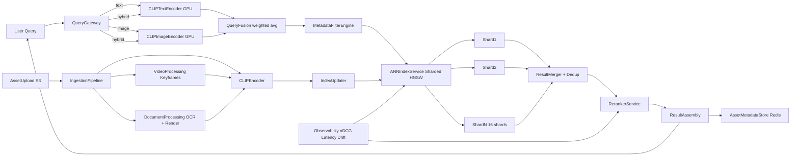

# Chapter 15: Design a Multimodal Asset Search System

## Context

> [!info] Quick Reference
> - **Pattern:** Cross-modal semantic search (image/video/document)
> - **Scale:** Large multi-modal asset corpus with real-time indexing
> - **Key Techniques:** CLIP/SigLIP shared embedding space, modality-specific indexes with score normalization, video keyframe extraction (TransNetV2 + uniform sampling), multimodal score fusion
> - **Primary Concerns:** Cross-modal calibration, temporal precision for video, document rendering strategy, index freshness
> - **Cross-references:** Chapter 3 (vector infrastructure), Chapter 7 (enterprise search), Chapter 14 (audio/video signals)

**Problem statement:** Design a search system that supports cross-modal queries (text→image, image→text, text→video, image→video) over 500embedding spaces, with sub-150ms retrieval Latency (TTFT, TPOT, latency and production-grade ranking.

### Real-World Examples

- A stock media platform (Shutterstock/Getty-class) serves 10K QPS across 500M images and 50M video clips. When text queries like "sunset over mountain lake" return irrelevant results, user engagement drops 15% week-over-week. Deploying CLIP-based embeddings with a learned reranker improves nDCG@10 by 22% over BM25-on-metadata baselines.
- An enterprise DAM (Digital Asset Management) system enables designers to search by uploading a reference image. The system retrieves visually similar assets across images and video keyframes in a unified embedding space. Without cross-modal retrieval, designers spend 40 minutes per search session manually browsing folders; with it, median search time drops to 3 minutes.

---

## Step 1: Understand the Problem and Establish Design Scope

### Functional Requirements

- **Cross-modal retrieval:** Any query modality can retrieve any asset modality. A user typing text must be able to retrieve images, video clips, or documents without separate search flows for each modality.
- **Text queries:** Return ranked images, video clips, and documents ordered by semantic relevance to the natural-language query, not just keyword overlap with metadata tags.
- **Image queries:** Return visually similar images and video keyframes using the shared CLIP embedding space, enabling "find more like this" functionality that respects content and style rather than just filename similarity.
- **Hybrid queries:** Support text + reference image with controllable weighting (e.g., α slider from "match text" to "match image"), so a user can say "find blue dresses like this one" where both the color description and the reference garment shape contribute to retrieval.
- **Faceted filtering:** Asset type, resolution, duration, license, upload date, and color palette filters applied pre-ANN-search to shrink the candidate set before embedding-space search, reducing both latency and irrelevant results.
- **Near-real-time indexing:** New assets searchable within 5 minutes of upload, so content creators see their uploads appear in search immediately after processing rather than waiting for overnight batch jobs.

### Non-Functional Requirements

- **Latency:** p95 < 150ms end-to-end from query receipt to ranked results returned to the client. This budget covers query encoding (~15ms GPU), ANN search (~15ms across shards), reranking (~40ms GPU), and result assembly (~20ms), leaving 60ms headroom.
- **Throughput|Throughput:** 10K QPS sustained at peak, with burst capacity to 15K QPS during promotional events without SLO degradation. Requires horizontal scaling of both the GPU query-encoding pool and the ANN shard replicas.
- **Corpus:** 500M assets at launch, growing 2M/week (~104M/year). Index architecture and capacity planning must accommodate 3–5 years of growth without full re-architecture, implying a target of ~1B assets before the next major design revision.
- **Freshness:** New assets indexed within 5 minutes of upload completion. This requires streaming ingestion (not batch), micro-batch index updates every 30 seconds, and a brute-force sidecar index covering the most recent 5-minute upload window.
- **Relevance:** nDCG@10 > 0.65 on human-judged cross-modal query sets. This is measured weekly on a held-out evaluation set of 10K (query, relevant-asset) pairs covering all modality combinations.
- **Availability:** 99.95% uptime for the search serving path, corresponding to < 4.4 hours downtime/year. The ingestion pipeline can tolerate brief outages (assets queue up and index on recovery) without violating this SLO.
- **Cost:** < $0.001 per query at scale. At 10K QPS and $123/hr infrastructure cost, actual cost is ~$0.0000034/query — three orders of magnitude under budget, providing room for additional reranking compute as quality needs grow.

### Back-of-the-Envelope Estimation

#### Corpus and Embedding Storage

- Assets: 500M
- Embedding dimension: 768 (CLIP ViT-L/14)
- Total vectors (images + video keyframes + documents): `400M + 1.2B + 20M = 1.62B vectors`

#### Index Architecture

- HNSW index for 1.62B vectors at 128 bytes/vector:
  - Memory: ~207 GB vectors + ~300 GB graph overhead = ~507 GB total
  - Sharded across 16 machines with 64 GB RAM each (2x replication for availability)
  - Each shard: ~100M vectors, ~32 GB memory
- Alternative: IVF-PQ index: smaller memory footprint (~150 GB) but requires nprobe tuning for recall

> **Why HNSW as the primary index:** HNSW (Hierarchical Navigable Small World) achieves recall (>95% R@10 at ef_search=128) and supports incremental i...

#### Query Processing

- Peak QPS: 10K
- Query embedding inference (CLIP text encoder): ~5ms per query on GPU, batch of 64 → ~312 embeddings/sec per GPU
- ANN search: ~5-10ms per shard, 16 shards queried in parallel → 10ms
- Reranking (cross-encoder on top-100): ~20ms (GPU) or ~50ms (CPU)
- Total query latency budget:

| Stage | Budget | Notes |
|---|---|---|
| Query embedding (CLIP text/image encoder) | 15ms | Batched GPU inference |
| Pre-filter (metadata facets) | 5ms | Inverted index on metadata |
| ANN search (parallel across shards) | 15ms | HNSW search, nprobe-tuned |
| Fetch candidate metadata | 10ms | Cache-backed metadata store |
| Reranking (cross-encoder or fusion) | 40ms | Top-100 → top-20 |
| Result assembly + dedup | 10ms | Remove near-duplicate images |
| Post-processing (thumbnail URLs, etc.) | 5ms | CDN URL signing |
| **Total** | **100ms** | 50ms headroom under 150ms SLO |

#### Ingestion Throughput

- Image embedding (CLIP ViT-L/14): ~20ms per image on GPU → single GPU handles 50/sec
- Video embedding: 15 keyframes per clip → 15 * 20ms = 300ms per video → single GPU handles ~3 videos/sec
- Total embedding compute for ingestion: 1-2 GPUs (trivial relative to serving fleet)
- Index update: micro-batch inserts into HNSW every 30 seconds

> **Why micro-batch inserts every 30 seconds rather than continuous streaming:** HNSW inserts require acquiring a write lock on the graph structure to update the navigable small world connections.

#### Cost Per Query

- GPU fleet (query embedding + reranking): ~30 GPUs, ~$2.50/hr each = $75/hr
- Index serving fleet (CPU/RAM): 32 machines, ~$1.50/hr each = $48/hr
- Total: ~$123/hr

---

## Step 2: Propose High-Level Design and Get Buy-In

### Core Architecture Components

- **Query Gateway:** Auth, rate limiting, query parsing, modality detection (is the query text, image, or hybrid?).
- **Query Encoder Service:** Encodes text/image queries into the shared embedding space using CLIP model. Batched GPU inference.
- **Metadata Filter Engine:** Pre-filters corpus by structured facets (type, license, date range, resolution) using an inverted index. Reduces ANN search space.
- **ANN Index Service:** Sharded HNSW (or IVF-PQ) index serving 1.62B vectors. Performs approximate nearest neighbor search in the joint embedding space.
- **Reranker Service:** Cross-encoder or late-fusion model that reranks top-100 ANN results to produce final top-20. Uses richer features than dot-product similarity.
- **Asset Metadata Store:** Low-latency key-value store (Redis-backed) for asset metadata, thumbnails, and preview URLs.
- **Ingestion Pipeline:** Processes new assets: extract visual features, generate embeddings, extract metadata, update index.
- **Video Processing Service:** Keyframe extraction, scene detection, temporal segmentation, per-keyframe embedding.
- **Observability:** Query latency histograms, nDCG sampling, embedding drift detection, index freshness metrics.

### Pipeline A: Asset Ingestion Pipeline

1. New asset uploaded to object storage (S3). Event triggers ingestion.
2. **Modality router:** routes to image, video, or document processing path.
3. **Image path:** resize to 224x224, run through CLIP ViT-L/14 image encoder → 768-dim embedding. Extract EXIF metadata.
4. **Video path:** decode video, run scene detection (PySceneDetect or TransNetV2), extract keyframes at scene boundaries + uniform sampling (max 15 keyframes per 30s clip). Each keyframe → CLIP embedding. Generate temporal metadata (keyframe timestamps, scene descriptions).
5. **Document path:** render each page to image (PDF→PNG at 300dpi), run CLIP embedding on rendered pages. Extract text via OCR (Tesseract or PaddleOCR), generate text embedding for full document content.
6. Embeddings + metadata written to ingestion queue (Kafka).
7. Index updater consumes queue, performs micro-batch HNSW insertions (every 30s).
8. Asset metadata written to metadata store. Thumbnails generated and pushed to CDN.
9. Quality check: sample 0.1% of new embeddings, compute cosine similarity against known test queries. Alert if mean similarity drops (embedding model drift).

### Pipeline B: Query Serving Pipeline

1. Query arrives at gateway. Modality detected: text / image / hybrid.
2. **Text query:** encoded by CLIP text encoder → 768-dim query vector.
3. **Image query:** encoded by CLIP image encoder → 768-dim query vector.
4. **Hybrid query:** both encoders run; vectors combined via weighted average (default α=0.7 text, 0.3 image, user-adjustable).
5. Metadata filters applied: generate a candidate bitmap from inverted index on structured facets.
6. Query vector + candidate bitmap sent to ANN index service. Parallel fan-out to all shards.
7. Each shard returns top-K candidates (K=100/num_shards) with scores.
8. Merge shard results, deduplicate near-identical images (perceptual hash distance < 5).
9. Top-100 candidates sent to reranker. Reranker uses cross-modal features: query-asset similarity, asset quality score, recency, popularity, visual diversity.
10. Top-20 results assembled with metadata, thumbnails, and preview URLs. Returned to client.

### Mermaid Architecture Diagram



---

## Step 3: Design Deep Dive

Focus areas:

1. **Multimodal Embedding Pipeline (CLIP, Video Frame Sampling, Document Rendering)**
2. **Cross-Modal Retrieval Architecture (Unified vs Separate Indexes, Fusion Strategies)**
3. **Video Search and Temporal Indexing**

### 1) Multimodal Embedding Pipeline

The embedding model is the foundation. Every asset and every query is projected into the same vector space. The quality of this projection determines retrieval relevance.

**Embedding model selection:**

| Model | Architecture | Embedding Dim | ImageNet Zero-Shot | Cross-Modal Retrieval (Flickr30k R@1) | Inference Speed (img, A100) | Training Data | License | Best For |
|---|---|---|---|---|---|---|---|---|
| CLIP ViT-L/14 (OpenAI) | ViT-L + GPT-2 text | 768 | 75.3% | 87.4% | ~8ms | 400M pairs (WIT) | MIT | General production default |
| SigLIP ViT-SO400M | ViT-SO + text tower | 1152 | 83.1% | 91.2% | ~12ms | 4B pairs (WebLI) | Apache 2.0 | Higher quality, slightly slower |
| OpenCLIP ViT-G/14 | ViT-G + text | 1024 | 80.1% | 90.8% | ~18ms | LAION-2B | MIT | Open-source high quality |
| EVA-CLIP ViT-E | ViT-E + text | 1024 | 82.0% | 89.5% | ~20ms | Merged datasets | Apache 2.0 | Research/academic |
| Custom fine-tuned CLIP | ViT-L + domain text | 768 | N/A (domain-specific) | +3-8% on domain | ~8ms | Domain data + CLIP init | Internal | Domain-specific corpus |
| BLIP-2 (retrieval mode) | ViT-G + Q-Former + LLM | 768 | 82.4% | 92.1% | ~35ms | 129M pairs | BSD-3 | When quality > speed |

**Recommendation:** Start with SigLIP ViT-SO400M for highest quality-to-speed ratio. Fine-tune on domain data (stock media pairs) with contrastive loss. Fall back to CLIP ViT-L/14 if latency budget is tight.

> **Why SigLIP over OpenAI CLIP ViT-L/14:** SigLIP replaces the softmax contrastive loss with a sigmoid pairwise loss, eliminating the in-batch normalization that causes CLIP's performance to degrade o...

**Fine-tuning strategy for domain adaptation:**

1. Collect 1M high-quality (text, image) pairs from the platform's search logs (query → clicked asset).
2. Initialize from pretrained SigLIP weights.
3. Fine-tune with sigmoid contrastive loss (SigLIP's native objective) for 5 epochs.
4. Hard negative mining: for each positive pair, sample 7 in-batch negatives + 1 hard negative (highest-similarity non-clicked asset).
5. Evaluation: measure R@1, R@5, R@10 on a held-out test set of 10K human-judged query-asset pairs.
6. A/B test: run fine-tuned model alongside base model on 10% of traffic. Promote if nDCG@10 improves > 2%.

**Document embedding strategy:**

Documents (PDFs, slides) are not natively handled by CLIP. Two approaches:

| Approach | How It Works | Quality | Latency | Best For |
|---|---|---|---|---|
| Render-to-image | Render each page as PNG at 300dpi, embed with CLIP image encoder | Good for visual documents — preserves layout, charts, and typography that text extraction destroys; CLIP achieves ~68% R@10 on infographic retrieval benchmarks vs 41% for text-only | 200ms/page — PDF rendering is the bottleneck; parallelizable across pages | Slides, visual-heavy PDFs, design documents, annual reports with charts |
| Text extraction + text embedding | OCR → text → CLIP text encoder (or a dedicated text encoder like text-embedding-3-large) | Good for text-heavy documents — captures semantic content even when layout is complex or multi-column; degrades on scanned PDFs where OCR accuracy drops below 95% | 50ms/page — OCR via PaddleOCR is faster than rendering; 20ms OCR + 5ms CLIP text encoding + 25ms overhead | Reports, articles, academic papers, legal documents with dense prose |
| Hybrid | Both visual and text embeddings per page; fuse at retrieval time with α * visual_score + (1-α) * text_score | Best overall — visual embedding captures layout and figures, text embedding captures prose content; ensemble consistently outperforms either alone by 10–15% nDCG@10 on mixed document corpora | 250ms/page — render + OCR + two encoder passes; parallelizable across pages and across GPUs | **Production default** for a corpus with heterogeneous document types |

**Embedding versioning and migration:**

When the embedding model is updated (fine-tuned or upgraded), all 1.62B vectors must be re-embedded. This is a massive offline job:
- 1.62B embeddings at 20ms each = `1.62B * 0.02s = 32.4M GPU-seconds ≈ 375 GPU-days`
- With a 100-GPU batch job: ~4 days for full re-embedding.
- **Shadow index strategy:** build new index in parallel with old. Run dual-read during migration (query both, merge results). Cut over when new index quality is validated. Zero-downtime migration.

> **Why shadow index instead of in-place update:** Embedding model upgrades change the vector space entirely — an old embedding from CLIP ViT-L and a new one from SigLIP are not comparable, so you cannot mix ...

### 2) Cross-Modal Retrieval Architecture

The core architectural decision: should all modalities share one index, or should each modality have its own index?

#### Index Architecture Trade-off Table

| Architecture | How It Works | Strengths | Weaknesses | Use When |
|---|---|---|---|---|
| Unified index | All modalities in one HNSW index; query vector searches all assets | Simplest ops; natural cross-modal retrieval; one search call | Modality bias (images dominate because there are more); hard to tune per-modality relevance | Small corpus (<50M), single-modality dominant |
| Separate indexes per modality | Image index, video index, document index; query hits all, results merged | Per-modality tuning; independent scaling; easier to debug | Fan-out latency; complex merge logic; score calibration across indexes | **Production default for mixed corpus** |
| Hierarchical (coarse + fine) | Coarse unified index for candidate generation; fine per-modality index for reranking | Best recall + precision | Most complex; two-stage latency | Highest-quality requirement |

**Recommended: Separate indexes with score normalization.**

Score calibration across indexes: raw cosine similarity from different indexes is not comparable (image embeddings cluster differently than video keyframe embeddings). Normalize scores per-index to zero mean, unit variance on a calibration set of 10K queries, then merge.

> **Why separate indexes rather than unified:** A unified index of 1.62B vectors dominated by 1.2B video keyframes causes systematic modality bias — ANN search returns video keyframes 74% of the time by sh...

**Fusion strategies for hybrid queries (text + image):**

| Strategy | How It Works | Quality | Latency | Complexity |
|---|---|---|---|---|
| Early fusion (vector average) | `q = α * q_text + (1-α) * q_image`, single ANN search | Moderate — the averaged vector loses modality-specific signal; on Flickr30k I→T, early fusion scores ~3–5% lower R@1 than late fusion | Lowest — single ANN search (~10ms); α is a scalar that can be adjusted at query time without retraining | Low — one index, one search call, no per-modality infrastructure |
| Late fusion (score merge) | Separate ANN searches for text and image vectors, merge by RRF or weighted score | Higher — preserves both signal types independently; each modality can retrieve candidates the other would miss | Higher — two ANN searches (~20ms), plus merge and dedup overhead; fan-out doubles internal ANN QPS | Medium — requires per-modality score normalization and merge logic; easier to debug than learned fusion |
| Learned fusion | Train a small MLP that takes both query vectors + candidate features → relevance score | Highest — MLP learns optimal weighting per query type (text-dominant vs image-dominant) from click data; +8% nDCG vs fixed-weight late fusion on stock media | Highest — requires fetching candidate features for top-100 results before scoring (~50ms added); non-trivial training infrastructure | High — requires labeled training data (query, positive, negative triplets), model versioning, and A/B test infrastructure |
| **Hybrid: early fusion for retrieval, late fusion for reranking** | Early fusion for ANN (speed), late fusion features fed to reranker | Best balance — ANN recall is adequate with averaged vector; reranker recovers lost signal using both query vectors as separate features | Medium — single ANN search (~10ms) + reranking with both vectors as features (~40ms); total comparable to simple late fusion | Medium — reranker takes both query vectors as input; one trained model replaces separate fusion and reranking stages |

**Reciprocal Rank Fusion (RRF) for late fusion:**

```text
RRF_score(d) = Σ 1 / (k + rank_i(d))
```

where `rank_i(d)` is the rank of document d in the i-th result list, and k=60 (standard constant). RRF is parameter-free, robust, and consistently outperforms raw score merging.

> **Why RRF over weighted score averaging:** Raw cosine similarity scores from two separate CLIP searches have incompatible scales — the image index might return scores in [0.25, 0.82] while the video i...

**Deduplication:**

Near-duplicate images are common in stock media (same image with different crops, watermarks, or color grades). Dedup strategy:
- Compute perceptual hash (pHash) at indexing time. Store in a Bloom filter.
- At query time, after ANN retrieval, compute pairwise pHash distance within top-100. Remove candidates with pHash Hamming distance < 5 (keep the higher-scored one).
- For video: deduplicate keyframes within the same clip (keep only scene-boundary keyframes).

> **Why pHash rather than cosine similarity for deduplication:** Cosine similarity in CLIP space measures semantic similarity, not pixel-level duplication.

### 3) Video Search and Temporal Indexing

Video search is the hardest modality. A 30-second clip contains ~900 frames, each potentially showing different content. The challenge: represent the clip compactly while enabling precise temporal retrieval.

**Keyframe extraction strategies:**

| Strategy | Frames per 30s Clip | Storage Cost | Retrieval Quality | Best For |
|---|---|---|---|---|
| Uniform sampling (1fps) | 30 | High — 30 embeddings × 128 bytes = 3.84 KB/clip; 80M clips = 307 GB compressed | Good coverage but produces 3–5 near-identical embeddings per static scene, wasting index space and distorting ANN neighbor graphs | Simple baseline or when scene detection infrastructure is unavailable |
| Scene boundary detection (TransNetV2) | 3-8 | Low — avg 5 embeddings × 128 bytes = 640 bytes/clip; 80M clips = 51 GB compressed | Good for narrative content with distinct scenes; misses important moments within long, visually static scenes (e.g., talking-head interviews) | Movies, TV clips, news footage with frequent hard cuts |
| Uniform + scene boundary (hybrid) | 10-15 | Medium — avg 12 × 128 bytes = 1.54 KB/clip; 80M clips = 123 GB compressed | Best coverage-vs-cost balance: scene boundaries catch hard transitions, uniform fill catches content within static scenes; measured +12% recall@5 vs scene-boundary-only on instructional video benchmarks | **Production default** |
| Dense sampling (all frames) | 900 | Prohibitive — 900 × 128 bytes = 115 KB/clip; 80M clips = 9.2 TB compressed, plus 1000x more ANN search work | Diminishing returns after ~30 frames due to temporal autocorrelation; consecutive frames at 30fps differ by < 1% of pixel content | Not viable at scale; useful only for ground-truth construction in research |
| Clustering (embed all, cluster, keep centroids) | 5-10 | Low — same footprint as scene-boundary approach | Misses brief but important moments that don't align with cluster centroids; a 0.5-second logo reveal at frame 847 is averaged away | Academic research on efficiency; not recommended when temporal precision matters |

**Recommended:** Hybrid sampling — scene boundaries (TransNetV2, ~50ms inference per clip) + uniform 0.5fps fill. Cap at 15 keyframes per 30s clip.

> **Why TransNetV2 for scene detection rather than simple frame differencing:** Simple frame differencing (comparing consecutive frame pixel differences against a threshold) produces high false-positive rates for camera pans, zooms, and ...

**Temporal indexing architecture:**

Each video clip is represented as a set of (keyframe_embedding, timestamp) pairs. This enables:

1. **Clip-level search:** aggregate keyframe scores. `clip_score = max(keyframe_scores)` or `clip_score = mean(top-3 keyframe_scores)`.
2. **Temporal search:** return specific moments. "Find the part where the speaker shows a chart" → match against individual keyframes, return the timestamp.
3. **Temporal context:** for each matching keyframe, return a 5-second window (keyframe ± 2.5s) as a preview clip.

**Video indexing data model:**

```text
Video {
  clip_id: string
  duration_sec: float
  keyframes: [
    { frame_idx: int, timestamp_sec: float, embedding: float[768], scene_label: string },
    ...
  ]
  metadata: { title, tags, resolution, codec, upload_date }
  audio_transcript: string (optional, from STT)
  text_embedding: float[768] (from title + tags + transcript)
}
```

**Multimodal video representation:**

Videos have multiple signal channels. Relying on visual keyframes alone misses:
- **Audio:** A video about "jazz music" might show a static stage. The audio is the signal, not the visual. Index audio via STT transcription + CLAP (Contrastive Language-Audio Pretraining) embeddings.
- **Text overlays:** Title cards, captions, on-screen text. Extract via OCR on keyframes.
- **Metadata:** Title, description, tags from uploader.

**Multi-signal video retrieval:**

| Signal | Embedding Model | Weight in Fusion | Latency Cost | Value |
|---|---|---|---|---|
| Visual keyframes | CLIP/SigLIP | 0.50 | ~20ms/keyframe, ~200ms per clip for 10 keyframes on GPU; batch across clips to amortize | Primary signal for visual content — captures scene composition, objects, color palette, spatial relationships that no other signal encodes |
| Audio transcript | CLIP text encoder on STT output (Whisper-base for speed) | 0.20 | ~100ms/clip for STT (Whisper-base on GPU); embedding is then free via the already-loaded CLIP text encoder | Critical for speech-heavy video: a lecture on "gradient descent" has virtually no visual signal distinguishing it from any other lecture, but the transcript is uniquely specific |
| Text overlays (OCR) | CLIP text encoder | 0.10 | ~50ms/clip for OCR via PaddleOCR on keyframes; reuse OCR output at indexing time, zero latency at query time | Important for instructional and tutorial content: on-screen code, formulas, product names, and title cards often contain the most query-relevant text in the entire clip |
| Metadata (title + tags) | CLIP text encoder | 0.20 | ~2ms — title + tags are a single short string processed by the CLIP text encoder in one forward pass at ingestion | High signal-to-noise for professionally curated assets where uploaders provide accurate descriptions; degrades for user-generated content with keyword-stuffed or missing tags |

Fusion: weighted average of per-signal scores during reranking. Weights tuned via grid search on a labeled relevance dataset.

#### Video Indexing Strategy Trade-off Table

| Strategy | Index Size (80M clips) | Query Latency | Temporal Precision | Best For |
|---|---|---|---|---|
| Single embedding per clip (mean of keyframes) | 80M vectors (10 GB compressed) | Fast (~5ms) | None (clip-level only) | Quick clip-level retrieval |
| All keyframes indexed independently | 1.2B vectors (154 GB compressed) | Slower (~15ms, more shards) | High (keyframe-level) | Temporal search within clips |
| Hierarchical: clip-level first, then keyframe drill-down | 80M + 1.2B (164 GB) | Two-stage: 5ms + 10ms | High with lower first-stage cost | **Production default** |
| Video-level embedding (ViViT/TimeSformer) | 80M vectors (10 GB) | Fast (~5ms) | None | When video has single dominant concept |

**Recommended:** Hierarchical indexing. First stage: search 80M clip-level embeddings (mean of top-3 keyframes). Second stage: for top-50 clips, search 750 keyframes (15 per clip) to identify the best-matching temporal segment. Total latency: 5ms + 10ms = 15ms for the ANN portion.

> **Why hierarchical two-stage rather than flat keyframe index:** A flat index of 1.2B keyframe vectors requires ~507 GB RAM across shards just for video, and every query must search all 1.2B vectors even for a simple "find...

### Production Bottlenecks and Mitigations

- **Embedding model latency under load**
  - Symptom: query embedding inference becomes bottleneck at peak QPS as GPU batch queue grows.
  - Mitigation: separate GPU pools for query encoding (latency-critical) and ingestion encoding (throughput-critical). Query encoding pool with autoscaling based on p95 latency.

- **Index freshness lag**
  - Symptom: newly uploaded assets not appearing in search results for >5 minutes.
  - Mitigation: micro-batch index updates every 30s. For HNSW, new vectors appended to a "hot" segment that is merged into the main index asynchronously. Fresh uploads also indexed in a small brute-force sidecar index that is always searched alongside the main HNSW index.

- **Score miscalibration across modalities**
  - Symptom: video results consistently ranked below image results because cosine similarity distributions differ.
  - Mitigation: per-modality score normalization using running statistics from the last 10K queries. Z-score normalize before merging.

- **Embedding drift after model update**
  - Symptom: old embeddings (from previous CLIP version) are incompatible with new query embeddings.
  - Mitigation: full re-embedding with shadow index. During migration, run a lightweight linear projection to map old embeddings to new space (trained on 100K paired embeddings). This is a temporary bridge that avoids serving stale results during the 4-day re-embedding job.

- **Near-duplicate flooding in results**
  - Symptom: top-10 results are all crops/variants of the same image.
  - Mitigation: pHash-based dedup post-retrieval. Maximal Marginal Relevance (MMR) reranking to enforce diversity: `score = λ * relevance - (1-λ) * max_similarity_to_selected`.

- **Video keyframe extraction bottleneck on ingestion**
  - Symptom: video ingestion falls behind upload rate due to decode + scene detection latency.
  - Mitigation: GPU-accelerated video decoding (NVDEC). Parallelize scene detection and keyframe embedding across GPU workers. Cap keyframe count at 15 per clip regardless of duration.

### Advanced Techniques

- **Matryoshka Representation Learning (MRL):** Train embeddings where the first N dimensions are a valid lower-dimensional embedding — i.e., the first 128 dimensions of a 768-dim vector are themselves a well-trained 128-dim embedding. At query time, use 128-dim for ANN search (4x faster per distance computation, 6x less memory), then rerank only the top-100 using the full 768-dim vectors. This yields ~5% recall loss on ANN retrieval, fully compensated by retrieving 2x candidates before reranking, while the reranking stage operates at full quality. MRL is trained by summing contrastive losses at multiple prefix lengths (128, 256, 512, 768), adding ~15% to training time with no changes to inference infrastructure.

  > **Why MRL instead of just training a smaller model:** A standalone 128-dim model loses the information capacity that 768 dimensions provide — it is fundamentally more constrained.

- **ColPali / late interaction for documents:** Instead of producing a single pooled embedding per document page, produce per-patch visual embeddings (one 128-dim vector per 16×16 image patch) and score a query against a document using MaxSim: `score(q, d) = Σ_i max_j(q_i · d_j)` where i ranges over query patches and j over document patches. This late interaction captures fine-grained visual alignment — a query about "the bar chart on slide 3" matches the specific patch containing that chart rather than being diluted into a page-level average. Measured improvement: 8–12% nDCG@10 on document retrieval benchmarks vs single-vector CLIP. Storage cost: ~196 patches per page × 128 bytes = 25 KB/page vs 768 bytes for single-vector, a 33x increase that is acceptable for the document modality (20M documents, ~800 GB total vs 24 MB single-vector).

  > **Why late interaction specifically for documents:** Documents have highly localized relevance — a query about "Q3 revenue" matches one cell in a financial table, not the entire slide.

- **CLIP score distillation for reranking:** Train a lightweight cross-encoder (2-layer transformer, ~10M parameters) that takes concatenated CLIP features from both the query and the candidate asset as input and predicts a human-annotated relevance label (0–4 scale). Distillation from CLIP's implicit knowledge into explicit relevance scores captures non-linearities that dot-product similarity cannot: two assets equidistant from the query vector in CLIP space can have different human relevance if one matches the query's primary subject and the other only matches a background element. Measured improvement: 5–10% nDCG@10 over raw cosine similarity at < 20ms additional latency on GPU when reranking the top-100 as a batch of 100 pairs. Training data: 500K (query, asset, label) triples from human judgment tasks using a 5-point relevance scale.

---

