# Chapter 17: Design a Legal Contract Review System

## Context

> [!info] Quick Reference
> - **Pattern:** Long-context legal document review with citation grounding
> - **Scale:** 10K contracts/day, avg 80 pages (~120K tokens)
> - **Key Techniques:** Hierarchical chunking (coarse + fine extraction), 5-layer citation verification, clause alignment algorithm, temperature=0 for reproducibility
> - **Primary Concerns:** Citation fabrication, digit transposition, OCR error propagation, 7-year audit trail (WORM)
> - **Cross-references:** Chapter 3 (chunking), Chapter 11 (document extraction), Chapter 5 (hallucination prevention)

**Problem statement:** Design a system that reviews legal contracts at scale—extracting clauses, grounding every finding to exact source text, comparing against master templates, and producing structured risk assessments—while handling documents that routinely exceed 100hallucinated legal language.

### Real-World Examples

- A corporate legal team reviews 500 vendor contracts/month against a Master Service Agreement (MSA). Each contract averages 80 pages. A junior associate spends ~4 hours per contract identifying deviations. Deploying an LLM-based review system with clause-level grounding reduces review time to 20 minutes per contract, but a hallucinated indemnification clause in the first week (the model fabricated language that wasn't in the contract) nearly causes a $2M liability. Adding character-level citation verification eliminates hallucinated clauses entirely at the cost of 15% more processing time.
- An insurance company processes 10K policy documents/day during renewal season. Each policy must be compared against the current template to flag clause changes. Manual comparison misses 8% of material deviations. An LLM-based diff pipeline with structured clause alignment catches 99.2% of deviations, but the long-context processing pipeline must handle policies with 200+ page appendices that exceed single-model context windows.

---

## Step 1: Understand the Problem and Establish Design Scope

### Functional Requirements

- Extract 50+ predefined clause types from contracts with exact text spans (start/end character offsets).
- Compare extracted clauses against master templates to identify deviations, additions, and omissions.
- Produce structured risk assessments: per-clause risk score (critical/high/medium/low), deviation summary, recommended action.
- Support multi-document comparison: compare two contracts against each other (e.g., proposed vs. executed version).
- Handle documents exceeding 200K tokens through chunked or hierarchical processing.
- Every extracted clause and finding must include exact source citation (page, paragraph, character span).
- Support PDF, DOCX, and scanned document ingestion with OCR.

### Non-Functional Requirements

- **Accuracy:** 99%+ extraction for critical clauses, 95%+ for standard clauses. Zero hallucinated text in citations.
- **Throughput:** 10K contracts/day = ~7 contracts/minute sustained.
- **Latency:** <5 min per standard contract (80 pages), <15 min per complex contract (200+ pages).
- **Cost:** <$2 per contract (LLM + compute).
- **Auditability:** full trace from finding to source text; reproducible results for legal discovery.
- **Security:** contracts contain sensitive business terms; data must not leave tenant boundary. On-prem or private cloud deployment required for many customers.

### Back-of-the-Envelope Estimation

#### Document Processing

- Contracts/day: 10K
- Average pages: 80
- Average tokens: 120K
- Total output tokens/day: ~105M

#### LLM Cost

- Using GPT-4-class model (128K context): ~$0.01/1K input, $0.03/1K output
- Total/day: ~$15,150

#### Alternative: Long-Context Model (1M+ tokens)

- Claude/Gemini with 1M context: ~$0.003/1K input, $0.015/1K output (cheaper per token but uses full context)
- 60% cheaper per contract but requires the model to attend over 120K tokens accurately

#### Processing Budget per Contract (80 pages, <5 min)

| Stage | Budget | Notes |
|---|---|---|
| Document ingestion (PDF parse + OCR if needed) | 30s | PDF → text with layout preservation |
| Document chunking + indexing | 10s | Overlapping chunks, section detection |
| Clause extraction (LLM, multiple chunks) | 150s | 5-8 LLM calls for chunked processing, or 1 call for long-context |
| Citation verification | 30s | Verify each extracted clause exists verbatim in source |
| Template comparison | 30s | Clause alignment + deviation detection |
| Risk scoring + report generation | 30s | Structured output assembly |
| **Total** | **280s (~4.7 min)** | Within 5-min budget |

#### Infrastructure

- Throughput: 7 contracts/min → 7 concurrent processing pipelines
- GPU (if self-hosted): 7 pipelines × 1 GPU each (for 70B model) = 7 GPUs sustained
- With API-based: 7 concurrent API calls with rate limit headroom
- OCR processing (5% scanned): 500 contracts/day × 80 pages × 200ms/page = ~2.2 GPU-hours for OCR

---

## Step 2: Propose High-Level Design and Get Buy-In

### Core Architecture Components

- **Document Ingestion Service:** Converts PDF, DOCX, and scanned image inputs into structured text with character-level position metadata preserved. It handles OCR via Tesseract or PaddleOCR for scanned content, applies text normalization (Unicode canonicalization, whitespace collapse), and performs section boundary detection so that downstream components know where article and clause divisions fall. Without accurate ingestion, all subsequent character offset tracking becomes unreliable.
- **Document Chunker:** Splits long documents into overlapping sliding-window chunks (~8K tokens each, 500-token overlap) aligned to detected section boundaries rather than arbitrary token counts. Paragraph integrity is preserved — a chunk never begins mid-sentence — and each chunk carries its global character offset range so that clause offsets reported by the LLM can be translated back to document-absolute positions used by the review UI.
- **Clause Extractor (LLM):** Issues a structured prompt to an LLM for each chunk, requesting verbatim extraction of the 50+ target clause types with start and end character offsets and a per-clause confidence score. Operates independently per chunk and feeds results to the cross-chunk deduplication step, which merges extractions that overlap by more than 50% of their character spans into a single canonical extraction with the higher confidence score retained.
- **Citation Verifier:** The system's primary hallucination firewall. It takes each extracted clause's (text, start_offset, end_offset) triple and validates it against the source document through a five-stage cascade: exact match, Unicode-normalized match, fuzzy window search within ±500 characters, full-document text search, and final rejection. Any extraction not confirmed by at least one of these stages is flagged as hallucinated and routed to a recovery re-prompt before it can reach the attorney queue.
- **Template Registry:** A versioned store of master contract templates, each pre-processed into per-clause records containing: canonical text, acceptable-variation rules (e.g., liability cap must fall between $1M and $10M), structured parameter schemas (amounts, durations, jurisdictions), and a severity classification (critical/high/medium/low) that drives risk scoring downstream. Multiple template versions coexist so that comparisons are always bound to a specific, auditable template version rather than whatever is currently "latest."
- **Clause Comparator:** Receives the verified extraction list and the template clause set, then performs three complementary checks for each matched clause type: a token-level diff to surface exact insertions and deletions, cosine-similarity scoring against sentence embeddings (thresholds: >0.95 = substantially similar, 0.80–0.95 = modified, <0.80 = significantly different), and rule-based parameter comparison for structured fields (e.g., comparing extracted dollar amounts against the template's acceptable range). Missing clause types in the contract and added clause types absent from the template are reported separately.
- **Risk Scorer:** Combines three inputs — clause severity (from the template definition), deviation magnitude (from the comparator's similarity score and parameter delta), and extraction confidence penalty (if extraction confidence < 0.8, the risk is multiplied by 1.5 to force human review) — into a per-clause risk score. The contract-level traffic-light summary (red/yellow/green) is driven by the maximum per-clause score, ensuring no single critical-severity deviation can be buried in an average.
- **Review Queue:** An attorney-facing interface that presents each contract with inline text highlights mapped via the verified character offsets, per-clause deviation summaries with risk scores, the corresponding template clause for side-by-side comparison, and three actions (approve, reject, escalate). Every attorney action is logged with a timestamp and user ID to satisfy the 7-year audit trail requirement.
- **Observability:** Tracks four primary metrics continuously: extraction accuracy sampled against attorney override decisions (weekly sampling of 2% of contracts), hallucination rate before and after citation verification, per-stage processing latency (targeting <150s for clause extraction, <30s for verification), and cost per contract with model/chunk-count breakdown. Dashboards alert on-call engineers when hallucination rate exceeds 10% or per-contract cost exceeds $1.90 (10% below the $2 budget ceiling).

### Pipeline A: Template Ingestion Pipeline

1. Legal team uploads a master contract template (the "gold standard" document).
2. **Document Ingestion** parses the template with full layout preservation.
3. **Clause Extractor** runs with a specialized prompt: "Extract every clause in this template. For each: clause type, exact text, section number, page number."
4. Attorney reviews and corrects the extracted template clauses (human-in-the-loop calibration).
5. Approved template clauses stored in **Template Registry** with: clause_type, canonical_text, acceptable_variation_rules (e.g., "liability cap must be between $1M and $10M"), severity_if_missing (critical/high/medium/low).
6. Template versioned. Multiple templates can coexist (e.g., vendor MSA template v3.2, NDA template v1.1).

### Pipeline B: Contract Review Pipeline

1. Contract submitted for review (PDF/DOCX upload via API or batch).
2. **Document Ingestion:** parse PDF with `pdfplumber` (for native PDF) or `Tesseract` (for scanned). Preserve page numbers, paragraph boundaries, and character offsets. Output: structured text with character-level position mapping.

> **Why pdfplumber:** pdfplumber preserves character-level bounding boxes and page coordinates from native PDFs, which feeds directly into the character offset tracking system.
3. **Section Detection:** identify document structure—section headers, numbered clauses, appendices, exhibits, signature blocks. Use a combination of regex patterns (numbered sections like "3.1", "ARTICLE IV") and an LLM classifier for ambiguous boundaries.
4. **Document Chunking:** split into overlapping chunks of ~8K tokens with 500-token overlap. Align chunk boundaries to section breaks when possible. Each chunk carries its character offset range in the original document.
5. **Clause Extraction:** for each chunk, call the LLM with the prompt:
   - System: "You are a legal contract reviewer. Extract all clauses matching the following types: [list of 50+ clause types]. For each clause found, return: clause_type, exact_verbatim_text (copy character-for-character from the document), start_char_offset, end_char_offset, confidence_score."
   - Emphasis in prompt: "Do NOT paraphrase or summarize. Return the EXACT text as it appears in the document."
6. **Cross-chunk deduplication:** clauses spanning chunk boundaries appear in both chunks. Deduplicate by character offset overlap (>50% overlap → merge, keep the extraction with higher confidence).
7. **Citation Verification:** for every extracted clause, verify: `document_text[start_offset:end_offset] == extracted_text`. If mismatch: fuzzy-match within a ±200 character window. If still no match: reject the extraction (hallucination detected).
8. **Template Comparison:** for each extracted clause, find the matching clause in the template. Compute:
   - Token-level diff (insertion/deletion/modification).
   - Semantic similarity (sentence embedding cosine similarity).
   - Clause-specific deviation rules (e.g., "liability cap changed from $5M to $2M" → critical deviation).
9. **Missing clause detection:** for each template clause not found in the contract, flag as "clause omitted" with severity from template definition.
10. **Risk Scoring:** aggregate per-clause scores into a contract-level risk report. Structure: critical (must fix), high (should fix), medium (review), low (informational).
11. Results pushed to **Review Queue** for attorney sign-off.

### Mermaid Architecture Diagram

```mermaid
flowchart LR
  contract[ContractUpload PDF/DOCX] --> ingestion[DocumentIngestion]
  ingestion --> ocr{Scanned?}
  ocr -->|yes| ocrEngine[OCR Tesseract/PaddleOCR]
  ocr -->|no| parser[PDFParser pdfplumber]
  ocrEngine --> structuredText[StructuredText + CharOffsets]
  parser --> structuredText

  structuredText --> sectionDetect[SectionDetector]
  sectionDetect --> chunker[DocumentChunker 8K overlap]

  chunker --> clauseExtract[ClauseExtractor LLM]
  clauseExtract --> dedup[CrossChunkDedup]
  dedup --> citVerify[CitationVerifier]

  citVerify -->|verified| comparator[ClauseComparator]
  citVerify -->|hallucination| reject[RejectedExtraction]

  templateUpload[TemplateUpload] --> templateIngest[TemplateIngestion]
  templateIngest --> templateRegistry[TemplateRegistry]

  templateRegistry --> comparator
  comparator --> riskScorer[RiskScorer]
  riskScorer --> reviewQueue[AttorneyReviewQueue]

  reviewQueue --> attorney[Attorney Approve/Reject/Escalate]

  observability[Observability Accuracy Hallucination Latency] --> clauseExtract
  observability --> citVerify
  observability --> comparator
```



---

## Step 3: Design Deep Dive

Focus areas:

1. **Long-Context Processing Strategies**
2. **Exact Grounding and Citation Verification**
3. **Multi-Document Comparison Pipeline**

### 1) Long-Context Processing Strategies

An 80-page contract at ~120K tokens exceeds the effective context window of most models. Even models with 128K or 1M token context windows degrade in accuracy on tasks requiring attention to specific passages deep in the context (the "lost in the middle" problem). Three architectural approaches:

**Approach A: Chunked Processing with Cross-Chunk Reconciliation**

Split the document into overlapping chunks, process each independently, reconcile results.

- Chunk size: 8K tokens (fits comfortably in any model's context with room for the system prompt + clause definitions).

> **Why 8K:** 8K sits well below the 128K context limit, leaving headroom for the 5K system prompt and clause definitions while still capturing most individual clauses in ...

- Overlap: 500 tokens (ensures clauses spanning chunk boundaries are captured in at least one chunk).

> **Why 500 tokens:** 500 tokens (~375 words) covers the longest typical clause preamble, ensuring a clause starting near the end of one chunk is fully present in the next.
- Processing: each chunk gets an independent LLM call for clause extraction.
- Reconciliation: deduplicate by character offset, merge split clauses, resolve conflicts (same text classified as different clause types in different chunks → use the classification with higher confidence).
- Chunks per 120K-token contract: `120K / (8K - 0.5K) = 16 chunks`
- LLM calls: 16 per contract for extraction + 1 for final reconciliation = 17 calls.

**Approach B: Long-Context Model (Single Pass)**

Use a model with 128K+ context window (Claude 3.5, Gemini 1.5 Pro, GPT-4-turbo 128K) to process the entire document in one call.

- Entire 120K-token document + system prompt + clause definitions (~5K tokens) = 125K tokens.
- Single LLM call. No chunking, no reconciliation.
- Risk: "lost in the middle" effect—clauses in the middle third of the document have lower extraction recall (~15% lower) than clauses near the beginning or end.
- Mitigation: use two passes with different document orderings (original order, then reversed order), merge results.

**Approach C: Hierarchical Processing**

Two-stage pipeline: coarse pass identifies clause locations, fine pass extracts and analyzes each.

1. **Stage 1 (coarse):** Use a fast model (or even regex + NLP) to identify candidate clause locations—section headers matching clause type patterns ("Indemnification", "Limitation of Liability", "Term and Termination"). Output: (section_header, page, char_offset) tuples.
2. **Stage 2 (fine):** For each candidate location, extract a ~4K token window around it. Run the LLM on this focused context with the specific clause type prompt. Higher accuracy because the model attends to a small, relevant window.
3. **Stage 3 (gap check):** Run a sweep to find clauses in unexpected locations (e.g., an indemnification clause buried in an appendix). Use embedding search: embed each paragraph, search for paragraphs similar to template clause embeddings.

#### Long-Context Strategy Trade-off Table

| Strategy | Extraction Recall | Precision (no hallucination) | LLM Calls (80-page contract) | Cost | Latency | Best For |
|---|---|---|---|---|---|---|
| Chunked (8K chunks, overlap) | 92% | 96% (some cross-chunk errors) | 17 | $1.80 | 150s (parallel) or 300s (serial) | Works with any model regardless of context window size; safest choice when model capabilities are uncertain or varied across deployments. |
| Long-context single pass | 85% (lost-in-middle) | 97% | 1 | $0.51 | 60s | Optimal for short contracts under 60 pages where the lost-in-middle effect is limited to a narrow center band that rarely contains unique critical clauses. |
| Long-context dual pass (fwd + reverse) | 93% | 97% | 2 | $1.02 | 120s | Good balance for 60–120 page contracts using a strong long-context model; doubles cost vs. single pass but recovers ~8 percentage points of missed-middle recall. |
| Hierarchical (coarse + fine + gap) | 96% | 98% | 10-15 (focused) | $1.20 | 180s | **Production default for critical clauses** — coarse header scan narrows each LLM call to a ~4K focused window, eliminating lost-in-middle degradation for the 15 highest-stakes clause types. |
| Hybrid: hierarchical for critical, chunked for standard | 96% critical, 92% standard | 98% critical, 96% standard | 12-18 | $1.50 | 200s | **Production default overall** — allocates expensive hierarchical processing to the 15 critical clause types and cost-effective chunked processing to the remaining 35+ standard types, keeping the per-contract cost at $1.50, safely inside the $2 budget ceiling. |

**Recommended:** Hybrid approach. Use hierarchical processing for the 15 critical clause types (indemnification, liability, termination, IP, confidentiality, etc.) and chunked processing for the remaining 35+ standard clause types. This allocates compute budget where accuracy matters most.

> **Why hierarchical as production default for critical clauses:** Hierarchical processing achieves 96% extraction recall vs.

### 2) Exact Grounding and Citation Verification

In legal review, a hallucinated clause—text the model generates that doesn't exist in the contract—can cause material harm. The citation verification layer is the system's most critical safety component.

**The hallucination problem in legal text:**

LLMs hallucinate legal text in predictable ways:
- **Paraphrasing:** the model rephrases a clause in its own words instead of quoting verbatim. "Company shall indemnify" becomes "The company agrees to provide indemnification."
- **Interpolation:** the model combines language from two different clauses into one quote.
- **Confabulation:** the model generates legally plausible language that doesn't appear anywhere in the document.
- **Offset drift:** the model returns the correct text but with wrong character offsets (pointing to a different part of the document).

**Citation verification pipeline:**

1. **Exact match check:** `document_text[start:end] == extracted_text`. If match → verified. (~70% of extractions pass this check immediately.)
2. **Normalized match:** strip whitespace variations, normalize Unicode, collapse multiple spaces. Re-check. (Catches ~10% more.)
3. **Fuzzy window search:** if no exact match at the claimed offset, search within ±500 characters using Levenshtein distance. Accept if edit distance < 3% of text length. (Catches offset drift, ~8% more.)

> **Why ±500 characters:** ±500 characters covers the maximum observed offset drift from PDF layout reflows and multi-column text re-ordering during ingestion.
4. **Full document search:** if still no match, search the entire document for the extracted text. If found elsewhere → correct the offset, flag as "offset corrected." (~5% more.)
5. **Rejection:** if no match found anywhere → reject as hallucination. Log for analysis. (~7% of initial extractions rejected.)

> **Why ~7% rejection rate is acceptable:** With verbatim instruction prompts, the ~7% pre-verification hallucination rate falls to <1% after recovery, meeting the zero-unverified-text-in-output requir...

**Post-rejection recovery:**

For rejected extractions, attempt recovery:
- Re-prompt the LLM with explicit grounding instructions: "The following text was not found in the document. Please re-read section [N] and extract the [clause_type] clause using ONLY text from the document."
- Include the actual document text for the relevant section in the re-prompt.
- Recovery success rate: ~60% (the model self-corrects when confronted with the actual text).

> **Why ~60% recovery:** When the rejected extraction is caused by paraphrasing or interpolation (the majority of cases), re-prompting with the actual section text causes the model t...

**Hallucination rate by model and strategy:**

| Model/Strategy | Hallucination Rate (before verification) | After Verification (rejected) | Latency Overhead |
|---|---|---|---|
| GPT-4-class, no grounding instructions | 12% | 0% (all caught) | +30s/contract |
| GPT-4-class, with "quote verbatim" instruction | 7% | 0% | +30s/contract |
| GPT-4-class, with verbatim instruction + few-shot grounding examples | 3% | 0% | +30s/contract |
| Claude 3.5 (strong instruction following) | 4% | 0% | +30s/contract |
| Any model + citation verification + recovery | <1% effective (after recovery) | 0% | +45s/contract |

**Character offset tracking through the pipeline:**

The entire system maintains a character-level coordinate system:
- Document ingestion outputs text with character offsets per page, paragraph, and line.
- Chunks carry their offset ranges.
- LLM extractions include offsets relative to the chunk, which are translated to document-global offsets.
- All downstream processing (comparison, risk scoring) references document-global offsets.
- The review UI uses these offsets to highlight exact text spans in the rendered PDF.

#### Grounding Strategy Trade-off Table

| Strategy | Hallucination Rate | Recall Impact | Implementation Complexity | Notes |
|---|---|---|---|---|
| Prompt instruction only ("quote verbatim") | 7% — the model follows the instruction most of the time but silently paraphrases or interpolates in the remaining 7% of cases, with no mechanism to detect it | None — the model extracts all clauses it identifies, so recall is unaffected even if the output text is fabricated | Trivial — a single sentence added to the system prompt | Insufficient for any legal use case where the extracted text will be shown to an attorney as authoritative; the 7% rate means roughly 3–4 hallucinated clauses per average 50-clause contract. |
| Instruction + few-shot grounding examples | 3% — few-shot examples demonstrating verbatim copying teach the model the expected behavior pattern more concretely than instructions alone, cutting the hallucination rate roughly in half | None | Low — requires curating 5–10 high-quality exemplar (document_section, correct_extraction) pairs; these can be sourced from attorney-corrected extractions during the first weeks of deployment | Good baseline that reduces attorney correction workload; not sufficient alone for zero-tolerance critical clauses. |
| Post-extraction exact match verification | 0% hallucinations reach output (all caught), but 7% of extractions are rejected entirely | -7% recall — rejected extractions are dropped unless a recovery step follows; for a 50-clause contract this means ~3–4 clause extractions lost | Medium — requires maintaining character offset tracking through the entire pipeline and implementing the five-stage verification cascade | The rejection is necessary but creates a gap; must be paired with recovery re-prompting to avoid systematically missing clauses that the model consistently paraphrases. |
| Verification + fuzzy match + recovery | 0% hallucinations in final output; <1% final effective miss rate after the re-prompt recovery step succeeds on ~60% of initially-rejected extractions | -1% recall — only the unrecoverable confabulations (where the model generates absent language even when shown the actual section text) are permanently lost | High — requires the full five-layer verification pipeline, the fuzzy-match engine, offset correction logic, and a recovery re-prompt loop with retry limits | **Production default** — the 15% latency overhead (+45s per contract) is the acceptable cost of guaranteeing that every clause text reaching the attorney review queue exists verbatim in the source document. |
| Constrained decoding (force output from source tokens) | 0% by construction — the generation vocabulary is restricted to token spans from the source document, making hallucination mathematically impossible | -5% recall — reformatted text (e.g., OCR-normalized characters, line-break-collapsed paragraphs) may not exactly match source tokens, causing valid clauses to be unreachable by the constrained decoder | Very high — requires custom inference infrastructure (typically a modified vLLM or TGI server) and source-token indexing per document; incompatible with hosted API services | Currently research-stage; viable for self-hosted deployments where the OCR pipeline is lossless and character-perfect source text is guaranteed. |

### 3) Multi-Document Comparison Pipeline

Contract review often requires comparing a submitted contract against a master template, or comparing two versions of the same contract (redline diff). This is fundamentally a structured alignment problem.

**Clause alignment algorithm:**

1. **Extract clauses from both documents** using the extraction pipeline described above. Output: two lists of (clause_type, text, offset) tuples.
2. **Match by clause type:** for each clause type present in the template, find the corresponding clause in the submitted contract. Three outcomes:
   - **Matched:** same clause type found in both. Proceed to diff analysis.
   - **Missing:** clause type in template but not in contract. Flag severity from template rules.
   - **Added:** clause type in contract but not in template. Flag for review (may be innocuous or adversarial).
3. **Semantic similarity scoring:** for matched clauses, compute sentence-embedding cosine similarity between template clause and contract clause. Threshold: >0.95 = "substantially similar," 0.80-0.95 = "modified," <0.80 = "significantly different."

> **Why 0.95 and 0.80:** Legal language is highly formulaic, so 0.95 cosine similarity reliably identifies paraphrases of the same legal intent while excluding clauses with meaningfu...
4. **Token-level diff:** for modified/different clauses, compute a word-level diff (similar to `git diff` but on legal text). Highlight insertions, deletions, and substitutions.
5. **Clause-specific rule evaluation:** some clauses have structured deviation rules:
   - Liability cap: extract the dollar amount, compare against template range ($1M-$10M). Flag if outside range.
   - Termination notice period: extract the number of days, compare against template (30 days). Flag if shorter.
   - Governing law: extract jurisdiction, compare against template (State of Delaware). Flag if different.
   - These rules are codified in the Template Registry as structured extraction + comparison functions.

**Structured extraction for parameterized clauses:**

For clauses with extractable parameters (amounts, dates, durations, jurisdictions), use structured output:

```json
{
  "clause_type": "limitation_of_liability",
  "full_text": "In no event shall either party's aggregate liability exceed $5,000,000...",
  "parameters": {
    "cap_amount": 5000000,
    "cap_currency": "USD",
    "cap_type": "aggregate",
    "applies_to": "both_parties",
    "exclusions": ["willful misconduct", "indemnification obligations"]
  },
  "source_offset": {"start": 45230, "end": 45487},
  "page": 23
}
```

The comparator then operates on structured parameters, not just text similarity.

**Multi-document comparison at scale:**

When comparing N contracts against a template (e.g., reviewing 100 vendor contracts against the same MSA):

1. Extract template clauses once (cached).
2. Process all N contracts through the extraction pipeline (parallelizable).
3. For each contract, compare against the cached template.
4. Aggregate deviations across all N contracts into a heat map: which clause types are most frequently deviated? Which vendors have the most critical deviations?

**Risk scoring model:**

Each deviation receives a risk score:

```text
risk_score = clause_severity × deviation_magnitude × confidence_penalty
```

- `clause_severity`: from template (critical=1.0, high=0.7, medium=0.4, low=0.1)
- `deviation_magnitude`: from semantic similarity (1 - cosine_similarity) for text changes; rule-based for parameter changes (e.g., liability cap below template minimum = 1.0)
- `confidence_penalty`: from extraction confidence (if extraction confidence < 0.8, multiply risk by 1.5 to ensure human review)

Contract-level risk = max(clause_risks) for the traffic-light summary (red/yellow/green).

#### Multi-Document Comparison Trade-off Table

| Strategy | Precision (correct deviations) | Recall (missed deviations) | Latency per Comparison | Best For |
|---|---|---|---|---|
| Full-text diff (no clause extraction) | Low (75%) — formatting changes (page breaks, header reformatting, exhibit reordering) pollute the diff with hundreds of false-positive line changes that obscure real legal deviations | High (98%) | 5s | Useful as a cheap first-pass triage to decide whether a contract is worth full extraction; not a substitute for clause-level analysis. |
| Clause-level extraction + type matching | High (93%) — accurate for clauses in expected locations, but misses same-type clauses when a counterparty places them under non-standard section titles such as "Hold Harmless" instead of "Indemnification" | Medium (90%) — roughly 10% of critical clauses that appear in unexpected sections or appendices are not matched against the template | 30s | Appropriate for standard commercial contracts with consistent structure, such as NDAs and short vendor agreements under 30 pages. |
| Clause extraction + semantic similarity + rule-based | Very high (97%) — combining semantic thresholds with hard parameter rules (dollar amounts, day counts, jurisdiction names) catches deviations that text similarity alone would score as "acceptable" because the surrounding boilerplate is unchanged | High (96%) | 45s | **Production default** — this combination catches the most common deviation categories with latency well inside the 5-minute budget. |
| Clause extraction + LLM-based deviation analysis | Highest (99%) — an LLM judges each matched clause pair in full context, catching subtle meaning changes (e.g., "may" replaced by "shall") that text diff and embedding similarity both underestimate | Highest (98%) | 120s — each matched clause pair requires an additional LLM call adding ~3s × 50 clause types = 150s overhead on top of extraction | Reserved for high-value contracts (M&A agreements, large vendor deals exceeding $10M) where the 2% precision gain justifies the 3× latency and ~$0.30 additional LLM cost per contract. |

### Production Bottlenecks and Mitigations

- **OCR quality on scanned documents**
  - Symptom: clause extraction accuracy drops to 70% on scanned PDFs with poor scan quality.
  - Mitigation: OCR confidence scoring per page. If average confidence < 85%, flag the document for manual re-scan or apply image enhancement (deskew, contrast normalization) before re-OCR. Use a multimodal model (GPT-4V) as fallback for low-confidence pages.

- **Clause spanning page breaks with different formatting**
  - Symptom: a single clause split across pages is extracted as two separate clauses, or the second half is missed.
  - Mitigation: section-aware chunking that groups content by section headers, not page boundaries. The overlap in chunk boundaries ensures split clauses are captured. Post-extraction merge: if two extracted clauses of the same type have adjacent offsets, merge them.

- **Template drift (template updated but not re-ingested)**
  - Symptom: the system flags deviations that were intentionally changed in the latest template version.
  - Mitigation: template versioning with mandatory re-ingestion on update. Comparison always uses the template version specified by the legal team. Alerts when a template hasn't been re-validated in 90 days.

- **Adversarial clause insertion**
  - Symptom: a counterparty inserts a clause in an unexpected location (e.g., a limitation of liability buried in the definitions section) to evade detection.
  - Mitigation: the hierarchical pipeline's gap-check stage (Stage 3) uses embedding search across the entire document to find clause-like text in unexpected locations. This catches ~85% of adversarial placements.

- **Cost explosion on 200+ page documents**
  - Symptom: a 300-page contract generates 40 chunks, resulting in 40+ LLM calls and $4+ per contract.
  - Mitigation: hierarchical processing with aggressive section filtering. If the table of contents is extractable, skip sections known to be boilerplate (e.g., "Exhibit A: List of Subprocessors"). Process only sections likely to contain the 50 target clause types.

### Advanced Techniques

- **fine-tuning:** Fine-tune a smaller open-source model (8B–13B parameters, such as Llama-3-8B or Mistral-7B) specifically on legal clause extraction using a supervised dataset of 10K+ (contract_section, extracted_clause_json) pairs sourced from attorney-corrected review outputs. The fine-tuned model reaches 95%+ accuracy on the 35 standard clause types at approximately 1/10th the per-token cost of GPT-4-class APIs, enabling a two-tier architecture: fine-tuned model for standard clauses, GPT-4-class for the 15 critical clauses where the accuracy gap matters. At 10K contracts/day, this tier split saves roughly $8,000/day compared to using GPT-4-class for everything.
- **Cross-reference resolution:** Legal contracts routinely defer clause definitions across sections ("as defined in Section 3.2(a)", "subject to the limitations in Exhibit B"). Without resolving these references, clause extraction sees incomplete text — an indemnification clause that says "shall indemnify for the Losses (as defined in Section 1.1)" is extracted without the loss definition, making parameter comparison impossible. Build a cross-reference graph during section detection: parse every reference pattern, resolve the target section, and inject the referenced text inline into the clause text before the LLM sees it. This requires a depth-limited resolver (max 3 hops) to avoid circular reference loops.
- **Precedent-based risk scoring:** Train a gradient-boosted classifier on historical attorney decisions — approved, negotiated, escalated, rejected — for each (clause_type, deviation_type) combination. The classifier learns empirical risk weights: "governing law changed from Delaware to California" is approved 95% of the time (low effective risk), while "mutual indemnification replaced by unilateral" is escalated 100% of the time (critical risk regardless of the template's static severity rating). After accumulating 2K+ annotated decisions, the precedent model outperforms the static rule-based scorer by ~12 percentage points in predicting which deviations will require escalation, reducing unnecessary critical-flag interruptions for attorneys by ~30%.

---

