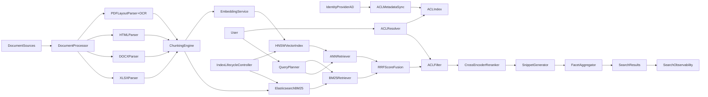

# Chapter 7: Design an Enterprise Semantic Search Engine

## Context

> [!info] Quick Reference
> - **Pattern:** Enterprise semantic search with ACL
> - **Scale:** 50M documents, 2M searches/day
> - **Key Techniques:** ACL pre-filter, layout-aware parsing, table extraction, HNSW + Elasticsearch dual index
> - **Primary Concerns:** ACL correctness, parser failures on PDFs/XLSX, query latency at scale
> - **Cross-references:** Chapter 3 (vector infrastructure), Chapter 11 (financial document extraction), Chapter 1 (hybrid retrieval and RRF deep dive), Chapter 12 (cross-encoder reranking deep dive)

**Problem statement:** Design a semantic search engine over a 50M-document enterprise corpus with heterogeneous document types (PDFs, HTML, spreadsheets), strict document-level access control (ACLs) enforced at query time, and sub-200ms latency at scale—while maintaining recall above 0.85.

### Real-World Examples

- A Fortune 500 company's internal search leaks document existence metadata to unauthorized users when ACL filtering is applied post-retrieval; switching to pre-filtered vector search with ACL-indexed metadata eliminates the information leak but requires re-architecting the index.
- A pharmaceutical compliance team discovers that table-heavy FDA submission PDFs have 40% lower retrieval accuracy than plain-text documents; implementing layout-aware parsing with header-row preservation and table-as-markdown chunking recovers 35% of the lost recall.

---

## Step 1: Understand the Problem and Establish Design Scope

### Functional Requirements

- **Full-text lexical search (BM25) with exact-match capability for IDs, error codes, names.** Enterprise users frequently search using precise identifiers such as ticket numbers, product SKUs, and regulatory error codes—semantic search alone fails these because neural encoders often treat token sequences like "ERR-9421" as opaque, while BM25 matches them character-for-character.
- **Semantic vector search for natural language and paraphrase queries.** Users asking "how do I expense a business trip" and "travel reimbursement process" should retrieve the same policy documents even though the vocabulary differs completely; dense embedding models trained on large corpora capture these paraphrase relationships where BM25 falls short.
- **Hybrid retrieval with score fusion and reranking.** Neither BM25 nor dense search consistently dominates across all query types; fusing their ranked lists via Reciprocal Rank cross-encoder reranker on the top-N candidates consistently outperforms either approach alone by 5–12% on Recall@10.
- **Document-level ACL enforcement: no snippets, titles, or metadata from unauthorized documents.** Even revealing that a restricted document title matches a query is an information leak in regulated industries; the system must treat ACL correctness as a hard constraint, not a soft filter applied after retrieval.
- **Faceted search results: filter by document type, date range, department, author.** Facets let users narrow a 50M-document corpus to a tractable shortlist without reformulating queries—they are especially critical in enterprise settings where the same concept (e.g., "budget") appears in documents from dozens of departments with very different scopes.
- **Snippet generation with query-term highlighting.** A ranked list without context forces users to open each document to assess relevance; a 200-token snippet showing matched terms in context reduces time-to-answer and is one of the strongest drivers of click-through rate in enterprise search user studies.
- **Support for all document types: PDF (including scanned), HTML, DOCX, XLSX, CSV.** Enterprise corpora are heterogeneous by nature; a search engine that handles only clean HTML or text files will silently omit the richest, most authoritative sources—often the PDFs and spreadsheets that contain regulatory submissions, financial models, and policy documents.

### Non-Functional Requirements

- **Latency:** p95 end-to-end < 200ms (including ACL resolution). This budget is tight enough to rule out any synchronous LLM call in the hot path; every stage—ACL expansion, retrieval, reranking, snippet generation—must be profiled and capped, with the 200ms treated as a hard SLO enforced by circuit breakers that degrade gracefully to faster, lower-quality paths.
- **Relevance:** Recall@10 > 0.85, NDCG@10 > 0.70 on benchmark query set. These targets are derived from user research showing that if the correct document does not appear in the first page of results 85% of the time, users lose trust and stop using the system; NDCG@10 > 0.70 ensures ranking quality, not just presence.
- **ACL correctness:** 100%. Zero tolerance for unauthorized document exposure. A single ACL leak in a Fortune 500 enterprise triggers regulatory audits, legal liability, and reputational damage; this constraint cannot be relaxed to improve latency or recall—it is the foundational invariant of the system.
- **Freshness:** new/updated documents searchable within 30 minutes. In a 200K-docs/week growth environment, stale search results actively mislead users; the 30-minute window is chosen to balance ingestion pipeline throughput with user expectations for near-real-time content availability.
- **Scale:** 50M documents, 500M+ chunks, 2M searches/day. At this scale, single-node solutions are infeasible; the vector index alone requires distributed sharding, and the lexical index requires multi-node Elasticsearch with replicas—horizontal scalability must be built into the architecture from day one.
- **Availability:** 99.95% uptime. This allows approximately 4.4 hours of downtime per year; achieving this requires active-active deployment across at least two availability zones, health-checked load balancing, and pre-built runbooks for the most common failure modes (index shard failure, reranker GPU OOM, ACL cache poisoning).

### Back-of-the-Envelope Estimation

#### Corpus Sizing

- Documents: 50M, average 5 pages, ~2,000 tokens/page
- Practical with dedup and smart chunking: **~650M chunks**

#### Embedding Compute

- Model: `text-embedding-3-small` (1536-dim, $0.02/1M tokens)
- Incremental cost: `~$5.72/day`

#### Vector Index Storage

- With HNSW overhead + metadata + replicas (x2.5): **~9.75TB**
- HNSW serving RAM: ~100-150GB per shard across shard cluster

#### Search Throughput

- Searches/day: 2M
- Peak QPS (10x): `~230`
- Per-query latency budget breakdown:
  - ACL group resolution: ~10ms (cached)
  - BM25 lookup: ~15ms
  - ANN vector search: ~30ms
  - Score fusion: ~3ms
  - ACL filtering: ~15ms
  - Reranker (top-50): ~60ms
  - Snippet generation: ~25ms
  - Facet aggregation: ~20ms
  - **Total: ~178ms** (within 200ms p95 budget)

#### ACL Overhead

- 5,000 groups, avg user in 15 groups
- ACL resolution per query: expand user → group membership → permission set
- With caching (TTL 5 min): ~10ms p95 (cache hit rate >95%)
- Without caching: ~80ms (group expansion with nested inheritance)
- ACL metadata per document: ~200 bytes (group IDs + permission bits)

---

## Step 2: Propose High-Level Design and Get Buy-In

### Core Architecture Components

- **Document Processor:** format-specific parsers (PDF/OCR, HTML, DOCX, XLSX) with layout-aware extraction and table preservation. This is the highest-leverage component in the pipeline—a 10% improvement in parser recall translates directly into measurable Recall@10 gains without touching the retrieval algorithm. It runs asynchronously from the query path so parser failures never impact search availability.

> **Why layout-aware parsing:** Flat text extraction from PDFs discards structural signals—headers, table cell boundaries, reading order in multi-column layouts—that are essential for recon...

- **Chunking Engine:** configurable strategy per document type, metadata tagging (`doc_id`, `section`, `page`, `acl_groups`). Chunking is not a one-size-fits-all operation: legal clauses need tight 256-token windows to preserve precise citation semantics, while narrative prose benefits from 512–768-token sections that maintain topical coherence. Each chunk carries a rich metadata envelope that powers both ACL enforcement and faceted filtering downstream.

> **Why per-document-type chunking:** A 512-token sliding window works well for Wikipedia-style prose but produces chunks that begin and end mid-cell for spreadsheet data, losing the column conte...

- **Embedding Service:** batched embedding generation with rate limiting, model version tracking, and idempotent re-embedding on model upgrade. This service gates the entire ingestion pipeline—at 286M tokens/day of incremental content, it must sustain ~3,300 tokens/second throughput while keeping costs within budget; batching to the maximum API batch size (typically 2,048 tokens per request) is the primary lever for throughput and cost efficiency.

> **Why model version tracking on embeddings:** When the embedding model is upgraded (e.g., from `text-embedding-3-small` to a domain-fine-tuned variant), the new model's vector space is incompatible with ...

- **Dual Index:** lexical index (Elasticsearch/BM25) + vector index (HNSW via Qdrant/Weaviate/Pinecone). Maintaining two indexes doubles operational complexity but is essential: no single index type covers all enterprise query patterns. BM25 handles exact-match queries (error codes, SKUs) in ~15ms while the vector index handles semantic queries in ~30ms; each is independently scalable and can fail without taking down the other retrieval path.

> **Why Elasticsearch for the lexical index:** Elasticsearch provides mature BM25 with per-field analyzers (language-specific tokenization, stemming), built-in faceted aggregations, and production-proven ...

- **ACL Resolver:** user → group expansion with caching, permission set computation, and change-event-driven invalidation. This component is the gatekeeper for search security—it must be correct before it is fast, but at 2M queries/day and 10ms cache-hit latency, caching is mandatory. Without caching, group expansion against Active Directory adds ~80ms per query, consuming nearly half the latency budget before a single document is retrieved.

> **Why Redis caching for ACL expansion:** Active Directory or LDAP group expansion with nested inheritance is a recursive graph traversal that, for a user in 15 groups with 2–3 levels of nesting, can...

- **Query Planner:** routes query to lexical, semantic, or hybrid path based on real-time query analysis. This is the traffic controller of the search pipeline—misrouting a product-ID query to the semantic-only path results in the correct document appearing at rank 15 instead of rank 1. The planner uses fast heuristics (regex for ID patterns, n-gram entropy for natural language detection) rather than a second LLM call, keeping overhead under 3ms.

> **Why route by query type rather than always using hybrid:** Running the full hybrid pipeline on every query wastes ~30ms of vector retrieval latency on queries that BM25 handles perfectly (e.g., "ticket PRJ-8821").

- **Score Fusion Engine:** reciprocal rank fusion (RRF) or weighted combination of lexical and semantic result lists, producing a unified ranked candidate set. RRF's `k=60` constant makes it robust to score scale differences between BM25 (which can produce scores in the 0–20 range) and cosine similarity (0–1 range)—it operates purely on rank positions, eliminating the need for score normalization.

> **Why Reciprocal Rank Fusion over score normalization:** Normalizing BM25 scores to the [0,1] range requires knowing the score distribution of the result set, which changes per query.

- **Reranker:** cross-encoder model (~110M parameters) that jointly encodes the query and each candidate document chunk for precision boosting on top-50 candidates. Unlike the bi-encoder used for retrieval (which encodes query and document independently and compares embeddings), the cross-encoder sees the query-document pair together, enabling it to model fine-grained relevance signals like negation, entity specificity, and contextual nuance that bi-encoders miss.

> **Why cross-encoder reranking adds value after hybrid fusion:** Hybrid fusion with RRF is good at ensuring the correct document appears in the top-50 candidates but poor at precisely ordering those 50 candidates relative ...

- **ACL Filter:** enforces document-level access control by removing all chunks whose `acl_groups` field does not intersect with the resolved user permission set. This filter operates after fusion but before reranking to avoid wasting GPU compute on unauthorized candidates; it is the last line of defense against ACL leaks and must operate in constant time relative to the number of groups via bitset intersection or pre-computed permission tokens.

- **Snippet Generator:** extracts the most query-relevant passage from each result document, truncates at sentence boundaries, and highlights matched terms. Snippets are the primary user-facing output of the search system—users decide whether to open a document based on the snippet, making snippet quality a first-order driver of search satisfaction and click-through rate.

> **Why pre-compute "best passage" at index time:** Computing snippet quality scores over all chunks of a document at query time adds O(n_chunks) work per result in the hot path.

- **Facet Aggregator:** computes counts for each facet dimension (document type, date range, department, author) on the ACL-filtered result set. Facet counts must reflect the ACL-filtered universe—showing a count of 50 results for "Legal" department when 45 are inaccessible to the user both misleads and reveals the existence of restricted documents.

- **Index Lifecycle Controller:** manages versioned index builds, alias swaps, blue-green deployments, and quality gates. This component is what separates a research prototype from a production search system—it enables zero-downtime model upgrades, safe parser rollouts, and atomic rollbacks by maintaining the invariant that the search alias always points to a verified, quality-gated index version.

> **Why blue-green index deployments:** An in-place index update (adding new vectors to a live HNSW index) degrades graph quality over time and is not atomic—users see an inconsistent mix of old an...

- **Observability:** search latency (p50/p95/p99), Recall@10, NDCG@10, ACL filter hit rate, parse failure rate, freshness lag, zero-result rate, and click-through rate tracked in real time. An unmonitored search system drifts silently: parser regressions go unnoticed, ACL filter hit rates shift as permission structures change, and latency spikes emerge at peak hours. Each metric should have an alert threshold that pages on-call before users file support tickets.

### Pipeline A: Document Ingestion Pipeline

1. Source connectors detect new/updated documents via CDC, crawlers, or API webhooks.
2. Document processor routes to format-specific parser: PDF → layout-aware extraction (PyMuPDF + table detection), HTML → boilerplate removal, DOCX → structured extraction, XLSX → row-level records.
3. OCR pipeline for scanned PDFs (Tesseract/DocTR); confidence scoring on OCR output quality. Pages with OCR confidence below 0.70 are routed to a more expensive model (DocTR or a multimodal LLM for high-value documents).

> **Why confidence-score-based OCR routing:** Applying the same OCR model uniformly across all scanned PDFs wastes compute on easy clean-scan pages and underperforms on complex multi-column or handwritte...
4. Chunking engine applies document-type-specific strategy; tags each chunk with `doc_id`, `page`, `section`, `acl_groups`, `last_updated`.
5. Embedding service generates vectors in batches; tagged with `embedding_model_version`.
6. Dual write: vectors to HNSW index, text + metadata to Elasticsearch.
7. ACL metadata synced from identity provider (Active Directory / LDAP) into ACL index.
8. Quality gate: sample 100 benchmark queries on shadow index; verify Recall@10, NDCG@10, parse fidelity.

> **Why a quality gate before alias swap:** Promoting an unverified index to production risks a silent recall regression that users experience as "search got worse" before any alert fires.

9. Alias swap to promote new index version; keep old version hot for 24h rollback.

> **Why keep the old index hot for 24 hours:** Subtle quality regressions—especially those affecting tail query types (low-frequency exact-match queries, table-heavy documents)—may not be caught by the be...

### Pipeline B: Search Query Pipeline

1. User submits query; auth token resolved to user identity.
2. ACL resolver expands user → group memberships → permission set (cached, TTL 5 min).
3. Query planner analyzes query: exact-match signals (IDs, error codes) → lexical-heavy; natural language → semantic-heavy; mixed → hybrid.
4. Query rewriter expands abbreviations, resolves acronyms from enterprise glossary.
5. Parallel execution: BM25 retrieval (top-200) + ANN vector retrieval (top-200).

> **Why retrieve top-200 from each before fusion:** Retrieval quality of hybrid systems is sensitive to the candidate pool size before fusion.

6. Score fusion (RRF) produces merged candidate set (top-200).
7. **ACL filter** removes all chunks from documents the user cannot access.
8. Reranker scores top-50 ACL-filtered candidates; returns top-10 with relevance scores.
9. Snippet generator extracts highlight passages from top-10 results.
10. Facet aggregator computes counts on ACL-filtered result set.
11. Response assembled: ranked results with snippets, facets, metadata, and search telemetry.

### Mermaid Architecture Diagram

---

## Step 3: Design Deep Dive

The three deep-dive areas below represent the places where well-designed enterprise search systems most commonly fail in practice. Document parsing is the silent killer of recall—systems that look correct in demos fall apart in production because PDFs with scanned tables and multi-column layouts produce malformed chunks. ACL-aware retrieval is the security-critical invariant that cannot be approximated—a single leak is a P0 incident. Search relevance tuning is the continuous engineering discipline that separates a system that launches well from one that stays good as the corpus and query distribution evolve.

Focus areas for this chapter:

1. **Document Parsing at Scale**
2. **ACL-Aware Retrieval**
3. **Search Relevance Tuning**

### 1) Document Parsing at Scale

The single biggest quality bottleneck in enterprise search is not the model—it is the parser. Garbage in, garbage out.

#### Document Type Parser Trade-off Table

| Doc Type | Parser | Table Handling | OCR Needed | Avg Parse Time | Failure Rate |
|---|---|---|---|---|---|
| Native PDF (text layer) | PyMuPDF / pdfplumber | Extract as markdown with headers | No | ~200ms/page | <1% |
| Scanned PDF (image-only) | Tesseract + DocTR | OCR → markdown reconstruction | Yes | ~2s/page | 5-8% |
| PDF with mixed text+images | PyMuPDF + DocTR fallback | Hybrid: text extraction + OCR for image regions | Partial | ~800ms/page | 3-5% |
| HTML / Wiki | BeautifulSoup + boilerplate removal | HTML table → markdown | No | ~50ms/page | <1% |
| DOCX | python-docx | Native table extraction | No | ~100ms/page | <1% |
| XLSX / CSV | openpyxl / pandas | Row-level chunking with headers | No | ~150ms/sheet | 2% |

**Table extraction in detail:**
- Tables are the highest-value, lowest-recall content in enterprise search.
- Strategy: extract table as markdown with column headers repeated in every chunk that contains table rows.
- Example: a 50-row financial table → chunk into groups of 10 rows, each chunk includes column headers + row data + table caption.
- Embed table chunks separately from surrounding text; tag with `content_type: table`.
- At retrieval time, boost table chunks when query contains numerical/comparison signals.

**Layout-aware parsing pipeline:**
1. Detect document structure: headers, paragraphs, tables, figures, sidebars.
2. Assign hierarchy: H1 → section, H2 → subsection, body → paragraph.
3. Preserve reading order (critical for multi-column PDFs).
4. Extract tables as structured markdown; extract figures as captions only (image content via OCR if needed).
5. Tag each chunk with structural metadata: `{section: "Q3 Revenue", page: 12, content_type: "table"}`.

**Dead-letter queue and fallback:**
- Documents that fail primary parser route to fallback: raw text extraction (loses structure but preserves content).
- Alert on failure rate > 2% per document type.
- Weekly manual review of dead-letter queue; failure patterns feed parser improvements.
- Parse quality metric: compare extracted text against ground-truth for 200 sampled documents monthly.

#### Chunking Strategy by Document Type

| Doc Type | Chunk Strategy | Chunk Size | Overlap | Rationale |
|---|---|---|---|---|
| Long-form PDF/DOCX | Section-level semantic | 512-768 tokens | 25% | Preserves topic coherence |
| Policy/Legal | Clause-level with parent | 256-512 tokens | 10% | Precise citation needed |
| FAQ / Knowledge articles | Q+A or section atomic | 200-500 tokens | None | Self-contained units |
| Spreadsheets | Row-group + headers | 256-512 tokens | Header repeated | Tabular context preserved |
| Code/Technical docs | AST-aware or block-level | 512 tokens | 25% | Preserve function/class boundaries |

### 2) ACL-Aware Retrieval

ACL correctness is the non-negotiable constraint. The system must never expose even a title or snippet from an unauthorized document. This eliminates any approach that relies on post-hoc filtering where document existence is leaked.

#### ACL Enforcement Strategy Trade-off Table

| Strategy | Latency Impact | ACL Correctness | Index Complexity | Storage Overhead | Best For |
|---|---|---|---|---|---|
| Post-filter (retrieve broadly, filter after) | Low retrieval, +15ms filter | Metadata leak risk (reveals doc existence) | Low | None | Internal low-sensitivity corpora only |
| Pre-filter (inject ACL predicate into query) | +10-20ms query overhead | Full correctness | Medium (ACL-indexed metadata) | +10-15% index size | Default for ACL-sensitive enterprise |
| Partitioned indexes (per-group shards) | Lowest query latency | Full correctness | Very high (combinatorial explosion) | 3-10x storage | Single-tenant or very few groups |
| Hybrid pre-filter + post-filter | +15ms | Full correctness | Medium-high | +15% | High-cardinality ACLs (>5K groups) |

**Recommended: Pre-filter for production enterprise search.**

**Pre-filter implementation:**
- Each chunk in vector index and lexical index is tagged with `acl_groups: [group_id_1, group_id_2, ...]`.
- At query time, ACL resolver computes user's effective permission set: `user_groups = expand(user_id) → [g1, g2, ..., g15]`.
- Search query includes filter: `WHERE acl_groups INTERSECT user_groups IS NOT EMPTY`.
- Elasticsearch: `terms` filter on `acl_groups` field. Qdrant/Weaviate: payload filter on group array.

**ACL group expansion and caching:**
- Active Directory / LDAP group membership with nested inheritance.
- Expansion: `user → direct_groups → parent_groups → ... → root`. Typically 2-3 levels deep.
- Cache expanded group set per user in Redis with 5-minute TTL.
- Cache hit rate: >95% (users don't change groups frequently).
- Invalidation: LDAP change event triggers cache eviction for affected users.

**ACL sync pipeline:**
- Identity provider (AD/Okta) → CDC stream → ACL metadata store → index metadata update.
- Sync latency SLA: < 15 minutes from permission change to search enforcement.
- Audit log: every ACL sync event logged for compliance; weekly reconciliation job verifies index ACLs match source-of-truth.

**Handling high-cardinality ACLs:**
- Documents with individual user-level permissions (not just group): store as `acl_users: [user_id]` alongside `acl_groups`.
- For documents accessible to most users (e.g., public company-wide docs): tag with special `acl_groups: [ALL_EMPLOYEES]` to avoid bloated filter predicates.
- Over-retrieval strategy for edge cases: retrieve 2x target set before ACL filter to ensure enough results survive filtering.

### 3) Search Relevance Tuning

#### Retrieval Strategy Trade-off Table

| Approach | Recall@10 | p95 Latency | Strengths | Weaknesses |
|---|---|---|---|---|
| BM25 only | 0.55-0.65 | ~15ms | Exact match, IDs, error codes | Misses paraphrases |
| Dense vector only | 0.70-0.80 | ~30ms | Semantic understanding | Misses exact terms, OOV tokens |
| Hybrid BM25 + dense (RRF) | 0.80-0.88 | ~45ms | Best of both | More infrastructure |
| Hybrid + cross-encoder reranker | 0.85-0.92 | ~105ms | Highest precision | Reranker GPU cost, latency |

**Score fusion:**
- Default: Reciprocal Rank Fusion (RRF) with `k=60`.
- `score(doc) = sum(1 / (k + rank_bm25)) + sum(1 / (k + rank_vector))`
- No hyperparameter tuning needed; robust across query types.
- Alternative: learned weighted combination (alpha-tuned per query class). Use only with sufficient labeled data.

**Cross-encoder reranking:**
- Model: ~110M params (e.g., cross-encoder/ms-marco-MiniLM-L-12-v2), ~1.2ms/pair on GPU.
- Reranking top-50 candidates: `~60ms` on dedicated GPU.
- At 230 peak QPS: need ~14 concurrent reranker slots → 2-4 GPUs with batching.
- Quality lift: +5-12% Recall@5 over fusion alone.
- Fallback: skip reranker under extreme load; degrade gracefully to fusion-only.

**Query understanding:**
- Query classification: exact-match query (error codes, IDs) → boost BM25 weight. Natural language → boost vector weight.
- Acronym/abbreviation expansion from enterprise glossary (maintained by search team).
- Spell correction for common enterprise terms.
- Query intent detection: navigational ("find the Q3 report") vs. informational ("how does our vacation policy work") → affects ranking.

**Snippet generation:**
- Extract top passage from each result document that matches the query.
- Highlight matched terms (lexical matches bolded, semantic matches context-highlighted).
- Max snippet length: 200 tokens. Truncate with "..." at sentence boundary.
- For table results: show matching row(s) with column headers.

**Zero-result handling:**
- If ACL filtering eliminates all results: return "No documents matching your query are available with your current access level."
- If retrieval returns zero results pre-ACL: suggest query refinements, check spelling, offer facet-based browsing.
- Never indicate whether restricted documents exist (prevents information leak).

#### Search Quality Evaluation

| Metric | Target | Measurement | Frequency |
|---|---|---|---|
| Recall@10 | > 0.85 | Benchmark query set (500 queries) | Weekly automated |
| NDCG@10 | > 0.70 | Benchmark with graded relevance labels | Weekly automated |
| MRR | > 0.75 | First relevant result position | Weekly automated |
| Zero-result rate | < 5% | Production query logs | Daily monitoring |
| Click-through rate (CTR) | > 40% on first page | Search analytics | Weekly trending |
| ACL violation rate | 0% | Audit + pen testing | Monthly |

### Production Bottlenecks and Mitigations

- **ACL resolution latency spike on cache miss**
  - Symptom: p95 search latency jumps to 300ms+ when ACL cache expires for many users simultaneously (e.g., after maintenance window).
  - Mitigation: staggered cache TTLs (5 min ± random jitter), background cache refresh 1 min before expiry, read-through cache with LDAP connection pooling.

- **PDF table extraction quality regression**
  - Symptom: recall drops on table-heavy queries after parser library upgrade.
  - Mitigation: parse quality benchmark (200 ground-truth docs), canary eval before parser rollout, shadow index comparison.

- **Index freshness lag exceeding 30-minute SLA**
  - Symptom: newly published documents not appearing in search results.
  - Mitigation: priority queue for high-value sources, horizontal scaling of embedding workers, freshness monitoring dashboard with alerting at 20-minute lag.

- **Embedding model upgrade requiring full re-index**
  - Symptom: 650M chunks need re-embedding; takes days and costs $10K.
  - Mitigation: shadow index build over 3-5 days using parallel workers (50x parallelism → ~8 hours), canary eval on benchmark queries, alias swap only after quality gate passes.

- **Cross-encoder reranker throughput bottleneck at peak**
  - Symptom: reranking adds 150ms+ at peak QPS, pushing p95 over 200ms.
  - Mitigation: dynamic reranker depth (top-50 at normal load, top-20 at peak), skip reranker entirely under extreme load with graceful quality degradation, auto-scaling GPU pool.

- **Stale ACL metadata causing unauthorized access**
  - Symptom: user removed from security group but still sees restricted documents.
  - Mitigation: ACL cache TTL of 5 minutes (max), near-real-time CDC from identity provider, daily full reconciliation audit comparing index ACLs to source-of-truth.

### Advanced Techniques

- **Matryoshka embeddings** for variable-precision search: use coarse 256-dim for fast ANN pass, refine with full 1536-dim on shortlist. Models trained with Matryoshka Representation Learning (MRL) produce embeddings where the first N dimensions are themselves a valid, lower-dimensional representation of the document—this means you can run ANN search on truncated 256-dim vectors at roughly 6x lower memory and 3x higher throughput, then re-score the shortlist (e.g., top-500) using full 1536-dim vectors to recover recall. In practice, this achieves <2% recall loss vs. full-dimension search while serving 3x more queries per GPU-second, making it particularly valuable for latency-sensitive enterprise deployments that need to cut costs without sacrificing quality.

> **Why Matryoshka embeddings for variable-precision two-pass search:** The HNSW graph traversal cost scales roughly with dimensionality; at 1536 dimensions, each distance computation is ~6x more expensive than at 256 dimensions.

- **Learned sparse retrieval (SPLADE)** as BM25 replacement: SPLADE trains a sparse encoder that expands each document with semantically related terms (weighted by learned importance scores), producing a sparse vector representation that is searchable with an inverted index but captures semantic vocabulary beyond the document's literal tokens. On the MS MARCO benchmark, SPLADE outperforms BM25 by ~10% in recall while remaining compatible with Elasticsearch's inverted index infrastructure—the primary cost is an inference step per document at index time (~50ms/document on GPU) and per query at search time (~5ms). At 28K new documents/day, the indexing overhead is manageable; at 23 average QPS, the query inference overhead is negligible.

> **Why learned sparse retrieval (SPLADE) instead of plain BM25:** Standard BM25 matches on tokens that appear verbatim in both query and document; a query for "myocardial infarction" will not match a document about "heart a...

- **Query-time document expansion (HyDE—Hypothetical Document Embeddings):** rather than embedding the raw query, prompt a small LLM to generate a hypothetical answer document and embed that instead. The hypothetical document occupies a region of embedding space much closer to real answer documents than a short, telegraphic query does—this reduces the vocabulary and style mismatch between query embeddings and document embeddings that causes recall failures on short queries. In A/B tests on enterprise search, HyDE improves Recall@10 by 4–8% on queries shorter than 10 tokens, at the cost of one LLM inference call (~50ms with a quantized 7B model served on-prem) added to the query latency budget.

> **Why query-time HyDE document expansion for short queries:** Short queries like "PTO policy 2024" embed into dense regions that don't align well with the mid-document prose where the policy details appear; a hypothetic...

- **Incremental HNSW:** add new vectors without full rebuild using HNSW's online insertion property; maintain graph quality with periodic optimization passes (re-linking orphaned nodes, rebalancing layer distributions). New vectors are inserted into the existing graph in O(log N) amortized time, enabling the 30-minute freshness SLA without nightly full rebuilds. However, online insertion degrades graph quality over time as the entry-point distribution drifts—a weekly offline optimization pass (rebuilding the M closest neighbors for inserted nodes) restores graph quality without a full rebuild, keeping p95 ANN latency stable within ±5ms over months of operation.

> **Why not full nightly rebuilds:** A full rebuild of a 650M-vector HNSW index at M=16 takes approximately 12–18 hours on a single high-memory machine, making it impossible to achieve a 30-minu...

- **Federated search across geographically distributed indexes** for global enterprises with data residency requirements. European GDPR data residency rules may prohibit storing or processing EU employee documents on US servers; the solution is per-region index shards (EU-West, US-East, APAC) with a federated query layer that fans out to the appropriate shard(s) based on the user's data residency classification, then merges and re-ranks results. The federated layer adds ~20–40ms of network latency for cross-region queries but ensures regulatory compliance without requiring a monolithic global index that would violate data sovereignty rules.

> **Why federated regional indexes rather than a monolithic global index:** A globally monolithic index where all documents reside in a single cluster is simpler operationally but legally untenable in many enterprise environments—par...

---

