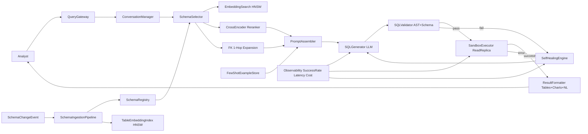

# Chapter 16: Design an AI Data Analyst (Text-to-SQL and Insights)

## Context

> [!info] Quick Reference
> - **Pattern:** Text-to-SQL agent with self-healing
> - **Scale:** 50K analysts, 200K queries/day, target < $0.05/query
> - **Key Techniques:** Embedding-based schema compression (400+ tables → 5-15), sandboxed SQL execution, 7-type error classification with self-repair, result validation heuristics
> - **Primary Concerns:** Schema grounding at scale, SQL injection prevention, query cost runaway, result correctness validation
> - **Cross-references:** Chapter 9 (agentic pattern), Chapter 5 (guardrails), Chapter 11 (structured output)

**Problem statement:** Design a natural-language-to-SQL system that translates analyst questions into executable queries over enterprise data warehouses with hundreds of tables, executes them safely in a sandboxed environment, and autonomously repairs failed queries—all within interactive Latency (TTFT, TPOT, latency.

### Real-World Examples

- A BI platform (Looker/Mode-class) serves 50K analysts across 200+ organizations. Analysts type questions like "What was the month-over-month revenue growth by region for Q3?" The system must resolve "revenue" to the correct column across 400-table schemas with ambiguous naming (e.g., `rev`, `total_revenue`, `gross_rev_usd`). embedding-based schema selection with few-shot SQL examples improves execution success from 62% to 87%.
- An e-commerce analytics team has a 600-table Snowflake warehouse. Their text-to-SQL tool generates a query with a `LEFT JOIN` on the wrong foreign key, returning inflated revenue numbers. No one catches the error for 3 weeks because the numbers "look plausible." Adding a result-sanity-check layer that validates output cardinality and value ranges against historical baselines catches 94% of semantically incorrect but syntactically valid queries.

---

## Step 1: Understand the Problem and Establish Design Scope

### Functional Requirements

- Translate natural language questions into executable SQL for the analyst's specific database schema.
- Support multi-turn conversations: follow-up questions that reference prior queries ("break that down by quarter").
- Execute generated SQL in a sandboxed environment with read-only access.
- Automatically detect and repair failed queries (syntax errors, missing columns, ambiguous references) with bounded retries.
- Return structured results (tables, charts) with natural language summaries.
- Support schema exploration: "What tables contain customer data?" "Show me the schema for the orders table."

### Non-Functional Requirements

- **Latency:** p95 < 3s for simple queries (single table), p95 < 8s for complex queries (multi-join/subquery).
- **Throughput|Throughput:** 200K queries/day, peak ~7 QPS sustained.
- **Accuracy:** >85% execution success, >70% semantic correctness on held-out eval set.
- **Safety:** read-only execution, row limits, query cost caps, per-tenant data isolation.
- **Availability:** 99.9% for query generation path.
- **Cost:** < $0.05 per query (including LLM inference + SQL execution).

### Back-of-the-Envelope Estimation

#### Traffic Profile

- Analysts: 50K
- Queries/day: 200K
- Burst peak (3x): ~17 QPS

#### Token Budget per Query

- System prompt (instructions, SQL dialect rules): ~500 tokens
- Schema context (selected tables): ~2,000 tokens (after compression, from potential 40K raw)
- Few-shot examples: ~800 tokens (3-4 examples)
- User question + conversation history: ~300 tokens
- Total input: ~3,600 tokens
- Output (SQL + explanation): ~200 tokens

#### LLM Cost per Query

- Using GPT-4-class model: ~$0.01/1K input + $0.03/1K output
- Monthly: ~$300K

#### Schema Storage

- 50K analysts across ~500 organizations (100 analysts/org avg)
- 500 schemas × 400 tables × 15 columns = 3M column entries
- Schema metadata store: ~500 MB (column names, types, descriptions, sample values, foreign keys)

#### Latency Budget — Simple Query (<3s total)

| Stage | Budget | Notes |
|---|---|---|
| Query understanding + schema selection | 400ms | Embedding search + reranking |
| Schema context assembly | 100ms | Fetch selected tables, compress |
| LLM SQL generation | 1,500ms | ~200 output tokens at ~7.5ms/token (streaming) |
| SQL validation (syntax check) | 50ms | AST parse |
| Sandbox execution | 800ms | Read replica query |
| Result formatting + NL summary | 150ms | Lightweight model or template |
| **Total** | **3,000ms** | Tight but achievable |

#### Latency Budget — Complex Query (<8s total, allows 1 retry)

| Stage | Budget | Notes |
|---|---|---|
| Query understanding + schema selection | 500ms | May need multi-hop schema traversal |
| Schema context assembly | 200ms | More tables, join paths |
| LLM SQL generation (attempt 1) | 2,000ms | Longer SQL output |
| SQL validation + execution (attempt 1) | 1,500ms | Complex joins take longer |
| Error classification + repair (if needed) | 500ms | Parse error, select repair strategy |
| LLM SQL generation (attempt 2) | 2,000ms | Retry with error context |
| SQL execution (attempt 2) | 1,000ms | |
| Result formatting | 300ms | |
| **Total** | **8,000ms** | 1 retry fits within budget |

---

## Step 2: Propose High-Level Design and Get Buy-In

### Core Architecture Components

- **Query Gateway:** Handles authentication, per-tenant rate limiting (default: 60 queries/minute/analyst), tenant identification from JWT claims, and upfront query classification into three tiers—simple (single table, no joins), complex (multi-join, subqueries, window functions), and exploration (schema-introspection questions). Classification determines which latency SLA applies and whether to pre-allocate a retry budget.
- **Schema Registry:** A per-tenant metadata store (PostgreSQL-backed, Redis-cached) holding table/column names, data types, primary and foreign keys, human-authored descriptions, LLM-generated descriptions, sample values, cardinality statistics, and historical usage counts. Updated both on scheduled crawls (every 6 hours) and on DDL change webhook events, ensuring the embeddings and metadata used for schema selection are always within one crawl period of truth.
- **Schema Selector:** An embedding-based retrieval component that encodes the analyst's question into a 768-dim vector and performs approximate nearest-neighbor search over the per-tenant HNSW table index. Returns a top-20 candidate list, reranks with a cross-encoder to a top-5-10 final set, and expands by one foreign-key hop to ensure join paths are included. This compression step is what makes 400-table schemas tractable within a ~2,000-token schema budget.
- **Prompt Assembler:** Constructs the full LLM prompt by combining: (1) a dialect-specific system prompt with SQL style rules and safety constraints; (2) compressed DDL for the selected tables; (3) 3 dynamically retrieved few-shot examples matched by question-similarity from the tenant's example pool; (4) the last 3 turns of conversation history (≤500 tokens); and (5) the analyst's current question. Enforces a hard token budget by truncating conversation history first, then compressing schema further if needed.
- **SQL Generator (LLM):** Calls a GPT-4-class model to generate the SQL query and a brief plain-English explanation of what the query computes. Supports Snowflake SQL, BigQuery Standard SQL, and PostgreSQL dialects via dialect-specific prompts. Output is streamed so the analyst sees the first tokens (the `SELECT` clause) within ~500ms, reducing perceived latency even before the full query is ready.
- **SQL Validator:** Performs static analysis on the generated SQL before execution by parsing the AST, checking that every referenced table and column exists in the selected schema, validating join condition types for compatibility, and flagging structural anti-patterns such as Cartesian products (`CROSS JOIN` on tables >10K rows) or aggregations without a `GROUP BY`. Catches ~40% of errors before any database round-trip.
- **Sandbox Executor:** Runs the validated SQL on a dedicated read-only replica using credentials with `SELECT`-only grants. Enforces `statement_timeout` (30 seconds), injects `LIMIT 1000` if no limit is present, pre-checks estimated scan cost via `EXPLAIN` and rejects queries that would scan more than 500 GB, and applies row-level security to mask PII columns the analyst is not authorized to see. Per-tenant connection pools (max 5 concurrent) prevent one analyst's heavy query from blocking others.
- **Self-Healing Engine:** When the validator or executor returns an error, this component classifies the failure into one of seven error categories (column not found, table not found, syntax error, type mismatch, ambiguous column, timeout, permission denied), selects the corresponding repair strategy, augments the prompt with the failed SQL, the exact error message, and class-specific fix hints, and re-invokes the SQL Generator. Bounded to 2 retries (3 total attempts) per query to cap latency and cost overhead.
- **Result Formatter:** Transforms raw database result sets into presentation-ready output. Automatically detects result shape to choose the best visualization: time-series data (a date/timestamp column with a numeric measure) renders as a line chart; categorical groupings with counts or sums render as bar charts; flat row-column outputs render as paginated tables. Appends a 1-2 sentence natural-language summary generated by a lightweight model or template, describing what the data shows (e.g., "Revenue in APAC grew 18% month-over-month in Q3, outpacing NA at 7%").
- **Conversation Manager:** Persists multi-turn state keyed by session ID: the last N (question, generated SQL, result summary) turns, the resolved schema context from prior turns (so follow-up questions like "break that down by quarter" don't repeat schema selection from scratch), and any clarification exchanges. Applies a sliding window of 3 turns and 500-token budget, compressing older turns to a one-line summary when the budget is exceeded.
- **Observability:** Tracks the full query lifecycle with structured logs and metrics: execution success rate per tenant and query class, semantic correctness rate (sampled via analyst thumbs-up/down), p50/p95/p99 latency broken down by pipeline stage, LLM token consumption and cost per query, schema selection precision (fraction of queries where all necessary tables were in the top-10), retry rate, and circuit-breaker trigger counts. Dashboards surface per-tenant health and fire alerts when any tenant's success rate drops below 70% for 5 consecutive minutes.

### Pipeline A: Schema Ingestion Pipeline

1. On customer onboarding or schema change event (DDL hook, scheduled crawl), connect to the warehouse via read-only credentials.
2. Extract full schema metadata: table names, column names, column types, primary/foreign keys, constraints, table comments, column descriptions.
3. For each table: sample 5 rows of data to capture value distributions (stored as examples, not raw data).
4. Compute column-level statistics: cardinality, null rate, min/max for numerics, top-10 distinct values for categoricals.
5. Generate natural language descriptions for undocumented tables/columns using an LLM pass ("Infer what this column likely represents given its name, type, and sample values").
6. Embed each table's metadata (name + column names + descriptions + sample values) using a text embedding model → 768-dim vector per table.
7. Build a per-tenant HNSW index over table embeddings for fast schema selection.
8. Store all metadata in the Schema Registry (PostgreSQL + Redis cache).
9. Curate few-shot SQL examples per tenant: 20-50 (question, SQL, result) triples covering common query patterns. These seed the example retrieval pool.

### Pipeline B: Query Execution Pipeline

1. Analyst submits natural language question via chat interface.
2. **Query Gateway** authenticates, resolves tenant, loads conversation history.
3. **Schema Selector** embeds the question, searches tenant's table index (top-20), reranks with a cross-encoder to select top-5-10 tables. Augments with foreign-key-connected tables (1-hop expansion).
4. **Prompt Assembler** builds the prompt: dialect-specific system prompt + selected schema DDL (compressed) + 3 few-shot examples (retrieved by question similarity) + conversation context + user question.
5. **SQL Generator** (LLM) produces SQL. Output is streamed; first tokens (SELECT...) visible within 500ms.
6. **SQL Validator** parses the AST, checks all referenced tables/columns exist in the selected schema, validates join conditions, flags potential cartesian products.
7. If validation fails → **Self-Healing Engine** classifies the error and retries (see deep dive).
8. If validation passes → **Sandbox Executor** runs the query on a read-only replica with `LIMIT 1000`, `statement_timeout = 30s`, and compute cost cap.
9. If execution fails → **Self-Healing Engine** classifies the DB error and retries with error context.
10. If execution succeeds → **Result Formatter** generates a table, optional chart (auto-detected: time series → line chart, categorical → bar chart), and a 1-2 sentence NL summary.
11. Response returned to analyst. All steps logged for observability.

### Mermaid Architecture Diagram



---

## Step 3: Design Deep Dive

Focus areas:

1. **Schema Compression and Context Management**
2. **Sandboxed SQL Execution**
3. **Self-Healing Query Pipeline**

### 1) Schema Compression and Context Management

A 400-table schema with full DDL is ~40K tokens—far exceeding the context window budget of ~2K tokens allocated for schema. The system must select and compress schema information to fit within budget while retaining all information the LLM needs to generate correct SQL.

> **Why embedding-based schema selection rather than sending the full DDL:** A 400-table schema with full DDL runs ~40,000 tokens—20x the allocated schema budget.

**Schema selection pipeline (question → relevant tables):**

1. **Embedding search:** Embed the analyst's question with a text embedding model (e.g., `all-MiniLM-L6-v2` for low latency, `text-embedding-3-large` for higher accuracy). Search the per-tenant HNSW index of table embeddings (each table is represented as a single vector of its name + column names + description). Retrieve top-20 candidate tables. Latency: ~10ms for indexes up to 5,000 tables.
2. **Cross-encoder reranking:** Rerank the 20 candidates using a cross-encoder model that scores each (question, table_description) pair jointly—cross-encoders attend to both inputs simultaneously and achieve higher precision than bi-encoder cosine similarity alone. Select top-5. Latency: ~50ms for 20 candidates on CPU.
3. **Foreign key expansion:** For each selected table, add any table reachable via a single foreign key hop that wasn't already selected. This ensures join paths are available—a query about "orders by customer" needs both `orders` and `customers`, even if only `orders` scores high on the question. Typically adds 2-5 more tables. Cap at 15 total to stay within the token budget.
4. **Column pruning within tables:** Not all columns in a selected table are relevant. Use a lightweight column relevance scorer: embed (question + table_name) and score each column by cosine similarity to the question embedding. Keep columns above a threshold (top 70% by score) plus all primary/foreign keys unconditionally—dropping FK columns would break join conditions the LLM needs to write.

**Schema representation formats:**

| Format | Tokens per Table (avg) | LLM SQL Quality | Notes |
|---|---|---|---|
| Full CREATE TABLE DDL | 250 | Highest (model sees types, constraints, FKs) | Blows budget at >8 tables |
| Compressed DDL (name + columns + types, no constraints) | 80 | Good | **Production default** |
| Table summary (NL description + key columns) | 40 | Moderate (misses exact column names) | Fallback for very large schemas |
| Column list only (no types) | 30 | Poor (model guesses types, causes casting errors) | Not recommended |
| Schema graph (table→FK→table as adjacency list) | 20 per relationship | N/A (supplement, not standalone) | Append to compressed DDL for join hints |

**Recommended: Compressed DDL + FK graph.**

For 10 tables at 80 tokens each + FK graph at 100 tokens = ~900 tokens. Leaves headroom within the 2K schema budget.

**Compressed DDL format example:**

```sql
-- orders (primary: order_id)
-- Columns: order_id INT PK, customer_id INT FK→customers.customer_id,
--   order_date DATE, total_amount DECIMAL(10,2), status VARCHAR(20),
--   region VARCHAR(50)
-- Sample values: status IN ('shipped','pending','cancelled'), region IN ('NA','EU','APAC')
-- Row count: 12.4M | Updated: 2024-01-15
```

**Few-shot example selection:**

> **Why dynamically retrieved few-shot examples rather than static hardcoded ones:** Static, hardcoded few-shot examples waste ~800 tokens on patterns that may be irrelevant to the current query.

Static examples waste tokens on irrelevant patterns. Dynamic selection:
1. Maintain a pool of 20-50 (question, SQL, result_summary) triples per tenant, seeded during onboarding and grown over time via analyst feedback.
2. On each query, embed the question, retrieve top-3 examples by cosine similarity from the pool—favoring examples that share SQL structural patterns (aggregation, join, window function) with the predicted complexity class.
3. Include examples that demonstrate the SQL patterns most likely needed (joins, aggregations, window functions). The pattern predictor is a lightweight classifier on the question embedding that predicts which SQL features will be needed, used to bias retrieval toward matching examples.
4. Periodically expand the pool: when a query is validated as correct by the analyst (thumbs up), add it to the pool with the confirmed SQL. This creates a flywheel—more usage improves future accuracy at no incremental cost.

**Multi-turn context management:**

> **Why inject prior SQL into the prompt for multi-turn follow-ups:** Follow-up questions like "break that down by quarter" contain no schema-grounding information on their own—the pronoun "that" is unresolvable without the pri...

Follow-up questions like "break that down by quarter" require the system to resolve references to prior queries. Strategy:
- Maintain a sliding window of last 3 (question, SQL, result_summary) turns. Three turns covers ~95% of follow-up chains in production (most analysts ask 1-2 follow-up questions before moving on).
- Inject prior SQL as context: "Previous query: [SQL]. The analyst now asks: [follow-up]." The model can reuse the same table selections, add a `DATE_TRUNC('quarter', ...)` grouping, and preserve all other clauses.
- Token budget for conversation history: 500 tokens max. Truncate older turns first, replacing them with a one-line summary ("Previously: revenue by region for Q3, grouped by product line") to preserve intent without the full SQL.

#### Schema Selection Trade-off Table

| Strategy | Precision (correct tables in top-5) | Recall (missing tables) | Latency | Best For |
|---|---|---|---|---|
| Keyword matching (table/column name contains query terms) | Low (~40%): fails on semantically named tables like `dim_geo_lkp` where no keyword overlaps with "country breakdown" | Medium: finds obviously named tables but misses aliased or poorly named ones entirely | <5ms: pure string matching, no embedding overhead | Prototype or demo environments where schema is small and consistently named |
| Embedding search only (no reranking) | Medium (~65%): cosine similarity treats all tables as independent, missing contextual relevance signals | High: tends to over-retrieve loosely related tables, adding noise that confuses the LLM | 10ms: single ANN search over HNSW index | Low-latency path where the 400ms schema selection budget is too tight for reranking |
| Embedding + cross-encoder rerank | High (~82%): cross-encoder attends jointly to (question, table_description), capturing relevance cues that bi-encoder similarity misses | High: reranking improves ordering but doesn't add new candidates beyond the initial top-20 | 60ms: 10ms ANN + 50ms reranker inference on CPU for 20 candidates | **Production default** — best precision-latency balance within the 400ms stage budget |
| Embedding + rerank + FK expansion | Highest (~89%): adds join-path tables that score low on the question but are structurally necessary for multi-table queries | Highest: FK expansion recovers missed join tables (e.g., `customers` table needed by "orders by customer" query that only mentions "orders") | 80ms: +20ms for FK graph traversal and deduplication | Complex multi-join queries; always on in production as a safety net for join path completeness |
| LLM-based schema selection (ask LLM to pick tables) | Very high (~90%+): LLM can reason about table semantics and business intent that embeddings miss | Very high: explicitly prompted to enumerate all tables needed; misses less | 2,000ms+: requires a full LLM call before SQL generation, doubling the end-to-end latency | Only viable when latency budget allows (e.g., async batch queries, not interactive); useful as a benchmark to measure how much the embedding approach leaves on the table |

### 2) Sandboxed SQL Execution

> **Why a sandbox is mandatory for executing LLM-generated SQL:** LLM-generated SQL is untrusted code.

Generated SQL executes against real production data. A single unrestricted query can exfiltrate data, crash a replica, or cost thousands in compute. The sandbox must enforce multiple layers of protection.

**Sandbox architecture:**

> **Why layer multiple independent sandbox controls rather than one:** Defense-in-depth requires that no single control be the only barrier.

1. **Read-only replicas:** All queries execute on dedicated read replicas, never the primary database. Connection credentials have `SELECT`-only grants. No `INSERT`, `UPDATE`, `DELETE`, `DROP`, `CREATE`, `ALTER`, `GRANT`, or `TRUNCATE`.
2. **Static SQL analysis (pre-execution):**
   - Parse SQL AST. Reject any statement that isn't a `SELECT`.
   - Reject queries with `INTO OUTFILE`, `COPY`, or any data export clauses.
   - Reject queries referencing system tables (`information_schema`, `pg_catalog`) unless explicitly allowed.
   - Flag queries with `CROSS JOIN` or missing `WHERE` clauses on large tables (>1M rows).
3. **Runtime guardrails:**
   - `statement_timeout`: 30 seconds per query. Kill query on timeout.
   - `LIMIT` injection: append `LIMIT 1000` if no limit present. Never return >10K rows.
   - **Cost estimation:** before execution, run `EXPLAIN` (or equivalent) to estimate scan cost. Reject queries estimated to scan >500GB. This prevents full table scans on petabyte-scale tables.
   - **Connection pooling:** per-tenant connection pool with max 5 concurrent connections. Prevents one tenant from exhausting replica capacity.
4. **Row-level security:** enforce the analyst's data access permissions. If the analyst doesn't have access to PII columns, the sandbox masks or strips those columns from results before return.

**Execution flow:**

```text
SQL → AST Parse → Static Checks → EXPLAIN Cost Check → Execute with Timeout + Limit → Result Filtering → Return
```

**Database dialect handling:**

| Feature | PostgreSQL | Snowflake | BigQuery |
|---|---|---|---|
| Timeout mechanism | `SET statement_timeout = 30000` | `STATEMENT_TIMEOUT_IN_SECONDS = 30` | `--maximum_bytes_billed` |
| Cost estimation | `EXPLAIN ANALYZE` (estimated) | `EXPLAIN` (warehouse credits) | `--dry_run` (bytes processed) |
| Read-only enforcement | `SET default_transaction_read_only = on` | Role with `SELECT` only | Dataset viewer IAM role |
| Row limit injection | `LIMIT 1000` | `LIMIT 1000` | `LIMIT 1000` |
| Connection pooling | PgBouncer (pool per tenant) | Snowflake warehouse sizing | BigQuery slots |

#### Sandbox Trade-off Table

| Control | Safety Impact | Latency Impact | False Positive Rate | Notes |
|---|---|---|---|---|
| AST-based DDL/DML rejection | Critical: fully blocks any write, schema modification, or data export operation regardless of how the SQL was crafted—this cannot be bypassed via prompt injection because rejection happens on the parsed AST, not the raw string | +5ms: SQL parsing is lightweight (sub-millisecond for queries under 10KB) with a ~5ms overhead for the rejection rule evaluation | ~0%: `SELECT`-only queries are never falsely blocked; any legitimate `SELECT` passes through | Non-negotiable as the first line of defense; log all rejections for security audit |
| EXPLAIN cost estimation | High: prevents full-table scans on multi-TB tables that would drain warehouse credits (a single uncapped BigQuery query can process 10 TB at $5/TB = $50 for one query) and saturate I/O on shared replicas | +200-500ms: `EXPLAIN` itself executes a query planning pass without running the query; cost varies by warehouse (PostgreSQL EXPLAIN is ~10ms, Snowflake EXPLAIN is ~200ms due to cloud round-trip) | 5-10% over-estimates on indexed queries: the query planner may predict a full scan when an index seek actually runs; mitigate by skipping EXPLAIN for queries on tables with <100K rows | Skip EXPLAIN for queries that the validator has already confirmed touch only small tables (verified via row-count metadata in the schema registry) |
| Statement timeout (30s) | Medium: kills runaway queries before they consume excessive CPU/memory on the replica; critical for preventing one bad query from degrading the shared read replica for all tenants | None (only activates when a query actually runs long): set at session level before query execution, no measurable overhead on queries that complete within the timeout | ~0%: legitimate interactive queries complete in <10s; only pathologically inefficient queries hit 30s | Non-negotiable; set at the database session level, not application level, so it cannot be circumvented by an application crash mid-query |
| Row limit injection (1000) | Low from a security standpoint (an attacker can still read all data, just 1,000 rows at a time) but high for UX safety: prevents analysts from accidentally pulling millions of rows into the UI, crashing their browser or the result formatter | None: `LIMIT` is appended to the SQL string before execution in <1ms; the database's optimizer incorporates it into the query plan, often reducing execution cost significantly | N/A: the limit is always injected if absent; analysts who legitimately need more rows can request an export workflow | Configurable per tenant (up to 10K rows for premium tiers); never configurable above 100K rows regardless of tier |
| Cross-join detection | Medium: prevents accidental Cartesian products that multiply row counts exponentially (two 100K-row tables cross-joined = 10B rows); LLMs occasionally omit `ON` clauses in `JOIN` statements | +5ms: AST traversal to detect `JOIN` nodes without associated `ON` or `USING` clauses | 3-5%: some legitimate queries use `CROSS JOIN` for small reference tables (e.g., date spine generation); handle by checking if either joined table has <1,000 rows, in which case allow it | Flag as a warning in the result UI ("This query uses a cross-join; verify results are as expected") rather than hard-blocking, to avoid frustrating power users |
| PII column masking | High for compliance: GDPR and CCPA require that analysts without explicit PII access cannot receive raw email, SSN, or payment data; failure to enforce this can trigger regulatory fines in the $10M+ range | +10ms: column-level PII tags are pre-loaded from the schema registry into a fast in-memory lookup; masking is applied as a post-processing step on the result set before serialization | Depends on column classification accuracy: PII tagging is typically 90-95% accurate if done via LLM-assisted classification during schema ingestion; missed PII tags (~5-10% of columns) represent compliance gaps | Requires column-level PII tags in the schema registry (set during ingestion via LLM classification + human review); fallback: if a column is unclassified and contains high-cardinality string data, mask it and require explicit analyst approval to unmask |

### 3) Self-Healing Query Pipeline

> **Why error-class-specific repair prompts rather than blind retries:** Blind retries (re-sending the identical prompt) recover only ~15% of failures because the LLM samples from the same distribution and is likely to generate th...

20-30% of generated SQL fails on first attempt. The self-healing engine classifies failures and selects targeted repair strategies instead of blindly retrying with the same prompt.

**Error taxonomy:**

| Error Class | Frequency | Example | Root Cause | Repair Strategy |
|---|---|---|---|---|
| Column not found | 35% | `column "rev" does not exist` | LLM hallucinated a column name | Feed error + actual column list for the referenced table → re-generate |
| Table not found | 10% | `relation "order_items" does not exist` | Schema selection missed a table | Re-run schema selection with the missing table name as a hint → re-generate |
| Syntax error | 20% | `syntax error at or near "GROUP"` | Dialect mismatch or malformed SQL | Feed error + dialect-specific syntax rules → re-generate |
| Type mismatch | 15% | `operator does not exist: varchar = integer` | Wrong column type assumption | Feed error + correct column types → re-generate |
| Ambiguous column | 8% | `column reference "id" is ambiguous` | Missing table alias in JOIN | Feed error + instruction to qualify all column references → re-generate |
| Timeout | 7% | Query killed after 30s | Inefficient query plan (missing index, full scan) | Suggest query optimization: add filters, limit scan range, use approximate aggregates |
| Permission denied | 3% | `permission denied for table pii_data` | Analyst lacks access | Do not retry. Return error explaining access restriction. |
| Semantic error | 2% | Query runs but returns obviously wrong results | Wrong join, wrong aggregation | Detected by result validation (see below). Re-generate with "your previous query returned [issue], please fix" |

**Self-healing flow:**

1. SQL generation fails validation or execution returns an error.
2. **Error classifier** (rule-based + regex on error messages) maps error to one of the above classes.
3. **Repair prompt augmentation:** The original prompt is augmented with:
   - The failed SQL
   - The exact error message
   - Class-specific hints (e.g., for "column not found": the actual column list)
   - Instruction: "Fix the SQL to resolve this error. Do not change the query intent."
4. Re-generate SQL with the augmented prompt.
5. If retry fails → attempt one more retry (max 2 retries total = 3 attempts).
6. If all retries fail → return the error with a human-readable explanation and suggest the analyst rephrase.

**Result validation (semantic error detection):**

Syntactically valid SQL can return wrong results. Detect obvious issues:
- **Cardinality check:** if the query asks for "top 10 customers" but returns 1M rows, the `LIMIT` was missing or misplaced.
- **Null dominance:** if >80% of a result column is NULL, likely a wrong JOIN condition (LEFT JOIN returning nulls for unmatched rows).
- **Order-of-magnitude check:** compare aggregated values against historical baselines stored in the schema registry. If revenue is 100x the expected range, flag for review.
- **Empty result:** query returned 0 rows. Likely over-constrained WHERE clause. Suggest relaxing filters.

**Retry budget and circuit breaker:**

- Max 2 retries per query (3 total attempts).
- If a tenant's failure rate exceeds 50% over a 5-minute window, circuit-break: return errors immediately with a "service degraded" message instead of burning LLM tokens on retries.
- Retry cost: each retry adds ~$0.04 and ~2s. Budget allows for 20% retry rate ($0.008 avg overhead per query).

#### Self-Healing Trade-off Table

| Strategy | Success Rate (1st attempt failures recovered) | Avg Latency Added | Token Cost per Retry | Complexity |
|---|---|---|---|---|
| Blind retry (same prompt) | ~15%: the LLM samples from the same token distribution and produces statistically similar SQL; most failures are deterministic (wrong column name) so the same error recurs | +2s: full LLM generation call with no additional input processing | Same as original (~$0.042): no additional context tokens beyond the original prompt | Trivial to implement; useful only as a floor baseline—never use in production because the 85% failure-through rate burns LLM budget with zero upside |
| Error message injection | ~55%: the raw database error message tells the model what failed ("column rev does not exist") and the model can often self-correct if the correct column name is nearby in the schema context already present | +2s: LLM call + ~50ms to parse and format the error message | +500 tokens: the error message and a brief instruction to fix it (~$0.005 overhead) | Low: requires only appending the error string and a fix instruction to the original prompt; no error classification logic needed |
| Error class-specific repair hints | ~72%: classifying the error and injecting targeted hints (e.g., for type mismatch: the correct column types) gives the model concrete data to fix the specific problem rather than guessing | +2s: LLM call + ~100ms for classification + hint lookup | +800 tokens: error class hint, affected schema elements, fix instruction (~$0.008 overhead) | Medium: requires an error classifier (rule-based regex is sufficient for 90% of cases) and a hint lookup table mapping error classes to fix templates |
| Error + correct schema + failed SQL | ~80%: injecting the failed SQL alongside the full corrected schema for affected tables lets the model see exactly where its prior SQL deviated from the schema; recovering with all three signals consistently achieves the highest single-retry recovery rate | +2.5s: LLM call + ~150ms to fetch corrected schema segment from registry and assemble augmented prompt | +1,200 tokens: error message + class hints + corrected table DDL + failed SQL (~$0.012 overhead per retry) | **Production default** — best recovery-per-retry ratio; the 20% retry cost overhead ($0.008 avg per query at 20% retry rate) is within the $0.05 query budget |
| Multi-candidate generation (generate 3 SQLs, pick first that executes) | ~88%: generating multiple independent samples increases the probability that at least one is correct; particularly effective for complex multi-join queries where there are multiple valid SQL formulations | +4s: 3x LLM generation calls in parallel (or ~6s sequential); validator runs on all 3 and selects the first passing | 3x original (~$0.126): three full LLM calls; use only when query is classified as "complex" and the analyst has explicitly requested high-confidence results | High cost and complexity; route only queries with >2 joins or window functions to this path; use cost estimation from EXPLAIN to prefer the lowest-cost passing SQL among the candidates |

### Production Bottlenecks and Mitigations

- **Schema selection misses a critical table**
  - Symptom: "column not found" errors spike for queries involving tables with non-obvious names (e.g., `dim_geo_hierarchy` for geographic queries).
  - Mitigation: Enrich table descriptions with aliases and business glossary terms during ingestion. "dim_geo_hierarchy: contains geographic region hierarchy—country, state, city. Used for regional breakdowns."

- **LLM generates dialect-incorrect SQL**
  - Symptom: Snowflake SQL uses PostgreSQL syntax (`::` casting instead of `TRY_CAST()`).
  - Mitigation: Dialect-specific system prompt with explicit syntax rules. Few-shot examples must be in the correct dialect. Static validator checks dialect-specific syntax before execution.

- **Connection pool exhaustion on read replicas**
  - Symptom: queries queue behind long-running analytical queries from other users.
  - Mitigation: Separate connection pool for AI-generated queries (max 5 concurrent per tenant, hard timeout at 30s). Auto-kill queries exceeding timeout.

- **Cost explosion from retries on ambiguous queries**
  - Symptom: vague questions like "show me everything about customers" trigger 3 attempts, each scanning large tables.
  - Mitigation: Pre-classify query ambiguity. If the question maps to >15 tables with no clear intent, ask a clarifying question instead of generating SQL. Saves 3x LLM cost + execution cost.

- **Schema drift (table renamed or dropped)**
  - Symptom: queries fail with "table not found" for tables that existed yesterday.
  - Mitigation: Schema ingestion runs every 6 hours. On DDL change webhook (if supported), trigger immediate re-ingestion. Stale schema entries marked with a TTL; if a table hasn't been confirmed in 24h, flag it.

### Advanced Techniques

- **SQL skeleton generation:** Instead of generating SQL directly, first generate a query skeleton (`SELECT ... FROM ... JOIN ... WHERE ... GROUP BY ... ORDER BY ...`) with placeholders for table and column names, then fill in the concrete identifiers from the schema in a second pass. This separates structural reasoning (which SQL clauses are needed and in what order) from schema grounding (which exact tables and columns to use), reducing hallucination on both dimensions independently. The skeleton constrains the second pass so the model cannot add spurious clauses or change the query shape. Measured improvement: +5% execution success on complex queries with window functions, at the cost of +200ms latency for the two-pass generation.

  > **Why:** LLMs conflate structural SQL reasoning with schema memorization.

- **Execution-guided beam search:** Generate N candidate SQLs (N=3) in parallel with temperature > 0 (e.g., 0.4) to produce diverse outputs, run all through the AST validator, and execute the first that passes validation. If multiple candidates pass validation, prefer the one with the lowest estimated execution cost from `EXPLAIN`. This approach increases success rate by ~15% for complex queries because the probability that all N samples contain the same hallucinated column or syntax error is much lower than for a single sample. The 3x LLM cost (~$0.126 vs. $0.042) is only justified for queries classified as "high complexity" (2+ joins, window functions, subqueries).

  > **Why:** SQL generation is probabilistic—the model's first sample may hallucinate a column with probability P.

- **Query fingerprinting and caching:** Normalize the analyst's question (lowercase, strip stop words, lemmatize), embed it, and hash the combination of `(schema_version_id, question_embedding_quantized_to_4bits)`. On a cache hit with cosine similarity ≥ 0.95 against a stored question, return the cached SQL—but first re-run the SQL Validator against the current schema snapshot to confirm no referenced columns were dropped or renamed since caching. Cache TTL is tied to schema version: any DDL event invalidates all cached queries for that tenant. This reduces LLM calls by ~15% for enterprise analytics workloads where analysts repeat the same weekly reports, saving ~$0.042 per cache hit and ~1.5s of latency. Only cache the SQL, never the result rows—data changes constantly and stale results erode trust faster than latency.

  > **Why:** Enterprise analytics is highly repetitive: the same "Monday morning revenue report" is re-asked weekly by dozens of analysts.

---

