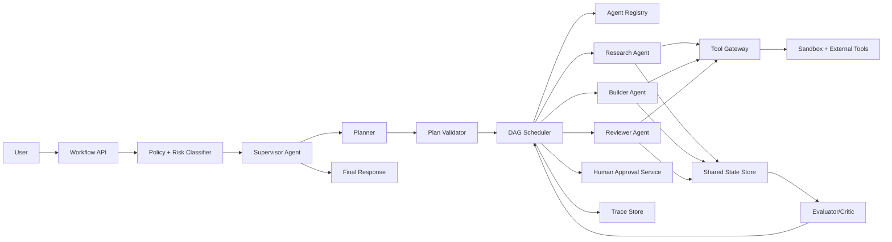

# Chapter 22: Design a Multi-Agent Workflow Orchestrator

## Context

> [!info] Quick Reference
> - **Pattern:** Supervisor-worker multi-agent orchestration with shared state, dependency graphs, tool budgets, and human approval
> - **Scale:** 200K workflows/day, 5-50 agent steps/workflow, p95 workflow completion < 10 minutes
> - **Key Techniques:** task decomposition, DAG scheduling, typed handoffs, tool sandboxing, state store, approval gates, trace replay
> - **Primary Concerns:** runaway loops, conflicting agents, tool safety, observability, cost, deterministic recovery
> - **Cross-references:** Chapter 9 (autonomous research agent), Chapter 10 (DAG orchestration), Chapter 16 (sandboxed execution)

**Problem statement:** Design a platform where multiple specialized agents collaborate on complex enterprise workflows such as incident response, sales research, code migration, or compliance review.

### Real-World Examples

- A migration assistant uses one agent to inspect code, one to edit files, one to run tests, and one to review security. Without a supervisor and state machine, agents overwrite each other's work and burn thousands of tool calls.
- An incident-response assistant coordinates log analysis, hypothesis generation, dashboard inspection, and remediation drafting. Human approval is required before any production-changing action.

### Design Contract

| Dimension | Target | Why It Matters |
|---|---:|---|
| Workflow volume | 200K workflows/day | scheduler and trace store must be horizontally scalable |
| Step count | 5-50 agent steps/workflow | budgets and loop detection must be explicit |
| Tool risk | read-only, sandboxed, internal-write, external-write | approval policy depends on side-effect class |
| Completion SLO | p95 < 10 minutes for standard workflows | long-running tasks need async state and resumability |
| Cost ceiling | per-workflow and per-agent budgets | prevents runaway planner/executor loops |
| Human control | approval before irreversible side effects | makes autonomy acceptable in enterprise settings |
| Auditability | replayable artifact and tool-call trace | required for debugging and compliance |

The orchestrator should be judged like a workflow engine: can it recover, retry, pause, resume, explain, and roll back? The LLM agents are workers inside that system, not the authority that defines correctness.

---

## Step 1: Understand the Problem and Establish Design Scope

### Functional Requirements

- **Decompose user goals into tasks and dependency graphs.** A free-form goal such as "investigate this incident" must be converted into discrete, bounded tasks whose inputs and outputs are well-defined; otherwise agents cannot be retried, parallelized, or audited independently.
- **Assign tasks to specialized agents with scoped tools and budgets.** Each agent should receive only the tools needed for its task—a log-analysis agent should not have access to deploy or payment tools—so a compromised or hallucinating agent cannot cause damage beyond its scope.
- **Run independent tasks in parallel.** Tasks with no data dependency should start simultaneously; in a 12-step workflow where 6 steps are independent, parallel execution can cut wall time by 40–60%, keeping workflows under the 10-minute SLO.
- **Share state through typed artifacts rather than free-form chat only.** Unstructured text transcripts cannot be validated, versioned, or indexed; typed artifacts with confidence scores, evidence IDs, and schema versions give downstream agents and the critic a machine-checkable record.
- **Enforce approvals for sensitive actions.** Before any tool call that modifies production state, sends external communication, or moves money, the workflow must pause and await explicit human authorization; this is the primary control that makes enterprise autonomy acceptable.
- **Detect loops, conflicts, stuck workflows, and low-confidence outputs.** An agent that keeps calling the same tool with minor prompt variations must be caught by a step counter and novelty check, not by the billing limit.
- **Produce an audit trace and replayable execution record.** Every artifact, tool call, model input/output, cost, and approval decision must be recorded so that engineers can replay a workflow with a fixed artifact to bisect model or prompt regressions.

### Non-Functional Requirements

- **Reliability:** workflows recover from individual agent/tool failures by persisting task state after each step; a retried task reads the last committed artifact rather than restarting from scratch, so a transient tool timeout does not waste prior computation.
- **Cost control:** enforce per-workflow, per-agent, and per-tool budgets enforced at the gateway layer, not in prompts; budgets expressed as dollars, tokens, and wall-clock seconds give operators a deterministic ceiling regardless of model verbosity.
- **Safety:** least-privilege tools and approval gates enforced structurally—agents receive a tool list from the registry at dispatch time and cannot call tools outside that list, even if the model generates a valid-looking tool call for an unauthorized tool.
- **Observability:** every step emits a structured span with model inputs, sampled outputs, tool call arguments and results, token cost, wall-time latency, and a decision rationale field; this makes p95 cost-per-workflow and step-level error rates queryable without log parsing.
- **Determinism:** the workflow state machine transitions are deterministic even if model outputs are not; given the same task state, the scheduler always makes the same scheduling decision, so replay and debugging are reliable.

### Back-of-the-Envelope Estimation

- Workflows/day: 200K
- Average steps/workflow: 12
- Peak multiplier: 5x
- Peak steps/sec: `~140`

---

## Step 2: Propose High-Level Design and Get Buy-In

### Core Architecture Components

- **Workflow API:** receives user goal, policy context, and approval preferences; it assigns a workflow ID, stores the raw goal, and hands off to the policy classifier before any agent is invoked.
- **Supervisor Agent:** decomposes the goal into a task plan, assigns tasks to agents, monitors progress, arbitrates conflicts between agent outputs, and decides whether the goal is complete or requires replanning.
- **Planner:** converts the supervisor's intent into a typed DAG with explicit task IDs, dependencies, per-task budgets, allowed tools, and output schemas that the scheduler can validate before any execution begins.
- **Agent Registry:** stores the authoritative definition of each agent role: which model tier it uses, which tools it may call, what input and output schemas it accepts, and what retry and timeout policy applies.
- **DAG Scheduler:** maintains a ready-queue of tasks whose dependencies are satisfied, dispatches tasks to the correct agent, tracks in-flight and completed tasks, and handles retries with exponential backoff up to a configurable maximum.
- **Shared State Store:** a versioned, append-only artifact store—backed by something like DynamoDB or Postgres with optimistic locking—that agents write structured outputs to and read prior artifacts from; it is the single source of truth for workflow progress.
- **Tool Gateway:** the enforcement point for all tool calls; it validates tool arguments against JSON Schema, checks the calling agent's permission list, enforces per-tool rate limits and timeouts, logs every call and response, and routes execution to the appropriate sandbox or external API.
- **Approval Service:** pauses a workflow by setting a task to `PENDING_APPROVAL` status, sends a notification with the proposed action and its evidence to the designated approver channel (Slack, email, or dashboard), and resumes or rejects the task based on the human response.
- **Evaluator/Critic Agent:** receives a completed task artifact and checks it against a rubric—schema compliance, confidence threshold, evidence coverage, and policy constraints—before marking the task as accepted; rejection triggers a retry or escalation rather than passing bad output downstream.
- **Trace Store:** stores a complete, ordered timeline of every event in a workflow—task dispatch, model calls with token counts and costs, tool invocations with arguments and results, artifact writes, approval decisions, and final output—queryable by workflow ID, agent, or tool name.

> **Why decompose orchestration into separate Supervisor, Planner, Scheduler, and Critic components:** Separating the Supervisor, Planner, Scheduler, and Critic into distinct components rather than a single "orchestrator agent" is the core reliability decision.

### Pipeline A: Workflow Planning

1. User submits goal and constraints.
2. Policy layer classifies risk and allowed automation level.
3. Supervisor asks planner to create task DAG.
4. Plan validator checks schema, dependencies, budget, and approval points.
5. Scheduler persists plan and starts ready tasks.

### Pipeline B: Multi-Agent Execution

1. Scheduler assigns a ready task to the appropriate agent.
2. Agent receives task, relevant state artifacts, allowed tools, and budget.
3. Tool calls go through gateway and sandbox.
4. Agent writes structured output artifact.
5. Critic validates artifact quality and policy compliance.
6. Scheduler unblocks dependent tasks.
7. Supervisor synthesizes final result or replans when required.

### Request Flow Walkthrough

Example workflow: "Investigate why checkout latency increased after yesterday's deployment and prepare a rollback recommendation."

1. **Policy layer:** classifies this as read-heavy with possible production-change recommendation.
2. **Supervisor:** decomposes the goal into log analysis, metrics analysis, deploy diff review, hypothesis synthesis, and rollback plan.
3. **Scheduler:** runs log and metrics analysis in parallel because they have no dependency.
4. **Research agent:** queries traces and incident docs, then writes a structured finding artifact.
5. **Metrics agent:** inspects dashboards and produces latency/cost/error-rate deltas.
6. **Code/deploy agent:** reads release notes and changed services, but cannot deploy or rollback.
7. **Critic agent:** checks whether evidence supports the proposed root cause.
8. **Supervisor:** merges findings and drafts a rollback recommendation.
9. **Approval service:** requires human approval before any rollback tool can be invoked.
10. **Trace store:** records every artifact, tool call, approval decision, and final recommendation.

### Developer-Facing Workflow Schema

The planner should emit a typed plan that the scheduler can validate before execution.

```json
{
  "workflow_id": "wf_latency_123",
  "goal": "Investigate checkout latency regression",
  "budget": {"max_steps": 30, "max_cost_usd": 8.0, "max_wall_time_min": 10},
  "tasks": [
    {
      "id": "t1",
      "agent": "metrics_agent",
      "description": "Compare checkout p95 latency before and after deploy",
      "allowed_tools": ["metrics.query"],
      "depends_on": [],
      "output_schema": "finding.v1"
    },
    {
      "id": "t2",
      "agent": "deploy_agent",
      "description": "Identify services changed in deploy 2026.05.28.3",
      "allowed_tools": ["deploy.read", "git.read"],
      "depends_on": [],
      "output_schema": "change_summary.v1"
    },
    {
      "id": "t3",
      "agent": "supervisor",
      "description": "Synthesize root cause and rollback recommendation",
      "depends_on": ["t1", "t2"],
      "requires_approval_for": ["deploy.rollback"]
    }
  ]
}
```

This schema gives the interviewer confidence that the design has real control surfaces: dependency validation, budget enforcement, scoped tools, and approval points.

### Mermaid Architecture Diagram



---

## Step 3: Design Deep Dive

### 1) Orchestration Patterns

| Pattern | Strengths | Weaknesses | Use When |
|---|---|---|---|
| Supervisor-worker | A single supervisor holds global context and resolves conflicts deterministically; ownership of each task is always clear, making retries and audits straightforward | The supervisor is a bottleneck: at 140 peak steps/sec, a single-threaded supervisor with a 500ms LLM round-trip can only sustain ~2 workflows/sec without parallelization strategies like batched reviews | Most enterprise workflows where correctness and auditability outweigh raw throughput |
| DAG workflow | Dependency edges make parallelism and retry scopes explicit without any LLM reasoning; a scheduler can guarantee that a failed node is retried exactly once without re-running its dependents | The plan is fixed at creation time; an unexpected finding mid-workflow—such as discovering a third affected service—cannot be incorporated without a replan that restarts the scheduler | Code migrations, report generation, data pipelines, and compliance reviews where the task graph is knowable upfront |
| Blackboard | Agents independently post discoveries to a shared workspace and consume each other's findings without a central coordinator, enabling emergent task coverage | Multiple agents writing to the same namespace without locks cause overwrites and contradictions; conflict resolution requires either pessimistic locking (serializes writes) or a reconciliation agent (adds latency and cost) | Open-ended research and threat-hunting tasks where the full task list cannot be enumerated in advance |
| Debate/consensus | Two or more agents produce competing analyses and a judge synthesizes them; this reliably catches factual errors and one-sided reasoning that a single agent misses | Running N agents plus a judge multiplies cost by roughly N+0.5; at $0.015/1K output tokens, a three-agent debate on a complex task can cost 3–5× a single-agent answer | High-stakes, low-frequency decisions such as legal risk assessment, financial model review, or security architecture sign-off |
| Swarm | Agents spawn sub-agents dynamically for high-branching exploration tasks, maximizing coverage of a large search space | Swarms are extremely difficult to audit, budget, and terminate gracefully; runaway spawning can exhaust tool quotas and cost budgets within minutes without hard resource caps at the spawn point | Rarely appropriate in production enterprise systems; better suited to offline research or strictly sandboxed environments |

> **Why supervisor-worker plus DAG scheduler as the default coordination pattern:** The supervisor-worker pattern is recommended as the default because it gives a single component—the supervisor—clear authority to arbitrate, replan, and appr...

Recommended default: supervisor-worker plus DAG scheduler. Use agents for judgment-heavy tasks and deterministic workflow code for control flow.

### 2) State, Handoffs, and Conflict Control

Agents should not hand off large unstructured transcripts as the primary state. Passing raw conversation history between agents couples their token budgets together—an agent that has accumulated a 30K-token context will push its downstream consumer past the model's effective reasoning window before the actual task content is even read. Use typed artifacts instead: compact, schema-validated structures that convey conclusions, evidence pointers, and confidence scores without carrying the entire reasoning trace.

> **Why typed artifacts for agent handoffs rather than unstructured transcripts:** Typed artifacts enforce a contract between agents the same way function signatures enforce a contract between code modules.

Example artifact types:

```json
{
  "artifact_type": "finding",
  "owner_agent": "research_agent",
  "confidence": 0.84,
  "evidence_ids": ["log-143", "doc-882"],
  "summary": "p95 latency regression starts after deploy 2026.05.28.3",
  "open_questions": ["whether cache hit rate drop is causal"]
}
```

Conflict handling:

- **Lock mutable resources such as files, tickets, and deployment plans.** Use optimistic locking with a version token in the artifact store: an agent reads an artifact at version N and may only write version N+1; if another agent has already written N+1, the write fails and the agent must re-read and retry, preventing silent overwrites in concurrent workflows.
- **Require merge/review steps for competing artifacts.** When two agents produce `finding` artifacts with different root causes for the same incident, the scheduler inserts an explicit merge task assigned to the critic or supervisor before any dependent tasks can start; this makes the conflict visible and resolvable rather than implicitly discarding one output.
- **Keep state append-only; mark artifacts superseded rather than deleting.** An artifact that is overwritten loses the evidence trail that the original agent produced; by appending a new artifact version and marking the old one `superseded_by: v2`, the trace store retains the full reasoning history needed for post-incident debugging and compliance review.
- **Give the supervisor authority to choose between conflicting outputs.** When the critic cannot resolve a conflict mechanically—for example, two plausible but mutually exclusive root causes with similar confidence scores—the supervisor agent performs a synthesis step, and if that is still inconclusive, the workflow pauses for human arbitration rather than proceeding with an arbitrarily selected output.

### 3) Safety, Budgets, and Human Approval

Every workflow needs a budget hierarchy enforced structurally at the gateway and scheduler layers, not in prompts. Prompt-based budget instructions ("stop after 10 tool calls") are ignored during long-context reasoning and cannot be trusted as a safety mechanism.

> **Why enforce budgets structurally at the gateway and scheduler rather than in prompts:** Budget enforcement in prompts fails because models do not have a reliable internal counter for tool calls or dollars spent, especially in multi-turn reasonin...

- **Workflow budget:** max total dollars, tokens, wall time, and total tool calls; when any dimension is exceeded the scheduler transitions the workflow to `BUDGET_EXCEEDED` state, persists all completed artifacts, and surfaces the partial result rather than silently terminating.
- **Agent budget:** max steps and model tier per agent per workflow; this prevents a single verbose planner from consuming the token budget intended for the entire pipeline, and allows a cost-sensitive operator to restrict certain agent roles to cheaper model tiers (e.g., Haiku for log extraction, Sonnet for synthesis).
- **Tool budget:** max calls per tool type, per-call timeout, per-minute rate limit, and data scope filter (e.g., a log-query tool capped at 7-day lookback); this makes the cost of each tool class predictable and prevents a runaway agent from issuing thousands of metrics queries in a single step.
- **Approval budget:** max pending approval time—typically 30 minutes for low-stakes actions and 4 hours for production changes—after which the workflow either escalates to a secondary approver, sends a reminder, or auto-rejects to avoid indefinite suspension of workflow resources.

Approval gates:

| Action | Approval Required? |
|---|---|
| Read logs/docs | No — read-only operations with no side effects are pre-authorized at workflow creation time via the policy classifier |
| Run tests in sandbox | No — sandboxed execution is isolated from production state; failure is recoverable and produces no external side effects |
| Open pull request | Usually yes — a PR is visible to the team and triggers CI pipelines; a mistaken PR from an automated agent can mislead reviewers and waste engineering time |
| Send customer email | Yes — external communications are irreversible; a mis-addressed or factually wrong email damages trust and may have legal consequences |
| Modify production config | Yes — config changes can cause immediate service degradation affecting all users; approval must include a diff and a rollback plan |
| Execute payment/refund | Yes — financial transactions are governed by audit and compliance requirements; every execution must have an approver identity and timestamp recorded |

> **Why gate the approval taxonomy on action reversibility:** The approval gate taxonomy maps directly to the concept of reversibility.

### Production Bottlenecks and Mitigations

- **Runaway loops:** enforce a hard `max_steps` counter in the scheduler (not in the prompt) and add a novelty check—if the last three tool calls produced identical results, mark the task as `STUCK` and escalate to the supervisor for replanning or human review; in practice, loops account for roughly 15–20% of budget overruns in early production deployments.
- **Agent disagreement:** when two agents produce conflicting artifacts with overlapping scope, route both to the critic with a structured comparison prompt; if the critic cannot resolve the conflict with confidence above 0.8, escalate to the supervisor; cap the arbitration loop at three rounds to prevent the arbitration itself from becoming a loop.
- **Tool failures:** classify errors at the gateway as `RETRYABLE` (network timeout, rate limit 429) versus `TERMINAL` (invalid credentials, permission denied, 404 not found) before triggering retry logic; persist every completed artifact checkpoint so a retry starts from the last successful artifact, not from the beginning of the workflow.
- **Trace overload:** at 48GB/day of raw trace data, store hot traces (last 7 days) in a queryable columnar store such as ClickHouse with indexed fields for workflow ID, agent, tool, and cost; compress and tier traces older than 7 days to object storage with a metadata index for compliance lookups; sample full tool-call payloads at 10% after the first 24 hours.
- **Approval latency:** group low-risk, homogeneous approvals (e.g., ten similar PR opens from the same workflow type) into a single batched approval card; include a structured diff, confidence score, and evidence links so the approver can decide in under 60 seconds; measure and alert on approval response time p95 because high approval latency directly inflates workflow wall time.

### Advanced Techniques

- **Hierarchical planning:** the top-level supervisor decomposes a large goal into sub-workflows, each with its own local supervisor, budget, and state namespace; this allows a "migrate 50 microservices" goal to run as 50 parallel sub-workflows without the root supervisor needing to hold all intermediate state in a single context window.

> **Why hierarchical planning into sub-workflows rather than one flat DAG:** A flat plan for a 50-service migration would have hundreds of tasks in a single DAG, making the scheduler's ready-queue enormous and the supervisor's synthes...

- **Speculative parallelism:** launch two or more independent research branches simultaneously when the planner cannot determine upfront which path will yield useful results; after a configurable time or step budget, score the branches by artifact confidence and evidence coverage, then commit the winning branch and discard the rest; this trades extra cost (typically 1.5–2× a single path) for lower p95 wall time when the best path is unpredictable.
- **Typed tool contracts:** define every tool's input and output for tool use with JSON Schema and validate at the gateway before execution; a schema mismatch surfaces as a `VALIDATION_ERROR` before the tool is invoked, which is cheaper and more debuggable than a runtime failure inside the tool and prevents malformed arguments from reaching external APIs.
- **Trace Replay|Trace replay:** re-run a workflow by substituting fixed artifacts for one or more completed tasks, allowing engineers to test a new prompt or model version against real historical inputs without re-executing expensive or side-effectful tool calls; replay is the primary mechanism for bisecting whether a regression is caused by a model change, a prompt change, or a data change.
- **Agent evals:** measure task success rate, cost per task, and tool error rate broken down by agent role, model tier, tool type, and workflow category; without role-level evals it is impossible to determine whether a quality regression is caused by the planner, a worker agent, or the critic, making prompt and model updates a guessing game.

---

## Step 5: Interviewer Curveballs

### Interviewer Follow-ups & Frequently Asked Questions (FAQ)

Q: Why not let agents coordinate through chat?  
**The Ideal Answer:** Chat is useful for shared context but structurally weak as a system-of-record for production orchestration. A chat transcript has no schema, no versioning, no ownership, no locking semantics, and no machine-checkable completion signal; if the process crashes mid-conversation, there is no safe point from which to resume. Typed artifacts with an append-only state store give the scheduler a deterministic view of what has been completed, what is in-flight, and what is blocked—making retries, parallelism, and audit trails reliable properties of the system rather than emergent behaviors of the model. Chat should remain the user-facing surface, not the inter-agent state bus.

**Deep Dive & Trade-offs:**
- A chat transcript lacks schema, versioning, ownership, locking, and a machine-checkable completion signal, so the scheduler cannot reliably determine what is done, in-flight, or blocked from prose alone.
- If a process crashes mid-conversation there is no safe resume point; typed artifacts in an append-only state store give a deterministic checkpoint that makes retries and resumption first-class properties.
- Typed artifacts make parallelism and audit trails reliable system guarantees rather than emergent model behaviors, which is essential when the workflow gate-keeps sensitive actions.
- Chat still has a role as the user-facing surface and for shared human context; the design separates that from the inter-agent state bus rather than discarding chat entirely.

**The Interviewer's Rubric:** A strong answer explains why prose fails as a system-of-record — no schema, versioning, locking, or completion signal — and contrasts it with typed artifacts plus an append-only store as the durable state bus. The rubric penalizes answers that treat chat coordination as sufficient or that ignore crash recovery and auditability.

Q: Two agents produce conflicting recommendations. What happens?  
**The Ideal Answer:** The scheduler detects the conflict when both artifacts are written to the shared state store with overlapping scope and different conclusions. It inserts a critic task that receives both artifacts as input along with their evidence IDs and confidence scores; the critic attempts a structured comparison and either endorses one artifact, synthesizes a merged conclusion, or flags the conflict as unresolvable. If the critic's confidence in its resolution is below the threshold (e.g., 0.75), the supervisor receives both artifacts and the critic's analysis, performs a final arbitration step, and pauses the workflow for human review if the conflicting task gate-keeps a sensitive action like a production rollback. The key point: the conflict is never silently discarded—both artifacts are retained in the trace store for audit.

**Deep Dive & Trade-offs:**
- Conflict detection is mechanical: the scheduler sees two artifacts written with overlapping scope and different conclusions, then inserts a critic task that receives both artifacts plus their evidence IDs and confidence scores.
- The critic can endorse one artifact, synthesize a merged conclusion, or declare the conflict unresolvable; making "unresolvable" an explicit outcome prevents a forced, low-confidence merge.
- A confidence threshold (e.g., 0.75) on the critic's resolution decides whether the supervisor must arbitrate, and a sensitive gate (like a production rollback) escalates to human review rather than auto-resolving.
- Both artifacts and the critic's analysis are retained in the trace store, so a discarded conclusion remains auditable rather than lost.

**The Interviewer's Rubric:** A strong answer describes a layered resolution path — critic, then supervisor arbitration, then human review for sensitive gates — driven by confidence thresholds rather than a silent pick. The rubric rewards retaining both artifacts for audit and penalizes designs that let the model quietly choose a winner with no escalation or trace.

Q: How do you know whether adding agents improves quality?  
**The Ideal Answer:** Controlled comparison is the only reliable answer. First establish a single-agent baseline and a deterministic-workflow baseline for the same task type, measuring task success rate (rubric-scored), cost per completion, wall-time p95, tool error rate, and human edit distance on final outputs. Then add the multi-agent configuration and measure the same metrics over a statistically significant sample. Adding agents is justified only if the quality improvement is real (not just longer output), the cost increase is within the per-workflow budget ceiling, and the wall-time increase stays within the completion SLO. Role-level evals—per-agent task success rate, per-tool error rate—are also necessary to diagnose which component is contributing value and which is adding cost without benefit.

**Deep Dive & Trade-offs:**
- Establish both a single-agent baseline and a deterministic-workflow baseline for the same task type before adding agents, measuring task success rate (rubric-scored), cost per completion, wall-time p95, tool error rate, and human edit distance.
- The multi-agent configuration must be measured on the same metrics over a statistically significant sample; longer output is not evidence of higher quality and must be controlled for explicitly.
- Adding agents is justified only when the quality gain is real, the cost increase stays within the per-workflow budget ceiling, and the added wall-time stays within the completion SLO — three simultaneous constraints, not one.
- Role-level evals (per-agent success rate, per-tool error rate) localize which component adds value versus cost, preventing a net-positive system from hiding a parasitic agent.

**The Interviewer's Rubric:** A strong answer insists on controlled comparison against single-agent and deterministic baselines with quality, cost, and latency measured together. The rubric rewards role-level evals to attribute value per component and penalizes claims that more agents help based on output length or anecdote rather than rubric-scored metrics.

Q: An agent gets stuck in a loop calling the same tool repeatedly. How does your design prevent runaway cost?  
**The Ideal Answer:** The design has three independent safety layers that operate without any model cooperation. First, the scheduler increments a per-task step counter with every tool call dispatch; when `steps_used >= max_steps_for_task`, the scheduler refuses to dispatch the next tool call and transitions the task to `STUCK`. Second, the tool gateway enforces per-tool call rate limits—for example, a metrics query tool is capped at 20 calls per task—and returns a `BUDGET_EXCEEDED` error rather than executing the call. Third, the workflow-level dollar meter in the gateway accumulates cost with each tool response; when the workflow budget is breached, the gateway blocks all further tool calls and the scheduler checkpoints the workflow state. All three layers are enforced in infrastructure code, not in prompts, so they cannot be bypassed by a hallucinating or stuck model.

**Deep Dive & Trade-offs:**
- The per-task step counter caps total tool dispatches and transitions a task to `STUCK` at `steps_used >= max_steps_for_task`, bounding loop length independent of model behavior.
- Per-tool rate limits at the gateway (e.g., 20 metrics-query calls per task) return `BUDGET_EXCEEDED` instead of executing, catching tight loops on a single tool even when the global step budget is not yet exhausted.
- A workflow-level dollar meter accumulates cost per tool response and blocks all further calls when the budget is breached, then checkpoints state — the financial backstop independent of step or per-tool counts.
- All three layers live in infrastructure code, not prompts, so a hallucinating or stuck model cannot reason its way past them; the trade-off is that thresholds must be tuned to avoid false-positive halts on legitimately long tasks.

**The Interviewer's Rubric:** A strong answer names multiple independent limits — step count, per-tool rate, and workflow dollar budget — and stresses that all are enforced in infrastructure rather than prompts. The rubric penalizes relying on the model to self-limit or on a single guardrail that a runaway agent could exhaust before any other layer triggers.

Q: How would you handle a workflow that needs to span multiple days because it waits on external events like a code review or a regulatory approval?  
**The Ideal Answer:** Long-running workflows must be fully resumable from persisted state, which means no in-memory workflow state. The scheduler stores every task in the state store with its status, last artifact version, and budget consumed; a task waiting for an external event transitions to `WAITING_EXTERNAL` and the scheduler releases its worker thread immediately. When the external event arrives—via webhook, polling, or human callback—the scheduler reads the task state from the store, validates that the workflow budget has not expired during the wait, and dispatches the task to the appropriate agent with its pre-existing context artifacts. Workflow timeouts must be configurable per event type: a code review might have a 3-day timeout, while a regulatory approval might have a 30-day timeout, each with escalation notifications at configurable intervals.

**Deep Dive & Trade-offs:**
- Full resumability requires no in-memory workflow state: every task's status, last artifact version, and budget consumed is persisted, so any worker or instance can pick up the task from the store.
- A task awaiting an external event transitions to `WAITING_EXTERNAL` and releases its worker thread immediately, so a 30-day wait consumes no compute rather than pinning a thread for the duration.
- On event arrival (webhook, polling, or human callback) the scheduler re-reads state, validates the workflow budget has not expired during the wait, then dispatches with the pre-existing context artifacts intact.
- Timeouts must be per event type (e.g., 3 days for code review, 30 days for regulatory approval) with escalation notifications at intervals, since one global timeout would either abort slow approvals or leave fast ones hanging.

**The Interviewer's Rubric:** A strong answer makes resumability the central requirement — persisted state, no in-memory workflow context, threads released during waits — and adds per-event-type timeouts with escalation. The rubric penalizes designs that hold worker threads or in-process state across multi-day waits, or that apply a single timeout to events with wildly different durations.

Q: Your supervisor agent is a bottleneck. How do you scale it?  
**The Ideal Answer:** The supervisor can be decomposed into two distinct responsibilities that scale differently. The first responsibility—plan synthesis and conflict arbitration—is stateful and judgment-heavy; it must be single-threaded per workflow but can run concurrently across workflows, so horizontal scaling across workflows is straightforward as long as each supervisor instance holds state for only its assigned workflow. The second responsibility—task status aggregation and dependency evaluation—is mechanically simple and can be offloaded to the DAG scheduler entirely, so the supervisor's LLM only activates for judgment steps (initial decomposition, conflict resolution, final synthesis) rather than for every task state transition. For very high-volume workloads, a hierarchical supervisor pattern assigns a local supervisor to each sub-workflow, so the root supervisor only handles cross-sub-workflow coordination, dramatically reducing its invocation frequency.

**Deep Dive & Trade-offs:**
- Separate the supervisor's two responsibilities: plan synthesis and conflict arbitration are stateful and judgment-heavy and must be single-threaded per workflow, but they run concurrently across workflows, so scaling is horizontal per workflow.
- Task status aggregation and dependency evaluation are mechanical and belong in the DAG scheduler, so the supervisor's LLM only fires for judgment steps (decomposition, conflict resolution, final synthesis) rather than every state transition.
- A hierarchical supervisor pattern assigns local supervisors to sub-workflows so the root supervisor only coordinates across sub-workflows, cutting its invocation frequency sharply at high volume.
- The trade-off is added coordination complexity and potential cross-sub-workflow latency; it pays off only when supervisor invocation frequency is genuinely the bottleneck.

**The Interviewer's Rubric:** A strong answer decomposes the supervisor by responsibility — offloading mechanical aggregation to the scheduler and reserving the LLM for judgment — and reaches for hierarchy only at high volume. The rubric rewards recognizing that per-workflow state must stay single-threaded and penalizes "just add replicas" answers that ignore the stateful judgment path.

Q: How do you handle a case where a tool returns partial or ambiguous results?  
**The Ideal Answer:** Partial or ambiguous tool results must be surfaced as a first-class artifact state rather than silently passed downstream as if they were complete. The agent writes a `finding` artifact with `confidence` below the threshold (e.g., 0.6) and populates `open_questions` with the specific ambiguities. The critic detects the low confidence score during evaluation and either triggers a retry with a narrowed tool query, spawns a supplementary task to gather additional evidence, or escalates to the supervisor for a replanning decision. The key design principle is that downstream tasks—and especially approval gates for sensitive actions—must never consume an artifact whose confidence is below the minimum acceptable threshold for that action class; the threshold should be configurable in the agent registry per output schema and action type.

**Deep Dive & Trade-offs:**
- Partial or ambiguous results become a first-class artifact state: the agent writes a `finding` with `confidence` below threshold (e.g., 0.6) and populates `open_questions` with the specific ambiguities rather than passing incomplete data downstream as if complete.
- The critic detects the low confidence and chooses a response — retry with a narrowed tool query, spawn a supplementary evidence-gathering task, or escalate to the supervisor for replanning — so ambiguity drives an explicit next action.
- Downstream tasks and especially approval gates must never consume an artifact below the minimum acceptable confidence for that action class, making confidence a hard gate, not advisory metadata.
- Thresholds are configurable per output schema and action type in the agent registry, so high-stakes actions can demand higher confidence than informational ones.

**The Interviewer's Rubric:** A strong answer treats low confidence as an explicit artifact state that gates downstream consumption and triggers retry, supplementation, or escalation. The rubric penalizes designs that pass ambiguous results downstream silently or that let a sensitive action gate consume a sub-threshold artifact.

Q: A new regulation requires you to prove that a human approved every production change. How does your design satisfy that?  
**The Ideal Answer:** The approval service records a tamper-evident log entry for every approval decision: the approver identity (from SSO token), the timestamp, the workflow ID, the task ID, the proposed action with its full argument payload, the evidence artifacts presented to the approver, and the approval or rejection outcome. This log is written to an append-only audit store—separate from the operational trace store—with a cryptographic hash chain so that deletions or modifications are detectable. The tool gateway checks for a valid, non-expired approval token before executing any action classified as `production-write`; if the token is missing or expired, the tool call is rejected and logged as `UNAUTHORIZED_TOOL_CALL`. Compliance reports can be generated by querying the audit store for all `production-write` tool executions joined with their approval records, giving auditors a complete chain of custody from user goal to approved action to executed tool call.

**Deep Dive & Trade-offs:**
- Each approval log entry captures approver identity (from SSO token), timestamp, workflow and task IDs, the proposed action with full argument payload, the evidence artifacts shown to the approver, and the outcome — enough to reconstruct exactly what was approved.
- The audit store is append-only and separate from the operational trace store, with a cryptographic hash chain so any deletion or modification is detectable; mixing it with operational data would weaken its tamper-evidence guarantee.
- The tool gateway checks for a valid, non-expired approval token before executing any `production-write` action and logs missing or expired tokens as `UNAUTHORIZED_TOOL_CALL`, so enforcement is mechanical rather than trusting the agent to ask.
- Compliance reports join `production-write` executions with their approval records to produce a complete chain of custody from user goal through approval to executed call.

**The Interviewer's Rubric:** A strong answer ties approval enforcement to a gateway token check on sensitive actions and a tamper-evident, append-only audit store separate from operational traces. The rubric rewards capturing approver identity, payload, and evidence per decision and penalizes logging schemes that are mutable, rely on the agent to self-report, or cannot reconstruct the full chain of custody.

---

