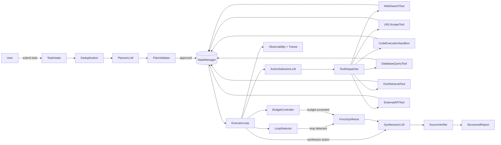

# Chapter 9: Design an Autonomous Research Agent

## Context

> [!info] Quick Reference
> - **Pattern:** Planner-executor autonomous agent
> - **Scale:** 500K tasks/day, $0.50/task budget
> - **Key Techniques:** Plan-then-ReAct, sandboxed tool execution (gVisor), loop detection (5 signal types), budget hierarchy
> - **Primary Concerns:** Loop termination, cost runaway, sandbox security, task budget enforcement
> - **Cross-references:** Chapter 2 (agentic pattern), Chapter 5 (safety), Chapter 16 (SQL agent)

**Problem statement:** Design a production-grade autonomous research agent that decomposes complex questions into sub-tasks, selects and executes tools (web search, APIs, code execution), synthesizes findings with citations—while preventing infinite loops, hallucinated sources, and runaway costs.

### Real-World Examples

- A competitive intelligence agent tasked with "Compare pricing strategies of the top 5 CRM vendors" executes 47 tool calls over 23 steps, spending $4.20 per task before loop detection and step budgets cap it at 15 steps and $0.50. After budget controls, task quality improves because the agent is forced to plan efficiently.
- A legal research agent hallucinates a court case citation that doesn't exist. Adding a mandatory source-verification tool call (check URL/database existence) before any citation is included drops hallucinated citations from 12% to 0.8%.

---

## Step 1: Understand the Problem and Establish Design Scope

### Functional Requirements

- **Task decomposition:** Break complex research questions into an ordered plan of sub-tasks with explicit dependencies, so the executor always knows what to do next and which steps can run in parallel. Without explicit decomposition, the agent treats every task as a flat chain of tool calls and cannot re-plan efficiently when a step fails.
- **Tool execution:** Select the correct tool from the registry, generate valid parameters that match the tool's JSON schema, and retry up to twice on schema validation failures before skipping the step. A malformed tool call that executes blindly can hit a live API with garbage parameters, wasting money and causing unpredictable side effects.
- **Source verification:** Every factual claim in the final report must link to a verifiable, retrievable source — a URL that returns 200 with matching content hash, a document ID present in the knowledge base, or a database row identifier. This is the single most important defence against hallucinated citations, which erode user trust far more than a gap in coverage does.
- **Partial result delivery:** When any budget or step limit is hit mid-task, the system must return the best available answer synthesised from completed sub-tasks, a list of skipped sub-tasks, a downward-adjusted confidence score, and suggested follow-up queries the user can issue to fill the gaps. Returning nothing on budget exhaustion is a hard user-experience failure.
- **Multi-format output:** Return a structured report containing a short executive summary (≤ 200 words), detailed findings keyed to specific sub-tasks, inline citations with source URLs, and confidence indicators at the claim level. This structure allows downstream consumers — dashboards, document editors, human reviewers — to process the output programmatically rather than parsing free text.

### Non-Functional Requirements

- **Latency:** p95 task completion < 5 minutes end-to-end, measured from task submission to report delivery. Individual tool call timeout is hard-capped at 30 seconds — tools that exceed this are treated as failed, so a single slow external API cannot block the entire task pipeline.
- **Cost:** Hard cap of $0.50/task covering LLM inference tokens, tool API charges, and sandbox compute combined. The budget controller must track costs in real time, not post-hoc, so it can block a tool call before it executes if doing so would exceed the limit.
- **Reliability:** Zero infinite loops guaranteed by a multi-signal loop detector and a hard 15-step ceiling. The target task completion rate is 99.5%, where graceful early termination with partial results counts as a successful completion — the agent must never silently crash or return an empty response.
- **Safety:** Code execution always runs inside a gVisor sandbox with network blocked and filesystem writes restricted to an ephemeral 50 MB /tmp volume that is destroyed after each call. No PII from the task input or intermediate tool results may appear in outbound API requests; a PII scanner runs over all tool call parameters before dispatch.
- **Auditability:** Every reasoning step, tool selection decision, tool call parameters and response, budget snapshot, and loop detector signal must be persisted to an append-only trace store with task-level correlation IDs. Traces must be queryable for 30 days to support post-hoc debugging, cost attribution, and compliance audits.

### Back-of-the-Envelope Estimation

#### Traffic Profile

- Tasks/day: 500K
- Peak (5x): ~29 tasks/sec
- Average tool calls/task: 8
- Peak tool call QPS: ~232 tool calls/sec

#### Token Budget per Task

- Average LLM calls per task: 10 (8 tool-selection + 1 planning + 1 synthesis)
- Average input tokens per LLM call: 1,200 (context + tool results + history)
- Average output tokens per LLM call: 300 (reasoning + tool call JSON + partial answer)
- Approximation check: ~12K tokens at median, ~25K at p95

#### Cost Budget Breakdown ($0.50/task)

| Component | Per-Task Budget | Calculation |
|---|---|---|
| LLM inference (planner, 70B class) | $0.30 | ~12K input @ $3/1M + ~3K output @ $15/1M |
| Web search API calls | $0.08 | ~4 searches @ $0.02/search |
| URL scraping/parsing | $0.02 | ~3 scrapes (self-hosted, negligible marginal cost) |
| Code execution sandbox | $0.02 | ~1 execution, 30s max, spot instance |
| Buffer for retries | $0.08 | ~16% headroom |
| **Total** | **$0.50** | |

#### Daily Aggregate Cost

- Cost optimization target: reduce average to $0.30/task → $4.5M/month (40% savings)

#### Infrastructure Sizing

- Sandbox cluster: 232 peak tool calls/sec, 30s max → ~7,000 concurrent sandbox slots at peak
- State store: 500K tasks * ~50KB state per task = ~25GB/day (7-day retention: 175GB)

---

## Step 2: Propose High-Level Design and Get Buy-In

### Core Architecture Components

- **Task Intake:** An API gateway that accepts incoming research task submissions, deduplicates them against recent tasks using embedding similarity (cosine > 0.95 = duplicate, return cached result), and classifies each task as simple/medium/complex to pre-assign an appropriate step and cost budget before routing downstream.
- **Planner LLM:** A large language model (70B class) that receives the task description plus the tool registry and outputs a structured JSON plan listing ordered sub-tasks with tool hints, dependencies, and expected output types. The planner runs once at the start and optionally again (up to twice) if a sub-task fails with unexpected results.
- **Executor Loop:** The central control loop that reads the current task state, calls the action-selection LLM to pick the next tool, dispatches the tool call through the proxy/sandbox, ingests the result into state, and then passes control to the loop detector and budget controller before choosing the next step. This loop runs at most 15 iterations per task.
- **Tool Registry:** A configuration store where each tool is described with its input/output JSON schema, per-call cost, average and p95 latency, maximum calls per task, and reliability score. The registry is the source of truth used by both the planner (to write realistic plans) and the executor (to validate tool calls before dispatch).
- **Tool Sandbox:** An isolated execution environment — specifically a gVisor container for code execution — that prevents any tool from accessing the network, writing to persistent storage, or consuming unbounded CPU or memory. Non-code tools (web search, database queries) route through a proxy layer that enforces rate limits and cost caps rather than full container isolation.
- **State Manager:** A durable, per-task key-value store (Redis with AOF persistence) holding the full task state: original query, structured plan, step-by-step history, accumulated findings with source references, and live counters for tokens used, cost incurred, and steps taken. If the executor crashes mid-task, the state manager allows resumption from the last completed step.
- **Loop Detector:** A stateless service that inspects the current task state after every executor step and applies five independent loop-detection signals — exact tool-call deduplication, semantic state similarity, non-progressing step counting, A→B→A oscillation detection, and token-velocity tracking. A single signal breach increments a loop counter; three breaches force transition to synthesis.
- **Budget Controller:** A gating component that runs before every tool call and LLM invocation, comparing the current accumulated cost (real-time, not estimated) against the per-task hard limit. At 80% of any budget dimension (tokens, cost, steps, wall-clock time), it injects a "wrap-up" instruction into the agent context. At 100%, it immediately forces synthesis with partial results.
- **Synthesizer LLM:** A large model (the same 70B class as the planner) that receives all accumulated, source-verified findings and produces the final structured report. It always runs as the last step, whether triggered by the agent's own decision or forced by the budget controller. Its output format is constrained: executive summary, keyed findings with inline citations, and a coverage assessment listing which sub-tasks were and were not completed.
- **Observability:** A distributed tracing system that emits one span per executor step, annotated with the action taken, tool called, tokens consumed, cost delta, and any loop detector signals fired. Traces are aggregated per task and per tool to power cost-attribution dashboards, p95 latency alerts, and circuit-breaker thresholds for degraded tools.

### Pipeline A: Task Planning Pipeline

1. Task arrives at intake; deduplicate against recent tasks (embedding similarity > 0.95 = duplicate).
2. Planner LLM receives task + tool registry descriptions.
3. Planner outputs a structured plan: ordered list of sub-tasks, each with preferred tool and expected output type.
4. Plan validator checks: step count ≤ 15, estimated cost ≤ $0.50, no forbidden tool combinations.
5. If validation fails: planner is re-prompted with constraints ("Reduce to 10 steps, budget is $0.35 remaining").
6. Approved plan is written to state store; executor loop begins.

### Pipeline B: Execution Loop Pipeline

1. Executor reads current state: completed steps, accumulated findings, remaining budget.
2. LLM selects next action: `{tool: "web_search", params: {query: "..."}}` or `{action: "synthesize"}`.
3. Tool dispatcher validates parameters against tool schema; rejects malformed calls.
4. Tool call executes in sandbox with 30s timeout. Result stored in state.
5. Loop detector checks: is this state similar to a previous state? Has the same tool been called with the same params? Is the accumulated finding set growing?
6. Budget controller checks: tokens used, cost incurred, steps taken, wall-clock time.
7. If budget/loop limit hit → force transition to synthesis step with partial results.
8. If action = "synthesize" → pass accumulated findings to synthesizer LLM → structured output.
9. Source verifier checks all citations against tool results; removes unverifiable claims.
10. Final report returned; full trace persisted.

### Mermaid Architecture Diagram



---

## Step 3: Design Deep Dive

Focus areas:

1. **Planner-Executor Architecture**
2. **Tool Integration and Sandboxing**
3. **Loop Detection and Budget Controls**

### 1) Planner-Executor Architecture

The core design choice is how much autonomy the agent gets per step. This is the spectrum from fully scripted pipelines to fully autonomous agents.

**Agent framework comparison:**

| Framework | Approach | Step Control | Best For | Risk |
|---|---|---|---|---|
| ReAct (Reason + Act) | Interleave reasoning and tool calls in a single LLM loop, producing Thought → Action → Observation sequences at every step | LLM fully decides each next step based on the accumulated trace; no external scheduler | Flexible, general-purpose research where the task structure is unpredictable and tools vary widely | High loop risk because there is no structural forcing function; token usage grows quadratically as the full trace is included in every step's context window |
| Plan-and-Solve | Generate a complete execution plan upfront, then mechanically execute each step in order without allowing the LLM to deviate | The pre-generated plan constrains execution; the LLM only fills in parameters, not step selection | Predictable, well-scoped tasks where the required steps are known before execution begins, such as templated report generation | Brittle whenever a plan assumption breaks — if step 3 returns no data, the executor has no mechanism to adapt without a full re-plan invocation |
| LATS (Language Agent Tree Search) | Expand a tree of possible action sequences, score each branch, backtrack on low-scoring branches, and commit to the best path found | A beam-search or MCTS algorithm controls which branches to expand; the LLM scores and proposes actions | High-stakes tasks that require exploring multiple solution paths and where spending 5-10x more tokens is justified by output quality requirements | Extremely expensive — exploring 5 branches to depth 10 means up to 50 LLM calls per task, making it impractical at $0.50/task budgets without aggressive pruning |
| Reflexion | Execute a full task attempt, then prompt the LLM to critique its own output, store the critique as episodic memory, and retry | A reflection loop controls iteration; the LLM decides when the reflection is sufficient to attempt a retry | Tasks with a clear, externally-verifiable success criterion (code that passes tests, answers that match a known ground truth) | The reflection loop can itself loop if the LLM's self-critique is not grounded in objective feedback, wasting an entire additional task budget on a second failed attempt |

**Recommended: Hybrid Plan-then-ReAct.**

> **Why a hybrid Plan-then-ReAct architecture rather than pure ReAct or pure Plan-and-Solve:** Pure ReAct without a plan has no upper bound on step count because the LLM decides each next action based only on its context — there is no structural forcin...

1. **Planning phase:** Planner LLM generates a high-level plan (5-10 sub-tasks) with tool hints and dependency ordering. This constrains the search space.
2. **Execution phase:** Each sub-task is executed via a ReAct loop (Thought → Action → Observation → Thought...) but scoped to that sub-task with a local step budget (max 3 steps per sub-task).
3. **Re-planning:** If a sub-task fails or returns unexpected results, the planner is re-invoked with updated state to generate a revised plan for remaining sub-tasks. Re-plan allowed at most 2 times per task.

**State representation:**

```json
{
  "task_id": "abc-123",
  "original_query": "Compare pricing strategies of top 5 CRM vendors",
  "plan": [
    {"step": 1, "subtask": "Identify top 5 CRM vendors by market share", "tool_hint": "web_search", "status": "completed"},
    {"step": 2, "subtask": "Find pricing pages for each vendor", "tool_hint": "url_scrape", "status": "in_progress"},
    {"step": 3, "subtask": "Extract pricing tiers and features", "tool_hint": "code_exec", "status": "pending"}
  ],
  "findings": [
    {"step": 1, "result": "Top 5: Salesforce, HubSpot, Zoho, Pipedrive, Freshsales", "sources": ["https://..."], "confidence": 0.92}
  ],
  "budget": {"tokens_used": 4200, "tokens_remaining": 10800, "cost_used": 0.18, "cost_remaining": 0.32, "steps_used": 3, "steps_remaining": 12},
  "loop_detector": {"state_hashes": ["a1b2c3", "d4e5f6"], "repeated_tool_calls": 0}
}
```

**Planner prompt structure:**

The planner receives: (1) task description, (2) available tools with schemas and costs, (3) budget constraints, (4) example plans for similar task types. It outputs a JSON plan. Key constraints injected into the prompt:
- "You have a maximum of 15 steps and $0.50 total budget."
- "Each web search costs $0.02. Each LLM reasoning step costs ~$0.03."
- "Prefer fewer, higher-quality tool calls over many speculative ones."

#### Planner-Executor Trade-off Table

| Decision | Option A: Pure ReAct | Option B: Plan-then-Execute | Option C: Hybrid Plan-then-ReAct | Recommended |
|---|---|---|---|---|
| Flexibility | High — the LLM can pivot strategy at every step based on new information, making it ideal when task structure is unknown upfront | Low — the executor is locked to the original plan; any deviation requires re-invoking the planner as an expensive out-of-band operation | Medium — the agent can adapt tool selection and sub-task approach within each plan step, but the overall plan structure acts as a guardrail | Hybrid |
| Cost predictability | Low — with no plan cap, a single task can run 30+ steps if the LLM does not self-terminate, easily exceeding the $0.50 budget by 5-10x | High — the plan specifies exactly N steps with known tool costs, making per-task spend predictable to within 10-15% before execution starts | Medium — each sub-task is bounded by a local step budget (max 3 steps), so cost is predictable at the sub-task level but variable across sub-tasks | Hybrid |
| Trace readability | Low — the full interleaved Thought/Action/Observation trace becomes difficult to audit past 8-10 steps, with 20,000+ tokens of history in a single context | High — the executor produces a clean step-by-step log aligned to plan entries, making it easy for engineers to identify which planned step caused a failure | High — the trace is structured at the plan level with compact per-sub-task detail, providing both overview clarity and local debugging depth | Hybrid |
| Failure recovery | Implicit — the LLM is expected to reason about its own failures in the next Thought, with no guaranteed recovery path if the model ignores the error | Requires an explicit re-plan trigger wired into the executor, adding a full planner LLM call (~$0.03) every time a step fails unexpectedly | Sub-task failure automatically triggers a targeted re-plan for remaining sub-tasks only, reusing completed findings and costing ~$0.01 less than a full re-plan | Hybrid |
| Token efficiency | Low — the full reasoning trace is appended verbatim at every step; by step 10 the context window carries 15,000+ tokens of history, most of which is redundant | High — the plan is generated once (~2,000 tokens) and execution steps are concise parameter-filling calls; total context per step stays under 3,000 tokens | Medium — the trace is scoped to the current sub-task (~4,000 tokens per sub-task context), with completed sub-tasks summarised into a 500-token findings block | Hybrid |

### 2) Tool Integration and Sandboxing

Every tool is a potential failure point: timeouts, malformed responses, rate limits, security vulnerabilities. The tool layer must be as hardened as the LLM layer.

**Tool registry schema:**

Each tool is registered with:

```json
{
  "tool_id": "web_search",
  "description": "Search the web for recent information. Returns top 5 results with titles, snippets, and URLs.",
  "input_schema": {"type": "object", "properties": {"query": {"type": "string", "maxLength": 200}}, "required": ["query"]},
  "output_schema": {"type": "array", "items": {"type": "object", "properties": {"title": {}, "snippet": {}, "url": {}}}},
  "cost_per_call": 0.02,
  "avg_latency_ms": 800,
  "timeout_ms": 10000,
  "max_calls_per_task": 8,
  "reliability_score": 0.97,
  "requires_sandbox": false
}
```

**Sandbox architecture (for code execution):**

> **Why gVisor over Docker:** Standard Docker containers share the host kernel, meaning a malicious or buggy script can exploit kernel vulnerabilities to break container boundaries.

| Requirement | Implementation | Notes |
|---|---|---|
| Isolation | gVisor container per execution | Kernel-level syscall filtering |
| Resource limits | 1 vCPU, 512MB RAM, 30s wall-clock | Kill on exceed |
| Network | Blocked (no outbound connections) | Prevents data exfiltration |
| Filesystem | Read-only base + ephemeral writable tmp (50MB) | Destroyed after execution |
| Language support | Python 3.11 + numpy/pandas/scipy pre-installed | Fixed image, no pip install |
| Output capture | stdout/stderr captured, max 10KB | Truncated if exceeded |

**Tool call validation pipeline:**

1. **Schema validation:** LLM output parsed as JSON; validated against tool input schema. If invalid, retry with schema error message (max 2 retries).
2. **Parameter sanitization:** SQL queries are parameterized (no string concatenation). URLs validated against allowlist patterns. Code execution input scanned for dangerous imports (`os.system`, `subprocess`, `socket`).
3. **Cost check:** Before executing, verify that tool cost doesn't exceed remaining budget.
4. **Execution with timeout:** Tool called with hard timeout. On timeout: return timeout error to agent state; agent can retry or skip.
5. **Output validation:** Tool output validated against output schema. Oversized outputs truncated to 2K tokens with summary.

**Tool reliability tracking:**

| Metric | Threshold | Action on Breach |
|---|---|---|
| Success rate (per tool, rolling 1h) | < 90% | Flag tool as degraded; reduce max calls per task |
| p95 latency (per tool, rolling 1h) | > 2x expected | Warn agent; extend timeout or suggest alternative tool |
| Consecutive failures | > 3 | Circuit-break tool for 5 minutes |
| Cost overrun rate | > 5% of tasks | Alert ops; review tool pricing assumptions |

#### Tool Integration Trade-off Table

| Decision | Option A: Direct API Calls | Option B: Tool Proxy Layer | Option C: Full Sandbox | Recommended |
|---|---|---|---|---|
| Security | Low — the agent has raw access to every API credential and can make unbounded calls; a prompt-injected instruction could exfiltrate credentials or call destructive endpoints | Medium — the proxy validates parameters against an allowlist, strips sensitive headers, and can enforce per-tool rate limits, but the proxy itself becomes a high-value attack target | High — each tool invocation runs in a fully isolated gVisor container with no network access and a read-only filesystem, making credential theft and data exfiltration structurally impossible | Sandbox for code execution; proxy for external API tools |
| Latency overhead | None — direct calls have no intermediary; a web search that takes 800 ms is purely the API's own latency | 5–10 ms — the proxy adds a single network hop and a fast parameter-validation step that adds negligible latency compared to tool execution time | 50–200 ms cold start — spinning up a new gVisor container adds 50–200 ms before the first line of code runs; warm container pools can reduce this to under 20 ms for high-throughput workloads | Accept sandbox latency for code; proxy for APIs where cold-start cost is unjustified |
| Observability | Low — every tool must be independently instrumented; without a central log, reconstructing what the agent did during a failed task requires correlating logs from five different external services | High — the proxy is the single chokepoint for all tool traffic, so every call's parameters, response size, latency, and status code can be logged in one place with the task correlation ID | High — the sandbox captures all stdout/stderr, resource usage, and system call patterns in a structured log attached to the task trace, making code execution fully auditable | Proxy for all tools to centralise logging; sandbox adds execution-level audit for code |
| Cost control | Hard — without a central gatekeeper, the agent can invoke an expensive external API 20 times in one task; the per-task budget is not enforced until after the calls complete | Easy — the proxy checks the remaining task budget before each call and returns a "budget exceeded" error rather than executing; this is the only architecture that can prevent over-spend in real time | Easy — the sandbox enforces CPU, memory, and wall-clock caps (1 vCPU, 512 MB, 30 s), preventing runaway code from consuming unbounded cloud compute | Proxy for all tools to enforce cost caps; sandbox for compute caps on code |
| Reliability | Low — raw API failures (timeouts, 5xx errors, rate limits) pass directly into the agent state as unhandled exceptions, often causing the LLM to loop or halt unpredictably | Medium — the proxy applies a standard retry policy (2 retries with exponential backoff) and normalises error responses into the agent's expected schema, so the agent sees a consistent "tool_error" object regardless of failure type | Medium — the sandbox contains failures by design (a crashing script cannot affect other tasks) but does not retry; the executor must decide whether to retry the entire sandbox invocation | Proxy with 2-retry policy for all tools; let executor decide on sandbox retry |

### 3) Loop Detection and Budget Controls

Infinite loops are the #1 production risk for agentic systems. An agent that calls web_search → gets unhelpful result → calls web_search again with a slightly different query → repeat is burning tokens and time with no progress.

> **Why loop detection must use multiple signals:** A single signal such as "same tool called twice with identical parameters" catches the most obvious loops but misses semantic loops where the agent rephrases...

**Loop detection signals:**

| Signal | Detection Method | Threshold | Action |
|---|---|---|---|
| Repeated tool call (same tool + same/similar params) | Hash tool_id + params; check against history | ≥ 2 identical calls | Block call; force agent to choose different action |
| Semantic state repetition | Embed accumulated findings; cosine similarity between consecutive steps | Similarity > 0.95 between step N and step N-2 | Increment loop counter; at 3: force synthesis |
| Non-progressing steps | Count new facts/findings added per step | 0 new findings for 3 consecutive steps | Force re-plan or synthesis |
| Oscillation | Detect A→B→A→B action pattern | 2 full oscillation cycles | Break with forced alternative action |
| Token velocity | Track tokens consumed per new finding | > 3,000 tokens per finding (vs 1,500 average) | Warn; at 2x threshold: force synthesis |

**Budget enforcement hierarchy:**

> **Why multiple budget dimensions instead of just a cost cap:** A single cost cap is necessary but not sufficient.

1. **Token budget (15,000 tokens):** Soft limit at 80% (12,000) triggers "wrap up" instruction injection. Hard limit at 100% terminates immediately.
2. **Step budget (15 steps):** At step 12, inject "you have 3 steps remaining; begin synthesis." At step 15, force synthesis.
3. **Cost budget ($0.50):** Tracked as sum of LLM token cost + tool call cost. At 80%, reduce allowed tool set to cheapest options. At 100%, terminate.
4. **Wall-clock budget (5 minutes):** Hard timeout. At 4 minutes, inject "time running low" signal.
5. **Per-sub-task budget:** Each sub-task in the plan gets proportional share of remaining budget. Prevents early sub-tasks from consuming everything.

**Graceful termination protocol:**

When any budget limit forces early termination:
1. Synthesizer LLM receives all accumulated findings + a "partial result" flag.
2. Output includes: (a) best available answer, (b) list of sub-tasks completed vs skipped, (c) confidence score adjusted downward for incomplete coverage, (d) suggested follow-up queries for uncovered areas.
3. User receives the partial result with a clear "Budget limit reached—results may be incomplete" indicator.

**Cost optimization strategies:**

| Strategy | Savings | Quality Impact | Complexity |
|---|---|---|---|
| Prompt compression (summarize history instead of appending full trace) | 30–40% reduction in input tokens per step; at 15,000 tokens/task average this saves ~5,000 tokens or $0.015/task, translating to ~$7,500/day at 500K tasks | Minimal quality loss if the summariser preserves key facts and source references; quality degrades measurably if the summary drops intermediate reasoning that a later step depends on | Medium — requires a dedicated summarisation LLM call after every 3 steps, adding ~$0.003/task in exchange for $0.015 savings |
| Tiered models (small model for tool selection, large for synthesis) | 40–50% cost reduction on inference; a 7B model at $0.20/1M tokens vs. a 70B at $3/1M tokens for 8 tool-selection steps saves roughly $0.12/task, or $60K/day at 500K tasks | Risk that the 7B model generates schema-invalid tool calls at 5% vs. 1% for the 70B, which the retry mechanism absorbs; risk of suboptimal tool selection (web search when database query would be better) requires A/B testing to quantify | Medium — requires a model routing layer and validation that 7B accuracy meets a minimum threshold per tool type before promotion |
| Result caching (cache web search results for 1h) | 15–20% reduction in web search API calls; if 4 searches average per task cost $0.02 each, caching reduces this to ~$0.065/task, saving $0.015/task or $7,500/day | Staleness risk for time-sensitive queries is real but bounded: a 1-hour TTL means data is at most 1 hour stale, which is acceptable for most non-financial research; temporal queries (containing "today", "latest", year references) must bypass the cache entirely | Low — standard Redis TTL cache keyed on normalised query string; requires a query normalisation step and temporal-query classifier |
| Plan reuse (match new tasks to cached plans for similar past tasks) | 20–30% reduction in planner LLM calls; at $0.03/planning call and 500K tasks/day, this saves $3,000–$4,500/day for the 10–15% of tasks that are structurally similar to recent tasks | Poor fit when cached plans differ in detail from the new task — for example, a plan for "Compare top 5 CRM vendors" applied to "Compare top 3 ERP vendors" may have the right structure but wrong tool sequence; requires a plan-adaptation step rather than blind reuse | Medium — requires an embedding index of past plans with similarity search, plus a plan-adaptation prompt to adjust vendor names, tool choices, and step count to the new task |
| Early termination (stop when confidence > 0.9) | Variable — for simple tasks that reach high confidence in 4–6 steps instead of the 8-step average, this saves 2–4 LLM calls and 2–4 tool calls, approximately $0.10–0.15/task for those tasks; estimated 20% of tasks qualify, saving ~$10K/day | Risk of premature termination on tasks that appear simple but have a hidden complexity tail — for example, a fact lookup that reaches 0.92 confidence based on a single source, then would have found a contradictory source on step 7; mitigated by requiring confidence > 0.9 across at least 2 independent sources | Low — add a confidence estimator as a post-step check; the main challenge is calibrating confidence scores so they are not systematically overconfident |

### Production Bottlenecks and Mitigations

- **Tool timeout cascades**
  - Symptom: Web search API has a 10-second outage; all active tasks stall on that step, hitting wall-clock budgets.
  - Mitigation: Per-tool circuit breaker (3 consecutive failures → skip tool for 5 min). Agent falls back to alternative tool or marks sub-task as incomplete.

- **Context window overflow in long tasks**
  - Symptom: After 10 steps, the accumulated trace exceeds the LLM's context window (8K-32K tokens), causing truncation and lost information.
  - Mitigation: Progressive summarization—after every 3 steps, summarize accumulated findings into a compressed representation (~500 tokens). Only current sub-task trace is kept in full.

- **Hallucinated tool calls**
  - Symptom: LLM generates a tool call for a tool that doesn't exist, or with parameters outside the schema.
  - Mitigation: Strict schema validation before execution. On invalid call, return the error with available tool list. Max 2 retries, then skip step.

- **Cost spike on complex tasks**
  - Symptom: 5% of tasks are 10x more expensive than average, blowing aggregate budget.
  - Mitigation: Pre-classify task complexity (simple/medium/complex) at intake. Complex tasks get higher budget ($0.80) but count as 1.6x against daily spend limits.

- **Stale web search results**
  - Symptom: Agent cites a cached search result that is outdated by the time the report is delivered.
  - Mitigation: Cache TTL of 1 hour for general queries, 0 (no cache) for queries containing temporal markers ("today", "latest", year references).

---

