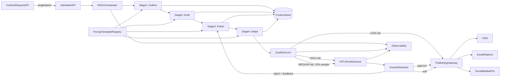

# Chapter 10: Design an Automated Content Generation Pipeline

## Context

> [!info] Quick Reference
> - **Pattern:** Multi-stage async content generation pipeline
> - **Scale:** High-volume content operations with HITL review
> - **Key Techniques:** Outline→draft→polish→format DAG (Temporal.io), quality scoring, 15% HITL routing, prompt A/B testing
> - **Primary Concerns:** Brand voice consistency, quality gate thresholds, pipeline observability, HITL latency
> - **Cross-references:** Chapter 2 (prompt chaining), Chapter 5 (output evaluation)

**Problem statement:** Design a high-throughput asynchronous content generation pipeline that processes 200K+ pieces per day through multi-stage prompt chains, automated quality scoring, and human-in-the-loop (HITL) review—optimizing for throughput and consistency over latency.

### Real-World Examples

- A marketing platform migrates from synchronous LLM calls (8 req/sec ceiling) to an async DAG-based pipeline, reaching 200K articles/day with 3-stage generation (outline → draft → polish) while reducing per-article cost from $0.15 to $0.06 through batch processing and prompt caching.
- A news wire deploys automated quality scoring on 100% of generated articles but routes only 15% (flagged as high-risk: legal, medical, financial topics) through human review. This cuts review backlog by 85% while maintaining a 99.7% compliance rate.

---

## Step 1: Understand the Problem and Establish Design Scope

### Functional Requirements

- **Multi-stage generation:** Each content piece passes through 2-4 generation stages (e.g., outline → draft → style polish → format adaptation).
- **Prompt template management:** Versioned prompt templates per content type and stage. A/B testing of prompt variants.
- **Quality scoring:** Automated scoring on every output (relevance, fluency, brand voice, factual grounding, compliance).
- **HITL review:** Route flagged content to human reviewers with structured feedback that flows back into the pipeline.
- **Batch processing:** Support bulk submission of 10K+ content requests with aggregate progress tracking.
- **Multi-format output:** Same content adapted for different channels (blog, email, social, ad copy) in a single pipeline run.

### Non-Functional Requirements

- **Throughput:** Sustain 200K content pieces/day. Peak: 3x (campaign launches).
- **Latency:** Standard p95 < 2 hours. Urgent p95 < 15 minutes.
- **Cost:** Average $0.08/piece (total, including HITL labor allocation).
- **Quality:** > 95% of published content passes human quality audit (sampled monthly).
- **Reliability:** No lost work—every stage result persisted before next stage begins. Retry on failure without re-running completed stages.
- **Observability:** Per-stage latency, quality score distribution, HITL queue depth, prompt version performance.

### Back-of-the-Envelope Estimation

#### Traffic Profile

- Content pieces/day: 200K
- Average stages per piece: 3
- Peak QPS (3x campaigns): ~21 calls/sec
- Average output tokens/stage: 700 tokens (outline: 300, draft: 1,200, polish: 600 → weighted avg)
- Average input tokens/stage: 1,300 tokens (prompt template + context + previous stage output)

#### Cost Breakdown ($0.08/piece target)

| Component | Per-Piece Cost | Calculation |
|---|---|---|
| LLM inference (3 stages) | $0.045 | 3.9K input + 2.1K output tokens @ blended $3/$15 per 1M |
| Quality scoring (1 LLM call) | $0.008 | ~800 input + 200 output tokens, cheaper model |
| HITL review (15% of pieces) | $0.021 | 15% * $0.14/review (human reviewer at $50/hr, 6 min avg) |
| Infrastructure (queues, storage, DAG engine) | $0.006 | Amortized compute + storage |
| **Total** | **$0.080** | |

#### Daily Aggregate

- **Total: ~$16,000/day → $480K/month**

#### HITL Queue Sizing

- Peak (3x): 375 reviewers → requires flexible workforce or longer SLA during peaks

#### Infrastructure Sizing

- LLM inference: 7-21 QPS is modest. A single 34B model instance handles this. Total fleet: 4-8 GPUs (or managed API).
- DAG engine: 200K DAG executions/day, 3-4 nodes per DAG → ~700K node executions/day → Airflow/Temporal handles easily.
- State store: 200K * ~15KB per piece (all stage outputs) = 3GB/day → 90GB/month (trivial).
- Queue: Kafka or SQS. 200K messages/day per topic, 5 topics → 1M messages/day (trivial throughput).

> **Why a durable queue rather than direct async calls:** Each stage executor must be able to crash, restart, or scale out without losing the in-flight task.

---

## Step 2: Propose High-Level Design and Get Buy-In

### Core Architecture Components

Nine components work together to move a content brief from request to published article without losing any intermediate work or blocking on a single stage's failure.

- **Job Intake API:** Accepts content requests (single or batch), validates that the brief contains the minimum required fields (topic, content type, target channels, priority), deduplicates against recent submissions via embedding similarity, and creates a DAG instance in the orchestrator. Batch submissions of 10K+ briefs are streamed into the queue rather than accepted all at once, preventing intake from becoming a write bottleneck.
- **DAG Orchestrator:** Manages the multi-stage execution graph per content piece, ensuring each stage waits on its upstream dependency before starting and that every stage result is durably persisted before the next stage is triggered. It handles configurable retry policies per failure type, priority preemption for urgent content, and fan-out coordination when a single piece must produce multiple channel variants in parallel.
- **Prompt Template Registry:** Stores versioned prompt templates keyed by content type and stage, with metadata for model selection, temperature, max tokens, and A/B test traffic-split configuration. Serving the correct template version at the moment a stage executor pulls a task is critical—stale template reads can cause an A/B test to mix variants and corrupt the experiment.
- **Stage Executors:** Horizontally scalable worker pools, one pool per stage type (outline, draft, polish, format adaptation), that pull tasks from their respective queues, fetch the active prompt template, inject previous stage output and request metadata, and call the LLM. Workers are stateless so any node can handle any queued task, enabling straightforward autoscaling during campaign peaks.
- **Quality Scorer:** Runs a multi-dimensional automated evaluation on every stage's final output using a combination of fine-tuned 7B judge models and rule-based checks. It produces a composite 0–1 score, a per-dimension breakdown, and a risk classification (LOW/MEDIUM/HIGH) that determines the publishing path. Keeping the scorer separate from the generation workers allows it to be retrained independently without touching the generation pipeline.
- **HITL Review Queue:** A priority queue that presents flagged content to human reviewers with the original brief, all quality score breakdowns, and highlighted passages that triggered the flag. It enforces the 30-minute SLA by surfacing time-remaining countdown to reviewers and auto-escalating items approaching the SLA limit.
- **Content Store:** Append-only persistent storage for every stage output, quality score record, reviewer action, and final published artifact. Using an append-only model means no stage result is ever overwritten—if a re-run produces a different output, both versions are stored and the active pointer is updated, enabling full audit trails and rollback.
- **Publishing Gateway:** Delivers approved content to downstream channel APIs (CMS, email platform, social media) through per-channel queues with independent retry logic and dead-letter handling. A channel API outage never blocks generation or review—content accumulates in the per-channel queue and drains automatically on recovery.
- **Observability:** Emits per-stage latency histograms, quality score distributions per content type and prompt version, HITL queue depth and reviewer throughput, prompt A/B test metrics, and per-piece cost attribution. Without this layer, regressions in quality or throughput are invisible until downstream stakeholders complain.

### Pipeline A: Content Generation DAG

1. Content request arrives at intake API with: content type, topic/brief, target channels, priority, metadata.
2. DAG orchestrator creates execution graph based on content type template:
   - Stage 1 (Outline): Generate structured outline from brief.
   - Stage 2 (Draft): Expand outline into full draft using content type prompt.
   - Stage 3 (Polish): Style, tone, and grammar refinement.
   - Stage 4 (Adapt): Format for target channels (blog version, email version, social snippet).
3. Each stage executor pulls from its queue, retrieves prompt template from registry, injects previous stage output + metadata.
4. LLM generates output; result persisted to content store before next stage begins.
5. After final generation stage: quality scorer evaluates the output.
6. Quality scorer assigns risk level: LOW (auto-publish), MEDIUM (spot-check pool), HIGH (mandatory HITL review).
7. LOW → publishing gateway. MEDIUM → 10% sampled for HITL. HIGH → HITL review queue.

### Pipeline B: HITL Review Pipeline

1. Content enters HITL queue with priority (urgent content jumps queue).
2. Review dashboard presents: generated content, source brief, quality scores, flagged issues.
3. Reviewer actions: APPROVE (publish), REJECT (back to generation with feedback), EDIT (inline corrections → publish).
4. On REJECT: feedback injected into Stage 3 (Polish) prompt as "Reviewer feedback: {feedback}"; re-run Stage 3 + quality scoring.
5. Reviewer feedback logged for: (a) prompt template improvement, (b) quality scorer calibration, (c) model fine-tuning data.
6. SLA tracker monitors queue depth and turnaround; alerts if 30-min SLA is at risk.

### Pipeline C: Prompt Template Lifecycle

1. Prompt engineers author new template version in template registry.
2. Template deployed to shadow lane (5% of traffic, results scored but not published).
3. Compare quality scores, HITL rejection rates, and downstream engagement metrics against baseline version.
4. If shadow metrics pass threshold: gradual rollout (5% → 25% → 50% → 100%).
5. If regression detected: automatic rollback to previous version.
6. All template versions retained with full audit trail.

### Mermaid Architecture Diagram



---

## Step 3: Design Deep Dive

Focus areas:

1. **DAG-Based Pipeline Orchestration**
2. **Quality Scoring and HITL Integration**
3. **Prompt Chain Design**

### 1) DAG-Based Pipeline Orchestration

The pipeline is not a simple linear chain—content types have different stage graphs, stages can fan out (multi-channel adaptation), and failures must not lose completed work.

**DAG structure per content type:**

| Content Type | Stages | Fan-Out | Typical Duration |
|---|---|---|---|
| Blog article | Outline → Draft → Polish → SEO optimize | None | 4-8 min |
| Product description | Extract features → Write copy → Adapt (3 channels) | 1→3 at Adapt | 2-4 min |
| Email campaign | Subject line (3 variants) → Body → CTA polish | 3→1→1 | 3-5 min |
| Social media pack | Core message → Adapt (Twitter, LinkedIn, Instagram, Facebook) | 1→4 | 2-3 min |
| News summary | Source ingest → Summarize → Fact-check → Polish | None (serial) | 3-6 min |

**Orchestration engine selection:**

| Engine | Throughput | Retry/Recovery | Visibility | Operational Cost | Best For |
|---|---|---|---|---|---|
| Temporal.io | Very high (100K+ workflows/sec) | Built-in durable execution; automatic retry with backoff | Excellent (web UI, history replay) | Medium (managed service or self-hosted) | Production default |
| Apache Airflow | Moderate (DAG scheduling overhead) | DAG-level retry; manual intervention for stuck tasks | Good (web UI) | Low (mature, well-understood) | Batch-heavy, scheduled pipelines |
| AWS Step Functions | High (serverless) | Built-in retry, catch, timeout | Good (console) | Low ops, higher per-execution cost at scale | AWS-native shops, low ops overhead |
| Custom queue-based (Kafka + workers) | Highest (no orchestration overhead) | Manual retry logic; higher engineering cost | Must build | Lowest per-unit at scale | Very high throughput, simple DAGs |

**Recommended: Temporal.io** for durability guarantees. Each content piece is a Temporal workflow; each stage is an activity with configurable retry policy.

> **Why Temporal.io over simpler queues:** Content generation workflows have three properties that make raw queue-based orchestration painful: long duration (up to 2 hours), fan-out parallelism (multi...

**Stage execution model:**

```text
ContentWorkflow(request):
  outline = execute_stage("outline", request.brief, request.content_type)
  draft = execute_stage("draft", outline, request.content_type)
  polished = execute_stage("polish", draft, request.content_type)

  if request.channels.length > 1:
    adaptations = parallel_for(request.channels, ch ->
      execute_stage("adapt", polished, ch))
  else:
    adaptations = [polished]

  for content in adaptations:
    score = quality_score(content)
    if score.risk == HIGH or (score.risk == MEDIUM and random() < 0.10):
      reviewed = submit_for_hitl_review(content, score)
      if reviewed.action == REJECT:
        polished = execute_stage("polish", draft, request.content_type,
                                  feedback=reviewed.feedback)
        content = execute_stage("adapt", polished, request.channels[0])
        score = quality_score(content)
    publish(content, request.channel)
```

**Failure handling:**

| Failure Type | Detection | Recovery | Max Retries |
|---|---|---|---|
| LLM API timeout | 60s timeout per call | Retry with exponential backoff (2s, 4s, 8s) | 3 |
| LLM API rate limit (429) | HTTP status code | Back off per retry-after header; route to secondary provider | 5 |
| Quality score below threshold | Score < 0.4 (hard fail) | Re-run stage with temperature 0.3 (more deterministic) | 2 |
| Stage output validation failure | Schema check on output (missing required fields) | Re-run with stricter format instructions in prompt | 2 |
| Workflow timeout | Wall-clock > 2h (standard) / 15min (urgent) | Escalate to ops; partial results saved | 0 (alert only) |
| Content store write failure | Write timeout or error | Retry write; on persistent failure, pause workflow | 5 |

**Priority scheduling:**

- Urgent content gets dedicated worker pool (20% of capacity reserved).
- Standard content uses remaining 80%.
- During campaigns (3x load): autoscale standard pool; urgent pool is elastic up to 50% of total.
- Starvation prevention: standard content waiting > 1 hour gets priority boost.

### 2) Quality Scoring and HITL Integration

Quality scoring replaces manual review for 85% of content. The scorer must be fast, calibrated, and transparent.

**Quality scoring dimensions:**

| Dimension | Weight | Measurement | Threshold (pass) |
|---|---|---|---|
| Relevance to brief | 0.25 | LLM judge: does the content address the brief's requirements? | ≥ 0.7 |
| Fluency and grammar | 0.15 | LLM judge + rule-based checks (LanguageTool) | ≥ 0.8 |
| Brand voice consistency | 0.20 | LLM judge against brand style guide reference | ≥ 0.6 |
| Factual grounding | 0.20 | Citation check: claims supported by provided sources? | ≥ 0.7 |
| Compliance (legal/regulatory) | 0.20 | Rule-based keyword scan + LLM judge for claims about health/finance/legal | ≥ 0.9 |

**Composite score:** Weighted sum. Pass threshold: 0.70. Risk classification:
- Score ≥ 0.85 AND no compliance flag → LOW risk (auto-publish)
- Score ≥ 0.70 AND compliance flag → HIGH risk (mandatory HITL)
- Score ≥ 0.70 AND no compliance flag → MEDIUM risk (10% sampled for HITL)
- Score < 0.70 → FAIL (re-generate)

**Quality scorer architecture:**

| Component | Model | Latency | Cost/Evaluation |
|---|---|---|---|
| Relevance judge | 7B fine-tuned on brief→content pairs | 200ms | $0.002 |
| Fluency checker | Rule-based (LanguageTool) + 7B backup | 100ms | $0.001 |
| Brand voice scorer | 7B fine-tuned on brand-labeled examples | 200ms | $0.002 |
| Factual grounding | Citation extraction + URL/source verification | 500ms | $0.002 |
| Compliance scanner | Keyword regex + 7B judge on flagged passages | 300ms | $0.001 |
| **Total** | | **~800ms** | **$0.008** |

> **Why LanguageTool as the primary fluency checker rather than always using an LLM:** LanguageTool is a deterministic, sub-10ms rule-based grammar checker that catches 90%+ of fluency issues (subject-verb disagreement, incorrect articles, run-...

**Scorer calibration loop:**

1. Monthly: sample 500 scored pieces across the score distribution.
2. Human evaluators rate the same dimensions independently.
3. Compute scorer-human correlation per dimension. Target: Kendall's τ > 0.7.
4. If correlation drops below 0.6 on any dimension: retrain that dimension's judge model on the new human labels.
5. Track score distribution drift over time—if mean score creeps up without quality improvement, the scorer is inflating.

**HITL review interface design:**

The review UI must minimize reviewer cognitive load to hit the 6-minute average review time:

| UI Element | Purpose | Design |
|---|---|---|
| Side-by-side view | Brief on left, generated content on right | Highlighted sections matching brief requirements |
| Quality score breakdown | Show per-dimension scores | Color-coded (green/yellow/red) with expandable rationale |
| Flagged passages | Compliance or grounding issues | Inline highlights with suggested fixes |
| Action buttons | Approve / Edit / Reject | One-click approve; inline edit mode; reject with structured feedback form |
| Feedback taxonomy | Structured reject reasons | Dropdown: factual error, tone mismatch, incomplete, compliance violation, other |
| Time tracker | SLA monitoring | Visible countdown; items turning red at 80% of SLA |

**Feedback loop from HITL to pipeline:**

| Feedback Signal | Consumer | Action |
|---|---|---|
| Rejection reason: "tone mismatch" | Prompt template team | Adjust brand voice instructions in polish stage prompt |
| Rejection reason: "factual error" | Quality scorer | Add failing case to grounding judge training set |
| Reviewer edits (diff) | Model fine-tuning | Editor preference pairs for RLHF/DPO training |
| Approval rate by prompt version | A/B test engine | Promote high-approval prompt versions |
| Average review time by content type | Ops | Adjust HITL staffing allocation |

### 3) Prompt Chain Design

Each stage in the pipeline uses a carefully designed prompt that takes the previous stage's output as input. The chain must maintain coherence, prevent error amplification, and allow independent stage optimization.

**Prompt chain architecture principles:**

1. **Explicit contracts between stages:** Each stage outputs a structured format that the next stage expects. No ambiguity.
2. **Context compression:** Don't pass the full output of all previous stages. Summarize or extract the relevant portions.
3. **Independent optimization:** Each stage's prompt can be A/B tested independently because the inter-stage format is fixed.
4. **Error isolation:** A bad outline produces a bad draft. Add validation gates between stages to catch errors early.

> **Why decompose into multiple stages rather than writing one large prompt that generates the final article directly:** A single-prompt approach forces the LLM to simultaneously plan structure, write prose, enforce brand voice, and satisfy SEO constraints—competing objectives ...

**Example prompt chain for blog article:**

| Stage | Input | Output Format | Prompt Key Instructions |
|---|---|---|---|
| 1: Outline | Brief (topic, keywords, audience, length target) | JSON: `{title, sections: [{heading, bullet_points, target_word_count}]}` | "Create a structured outline. Each section must have 3-5 bullet points. Total target: {word_count} words." |
| 2: Draft | Outline JSON + brief | Markdown article with section headers | "Expand each section from the outline. Maintain the heading structure. Target {word_count} words total." |
| 3: Polish | Draft markdown + brand style guide excerpt | Markdown article (same structure, refined prose) | "Refine for {brand_voice}. Fix grammar. Ensure claims are supported. Do not change the structure or add new sections." |
| 4: SEO | Polished markdown + target keywords | Final markdown + meta description + alt texts | "Naturally integrate keywords: {keywords}. Add meta description (155 chars). Do not keyword-stuff." |

**Inter-stage validation gates:**

| Gate | Between Stages | Check | Failure Action |
|---|---|---|---|
| Outline completeness | 1 → 2 | All required sections present? Word count targets sum to ±20% of total target? | Re-run Stage 1 with stricter constraints |
| Draft length | 2 → 3 | Output within ±30% of target word count? | Re-run Stage 2 with explicit "you wrote X words, target is Y" |
| Structure preservation | 3 → 4 | Section headings match between draft and polished version? | Re-run Stage 3 with "do not modify headings" reinforced |
| Keyword integration | 4 → publish | All target keywords present at least once? | Re-run Stage 4 with missing keyword list |

**Prompt template versioning and A/B testing:**

```json
{
  "template_id": "blog_draft_v3",
  "content_type": "blog_article",
  "stage": "draft",
  "version": 3,
  "status": "canary",
  "traffic_split": 0.10,
  "baseline_version": 2,
  "prompt_text": "You are a content writer for {brand}. Expand this outline into a well-structured blog article...",
  "model": "gpt-4o-mini",
  "temperature": 0.7,
  "max_tokens": 2000,
  "evaluation_metrics": ["quality_score", "hitl_approval_rate", "avg_review_time"],
  "promotion_criteria": {
    "quality_score_delta": ">= -0.02",
    "hitl_approval_rate_delta": ">= 0",
    "min_sample_size": 500
  }
}
```

**A/B test lifecycle:**
1. New template version created → deployed at 10% traffic.
2. After 500 pieces through new version: compare metrics against baseline.
3. If promotion criteria met: escalate to 50%, then 100%.
4. If any metric regresses beyond threshold: auto-rollback to baseline.
5. Typical A/B test duration: 2-5 days at 200K pieces/day.

#### Prompt Chain Trade-off Table

| Decision | Option A: Single-Stage Generation | Option B: 2-Stage (Draft + Polish) | Option C: 3-4 Stage Chain | Recommended |
|---|---|---|---|---|
| Quality | Acceptable for short content | Good—polish fixes draft issues | Best—each stage specializes | 3-stage for articles; 2-stage for short content |
| Cost | Lowest (1 LLM call) | 2x cost | 3-4x cost | 3-stage; cost is marginal vs HITL savings |
| Latency | Fastest | 2x | 3-4x | Acceptable for async pipeline |
| Error amplification risk | None (single pass) | Low | Medium—bad outline propagates | Mitigated by inter-stage validation gates |
| Optimization granularity | Coarse (one prompt to tune) | Medium | High—tune each stage independently | 3-stage for mature pipelines |
| Consistency across pieces | Low (high variance per run) | Medium | High (structured output reduces variance) | 3-stage for brand consistency |

**Deduplication and semantic caching:**

- Before running a new content piece: embed the brief and check against recent pieces (last 30 days).
- Cosine similarity > 0.92 → flag as potential duplicate. Serve cached result or merge briefs.
- Saves ~8-12% of pipeline cost from accidental re-submissions and similar briefs from different teams.
- Cache key: content_type + brief_embedding + target_channels. TTL: 30 days.

> **Why 0.92 as the cosine similarity threshold rather than a stricter 0.98 or a looser 0.85:** At 0.98 the deduplication only catches verbatim-equivalent briefs (copy-paste re-submissions), missing the large class of "same campaign, slightly reworded b...

### Production Bottlenecks and Mitigations

- **HITL queue backlog during campaign launches**
  - Symptom: Queue depth exceeds 3,000; 30-min SLA breached for 20% of items.
  - Mitigation: (1) Temporarily raise auto-publish threshold (score ≥ 0.80 → LOW risk instead of 0.85). (2) Activate surge reviewer pool. (3) For urgent content: bypass HITL for MEDIUM risk, rely on post-publish audit.

- **Prompt version regression goes undetected**
  - Symptom: New prompt template version slowly degrades quality, but quality scorer doesn't catch it because the scorer was calibrated on the old prompt's output distribution.
  - Mitigation: A/B test every template version with mandatory hold-out. Track HITL rejection rate per prompt version (leading indicator before scorer drift).

- **Stage output format drift**
  - Symptom: Stage 2 occasionally outputs HTML instead of markdown, breaking Stage 3's parser.
  - Mitigation: Strict output validation between stages. If format check fails, retry with "Output MUST be in markdown format. No HTML tags." appended to prompt. After 2 retries, flag for manual review.

- **Cost spikes from retry amplification**
  - Symptom: A temporarily degraded LLM API causes 60% of Stage 2 calls to fail quality gate, triggering 2 retries each. Cost doubles.
  - Mitigation: Circuit breaker on per-stage retry rate. If retry rate > 30% for a stage over 10 minutes, pause that stage and alert. Resume after API health check passes.

- **Content store write contention during batch submissions**
  - Symptom: 10K-piece batch submission causes write throughput bottleneck; DAGs stall waiting for persistence.
  - Mitigation: Content store uses write-ahead log with async replication. Stage can proceed once WAL write confirms. Background replication to durable store.

> **Why a write-ahead log (WAL) rather than waiting for full synchronous replication before proceeding:** A synchronous multi-AZ replication write adds 5–15ms per stage; across 600K stage writes per day this accumulates to hours of added latency in aggregate.

- **Reviewer fatigue degradation**
  - Symptom: Reviewer approval rate increases over a shift (rubber-stamping). Quality of reviews degrades in hours 6-8.
  - Mitigation: Inject known-bad content as calibration items (5% of queue). Flag reviewers whose calibration accuracy drops below 80%. Mandatory breaks every 2 hours.

---

