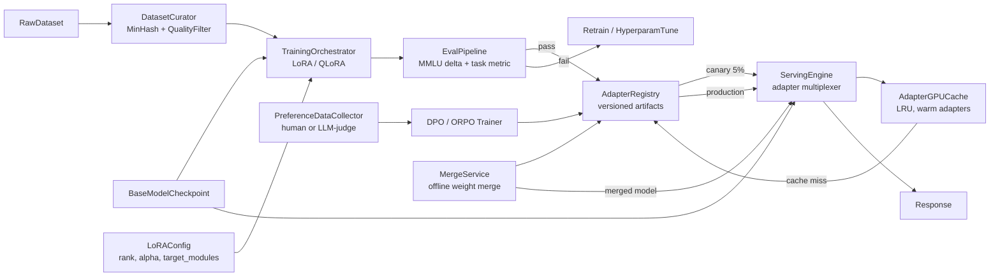

# Chapter 26: Fine-Tuning and Adaptation

## Context

> [!info] Quick Reference
> - **Pattern:** Parameter-efficient adaptation of a pretrained base model for a specific task or domain, with adapters served separately from the base weights
> - **Scale:** Single GPU (A100 80GB) for 7B LoRA training; multi-GPU DDP for 70B; adapter multiplexing at serving time supports 10–100 adapters per base model replica
> - **Key Techniques:** LoRA (low-rank adaptation), QLoRA (4-bit quantized LoRA), instruction tuning, DPO, ORPO, continual learning with EWC, adapter merging and hot-swap serving
> - **Primary Concerns:** Training compute, dataset quality, catastrophic forgetting, serving overhead of adapter loading, evaluation regression against the base model
> - **Cross-references:** Chapter 2 (LLM stack patterns), Chapter 5 (evaluation and guardrails), Chapter 25 (prompt engineering — must precede fine-tuning decision), Chapter 21 (RAG platform — alternative to fine-tuning for knowledge injection), Chapter 4 (PagedAttention KV cache and continuous batching deep dive)

**Problem statement:** Design a production fine-tuning and adaptation system that takes a pretrained base model and a domain-specific dataset, produces a task-specialized model that outperforms the base on target metrics, and serves it efficiently without duplicating base model weights across every adapter variant.

### Real-World Examples

- A legal tech company needs a model that produces clause-level contract analysis in a strict JSON schema with jurisdiction-specific terminology. Zero-shot GPT-4 achieves 71% schema compliance. After instruction tuning a Mistral-7B with 8,000 curated (contract, analysis) pairs using LoRA rank-16, schema compliance reaches 97% and per-request cost drops by 4× (smaller model, no few-shot examples required in the prompt).
- A code intelligence company serves 40 customer-specific code-completion models, each fine-tuned on a different proprietary codebase. Serving 40 full model copies would require 40 × 14GB = 560GB of GPU memory. Using LoRA adapter multiplexing on a single Deepseek-Coder-7B base, all 40 adapters fit in an additional 800MB, reducing GPU fleet size from 12 nodes to 2.

---

## Step 1: Understand the Problem and Establish Design Scope

### Functional Requirements

- Accept a task-specific dataset (instruction-response pairs or preference pairs) and produce a fine-tuned adapter artifact.
- Support LoRA and QLoRA training on 7B–70B parameter base models on commodity A100 hardware.
- Implement dataset curation pipeline: deduplication, format normalization, quality filtering.
- Support instruction tuning and preference optimization (DPO or ORPO).
- Serve multiple adapter variants on a single base model without duplicating weights.
- Support hot-swap of adapters with < 50ms added latency per swap.
- Evaluate fine-tuned models against held-out test sets and report delta from base model performance.

### Non-Functional Requirements

- **Training time:** 7B model with 10,000 examples and LoRA rank-16 completes in < 4 hours on 1× A100 80GB.
- **GPU efficiency:** QLoRA fits a 7B model in < 12GB VRAM; bfloat16 LoRA fits in < 40GB VRAM.
- **Serving memory:** 30 LoRA adapters (rank-16, 7B model, attention-only) add < 900MB to base model VRAM.
- **Adapter load latency:** cold-load of an adapter from disk to GPU < 200ms; from warm cache < 30ms.
- **Quality gate:** promoted fine-tuned model must not regress > 2% on MMLU relative to the base model; must beat the base model on the target task metric by >= 5%.
- **Reproducibility:** training runs are versioned with dataset hash, hyperparameter config, and base model checkpoint reference.

### Back-of-the-Envelope Estimation

#### Training Compute

Assume:

- **Base model:** 7B parameters, bfloat16 (14GB model weights)
- **LoRA rank:** 16, applied to query and value projections in all 32 attention layers
- **Trainable parameters:** `32 layers × 2 projections × 2 matrices (A, B) × rank-16 × hidden-dim-4096 / 4096 = 32 × 2 × 2 × 16 × 4096 = ~8.4M parameters` (~0.12% of 7B)
- **Dataset:** 10,000 instruction-response pairs, average 512 tokens each
- **Batch size:** 4 (gradient accumulation × 8 = effective batch 32)
- **Epochs:** 3
- **Forward + backward pass time on A100:** ~0.8s per step at batch 4

Practical wall-clock with overhead: **2–4 hours** for a full run with eval checkpoints every 200 steps.

#### Adapter Serving Memory

- 7B base model in bfloat16: 14GB
- Each LoRA adapter (rank-16, Q+V projections, 32 layers): `32 × 2 × 2 × 16 × 4096 × 2 bytes (bf16) = ~33MB`
- 30 adapters resident in GPU memory: `30 × 33MB = ~990MB`
- Single A100 80GB: 14GB (base) + 1GB (adapters) + ~20GB (KV cache at batch-32 and 2048 context) = **~35GB** — well within the 80GB budget

#### Dataset Cost

- 10,000 examples curated manually: ~$0.50/example = $5,000
- 10,000 examples from GPT-4 distillation: ~$0.02/example (500 tokens in + 200 tokens out at $2.50/1M and $10/1M) = $200
- QA filtering pass on distilled data: human review of 10% sample = $500

Distillation path: **~$700 total vs $5,000 manual** — 7× cheaper, but requires quality filtering to remove hallucinated examples.

---

## Step 2: Propose High-Level Design and Get Buy-In

### Core Architecture Components

- **Dataset Curator:** ingests raw (prompt, response) or (prompt, chosen, rejected) pairs; runs deduplication (MinHash), format normalization, length filtering, and quality scoring.
- **Training Orchestrator:** schedules training jobs on GPU nodes; injects LoRA config into the base model; manages gradient checkpointing, mixed precision, and optimizer state.
- **Adapter Registry:** versioned store of adapter artifacts (weights file, LoRA config, base model checkpoint reference, eval results, deployment status). Each artifact is addressed by a content hash of the dataset + hyperparameter config + base model ID, enabling reproducible training runs and point-in-time rollback without storing duplicate model weights.
- **Eval Pipeline:** runs fine-tuned adapter against the held-out test set and an MMLU subset; computes task metric delta and general capability delta from the base model; enforces the promotion gate (task delta >= +5%, MMLU delta >= -2%). Rejects adapters that pass task metrics but regress on general capability — catching overfitting to narrow task distributions.
- **Serving Engine:** loads the base model once into GPU memory and keeps it resident; manages an LRU adapter weight cache sized to the top-20 most recently active adapters; routes incoming requests to the correct adapter by `adapter_id`; handles hot-swap in < 200ms on cold cache miss by loading from the Adapter Registry.
- **Preference Data Collector:** (for DPO/ORPO) surfaces model outputs to human annotators or LLM-as-judge for pairwise preference annotation; outputs (prompt, chosen, rejected) triplets formatted for DPO training. Tracks inter-annotator agreement (Cohen's kappa) and flags annotation batches below kappa=0.6 for re-annotation.
- **Merge Service:** offline job triggered for adapters exceeding 30% of total traffic; permanently merges adapter A and B matrices into base model weights (`W_merged = W₀ + BA × α/r`) to produce a zero-overhead serving artifact. Merged models are stored as separate base model variants in the registry — not as adapters — because they cannot be un-merged without reloading the original base weights.

### Pipeline A: Fine-Tuning a New Adapter

1. Raw dataset uploaded to the Dataset Curator. The upload triggers a content hash computation and a duplicate-run check against the registry — if a prior training run used the same dataset hash and LoRA config, the existing adapter is returned without re-training.
2. Deduplication (MinHash, Jaccard threshold 0.85), format normalization to ChatML, length filter (discard examples > 4,096 tokens or response < 10 tokens), quality score filter using perplexity-based outlier removal (remove bottom 10th percentile by base model perplexity on the response).
3. Training Orchestrator launches LoRA training job: injects rank-16 adapters into Q and V projections for all 32 attention layers, trains with AdamW at lr=2e-4 on a cosine schedule with 100-step linear warmup, for 3 epochs with gradient accumulation across 8 micro-batches for an effective batch size of 32.
4. Checkpoint saved every 200 gradient steps to object storage (S3 or GCS); Eval Pipeline immediately runs the checkpoint against the held-out 10% eval split to detect overfitting (rising eval loss while train loss decreases) and enable early stopping.
5. At training completion: full task benchmark evaluation and MMLU 10-subject delta check against the base model. Both results are recorded in the registry entry to enable historical quality trending across adapter versions.
6. If both eval gates pass (task delta >= +5%, MMLU delta >= -2%): adapter artifact is registered in the Adapter Registry with status `canary` and the training data hash, hyperparameter config, and base model checkpoint reference stored as immutable metadata.
7. 5% of production traffic for that customer is routed to the canary adapter; live quality metrics (task-specific accuracy, p95 latency, error rate) are tracked in a 24-hour monitoring window against the production baseline.
8. Promote to production (100% traffic) or roll back to the previous adapter version via a single registry status update — no redeployment of the serving engine is required because the adapter is loaded by ID at request time.

### Pipeline B: Request-Time Adapter Serving

1. Request arrives with `adapter_id` and prompt. The serving engine validates that the `adapter_id` exists in the registry and is in `production` or `canary` status; unknown or deprecated adapter IDs return a 404 before the forward pass begins.
2. Serving Engine checks adapter GPU cache keyed by `adapter_id`: cache hit (adapter tensors already resident in GPU VRAM) → proceed directly to forward pass with zero swap overhead; cache miss → load adapter from Adapter Registry to GPU in < 200ms cold (NVMe read + PCIe transfer) or < 30ms warm (CPU RAM to GPU via PCIe).
3. Forward pass: base model weights remain frozen on GPU throughout; adapter A and B matrices are applied as additive weight deltas `(B × A × α/r)` at each targeted projection layer before the attention computation — no weight overwriting occurs, so the base model state is unchanged after the request.
4. Response is generated token-by-token via autoregressive decoding and streamed back to the caller; after generation completes, the adapter tensors remain in the GPU LRU cache — not evicted — because the next request for the same customer is highly likely to use the same adapter ID within seconds.

### Mermaid Architecture Diagram



---

## Step 3: Design Deep Dive

The four deep-dive areas represent the core system concerns that a production fine-tuning platform must solve. LoRA and QLoRA mechanics govern the memory and compute feasibility of training — without understanding rank, scaling, and quantization, you cannot reason about GPU budgets. Dataset curation is the highest-leverage intervention in the entire pipeline: a model trained on 1,000 well-curated examples consistently outperforms one trained on 100,000 noisy examples, making quality filtering a first-class engineering concern rather than a preprocessing afterthought. The alignment method — whether RLHF, DPO, or ORPO — determines the infrastructure complexity and the quality ceiling for preference-shaped behavior. Finally, adapter serving mechanics determine whether the system is economically viable at scale: serving 30 customers from one base model rather than 30 separate model copies is the difference between a 2-node and a 12-node GPU fleet.

Focus areas for this chapter:

1. **LoRA / QLoRA Mechanics**
2. **Dataset Curation and Instruction Tuning**
3. **RLHF vs DPO vs ORPO**
4. **Serving Fine-Tuned Adapters**

---

### 1) LoRA / QLoRA Mechanics

#### Low-Rank Decomposition

LoRA (Hu et al., 2022) decomposes the weight update for a linear layer into two low-rank matrices:

```text
W = W₀ + ΔW = W₀ + B × A
```

Where:
- `W₀` ∈ ℝ^(d×k) — frozen pretrained weight matrix
- `A` ∈ ℝ^(r×k) — down-projection; initialized with random Gaussian
- `B` ∈ ℝ^(d×r) — up-projection; initialized with zeros (so ΔW = 0 at training start)
- `r` — the rank hyperparameter (r << min(d, k))

During the forward pass, the output is:

```text
h = W₀x + (B × A)x × (α / r)
```

The `α / r` scaling factor decouples the learning rate sensitivity from the rank choice. `α` is typically set equal to `r` (scaling factor = 1.0) or to `2r` for a slight boost.

> **Why LoRA over full fine-tune:** Full fine-tune of a 7B model requires 112GB+ GPU RAM for Adam optimizer states (2x parameter copies in fp32).

> **Why initialize B to zeros:** If both A and B are initialized randomly, the initial output of `BA` is a non-zero random matrix, which creates large gradient noise at the start of training...

#### What Rank r Controls

The rank `r` determines the expressivity of the adapter:

- `r=4`: ~2.1M trainable params for a 7B model. Sufficient for format adherence and simple style tasks.
- `r=16`: ~8.4M trainable params. Sufficient for most instruction-tuning and domain-adaptation tasks.
- `r=64`: ~33.6M trainable params. Diminishing returns for most tasks; justified only for highly complex style transfer or tasks requiring large distributional shifts.

> **Why r=16:** r=4 underperforms on style-transfer tasks; r=64 shows diminishing returns past r=16 at 4× parameter cost.

> **Why not r=4 for domain adaptation:** Domain adaptation requires the adapter to shift the model's probability distribution toward the target domain's vocabulary, syntax, and reasoning patterns.

#### Which Layers to Target

LoRA is typically applied to the query (Q) and value (V) projection matrices in each attention layer. Applying to all four projections (Q, K, V, O) increases expressivity at 2× the parameter count.

| Target Modules | Params (7B, r=16) | Use Case |
|---|---|---|
| Q, V only | ~4.2M | Format adherence, style, instruction following |
| Q, K, V, O | ~8.4M | Domain knowledge injection, significant vocabulary shift |
| Q, K, V, O + MLP up/gate | ~16.8M | Maximum adaptation; approaches full fine-tune quality |

> **Why Q and V, not K:** The key matrix K acts as a lookup index in attention — it determines which positions are attended to.

#### QLoRA: 4-Bit Quantization

QLoRA (Dettmers et al., 2023) combines LoRA with 4-bit NormalFloat quantization of the frozen base model weights:

1. Base model weights are quantized to NF4 (4-bit NormalFloat) and remain frozen.
2. LoRA adapter matrices A and B are trained in bfloat16.
3. During the forward pass, base weights are dequantized to bfloat16 for computation, then immediately discarded (not stored in full precision).

Memory comparison for a 7B model:

| Method | GPU RAM | Notes |
|---|---|---|
| Full fine-tune (bfloat16) | ~112GB | Includes Adam optimizer states (2× param copies in fp32) |
| LoRA (bfloat16 base) | ~40GB | Frozen base in bf16 + adapter states |
| QLoRA (NF4 base) | ~10–12GB | Quantized base + bf16 adapter states |

> **Why NF4 over INT4 quantization:** INT4 uniformly maps values to 16 discrete levels, which wastes bits on the tails of the weight distribution (where very few weights actually live).

> **Why not quantize the adapter matrices:** The adapter matrices A and B have far fewer parameters than the base model, so the memory saving from quantizing them is negligible (~3MB at r=16).

#### Trade-off Table: Adaptation Methods

| Method | GPU RAM (7B) | Training Time | Quality vs Base | Catastrophic Forgetting | Best For |
|---|---|---|---|---|---|
| Full fine-tune | 112GB+ | Hours–days | Best (upper bound) | Severe | Large compute budgets, large datasets (100K+) |
| LoRA (bf16) | 40GB | 1–4 hours | 90–95% of full FT | None (base frozen) | Most production use cases |
| QLoRA (NF4) | 10–12GB | 2–6 hours (slower dequant) | 85–92% of full FT | None (base frozen) | Single GPU, 7B–13B models |
| Adapter (prefix) | 14GB | Fast (~30 min on A100 for 10K examples) | 70–80% of full FT; competitive on style tasks but weaker on domain shift | None (base frozen; only prefix vectors trained) | Lightweight style or tone adaptation where minimal parameter count is prioritized over peak quality |
| Prompt tuning | 14GB | Very fast (~5–15 min); only soft prompt vectors are updated, not any model weights | 60–75% of full FT; quality ceiling is low because no weight change occurs in the model | None | Tasks with < 1,000 examples where a format or persona change is the only goal and quality ceiling does not need to match SFT |

---

### 2) Dataset Curation and Instruction Tuning

#### Quality Over Quantity

The most impactful dataset finding from production fine-tuning: 1,000 high-quality examples consistently outperform 100,000 low-quality examples. The LIMA paper (Zhou et al., 2023) demonstrated this with 1,000 curated instruction pairs producing a model competitive with models trained on 52,000 examples.

Why: a language model's pretraining gives it broad capabilities. Fine-tuning does not teach new facts — it teaches the model how to apply its existing knowledge in a specific format, style, and domain. A single high-quality example of the target format provides more signal than 100 noisy examples where the target behavior is inconsistently demonstrated.

> **Why quality filtering matters more at small dataset sizes:** At 10,000 examples, one noisy example is 0.01% of the data — negligible.

#### Dataset Curation Pipeline

**Step 1: Deduplication (MinHash LSH)**

Near-duplicate examples waste training compute and cause the model to memorize specific phrasings rather than generalize. MinHash with Locality Sensitive Hashing detects near-duplicates at scale:

1. Tokenize each example; extract character-level n-grams (n=3).
2. Compute k=128 MinHash signatures per example.
3. Use LSH with b=32 bands and r=4 rows: examples with Jaccard similarity > 0.85 are near-duplicates.
4. Keep one example per near-duplicate cluster (prefer the longer, more detailed example).

At 100,000 examples, MinHash deduplication runs in O(n) time and typically removes 15–30% of web-scraped data.

> **Why Jaccard threshold 0.85, not 1.0 (exact duplicate):** Exact duplicate detection misses paraphrases and near-identical examples with trivial surface differences (whitespace, punctuation).

**Step 2: Format Normalization**

All examples must follow the same conversation format as the target inference format. Common issues in assembled datasets:

- Mixed chat formats: ChatML, Alpaca, ShareGPT, plain text.
- Inconsistent role markers: "Human:", "User:", "### Instruction:".
- Trailing whitespace and encoding artifacts.

Normalize to a single canonical format (e.g., ChatML) before training. A model trained on mixed formats learns multiple format patterns simultaneously, leading to inconsistent output format at inference time.

**Step 3: Length Filtering**

- Discard examples where the input prompt is > 4,096 tokens (exceeds training context length).
- Discard examples where the response is < 10 tokens (likely degenerate: "Yes.", "OK.") unless the task intentionally produces short outputs.
- Discard examples where response length > 4× the median response length (likely runaway generation or copy-pasted noise).

**Step 4: Quality Scoring**

Two practical approaches:

| Method | Cost | Quality | Best For |
|---|---|---|---|
| Perplexity filter | Free — requires only a forward pass through the base model, no annotation labor | Medium — catches incoherent or off-domain text but cannot assess correctness or helpfulness | Removing responses that the base model already considers highly unlikely, which are rarely useful training examples |
| LLM-as-judge scoring | $0.001–0.005/example using GPT-4o; ~100× cheaper than human review at scale | High — structured rubrics (helpfulness, correctness, format compliance) correlate well with human preference at 0.8–0.9 Spearman rank | Ranking all examples by quality score and discarding the bottom 10–20% before training |
| Human review (10% sample) | $0.50–$1.50/example depending on task complexity; use for 10% audit of auto-filtered data | Ground truth — direct measure of the actual quality signal the model should learn; no proxy errors | Calibrating and validating the thresholds set by automated filters; identifying systematic failure modes in LLM-as-judge |
| Reward model scoring | One-time reward model training cost (~4 GPU-hours for a 7B RM) plus $0.0005/example inference | High — directly aligned with the downstream preference objective if the reward model was trained on the same task domain | Tasks where a domain-specific reward model already exists from a previous RLHF run and can be reused to score new data cheaply |

> **Why perplexity filtering works for noise detection:** A high-quality instruction-following dataset should have responses with moderate perplexity under the base model — low enough that the model "knows" the doma...

**Step 5: Negative Example Sourcing**

For tasks requiring refusals or boundary enforcement (e.g., "do not answer questions outside domain X"), the dataset must include negative examples: inputs that should trigger a refusal, paired with well-formed refusal responses. Without negatives, the model never learns the refusal behavior — every fine-tuning gradient pushes toward compliance.

Sources:
- Red-team generation: GPT-4 prompted to generate adversarial inputs for the specific domain. Effective because it produces inputs that are grammatically fluent and semantically adjacent to the in-scope task, which are exactly the cases where the model is most likely to incorrectly comply rather than refuse.
- Production logs: real user inputs that fall outside the intended task scope. These are the highest-fidelity negative examples because they represent actual user behavior — not hypothetical adversarial inputs. Capturing 500–1,000 real out-of-scope examples from production logs and adding well-formed refusal responses dramatically improves boundary enforcement.
- Synthetic mutation: paraphrase valid inputs to create out-of-scope variants by changing the subject, domain, or intent. Cheaper than red-teaming but lower coverage — mutation may not generate the implicit out-of-scope patterns that users actually produce.

> **Why negative examples must be explicitly included in the training set:** Instruction tuning gradients are computed only on examples in the training set.

#### Instruction Tuning Format

The standard instruction tuning objective is supervised fine-tuning (SFT) on next-token prediction, with loss computed only on the response tokens (not the prompt tokens):

```text
Loss = -Σ log P(y_t | y_<t, x)   for t in response_positions_only
```

Masking the prompt from the loss prevents the model from being penalized for the prompt format, which is not the behavior we want to shape. Training loss on prompt tokens typically hurts instruction-following quality.

> **Why mask prompt tokens from loss:** Including prompt tokens in the loss creates a gradient signal that nudges the model toward generating prompt-like text — the opposite of what instruction tun...

---

### 3) RLHF vs DPO vs ORPO

#### RLHF (Reinforcement Learning from Human Feedback)

RLHF consists of three stages:

1. **SFT stage:** supervised fine-tuning on a curated dataset (same as instruction tuning).
2. **Reward modeling stage:** train a reward model R(prompt, response) on human preference pairs (chosen, rejected).
3. **RL stage:** use PPO (Proximal Policy Optimization) to maximize E[R(prompt, π(prompt))] while keeping the policy close to the SFT model via KL divergence penalty.

Infrastructure requirements:
- SFT model (active policy): 1 copy
- Reward model: 1 copy (typically same size as SFT model)
- Reference model (SFT model frozen): 1 copy
- Value function: 1 additional head or separate model

Effective GPU requirement: **3–4× the base model size** in GPU memory simultaneously.

> **Why not RLHF for domain adaptation:** RLHF requires a trained reward model, PPO loop, and reference model — 3× the infrastructure of DPO.

#### DPO (Direct Preference Optimization)

DPO (Rafailov et al., 2023) eliminates the reward model and RL loop entirely. It directly optimizes the policy using preference pairs (prompt, chosen, rejected) via a closed-form loss derived from the RLHF objective:

```text
L_DPO(π_θ) = -E[(p,y_w,y_l)] [pppp)) ) ]
```

Where:
- `y_w` = chosen (preferred) response
- `y_l` = rejected (less preferred) response
- `π_ref` = reference model (frozen SFT model)
- `β` = temperature controlling KL divergence penalty strength (typical: 0.1–0.5)

Infrastructure requirements: **2 copies of the model** (active policy + frozen reference).

> **Why DPO over RLHF for most production cases:** DPO is a supervised loss — it trains with standard gradient descent on labeled preference pairs.

> **Why RLHF still applies for frontier alignment:** DPO requires a fixed preference dataset — it cannot explore new response distributions during training.

#### ORPO (Odds Ratio Preference Optimization)

ORPO (Hong et al., 2024) eliminates the reference model requirement. It combines SFT loss and preference optimization into a single loss:

```text
L_ORPO = L_SFT + λ × L_OR
L_OR = -E [pp)) ) ]p) = p) / (1 - p))
```

Infrastructure requirements: **1 copy of the model** (no reference model needed).

> **Why ORPO for resource-constrained training:** Eliminating the reference model halves GPU memory for the training process relative to DPO.

> **Why not ORPO by default:** ORPO's odds ratio formulation can produce unstable gradients when response token probabilities approach 0 or 1 — common early in training.

#### Trade-off Table: Alignment Methods

| Method | GPU Copies | Dataset Required | Stability | Quality (vs RLHF) | Best For |
|---|---|---|---|---|---|
| RLHF (PPO) | 3–4× the base model size simultaneously (policy, reference, reward model, value head) | Preference pairs for reward model training (5K–50K pairs) plus SFT data | Low — PPO has notoriously tight hyperparameter sensitivity; reward hacking and KL collapse are common failure modes requiring careful β and clip-ratio tuning | Baseline upper bound — best for frontier model alignment where online exploration is necessary | Frontier model alignment where the reward model must score novel response distributions not covered by the static preference dataset |
| DPO | 2× (active policy + frozen reference model loaded simultaneously during training) | Preference pairs only (2K–20K pairs); no reward model training data needed | High — standard supervised gradient descent with no RL loop; training loss is monotone and interpretable, making hyperparameter search straightforward | 95–98% of RLHF on most alignment benchmarks; gap widens only for tasks requiring exploration of novel behaviors | Production alignment tuning where a static preference dataset is available and infrastructure cost is a constraint |
| ORPO | 1× (no reference model; SFT and preference loss combined in a single training pass) | Preference pairs only; same as DPO but model learns format and preference simultaneously | Medium — odds ratio gradient can become numerically unstable when response token probabilities are near 0 or 1, requiring careful learning rate warmup | 90–95% of RLHF; slight quality ceiling below DPO due to odds ratio formulation instability and absence of reference model anchor | Resource-constrained settings (single-GPU training for a 13B–70B model) or iterative fine-tuning rounds where the reference model is stale |
| SFT only | 1× (single model copy; simplest possible training setup) | Instruction-response pairs only; no preference annotation required | Very high — standard cross-entropy loss on next-token prediction; no RL, no contrastive objectives, no reference model divergence | N/A — no preference signal is incorporated; quality is bounded by the quality of labeled responses in the training set | Format, schema, or domain adaptation tasks where any response that meets the format constraint is acceptable and quality ordering is not meaningful |

#### When to Use Each Method

Decision framework:

1. **Use SFT only** when: task is format/schema adherence; no human preference data exists; dataset is < 1,000 examples; latency budget for data collection is zero.
2. **Use DPO** when: you have preference pairs (or can generate them with LLM-as-judge); you want alignment to quality/tone preferences beyond what SFT captures; you have two copies of GPU memory available.
3. **Use ORPO** when: GPU memory is the binding constraint; you are fine-tuning iteratively and the SFT model has drifted from its original reference.
4. **Use RLHF** when: you are training a frontier general-purpose model; quality requires online exploration of novel response distributions; you have the infrastructure for a full RL loop.

---

### 4) Serving Fine-Tuned Adapters

#### Adapter Multiplexing

A single base model process can serve multiple LoRA adapters simultaneously using adapter multiplexing:

1. Base model weights are loaded once into GPU memory and remain static.
2. Each adapter's A and B matrices are stored as separate tensors, keyed by adapter ID.
3. Incoming requests are tagged with an adapter ID. The serving engine groups requests by adapter ID within each batch.
4. During the forward pass, the correct adapter delta `(BA × α/r)` is added to the frozen base weight at each targeted layer.

For homogeneous batches (all requests use the same adapter), the overhead is a single matrix addition per targeted layer per forward pass — negligible compute cost.

For heterogeneous batches (multiple adapters in one batch), the overhead is:
- One matrix addition per adapter per targeted layer per forward pass.
- If batch has 8 distinct adapters and 32 layers with 2 targeted projections: `8 × 32 × 2 = 512` extra matrix additions per batch.

At modern GPU compute rates, 512 small matrix additions (rank-16 matrices) add < 0.5ms to the forward pass — well within the 2s TTFT budget.

> **Why multiplexing on a single base rather than separate fine-tuned models:** 30 separate 7B fine-tuned models require `30 × 14GB = 420GB GPU memory` — 6 full A100 80GB nodes.

#### Adapter Hot-Swap

When a request arrives for an adapter not currently resident in GPU memory, the serving engine must load it:

- **Cold load (from disk):** adapter file is ~33MB for a 7B rank-16 adapter. NVMe SSD read speed ~3GB/s → disk read time ~11ms. PCIe transfer to GPU ~15GB/s → transfer time ~2ms. Total: **~13–15ms cold load**.
- **Warm load (from CPU RAM):** adapter tensor cached in host RAM. PCIe transfer only: **~2ms**.
- **Cache hit (GPU RAM):** adapter tensors already resident. Forward pass proceeds immediately with **0ms overhead**.

GPU adapter cache management: LRU eviction with a configurable cache budget (e.g., top-20 most recently used adapters always resident). This keeps the 80th-percentile hot adapters in cache, amortizing cold load latency for the long tail.

> **Why LRU over frequency-based eviction:** In production, adapter request patterns are bursty — a customer using adapter A intensively for 10 minutes then going idle.

#### Adapter Merging for Zero-Overhead Serving

For adapters with very high traffic (e.g., top 3 adapters account for 80% of requests), the adapter delta can be merged permanently into the base weights:

```text
W_merged = W₀ + B × A × (α / r)
```

A merged model is a standard dense model with no adapter overhead — forward passes are identical to the base model in cost. The trade-off: the merged model cannot be easily un-merged (requires re-loading the original base weights).

When to merge:
- Adapter serves > 30% of total traffic, meaning the adapter's forward-pass overhead is paid on enough requests that eliminating it provides a measurable fleet-level compute saving — roughly 0.5ms × 30% of requests per second.
- Adapter is stable (no planned updates in the next 30 days) — merging locks the adapter weights into the base model, so any adapter update requires re-merging a new base model copy, which takes 15–30 minutes of offline processing.
- Zero added latency is required at the p99 level (real-time interactive product with a p99 TTFT budget so tight that even the sub-millisecond adapter delta overhead is unacceptable).

> **Why not merge all adapters by default:** Merging creates a separate full model copy per adapter, eliminating the memory efficiency that multiplexing provides.

#### Continual Learning and Catastrophic Forgetting

When a new task dataset is used to further fine-tune a model that already has an adapter (e.g., updating adapter for quarterly domain knowledge refresh), naive retraining overwrites the adapter weights toward the new data distribution, causing the model to "forget" behaviors learned in the previous training round.

**Mitigation 1: Elastic Weight Consolidation (EWC)**

EWC adds a regularization penalty proportional to the Fisher information of each parameter:

```text
L_EWC = L_task + λ × Σᵢ Fᵢ × (θᵢ - θᵢ*)²
```

Where `Fᵢ` is the diagonal Fisher information for parameter `i` and `θᵢ*` are the parameter values from the previous training round. Parameters that were important for the previous task (high Fisher information) are penalized more heavily for changing.

> **Why EWC rather than simply freezing important parameters:** Freezing completely prevents adaptation of important parameters — the model cannot update them even when the new task requires it.

**Mitigation 2: Replay Buffers**

Maintain a small buffer (1–5% of new dataset size) of examples from the previous training data. Include replay examples in each training batch. The model sees both old and new data simultaneously, preventing it from fully fitting to the new distribution.

> **Why LoRA inherently mitigates catastrophic forgetting:** The base model weights are frozen during LoRA training — they cannot change regardless of the adapter gradient.

**Mitigation 3: Task Vectors**

LoRA adapters can be treated as task vectors in weight space. Arithmetic on adapter weights produces meaningful behavior interpolations:

- `adapter_A + adapter_B` = model that exhibits behaviors of both tasks simultaneously.
- `adapter_merged - adapter_A` = model that retains adapter_merged's capabilities but reduces adapter_A's influence.

This enables composable specialization: a base adapter for domain vocabulary + a separate adapter for output format, combined at inference time by summing adapter weights.

> **Why task vector arithmetic works:** LoRA adapters are low-rank perturbations in the same linear weight space as the frozen base model.

---

